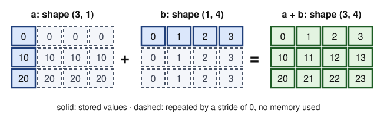

## Contents

-   [Introduction and overview](#intro)
-   [0. Review: Python for scientific work](#ch0)
-   [1. NumPy arrays: memory, dtypes and views](#ch1)
-   [2. Vectorisation and broadcasting](#ch2)
-   [3. Numerical linear algebra and its pitfalls](#ch3)
-   [4. SciPy: optimisation, sparse matrices, signals and plots](#ch4)
-   [5. scikit-learn: the estimator API and cross-validation](#ch5)
-   [6. PyTorch tensors and automatic differentiation](#ch6)
-   [7. Training loops, data loaders and GPUs](#ch7)
-   [8. Reproducibility, environments, timing and profiling](#ch8)
-   [9. Going further: rounding errors, differentiation modes and speed](#ch9)
-   [10. Research directions and open problems](#ch10)
-   [Exercises](#ex)
-   [Projects and assessment](#projects)
-   [References](#refs)

## Introduction and overview {#intro}

  -------------------- -------------------------------------------------------------------------------------------------------------------------------------------------------------------------------------------------------------------------------
  Module               Refresher: Scientific Python, NumPy and PyTorch for MVA
  Official title       Cours de remise à niveau (refresher fortnight) — content not published
  Instructors          not published (master-mva.com, 2026–2027)
  Period               Before semester 1 · refresher fortnight (14/09/2026 – 24/09/2026)
  Credits and volume   no ECTS · 12 h of guided self-study (master-mva.com planning: “Cours de remise à niveau : 14/09 au 24/09/2026 (facultatifs et sans inscription / obligatoires pour track I&I)”; content and volume not published)
  Label                [Refresher]{.badge .refresher} · optional and without registration, mandatory for the I&I track (master-mva.com planning) · this page is independent support, not the refresher's material
  Language             Not displayed (no programme is published for the refresher fortnight); these notes are in English
  Assessment           None announced: the master-mva.com planning describes the refresher courses as optional and without registration; the diagnostic self-check of this page is not an official assessment
  Prerequisites        Not displayed; these notes assume an M1 in mathematics, computer science or physics and some programming experience in any language
  -------------------- -------------------------------------------------------------------------------------------------------------------------------------------------------------------------------------------------------------------------------

**Audience**: an incoming MVA student who can write a Python loop, but has not yet used NumPy, SciPy, scikit-learn and PyTorch together on research-grade problems.

**Empirical first**: fitting a degree-12 polynomial to exact data through the normal equations returns coefficients with a 19 % relative error, while `numpy.linalg.lstsq` on the same data is accurate to nine digits (ch. 3). Choosing the 20 "best" of 10 000 pure-noise features before cross-validation reports 87 % accuracy on random labels, against an honest 48 % (ch. 5). Every line of both computations is correct; the failures come from habits, and this refresher is about those habits.

This page covers the computing layer that the MVA courses take for granted from their first lab: arrays and their memory, vectorised code, stable numerical linear algebra, the SciPy toolbox, the scikit-learn interface, PyTorch's automatic differentiation and training loop, and the hygiene of reproducible, timed experiments.

The two companion refreshers supply the mathematics: [Probability and Statistics for MVA](../s0-refresher-probability-statistics/index.html) and [Linear Algebra, Analysis and Optimization for MVA](../s0-refresher-linear-algebra-optimization/index.html). This page supplies the code that runs it.

### What you will be able to do

-   Predict whether a NumPy operation returns a view or a copy, and compute the strides of an array.
-   Replace Python loops by vectorised and broadcast expressions, and bound their memory cost.
-   Solve linear systems and least-squares problems stably, and predict the accuracy of the result from a condition number.
-   Evaluate log-sum-exp, softmax and differences of close numbers without overflow or cancellation.
-   Minimise a function with `scipy.optimize`, check a gradient, store a large sparse matrix and filter a signal without phase distortion.
-   Build a scikit-learn pipeline and estimate its error by cross-validation without leakage.
-   Compute gradients with PyTorch's autograd, check them numerically, and state what a backward pass costs.
-   Write a training loop with a `DataLoader`, run it on a GPU when one is available, and time it correctly.
-   Make an experiment reproducible with seeds, recorded versions and an environment file.
-   Profile a slow script and decide, with Amdahl's law, which part is worth optimising.

### Official objectives and syllabus (2026–2027)

The planning page of master-mva.com announces refresher courses ("cours de remise à niveau") from 14 to 24 September 2026. They are optional and require no registration, and they are mandatory for students of the I&I track. Neither their content nor their volume is published, and no instructor is named.

This page is therefore independent support, not the material of the refresher fortnight, and it has no official topic list to follow. Its scope comes from what the official descriptions of the MVA courses ask of their students. Many list Python as a prerequisite or as the language of their labs. Several name NumPy, SciPy, scikit-learn or PyTorch, and some teach GPU computing.

The table maps each tool taught here to the MVA courses that use it. A course is listed under "named" when its official description on master-mva.com names the tool (prerequisites, organisation, resources or programme). It is listed under "relies on it" when its announced topics need the tool; that second list is a judgement of these notes.

| Tool | Used in (MVA courses) |
|---|---|
| Python language: objects, containers, functions, scripts (ch. 0) | Named: [Foundations of Large Language Models](../s1-foundations-llms/index.html) ("mastery of Python"), [Robotics](../s1-robotics/index.html) (labs in Python), [Geometric Data Analysis](../s1-geometric-data-analysis/index.html), [Geosciences](../s1-ml-geosciences/index.html), [Deep Learning and Signal Processing](../s1-deep-learning-signal-industry/index.html), [Theoretical Foundations of Deep Learning](../s1-theoretical-foundations-dl/index.html), [Deep Learning](../s1-deep-learning/index.html), [Topological Data Analysis](../s1-tda-imaging-ml/index.html) (Python and/or C++), [Cultural Heritage](../s2-ai-cultural-heritage/index.html), [Representation Learning for Medical Imaging](../s2-representation-learning-medical/index.html), [LLMs for Code and Proof](../s2-llm-code-proof/index.html), [AI and the Environment](../s2-ai-environment/index.html), [Deep Learning for Medical Imaging](../s2-deep-learning-medical-imaging/index.html), [Bayesian Machine Learning](../s2-bayesian-ml/index.html) (Python and R), [Deep Learning in Practice](../s2-deep-learning-in-practice/index.html), [Network Optimization](../s2-network-optimization/index.html), [Image Restoration and Synthesis](../s2-dl-image-restoration-synthesis/index.html) (Python, Matlab), [Audio Signal Analysis](../s2-audio-analysis-indexing/index.html) (Matlab or Python), [Point Clouds](../s2-point-clouds-3d/index.html) (C, C++, Python or Matlab), [Interactions](../s2-interactions/index.html) (for example C, Python, R) |
| NumPy arrays, dtypes and views (ch. 1); vectorisation and broadcasting (ch. 2) | Named: [Cultural Heritage](../s2-ai-cultural-heritage/index.html) ("Python with numpy proficiency is required"), [AI and the Environment](../s2-ai-environment/index.html). Relies on it: [Computational Statistics](../s1-computational-statistics/index.html), [Optimal Transport for Machine Learning](../s1-optimal-transport-ml/index.html), [Kernel Methods](../s2-kernel-methods/index.html), [Time Series](../s1-time-series/index.html), every course with labs |
| Numerical linear algebra: conditioning, stable solvers, SVD, log-sum-exp (ch. 3) | Relies on it: [Convex Optimization](../s1-convex-optimization/index.html), [Kernel Methods](../s2-kernel-methods/index.html), [Large Random Matrices](../s2-random-matrices-ml/index.html), [Inverse Problems and Imaging](../s2-inverse-problems-imaging/index.html), [3D Computer Vision](../s1-3d-computer-vision/index.html), [Graphs in Machine Learning](../s2-graphs-in-ml/index.html), [Probabilistic Graphical Models](../s1-probabilistic-graphical-models/index.html) |
| SciPy optimisation (ch. 4.1) | Named: [Cultural Heritage](../s2-ai-cultural-heritage/index.html) ("some familiarity with scipy"). Relies on it: [Convex Optimization](../s1-convex-optimization/index.html), [Computational Statistics](../s1-computational-statistics/index.html), [Distributed and Large-Scale Optimization](../s1-distributed-optimization/index.html) |
| SciPy sparse matrices (ch. 4.2) | Relies on it: [Graphs in Machine Learning](../s2-graphs-in-ml/index.html), [Network Optimization](../s2-network-optimization/index.html), [Geometry Processing and Geometric Deep Learning](../s1-geometry-processing-gdl/index.html), [Point Clouds](../s2-point-clouds-3d/index.html) |
| SciPy signal processing and the FFT (ch. 4.3) | Relies on it: [Time Series](../s1-time-series/index.html), [Deep Learning and Signal Processing](../s1-deep-learning-signal-industry/index.html), [Audio Signal Processing: Time–Frequency Analysis](../s2-audio-time-frequency/index.html), [Audio Signal Analysis](../s2-audio-analysis-indexing/index.html), [Brain Imaging and BCI](../s2-brain-imaging-bci/index.html), [Detection Theory](../s2-detection-theory/index.html), [Sub-Pixel Image Processing](../s1-sub-pixel-image-processing/index.html) |
| Plotting with Matplotlib (ch. 4.4) | Relies on it: every course graded on reports, for example [Time Series](../s1-time-series/index.html) (lab reports), [Remote Sensing](../s2-remote-sensing/index.html) (reports and source code of the practical sessions), [Reproducible Research Project](../s2-reproducible-research-project/index.html) |
| scikit-learn estimators, pipelines, cross-validation (ch. 5) | Named: [Geometric Data Analysis](../s1-geometric-data-analysis/index.html) ("Lab session: the scikit-learn classifiers"), [AI and the Environment](../s2-ai-environment/index.html) ("scikit" among the required libraries). Relies on it: [Introduction to Statistical Learning](../s1-intro-statistical-learning/index.html), [ALTEGRAD](../s1-altegrad/index.html) (data challenge), [Kernel Methods](../s2-kernel-methods/index.html), [Responsible Machine Learning](../s2-responsible-ml/index.html), [Biostatistics](../s2-biostatistics/index.html) |
| PyTorch tensors and automatic differentiation (ch. 6) | Named: [Deep Learning](../s1-deep-learning/index.html) (software tools: Python, Keras, PyTorch), [Theoretical Foundations of Deep Learning](../s1-theoretical-foundations-dl/index.html) (a variational linear layer in PyTorch), [Optimal Transport for Machine Learning](../s1-optimal-transport-ml/index.html) (numerical sessions in PyTorch), [Representation Learning for Medical Imaging](../s2-representation-learning-medical/index.html), [LLMs for Code and Proof](../s2-llm-code-proof/index.html), [Deep Learning in Practice](../s2-deep-learning-in-practice/index.html) (exercises in PyTorch), [Deep Learning for Medical Imaging](../s2-deep-learning-medical-imaging/index.html), [Multimodal XAI](../s2-multimodal-xai/index.html) (pytorch-grad-cam), [AI and the Environment](../s2-ai-environment/index.html), [Cultural Heritage](../s2-ai-cultural-heritage/index.html) (PyTorch, TensorFlow or JAX) |
| Training loops and data loaders (ch. 7.1–7.2) | Named: [Foundations of Large Language Models](../s1-foundations-llms/index.html) (session 1: "training loop and optimisation, from SGD to Muon through AdamW"). Relies on it: [Deep Learning](../s1-deep-learning/index.html), [Object Recognition and Computer Vision](../s1-object-recognition-cv/index.html) (three programming assignments), [Generative Models for Images](../s2-generative-models-images/index.html), [Diffusion and Multiscale Models](../s2-diffusion-multiscale/index.html), [Reinforcement Learning](../s2-reinforcement-learning/index.html), [Speech and NLP](../s2-speech-nlp/index.html) |
| GPU use (ch. 7.3) | Named: [Geometric Data Analysis](../s1-geometric-data-analysis/index.html) (lecture 7, "GPU programming"), [Foundations of Large Language Models](../s1-foundations-llms/index.html) (session 5: GPU specifications such as VRAM and memory bandwidth, and FlashAttention), [Training and Deploying Large-Scale Models](../s2-training-deploying-large-models/index.html) (training across multiple GPUs, nodes and clusters). [Deep Learning in Practice](../s2-deep-learning-in-practice/index.html) states that its practical sessions need no GPU |
| Reproducibility: seeds, environments, versions (ch. 8.1–8.2) | Named: [Fundamentals of Reproducible Research and Free Software](../s1-reproducible-research/index.html), [Open Science in the Age of AI: Reproducible Research Project](../s2-reproducible-research-project/index.html) (sharing code with git, GitHub or GitLab), [Protein Science](../s2-protein-science/index.html) (a git repository, notebook or code archive is returned with the report). Relies on it: every course graded on code |
| Timing, profiling and arithmetic intensity (ch. 8.3; ch. 9.4, self-study) | Named: [Geometric Data Analysis](../s1-geometric-data-analysis/index.html) (lecture 7, "Accelerating scientific code"), [Foundations of Large Language Models](../s1-foundations-llms/index.html) (session 5: "prefill vs decode, arithmetic intensity"; session 3: counting forward and backward FLOPs). Relies on it: [Training and Deploying Large-Scale Models](../s2-training-deploying-large-models/index.html) (session "Systems for ML") |
| Low-precision arithmetic, FP16 and BF16 (ch. 9.3, self-study) | Named: [Foundations of Large Language Models](../s1-foundations-llms/index.html) (session 2: "numerical precision: training in FP16/BF16 and understanding the stakes of quantisation"). Relies on it: [Training and Deploying Large-Scale Models](../s2-training-deploying-large-models/index.html) |

Beyond this list, the page adds a self-study chapter on rounding-error analysis, forward and reverse differentiation, low precision and the roofline model (ch. 9), and a chapter of research directions (ch. 10).

### Where this course fits in the programme

Official prerequisites: not displayed. The page assumes M1 linear algebra and differential calculus, and some programming in any language; ch. 0 restates the language features that matter.

-   **Companion refreshers** — [Probability and Statistics for MVA](../s0-refresher-probability-statistics/index.html) (the expectations and variances behind cross-validation and mini-batches) and [Linear Algebra, Analysis and Optimization for MVA](../s0-refresher-linear-algebra-optimization/index.html) (singular values, the chain rule, gradient methods). The three refreshers can be studied in parallel.
-   **Semester 1 courses whose labs, homework or projects use these tools** — [Deep Learning](../s1-deep-learning/index.html), [Geometric Data Analysis](../s1-geometric-data-analysis/index.html), [Computational Statistics](../s1-computational-statistics/index.html), [Optimal Transport for Machine Learning](../s1-optimal-transport-ml/index.html), [ALTEGRAD](../s1-altegrad/index.html), [Object Recognition and Computer Vision](../s1-object-recognition-cv/index.html), [Time Series](../s1-time-series/index.html) and [Foundations of Large Language Models](../s1-foundations-llms/index.html).
-   **Semester 2 courses that assume them** — [Deep Learning in Practice](../s2-deep-learning-in-practice/index.html), [LLMs for Code and Proof](../s2-llm-code-proof/index.html), [Training and Deploying Large-Scale Models](../s2-training-deploying-large-models/index.html), [Representation Learning for Computer Vision and Medical Imaging](../s2-representation-learning-medical/index.html) and [Deep Learning for Medical Imaging](../s2-deep-learning-medical-imaging/index.html).
-   **After the courses** — the [Research Internship](../s3-research-internship/index.html), where reproducible, timed and tested code is the daily work.

### Course outline

-   **0. Review: Python for scientific work** — names and mutable objects, the cost of containers, scripts, and the two pieces of M1 mathematics used everywhere.
-   **1. NumPy arrays: memory, dtypes and views** — the buffer–dtype–shape–strides model, which operations copy, and the traps of integer and single-precision types.
-   **2. Vectorisation and broadcasting** — why loops are slow, the broadcasting rule, and its memory cost on pairwise distances.
-   **3. Numerical linear algebra and its pitfalls** — floating point, cancellation, condition numbers, stable solvers, least squares, log-sum-exp.
-   **4. SciPy: optimisation, sparse matrices, signals and plots** — `minimize` with checked gradients, CSR matrices, the FFT and zero-phase filters, Matplotlib figures.
-   **5. scikit-learn: the estimator API and cross-validation** — `fit`, `predict` and `transform`, pipelines, what cross-validation estimates, leakage and nested search.
-   **6. PyTorch tensors and automatic differentiation** — tensors, the computational graph, backpropagation and its cost, gradient checks.
-   **7. Training loops, data loaders and GPUs** — the loop, mini-batch gradients, `Dataset` and `DataLoader`, device-agnostic code.
-   **8. Reproducibility, environments, timing and profiling** — seeds and their limits, environment files, honest timings, Amdahl's law, profilers.
-   **9. Going further: rounding errors, differentiation modes and speed** — summation error bounds, forward versus reverse mode, checkpointing, FP16 and BF16, the roofline model (self-study).
-   **10. Research directions and open problems** — reproducibility of ML research, uncertainty of cross-validation, nonsmooth automatic differentiation, low precision, compilers (self-study).

### Session plan {#sessions}

**12 h of guided self-study = 4 steps of 3 h.**

The master-mva.com planning announces the refresher fortnight (14–24 September 2026) without content or volume; the 12 h are the volume these notes plan for this refresher, and the split into four steps is a proposal. Each step is meant as a half-day at a laptop: read, run every code block, then do the listed exercises.

Level 1 = foundations, 2 = core methods and their analysis, 3 = advanced material; the level never decreases. Questions Q1–Q14 are those of the [diagnostic self-check](#projects-selfcheck).

| Session | Hours | Level | Content | Practice |
|---|---|---|---|---|
| 1 | 3 h | 1 | ch. 0 Review: names and mutability, container costs, scripts, matrix-product cost and chain rule; ch. 1 NumPy arrays: strides, views and copies, dtypes and promotion | Ex. 1, 2; Q1–Q4 |
| 2 | 3 h | 2 | ch. 2 Vectorisation, broadcasting, pairwise distances, reductions; ch. 3 Floating point, cancellation, conditioning, solvers, least squares, log-sum-exp | Ex. 3, 4, 7, 9; Q5–Q7 |
| 3 | 3 h | 2 | ch. 4 `scipy.optimize`, finite differences, CSR matrices, convolution theorem and filters, Matplotlib; ch. 5 Estimator API, pipelines, cross-validation, leakage, nested search | Ex. 5, 6, 8; Q8–Q10 |
| 4 | 3 h | 2 | ch. 6 Tensors, computational graph, backpropagation and its cost; ch. 7 Training loop, mini-batches, data loaders, GPUs; ch. 8 Seeds, environments, timing, Amdahl's law, profiling | Ex. 10, 11, 12; Q11–Q14 |

**Self-study, outside the 12 h** (about 5 h in total): ch. 9 Going further — summation error, Kahan summation, forward and reverse mode, checkpointing, FP16 and BF16, the roofline model (≈ 3 h, with Ex. 13–14) · ch. 10 Research directions and open problems (≈ 2 h, with Ex. 15).

### How to study this module

-   Take the [diagnostic self-check](#projects-selfcheck) first. If you answer a step's questions without hesitation, skim that step and do only its highest-level exercises (★★ from step 2 on).
-   Type the code blocks rather than pasting them, then change one number and predict the effect before running again.
-   Keep a single environment for the whole year: Python 3.10 or later with NumPy 2, SciPy 1.12 or later, Matplotlib, scikit-learn and PyTorch 2 (the CPU build is enough here). Older versions lack some functions used below, such as `sp.eye_array` and the `rtol` argument of `cg`. Every block fixes its seeds and runs in a few seconds on a laptop.
-   After step 4, do one of the two [practice projects](#projects-practice): they combine all the steps the way the first MVA labs will.

::: note
[Independent notes]{.tag} No programme is published for the refresher fortnight. These notes are written from the official descriptions of the MVA courses and from standard references; they are not the material of the refresher courses and do not replace them.
:::

## 0. Review: Python for scientific work {#ch0}

Scientific Python code often fails for reasons unrelated to mathematics: two names share one object, or an innocent line costs quadratic time. This chapter reviews the language behind both failures, then two M1 facts used in every later chapter.

### 0.1 Names, objects and mutability

::: def
[Definition 0.1 — Names, objects, mutability]{.tag} A Python *object* has an identity, a type and a value. A *name* is a reference to an object: the assignment `b = a` binds a second name to the same object and copies nothing.

An object is *mutable* when its value can change in place (lists, dictionaries, sets, NumPy arrays, PyTorch tensors) and *immutable* otherwise (integers, floats, strings, tuples).
:::

```python
a = [1, 2, 3]
b = a                     # a second name for the same list
b.append(4)
print(a, a is b)          # [1, 2, 3, 4] True
c = list(a)               # a new list (a shallow copy)
c.append(5)
print(a, c)               # [1, 2, 3, 4] [1, 2, 3, 4, 5]

def add_item(x, bucket=[]):      # pitfall: the default list is built once
    bucket.append(x)
    return bucket

print(add_item(1), add_item(2))  # [1, 2] [1, 2]: one shared list

def add_item_safe(x, bucket=None):
    bucket = [] if bucket is None else bucket
    bucket.append(x)
    return bucket

print(add_item_safe(1), add_item_safe(2))  # [1] [2]
```

### 0.2 The cost of containers

| Operation | `list` of length $n$ | `dict` or `set` of size $n$ |
|---|---|---|
| read or write `x[i]` | $O(1)$ | $O(1)$ on average (by key) |
| `x.append(v)` | $O(1)$ amortised | — |
| membership `v in x` | $O(n)$ | $O(1)$ on average |
| insert or delete at the front | $O(n)$ | — |

:::: prop
[Proposition 0.2 — Amortised cost of append]{.tag} Suppose a list multiplies its capacity by $\gamma > 1$ each time it is full. Then $n$ appends perform at most
$$
\frac{\gamma}{\gamma - 1}\, n
$$
element copies in total.

::: proof
Each resize copies the current length, which equals the capacity just reached. These capacities grow geometrically, $c_0, \gamma c_0, \dots, c_J$, and the last one satisfies $c_J < n$. Summing the series backwards from $c_J$ bounds the total by
$$
n \sum_{j \ge 0} \gamma^{-j} = \frac{\gamma}{\gamma - 1}\, n.
$$
[∎]{.qed}
:::
::::

CPython grows lists by a factor close to $9/8$, so appending is cheap. A NumPy array has a fixed size: `np.append` in a loop copies the whole array at each call, so $n$ calls cost $O(n^2)$. Collect values in a list and convert once.

### 0.3 Scripts and modules

Put reusable code in functions, and the experiment under a guard:

```python
import sys


def main(argv):
    n = int(argv[0]) if argv else 10
    squares = [k * k for k in range(n)]          # list comprehension
    print(f"sum of the first {n} squares: {sum(squares)}")


if __name__ == "__main__":       # runs when executed, not when imported
    main(sys.argv[1:])
```

On some platforms, data-loader workers (ch. 7) re-import the main module and would rerun unguarded code.

### 0.4 Two M1 facts used everywhere

::: prop
[Proposition 0.3 — Cost of matrix products]{.tag} Multiplying an $m \times n$ matrix by an $n \times p$ matrix with the usual algorithm costs $mnp$ multiplications. For $A, B \in \mathbb{R}^{n \times n}$ and $x \in \mathbb{R}^n$:
$$
(AB)x \text{ costs } n^3 + n^2, \qquad A(Bx) \text{ costs } 2n^2 .
$$
:::

With $n = 1000$ the bracketing changes the cost 500-fold. Reverse-mode differentiation (ch. 6) is the cheap bracketing of a product of Jacobians.

::: key
[Key result — the chain rule as a product of Jacobians]{.tag} For $f = f_L \circ \dots \circ f_1$ with intermediate values $v_k = f_k(v_{k-1})$ and $v_0 = x$,
$$
J_f(x) = J_{f_L}(v_{L-1}) \cdots J_{f_2}(v_1)\, J_{f_1}(v_0).
$$
:::

::: recap
**Key takeaways — chapter 0**

-   Assignment binds names and never copies; a mutation is seen through every name.
-   Lists append in amortised constant time; arrays do not grow.
-   Guard experiment code with `if __name__ == "__main__":`.
-   Bracketing changes the cost of a matrix product; the chain rule is such a product.
:::

## 1. NumPy arrays: memory, dtypes and views {#ch1}

A NumPy array is a block of memory plus a recipe for reading it. The recipe tells you which operations are free, which ones copy, and why writing into one array can change another.

### 1.1 The memory model

::: def
[Definition 1.1 — The ndarray]{.tag} An array of dimension $d$ consists of:

-   a buffer of bytes;
-   a *dtype*, the type of one element and its size $b$ in bytes (8 for `float64`, 4 for `float32`, 1 for `uint8`);
-   a *shape* $(n_0, \dots, n_{d-1})$;
-   *strides* $(s_0, \dots, s_{d-1})$, the number of bytes to skip to move by one along each axis;
-   an *offset*, the position of the first element in the buffer.
:::

::: key
[Key result — the address of an element]{.tag}
$$
\mathrm{address}(i_0, \dots, i_{d-1}) = \mathrm{offset} + \sum_{k=0}^{d-1} i_k\, s_k .
$$
:::

:::: prop
[Proposition 1.2 — Strides of a C-ordered array]{.tag} A freshly created array is stored in C order (row-major): its strides are
$$
s_{d-1} = b, \qquad s_k = s_{k+1}\, n_{k+1} = b \prod_{j > k} n_j .
$$
The address map is then a bijection from the index grid onto the offsets $0, b, \dots, (N-1)\,b$, where $N = \prod_k n_k$.

::: proof
In C order the last index varies fastest, so its neighbours are $b$ bytes apart. Increasing $i_k$ by one skips a sub-array over the later axes, of $\prod_{j>k} n_j$ elements.

The address divided by $b$, $\sum_k i_k \prod_{j>k} n_j$, writes an integer of $[0, N)$ in the mixed radix $(n_0, \dots, n_{d-1})$; this writing is unique, hence the bijection. [∎]{.qed}
:::
::::

::: ex
[Example 1.3 — Strides at work]{.tag} A `float64` array of shape $(3, 4)$ has strides $(32, 8)$: one row is 4 elements of 8 bytes.

-   Its transpose has shape $(4, 3)$ and strides $(8, 32)$: same buffer, no copy.
-   The slice `a[:, ::2]` has shape $(3, 2)$ and strides $(32, 16)$: again no copy.
:::

### 1.2 Views and copies

::: prop
[Proposition 1.4 — When NumPy copies]{.tag}

-   *Basic indexing* (integers, slices `start:stop:step`, `None`, `...`) and transposition return a **view**: a new header on the same buffer.
-   *Advanced indexing* (integer arrays, boolean masks) returns a **copy**.
-   `reshape` returns a view when the new shape can be described by strides on the old buffer, and copies otherwise.

*Reason*: a view needs addresses affine in the new indices. A slice selects $\mathrm{offset} + i \cdot \mathrm{step} \cdot s$, which is affine; an arbitrary index list is not.
:::

```python
import numpy as np

a = np.arange(12, dtype=np.float64).reshape(3, 4)
print(a.strides, a.T.strides, a[:, ::2].strides)  # (32, 8) (8, 32) (32, 16)

v = a[1]                  # basic indexing: a view of row 1
v[:] = -1                 # writes into a
print(a[1])               # [-1. -1. -1. -1.]

f = a[[0, 2]]             # advanced indexing: a copy
f[:] = 99                 # a is unchanged
print(a[0, 0], np.shares_memory(a, v), np.shares_memory(a, f))  # 0.0 True False

print(np.shares_memory(a, a.reshape(-1)))    # True: C-contiguous, a view
print(np.shares_memory(a, a.T.reshape(-1)))  # False: must copy
```

A function that must not modify its input calls `x.copy()`.

### 1.3 Dtypes and promotion

Three dtype facts cause most silent errors.

-   *Integers wrap around.* In `uint8`, the type of most images, $200 + 100$ gives $44 = 300 \bmod 256$. Convert to floats before arithmetic.
-   *Single precision keeps about 7 digits.* Near 1, `float32` numbers are $1.2 \times 10^{-7}$ apart, against $2.2 \times 10^{-16}$ for `float64`; PyTorch uses `float32` by default.
-   *Arrays promote, Python scalars do not.* A `float32` array plus a `float64` array gives `float64`, but NumPy 2 keeps `float32` in `x + 1.0`.

```python
import numpy as np

x = np.array([200], dtype=np.uint8)
print(x + np.uint8(100))                         # [44]
print(np.finfo(np.float32).eps, np.finfo(np.float64).eps)
y = np.ones(3, dtype=np.float32)
print((y + 1.0).dtype, (y + np.ones(3)).dtype)   # float32 float64
```

::: recap
**Key takeaways — chapter 1**

-   An array is a buffer read through a dtype, a shape and strides.
-   Slices, transposes and most reshapes are views; integer and boolean indexing copy.
-   Writing into a view writes into the original.
-   Watch `uint8` overflow and the 7 digits of `float32`.
:::

## 2. Vectorisation and broadcasting {#ch2}

A Python loop pays an interpreter overhead of tens to hundreds of nanoseconds per iteration; a NumPy function pays it once per call. Vectorising writes a computation as a few whole-array operations, and broadcasting lets arrays of different shapes take part in one.

### 2.1 Why loops are slow

```python
import time
import numpy as np

x = np.random.default_rng(0).standard_normal(1_000_000)
t0 = time.perf_counter()
s = 0.0
for v in x:                  # one interpreted iteration per element
    s += v * v
t1 = time.perf_counter()
s_vec = np.dot(x, x)         # one call, one compiled loop
t2 = time.perf_counter()
print(f"loop {t1 - t0:.3f} s, vectorised {t2 - t1:.5f} s")
print(abs(s - s_vec) / s_vec < 1e-12)   # same value
```

On a laptop the ratio is typically 100 to 300. Vectorised code is also shorter, and it ports directly to PyTorch and GPUs.

### 2.2 The broadcasting rule

::: def
[Definition 2.1 — Broadcasting]{.tag} Align two shapes on their last axis, padding the shorter one with ones on the left. The shapes are *compatible* when, on every axis, the two lengths are equal or one of them is 1. The result has, on axis $k$, the length
$$
n_k = \max(a_k, b_k),
$$
and an axis of length 1 is repeated without copying: its stride is set to 0.
:::

{width="100%" fig-alt="A column 0, 10, 20 and a row 0, 1, 2, 3, stretched by dashed repeats into a 3 by 4 sum with rows 0 to 3, 10 to 13 and 20 to 23."}

::: ex
[Example 2.2 — Compatible and incompatible shapes]{.tag}

-   $(3, 1)$ with $(1, 4)$ gives $(3, 4)$, as in the figure.
-   $(5, 3)$ with $(3,)$ gives $(5, 3)$: a row vector is added to every row.
-   $(5, 3)$ with $(5,)$ fails: aligned on the right, $3$ meets $5$. Write `v[:, None]` to make a column of shape $(5, 1)$.
:::

```python
import numpy as np

print(np.broadcast_shapes((3, 1), (1, 4)), np.broadcast_shapes((5, 3), (3,)))
print(np.broadcast_to(np.arange(4.0), (3, 4)).strides)   # (0, 8): no copy
X = np.random.default_rng(0).standard_normal((5, 3))
Z = (X - X.mean(axis=0)) / X.std(axis=0)                 # standardise columns
row_norms = np.sqrt((X ** 2).sum(axis=1, keepdims=True))  # shape (5, 1)
print(Z.mean(axis=0).round(12), (X / row_norms).shape)
```

`keepdims=True` keeps the reduced axis with length 1, so the result broadcasts back against the original array.

### 2.3 Pairwise distances and the memory cost

::: ex
[Example 2.3 — Two vectorisations of pairwise distances]{.tag} Given points $x_1, \dots, x_n$ and $y_1, \dots, y_m$ in $\mathbb{R}^d$, the matrix of squared distances has entries $D_{ij} = \|x_i - y_j\|^2$.

-   *Direct broadcast*: `X[:, None, :] - Y[None, :, :]` builds an $n \times m \times d$ temporary, that is $8nmd$ bytes in `float64`.
-   *Expansion*: one matrix product and $n \times m$ memory, through
    $$
    \|x_i - y_j\|^2 = \|x_i\|^2 + \|y_j\|^2 - 2\, x_i^\top y_j .
    $$

For $n = m = 2000$ and $d = 100$ the temporary weighs 3.2 GB, against 32 MB for the result.

The expansion has its own risk: it subtracts large, nearly equal numbers when the points are far from the origin. Chapter 3 explains why; the code shows it.
:::

```python
import numpy as np

rng = np.random.default_rng(0)
X, Y = rng.standard_normal((500, 3)), rng.standard_normal((400, 3))


def sq_dist(X, Y):
    sq = (X ** 2).sum(axis=1)[:, None] + (Y ** 2).sum(axis=1)[None, :]
    return sq - 2 * X @ Y.T


D_direct = ((X[:, None, :] - Y[None, :, :]) ** 2).sum(axis=-1)
print(np.abs(D_direct - sq_dist(X, Y)).max())          # about 1e-14
D_far = sq_dist(X + 1e8, Y + 1e8)                       # same distances in theory
print(np.abs(D_far - D_direct).max(), (D_far < 0).mean())  # about 20, 5 % negative
```

The fixes are to centre the data first, which changes no distance, and to clip at zero with `np.maximum(D, 0)`.

`np.einsum` names the axes of a contraction: `np.einsum("ij,ij->i", A, B)` gives row-wise dot products. The operator `@` broadcasts over leading axes: shapes $(k, n, p)$ and $(k, p, q)$ give $(k, n, q)$.

::: recap
**Key takeaways — chapter 2**

-   Vectorised code pays the interpreter overhead once per call.
-   Broadcasting aligns shapes on the right; length-1 axes stretch for free.
-   Count the bytes of every temporary, not only of the result.
-   Reduce with `keepdims=True` to broadcast back; use `einsum` for contractions.
:::

## 3. Numerical linear algebra and its pitfalls {#ch3}

Computers do not compute with real numbers. This chapter gives the model of floating-point arithmetic and the condition number, which says how many digits a problem can lose. Three rules follow: solve rather than invert, avoid the normal equations, shift before exponentiating.

### 3.1 Floating-point numbers

::: def
[Definition 3.1 — Floating-point numbers and unit roundoff]{.tag} A binary floating-point system of precision $p$ represents the numbers
$$
x = \pm\, m \times 2^{e}, \qquad 2^{p-1} \le m < 2^{p},
$$
with integers $m$ and $e$, the exponent lying in a fixed range. `float64` has $p = 53$ and `float32` has $p = 24$.

The *unit roundoff* is $u = 2^{-p}$: about $1.1 \times 10^{-16}$ in `float64` and $6.0 \times 10^{-8}$ in `float32`. NumPy's `eps` equals $2u$.
:::

::: thm
[Theorem 3.2 — The standard model of arithmetic]{.tag} IEEE 754 arithmetic rounds every operation correctly. Hence, for floating-point $x$, $y$ and $\circ \in \{+, -, \times, /\}$, barring overflow and underflow,
$$
\mathrm{fl}(x \circ y) = (x \circ y)(1 + \delta), \qquad |\delta| \le u .
$$

*Sketch.* In $[2^{e}, 2^{e+1})$ floating-point numbers are $2^{e-p+1}$ apart; rounding to the nearest errs by at most $2^{e-p} \le u\, |x \circ y|$.
:::

:::: prop
[Proposition 3.3 — Catastrophic cancellation]{.tag} Let $\tilde a = a(1 + \alpha)$ and $\tilde b = b(1 + \beta)$ with $|\alpha|, |\beta| \le \varepsilon$ and $a \ne b$. Then
$$
\frac{|(\tilde a - \tilde b) - (a - b)|}{|a - b|} \le \varepsilon\, \frac{|a| + |b|}{|a - b|} .
$$

::: proof
The numerator equals $|a\alpha - b\beta|$, which is at most $\varepsilon(|a| + |b|)$. [∎]{.qed}
:::
::::

The subtraction itself is nearly exact: it *reveals* the errors already in $\tilde a$ and $\tilde b$, amplified by $(|a| + |b|)/|a - b|$. This broke the expanded distances of Example 2.3.

::: ex
[Example 3.4 — Rewriting to avoid cancellation]{.tag} At $x = 10^{-8}$, `(1 - np.cos(x)) / x**2` returns $0$ instead of about $0.5$, because $\cos x$ rounds to 1. Writing $1 - \cos x = 2 \sin^2(x/2)$ removes the subtraction and returns $0.5$.

Likewise, use `log1p(x)` for $\log(1 + x)$ and `expm1(x)` for $e^x - 1$. Compare floats with a tolerance (`np.isclose`): `0.1 + 0.2 == 0.3` is false.
:::

### 3.2 Conditioning

::: def
[Definition 3.5 — Condition number]{.tag} For an invertible matrix $A$, $\kappa(A) = \|A\|\, \|A^{-1}\|$. In the Euclidean norm,
$$
\kappa_2(A) = \frac{\sigma_{\max}(A)}{\sigma_{\min}(A)},
$$
the ratio of the extreme singular values; `np.linalg.cond` computes it.
:::

:::: thm
[Theorem 3.6 — Sensitivity of a linear system]{.tag} Let $Ax = b$ with $b \ne 0$, and $A(x + \delta x) = b + \delta b$. Then
$$
\frac{\|\delta x\|}{\|x\|} \le \kappa(A)\, \frac{\|\delta b\|}{\|b\|} .
$$

::: proof
From $\delta x = A^{-1} \delta b$ we get $\|\delta x\| \le \|A^{-1}\|\, \|\delta b\|$. From $b = Ax$ we get $\|b\| \le \|A\|\, \|x\|$. Dividing the first inequality by $\|x\| \ge \|b\| / \|A\|$ gives the claim. [∎]{.qed}
:::
::::

The LAPACK solvers behind NumPy and SciPy are *backward stable* (for LU with partial pivoting, in practice): they solve exactly a problem whose data $A$ and $b$ are perturbed by a few units of $u$.

Theorem 3.6 covers the perturbation of $b$. A relative perturbation $\varepsilon$ of $A$ has, to first order, the same effect, a relative error of at most $\kappa(A)\, \varepsilon$. Hence a rule of thumb.

::: key
[Key result — digits lost to conditioning]{.tag}
$$
\frac{\|\hat x - x\|}{\|x\|} \lesssim \kappa(A)\, u :
$$
a stable solver loses about $\log_{10} \kappa(A)$ of the 16 digits of double precision.
:::

Two practical rules follow.

-   *Solve, do not invert.* `solve(A, b)` factors $A = LU$ in about $\tfrac23 n^3$ operations; `inv(A) @ b` costs about $2n^3$ and is less accurate.
-   *Use the structure.* For symmetric positive definite $A$, a Cholesky factorisation (`cho_factor`) costs $\tfrac13 n^3$ and serves many right-hand sides. For symmetric $A$, `eigh` is faster and more accurate than `eig`.

### 3.3 Least squares

:::: prop
[Proposition 3.7 — The normal equations square the condition number]{.tag} If $A \in \mathbb{R}^{m \times n}$ has full column rank, then
$$
\kappa_2(A^\top A) = \kappa_2(A)^2 .
$$

::: proof
Write the thin singular value decomposition $A = U \Sigma V^\top$. Then $A^\top A = V \Sigma^2 V^\top$, whose singular values are the $\sigma_i^2$. [∎]{.qed}
:::
::::

Solving $A^\top A x = A^\top b$ therefore loses about $2 \log_{10} \kappa_2(A)$ digits. Solvers based on QR or the SVD, such as `lstsq`, work on $A$ itself and lose about half as many when the residual is small.

```python
import numpy as np

rng = np.random.default_rng(0)
t = np.linspace(0, 1, 100)
A = np.vander(t, 13, increasing=True)         # degree-12 polynomial fit
c = rng.standard_normal(13)                   # true coefficients
b = A @ c                                     # exact data
x_normal = np.linalg.solve(A.T @ A, A.T @ b)
x_lstsq = np.linalg.lstsq(A, b, rcond=None)[0]
err = lambda x: np.linalg.norm(x - c) / np.linalg.norm(c)
print(f"cond(A) = {np.linalg.cond(A):.1e}")                       # 6.9e+08
print(f"normal equations {err(x_normal):.1e}, lstsq {err(x_lstsq):.1e}")  # 1.9e-01, 3.7e-10
```

With $\kappa_2(A) \approx 7 \times 10^8$, the normal equations face $\kappa^2 u \approx 50$ and keep no correct digit, while `lstsq` keeps about nine.

### 3.4 Exponentials: log-sum-exp and softmax

:::: prop
[Proposition 3.8 — Stable log-sum-exp]{.tag} For $x \in \mathbb{R}^n$ and $m = \max_i x_i$,
$$
\log \sum_{i=1}^n e^{x_i} = m + \log \sum_{i=1}^n e^{x_i - m}, \qquad \mathrm{softmax}(x)_i = \frac{e^{x_i - m}}{\sum_j e^{x_j - m}} .
$$
Every exponent on the right is at most 0, so nothing overflows. The largest term equals 1, so the sum lies in $[1, n]$ and its logarithm is never $-\infty$.

::: proof
Factor $e^m$ out of the sum: $\sum_i e^{x_i} = e^m \sum_i e^{x_i - m}$. [∎]{.qed}
:::
::::

```python
import numpy as np
from scipy.special import logsumexp

z = np.array([1000.0, 1001.0, 1002.0])
with np.errstate(over="ignore", invalid="ignore"):
    print(np.log(np.exp(z).sum()))            # inf: exp(1000) overflows
m = z.max()
print(m + np.log(np.exp(z - m).sum()), logsumexp(z))   # 1002.4076... twice
```

Mixture log-likelihoods, the cross-entropy loss and attention weights all rely on this shift.

::: recap
**Key takeaways — chapter 3**

-   Each operation errs by a relative $u$ at most; cancellation exposes earlier errors.
-   A stable solver loses about $\log_{10} \kappa$ digits; the normal equations lose twice as many.
-   Solve, do not invert; use Cholesky, `eigh` and `lstsq` where they apply.
-   Shift before exponentiating; use `log1p`, `expm1` and `logsumexp`.
:::

## 4. SciPy: optimisation, sparse matrices, signals and plots {#ch4}

SciPy wraps mature compiled libraries behind one Python interface. This chapter covers the four modules the MVA courses use most, and the classic mistake of each.

### 4.1 Optimisation and gradient checks

`minimize(fun, x0, jac=grad)` returns the solution `x`, the value `fun` and a `success` flag to read every time. Without `jac`, SciPy uses finite differences, which are slow and inaccurate.

:::: prop
[Proposition 4.1 — Error of a forward difference]{.tag} Let $|f''| \le M$ near $x$, and let every computed value of $f$ near $x$ err by at most $\eta$ in absolute value. Then
$$
\Big| \frac{\hat f(x + h) - \hat f(x)}{h} - f'(x) \Big| \le \frac{M h}{2} + \frac{2 \eta}{h} .
$$
The bound is smallest for $h^\ast = 2\sqrt{\eta / M}$, where it equals $2\sqrt{\eta M}$.

::: proof
Taylor's formula $f(x + h) = f(x) + h f'(x) + \tfrac12 h^2 f''(\xi)$ gives the truncation term $Mh/2$. Each computed value errs by at most $\eta$, and the difference is divided by $h$: the rounding term.

A function $\alpha h + \beta / h$ is minimal at $h = \sqrt{\beta/\alpha}$, with value $2\sqrt{\alpha\beta}$. [∎]{.qed}
:::
::::

With $\eta \approx u\,|f(x)|$ and $M$, $|f(x)|$ of order one, the best step is near $10^{-8}$ and only about 8 of 16 digits survive. Derive gradients by hand, check them once against finite differences, and pass them to the optimiser.

```python
import numpy as np
from scipy.optimize import check_grad, minimize, rosen, rosen_der

rng = np.random.default_rng(0)
print(check_grad(rosen, rosen_der, rng.standard_normal(10)))  # about 2e-5, for a gradient of norm 1.2e3
x0 = np.full(10, -1.0)
r_fd = minimize(rosen, x0, method="BFGS")                    # finite differences
r_ex = minimize(rosen, x0, jac=rosen_der, method="BFGS")      # exact gradient
for r in (r_fd, r_ex):
    print(r.success, r.nfev, f"{r.fun:.1e}")  # False 1574 4.3e-11, then True 107 2.8e-14
```

With finite differences, BFGS uses 15 times more function evaluations and stops on a precision-loss warning.

### 4.2 Sparse matrices

::: def
[Definition 4.2 — Compressed sparse row (CSR) format]{.tag} A matrix with $n$ rows and $\mathrm{nnz}$ non-zero entries is stored in three arrays:

-   `data`, the non-zero values row by row;
-   `indices`, their column indices;
-   `indptr`, of length $n + 1$: row $i$ occupies positions `indptr[i]` to `indptr[i+1] - 1`.

The memory is $O(\mathrm{nnz} + n)$, and a product $y = Ax$ costs $O(\mathrm{nnz})$ operations.
:::

Build in a convenient format (COO, diagonals, Kronecker products), convert once to CSR, and never densify a large matrix.

::: ex
[Example 4.3 — The Laplacian of a grid]{.tag} The five-point Laplacian on an $N \times N$ grid has $n = N^2$ unknowns and about $5n$ non-zeros. For $N = 1000$, the dense matrix needs $8n^2$ bytes, 8 TB; CSR needs about 64 MB.
:::

```python
import numpy as np
import scipy.sparse as sp
from scipy.sparse.linalg import cg, spsolve

N = 200
T = sp.diags_array([-np.ones(N - 1), 2 * np.ones(N), -np.ones(N - 1)], offsets=[-1, 0, 1])
I = sp.eye_array(N)
L = (sp.kron(I, T) + sp.kron(T, I)).tocsr()      # 40 000 x 40 000
print(L.nnz, L.indptr[:4], L.indices[:7])        # 199200 [0 3 7 11] [0 1 200 0 1 2 201]
b = np.ones(N * N)
x = spsolve(L, b)                                # sparse direct solver
x_cg, info = cg(L, b, rtol=1e-10, maxiter=5000)  # conjugate gradient (L is SPD)
print(info, np.linalg.norm(L @ x - b), np.linalg.norm(x - x_cg) / np.linalg.norm(x))
```

### 4.3 Signals and the FFT

:::: thm
[Theorem 4.4 — Convolution theorem for the DFT]{.tag} For $x, y \in \mathbb{C}^N$ define the discrete Fourier transform and the circular convolution
$$
X_k = \sum_{n=0}^{N-1} x_n\, e^{-2i\pi kn/N}, \qquad (x \circledast y)_n = \sum_{m=0}^{N-1} x_m\, y_{(n-m) \bmod N} .
$$
Then the DFT of $x \circledast y$ is the pointwise product:
$$
\widehat{(x \circledast y)}_k = X_k\, Y_k .
$$

::: proof
Substitute the definition and exchange the sums:
$$
\sum_{n} \sum_{m} x_m\, y_{(n-m) \bmod N}\, e^{-2i\pi kn/N} = \sum_m x_m\, e^{-2i\pi km/N} \sum_n y_{(n-m) \bmod N}\, e^{-2i\pi k(n-m)/N} .
$$
By $N$-periodicity of the exponential, the inner sum is a re-indexing of $Y_k$, whatever $m$. [∎]{.qed}
:::
::::

With the FFT, a convolution costs $O(N \log N)$ instead of $O(N^2)$. For lengths $N$ and $M$, zero-padding both signals to $N + M - 1$ gives the ordinary convolution, as `fftconvolve` does.

A causal filter delays each frequency differently; filtering forwards then backwards (`sosfiltfilt`) cancels this phase shift. Second-order sections (`output="sos"`) are safer than polynomial coefficients.

```python
import numpy as np
from scipy import signal

rng = np.random.default_rng(0)
x, y = rng.standard_normal(64), rng.standard_normal(64)
circ = np.array([sum(x[m] * y[(n - m) % 64] for m in range(64)) for n in range(64)])
print(np.allclose(np.fft.fft(circ), np.fft.fft(x) * np.fft.fft(y)))  # Theorem 4.4

fs = 1000.0                                       # sampling rate (Hz)
t = np.arange(0, 2.0, 1 / fs)
clean = np.sin(2 * np.pi * 5 * t)                 # 5 Hz sine
noisy = clean + 0.5 * rng.standard_normal(t.size)
sos = signal.butter(4, 20, btype="low", fs=fs, output="sos")   # 20 Hz low-pass
snr = lambda z: 10 * np.log10(np.sum(clean ** 2) / np.sum((z - clean) ** 2))
print(f"noisy {snr(noisy):.1f} dB, causal {snr(signal.sosfilt(sos, noisy)):.1f} dB, "
      f"zero-phase {snr(signal.sosfiltfilt(sos, noisy)):.1f} dB")   # 3.0, 3.5, 17.3
```

The causal filter removes noise but shifts the sine, so its error stays large; the zero-phase filter gains about 14 dB.

### 4.4 Figures with Matplotlib

Use the object-oriented interface (`fig, ax = plt.subplots()`), label every axis, use log scales for errors and times, and give one message per figure. On servers, select the `Agg` backend.

```python
import matplotlib
matplotlib.use("Agg")                     # no display needed
import matplotlib.pyplot as plt
import numpy as np

h = np.logspace(-16, 0, 200)
x0 = 1.0
fd = (np.sin(x0 + h) - np.sin(x0)) / h    # forward differences of sin at 1
err = np.abs(fd - np.cos(x0))
fig, ax = plt.subplots(figsize=(5, 3.5))
ax.loglog(h, err, label="observed error")
ax.loglog(h, h / 2 + 2 * 1.1e-16 / h, "--", label="bound of Proposition 4.1")
ax.set_xlabel("step $h$")
ax.set_ylabel("error on the derivative")
ax.legend()
fig.tight_layout()
fig.savefig("forward_difference_error.png", dpi=150)
print(f"best h = {h[np.argmin(err)]:.1e}, error = {err.min():.1e}")
```

The curve is V-shaped: rounding dominates on the left, truncation on the right, and the smallest errors occur for $h$ between $10^{-9}$ and $10^{-7}$.

::: recap
**Key takeaways — chapter 4**

-   Pass checked exact gradients to `minimize` and read `success`.
-   Forward differences keep half the digits, at best for $h \approx \sqrt{u}$.
-   CSR storage and products scale with the non-zeros.
-   Convolution is a Fourier product; filter forwards and backwards.
-   Label axes; use log scales for errors.
:::

## 5. scikit-learn: the estimator API and cross-validation {#ch5}

scikit-learn gives every learning algorithm the same small interface. This makes model selection automatic, and leakage easy, because the interface hides where the data flows.

### 5.1 Estimators and pipelines

::: def
[Definition 5.1 — The estimator API]{.tag}

-   An *estimator*'s constructor takes only hyperparameters, stored unchanged (`get_params()`).
-   `fit(X, y)` learns, stores the results in attributes ending with an underscore (`coef_`), and returns the estimator.
-   A *predictor* adds `predict`; a *transformer* adds `transform`.
-   `X` has shape $(n_{\text{samples}}, n_{\text{features}})$.
:::

A `Pipeline` chains transformers and a predictor into one estimator, whose `fit` fits each step on the training data only. Its hyperparameters are named `step__parameter`.

```python
from sklearn.datasets import load_breast_cancer
from sklearn.linear_model import LogisticRegression
from sklearn.model_selection import StratifiedKFold, cross_val_score
from sklearn.pipeline import make_pipeline
from sklearn.preprocessing import StandardScaler

X, y = load_breast_cancer(return_X_y=True)        # 569 samples, 30 features
pipe = make_pipeline(StandardScaler(), LogisticRegression(max_iter=1000))
print(pipe.get_params()["logisticregression__C"])  # 1.0
cv = StratifiedKFold(n_splits=5, shuffle=True, random_state=0)
scores = cross_val_score(pipe, X, y, cv=cv)
print(f"5-fold accuracy {scores.mean():.3f} +/- {scores.std():.3f}")  # 0.979 +/- 0.014
pipe.fit(X, y)
print(pipe[-1].coef_.shape, pipe[0].mean_[:2])     # learned attributes end with _
```

### 5.2 What cross-validation estimates

::: def
[Definition 5.2 — K-fold cross-validation]{.tag} Split the indices $\{1, \dots, n\}$ into $K$ folds $I_1, \dots, I_K$.

For each $k$, train $\hat f^{(-k)}$ on all folds except $I_k$, and evaluate it on $I_k$:
$$
\widehat R_{\mathrm{CV}} = \frac1n \sum_{k=1}^{K} \sum_{i \in I_k} \ell\big(y_i, \hat f^{(-k)}(x_i)\big) .
$$
:::

:::: prop
[Proposition 5.3 — Cross-validation is unbiased for a smaller sample]{.tag} Assume the pairs $(x_i, y_i)$ are i.i.d., and the folds are fixed in advance with equal size $n/K$. Let $\hat f_{m}$ denote the procedure trained on $m$ points and $R(f)$ the risk of a fixed predictor $f$. Then
$$
\mathbb{E}\big[\widehat R_{\mathrm{CV}}\big] = \mathbb{E}\big[R(\hat f_{n(K-1)/K})\big] .
$$

::: proof
Fix $k$ and $i \in I_k$. The pair $(x_i, y_i)$ is independent of the $n - n/K$ training points of $\hat f^{(-k)}$. Conditioning on them gives
$$
\mathbb{E}\big[\ell(y_i, \hat f^{(-k)}(x_i)) \mid \text{training folds}\big] = R(\hat f^{(-k)}) .
$$
The training folds are i.i.d. samples of size $n(K-1)/K$, so each $\hat f^{(-k)}$ has the law of $\hat f_{n(K-1)/K}$. Averaging over the $n$ terms gives the claim. [∎]{.qed}
:::
::::

The proof needs the held-out point to be independent of *everything* that built $\hat f^{(-k)}$: scaling, imputation, feature selection, hyperparameters. One step fitted on all the data breaks it. The variance of $\widehat R_{\mathrm{CV}}$ has no universal unbiased estimator (ch. 10).

### 5.3 Leakage

::: ex
[Example 5.4 — Leakage through feature selection]{.tag} Take $n = 100$ samples of $d = 10\,000$ pure-noise features and random binary labels. Every classifier has a true accuracy of 50 %.

-   Selecting the 20 features most correlated with the labels on *all* the data, then cross-validating, reports 87 %.
-   Putting the selection inside the pipeline, so that it is refitted on each training fold, reports 48 %.

This is the "wrong way to do cross-validation" of Hastie, Tibshirani and Friedman (2009, section 7.10.2), documented on microarray data by Ambroise and McLachlan (2002).
:::

```python
import numpy as np
from sklearn.feature_selection import SelectKBest, f_classif
from sklearn.linear_model import LogisticRegression
from sklearn.model_selection import cross_val_score
from sklearn.pipeline import make_pipeline

rng = np.random.default_rng(0)
X = rng.standard_normal((100, 10_000))       # pure noise
y = rng.integers(0, 2, size=100)             # random labels
X_sel = SelectKBest(f_classif, k=20).fit_transform(X, y)   # WRONG: uses all labels
leaky = cross_val_score(LogisticRegression(), X_sel, y, cv=5).mean()
pipe = make_pipeline(SelectKBest(f_classif, k=20), LogisticRegression())
honest = cross_val_score(pipe, X, y, cv=5).mean()          # selection inside each fold
print(f"leaky {leaky:.2f}, honest {honest:.2f}")            # leaky 0.87, honest 0.48
```

The splitter must respect the data: `GroupKFold` when several samples come from one patient, `TimeSeriesSplit` when the future must not inform the past.

### 5.4 Hyperparameter search

`GridSearchCV` is an estimator that cross-validates each candidate and refits the best. Its `best_score_` is optimistic, as the maximum of noisy estimates is biased upwards; *nest* the search in an outer cross-validation.

```python
from sklearn.datasets import load_breast_cancer
from sklearn.linear_model import LogisticRegression
from sklearn.model_selection import GridSearchCV, StratifiedKFold, cross_val_score
from sklearn.pipeline import make_pipeline
from sklearn.preprocessing import StandardScaler

X, y = load_breast_cancer(return_X_y=True)
pipe = make_pipeline(StandardScaler(), LogisticRegression(max_iter=1000))
inner = StratifiedKFold(n_splits=5, shuffle=True, random_state=0)
outer = StratifiedKFold(n_splits=5, shuffle=True, random_state=1)
grid = GridSearchCV(pipe, {"logisticregression__C": [0.01, 0.1, 1, 10, 100]}, cv=inner)
grid.fit(X, y)
print(grid.best_params_, f"{grid.best_score_:.3f}")            # C = 1, 0.979
print(f"nested {cross_val_score(grid, X, y, cv=outer).mean():.3f}")  # 0.975
```

::: recap
**Key takeaways — chapter 5**

-   Hyperparameters go to the constructor; learning happens in `fit`.
-   Cross-validation estimates the risk at sample size $n(K-1)/K$, if no step sees the held-out fold.
-   Put every data-dependent step in a `Pipeline`; respect groups and time.
-   Nest a hyperparameter search to estimate its error honestly.
:::

## 6. PyTorch tensors and automatic differentiation {#ch6}

PyTorch is NumPy plus two things: tensors can live on a GPU, and operations on them are recorded to compute gradients automatically. This chapter explains what is recorded and what the backward pass costs.

### 6.1 Tensors

Tensors follow the NumPy rules of chapters 1 and 2, with three differences.

-   The default floating type is `float32`, not `float64`.
-   `torch.from_numpy(a)` and `t.numpy()` share memory with their source, like a view.
-   `view` never copies and fails on incompatible strides; `reshape` copies when it must.

```python
import numpy as np
import torch

torch.set_num_threads(1)
a = np.zeros(3)
t = torch.from_numpy(a)       # shares the buffer of a
t += 1
print(a, t.dtype, torch.tensor([1.0]).dtype)   # [1. 1. 1.] torch.float64 torch.float32
m = torch.ones(2, 3).T        # a transposed view: not contiguous
print(m.is_contiguous(), m.reshape(6).shape)   # False torch.Size([6])
```

### 6.2 The computational graph and backpropagation

::: def
[Definition 6.1 — Computational graph]{.tag} When an input has `requires_grad=True`, PyTorch records the operations depending on it in a directed acyclic graph. Its nodes are the intermediate tensors $v_1, \dots, v_K$; an edge $k \to j$ means that $v_k$ is an argument of the operation producing $v_j$.
:::

:::: thm
[Theorem 6.2 — Backpropagation]{.tag} Let $L = v_K$ be a scalar and define the *adjoints* $\bar v_k = \partial L / \partial v_k$. Then $\bar v_K = 1$ and, for $k < K$,
$$
\bar v_k = \sum_{j \,:\, k \to j} \Big( \frac{\partial v_j}{\partial v_k} \Big)^{\top} \bar v_j .
$$
One sweep in reverse topological order therefore gives $\partial L / \partial x$ for every input $x$. Each step is a *vector–Jacobian product*; no Jacobian matrix is ever formed.

::: proof
$L$ depends on $v_k$ only through the nodes $v_j$ that use it. The multivariate chain rule sums the contributions of these paths, which is the formula.

In reverse topological order, every child $j$ of $k$ is processed before $k$. Hence all the $\bar v_j$ needed by the formula are known when $\bar v_k$ is computed. [∎]{.qed}
:::
::::

::: prop
[Proposition 6.3 — The cost of a gradient]{.tag} If the vector–Jacobian product of each primitive costs at most $c$ times the primitive, the backward sweep costs at most $c$ times the forward pass, since it performs one such product per primitive.

A gradient in $n$ variables thus costs a constant multiple of one evaluation, whatever $n$: the *cheap gradient principle* (Baur and Strassen, 1983; Griewank and Walther, 2008). The price is memory, since the backward pass reads the stored intermediates.
:::

In the language of Proposition 0.3, reverse mode brackets the chain rule from the left, starting from $\bar v_K = 1$: every product is a vector times a matrix.

### 6.3 Using and checking autograd

```python
import torch
import torch.nn.functional as F

torch.set_num_threads(1)
torch.manual_seed(0)
n, d = 200, 5
X = torch.randn(n, d, dtype=torch.float64)
y = (torch.rand(n, dtype=torch.float64) < 0.5).to(torch.float64)
w = torch.zeros(d, dtype=torch.float64, requires_grad=True)

loss = F.binary_cross_entropy_with_logits(X @ w, y)   # logistic loss
loss.backward()                                        # fills w.grad
with torch.no_grad():
    manual = X.T @ (torch.sigmoid(X @ w) - y) / n      # gradient by hand
print(torch.allclose(w.grad, manual))                  # True

v = torch.randn(d, dtype=torch.float64, requires_grad=True)
print(torch.autograd.gradcheck(lambda v: F.binary_cross_entropy_with_logits(X @ v, y), (v,)))

F.binary_cross_entropy_with_logits(X @ w, y).backward()   # a second backward...
print(torch.allclose(w.grad, 2 * manual))                 # ...adds: gradients accumulate
```

The last two lines show the most common bug: gradients *accumulate* in `.grad`, so a training loop resets them at every step. Four more rules:

-   Evaluate and update parameters by hand inside `torch.no_grad()`.
-   `detach()` cuts a tensor from the graph and `item()` returns a float; summing losses without `item()` keeps every graph alive.
-   Run `gradcheck` in `float64`; in `float32` finite differences are too coarse (Proposition 4.1).
-   Where a function is not differentiable, PyTorch uses a convention, such as a ReLU derivative of 0 at 0 (ch. 10).

::: recap
**Key takeaways — chapter 6**

-   Tensors are arrays with `float32` by default and an optional GPU device.
-   Autograd backpropagates adjoints by vector–Jacobian products in reverse order.
-   A gradient costs a constant times the function, but stores the intermediates.
-   Gradients accumulate: zero them; check new code with `gradcheck`.
:::

## 7. Training loops, data loaders and GPUs {#ch7}

Every deep-learning lab runs the same loop: draw a mini-batch, compute the loss, backpropagate, update. This chapter writes the loop once, explains why mini-batch gradients work, and plugs in data and devices.

### 7.1 The loop

A model is an `nn.Module` holding parameter tensors; an optimiser updates them from their `.grad`. The five numbered lines are the core of every training script.

```python
import torch
from sklearn.datasets import make_moons
from torch import nn
from torch.utils.data import DataLoader, TensorDataset

torch.set_num_threads(1)
torch.manual_seed(0)
X, y = make_moons(n_samples=2000, noise=0.2, random_state=0)
X, y = torch.tensor(X, dtype=torch.float32), torch.tensor(y, dtype=torch.float32)
train = TensorDataset(X[:1500], y[:1500])
X_test, y_test = X[1500:], y[1500:]
loader = DataLoader(train, batch_size=64, shuffle=True,
                    generator=torch.Generator().manual_seed(0))

device = "cuda" if torch.cuda.is_available() else "cpu"
model = nn.Sequential(nn.Linear(2, 64), nn.ReLU(),
                      nn.Linear(64, 64), nn.ReLU(),
                      nn.Linear(64, 1)).to(device)
opt = torch.optim.AdamW(model.parameters(), lr=1e-2, weight_decay=1e-4)
loss_fn = nn.BCEWithLogitsLoss()

for epoch in range(30):
    model.train()                          # training mode (dropout, batch norm)
    for xb, yb in loader:
        xb, yb = xb.to(device), yb.to(device)
        opt.zero_grad()                    # 1. reset the accumulated gradients
        logits = model(xb).squeeze(1)      # 2. forward pass
        loss = loss_fn(logits, yb)         # 3. loss
        loss.backward()                    # 4. backpropagation (Theorem 6.2)
        opt.step()                         # 5. update the parameters

model.eval()                               # evaluation mode
with torch.no_grad():
    pred = model(X_test.to(device)).squeeze(1) > 0
acc = (pred.cpu().float() == y_test).float().mean().item()
print(f"test accuracy {acc:.3f}")          # 0.970
```

An RBF support vector machine reaches 0.972 on the same split, so the network is near what this noise allows. Without `model.eval()`, networks with dropout or batch normalisation would predict differently.

:::: prop
[Proposition 7.1 — Mini-batch gradients]{.tag} Let $L(\theta) = \frac1n \sum_{i=1}^n \ell_i(\theta)$, and draw $B$ indices $i_1, \dots, i_B$ uniformly with replacement. The mini-batch gradient
$$
\hat g = \frac1B \sum_{b=1}^{B} \nabla \ell_{i_b}(\theta)
$$
is unbiased, $\mathbb{E}[\hat g] = \nabla L(\theta)$, and its mean squared error is
$$
\mathbb{E}\, \|\hat g - \nabla L(\theta)\|^2 = \frac{\sigma^2(\theta)}{B}, \qquad \sigma^2(\theta) = \frac1n \sum_{i=1}^n \|\nabla \ell_i(\theta) - \nabla L(\theta)\|^2 .
$$

::: proof
Each term $\nabla \ell_{i_b}(\theta)$ has mean $\frac1n \sum_i \nabla \ell_i(\theta) = \nabla L(\theta)$ and mean squared deviation $\sigma^2(\theta)$. The $B$ terms are independent, so the variance of their average is divided by $B$. [∎]{.qed}
:::
::::

A shuffled epoch (`shuffle=True`) samples *without* replacement, which multiplies the variance by $(n - B)/(n - 1)$ (Exercise 11).

### 7.2 Datasets and data loaders

::: def
[Definition 7.2 — Dataset and DataLoader]{.tag} A map-style `Dataset` implements `__len__` and `__getitem__(i)`, which returns one sample. A `DataLoader` draws indices, in order or shuffled by a seeded generator, groups them into batches and stacks the samples into tensors. With `num_workers > 0` it loads batches in parallel worker processes.
:::

Random augmentations need care with workers. Each worker process receives a copy of the dataset.

-   Since PyTorch 1.9, every worker re-seeds Python's `random`, PyTorch and NumPy's global generator from a base seed drawn from the loader's `generator`.
-   A NumPy `Generator` object stored in the dataset is copied with its state, so all workers draw the same "random" noise.

The fix is a `worker_init_fn` that gives each worker its own stream, seeded from the per-worker seed.

```python
import numpy as np
import torch
from torch.utils.data import DataLoader, Dataset, get_worker_info


class NoisyWindows(Dataset):
    """Windows of a sine wave, with fresh noise drawn at every access."""

    def __init__(self, n_windows=64, length=32):
        t = np.arange(n_windows * length) / 50.0
        self.clean = np.sin(t).reshape(n_windows, length).astype(np.float32)
        self.rng = np.random.default_rng(0)        # copied, state included, into every worker

    def __len__(self):
        return len(self.clean)

    def __getitem__(self, i):
        noise = self.rng.standard_normal(self.clean.shape[1]).astype(np.float32)
        return torch.from_numpy(self.clean[i] + 0.1 * noise), torch.from_numpy(self.clean[i])


def seed_worker(worker_id):
    info = get_worker_info()                       # info.seed comes from the loader's generator
    info.dataset.rng = np.random.default_rng(info.seed)


def noise_of_batches(seed, init=None):
    loader = DataLoader(NoisyWindows(), batch_size=16, shuffle=True, num_workers=2,
                        worker_init_fn=init, generator=torch.Generator().manual_seed(seed))
    return [xb - yb for xb, yb in loader]          # batch b is built by worker b % 2


if __name__ == "__main__":       # required when workers are started by "spawn"
    torch.set_num_threads(1)
    dup = noise_of_batches(0)
    print(torch.allclose(dup[0], dup[1], atol=1e-6))       # True: both workers drew the same noise
    run1, run2 = noise_of_batches(0, seed_worker), noise_of_batches(0, seed_worker)
    print(torch.allclose(run1[0], run1[1], atol=1e-6),     # False: one stream per worker
          all(torch.equal(a, b) for a, b in zip(run1, run2)))  # True: and reproducible
```

### 7.3 GPUs

A GPU runs thousands of operations in parallel, from its own memory, driven asynchronously by Python. Four habits follow.

-   *Device-agnostic code.* Choose `device` once (`"cuda"`, `"mps"` on Apple machines, else `"cpu"`), move the model and each batch with `.to(device)`, and results back with `.cpu()`.
-   *Few transfers.* Host–device copies are slow: keep tensors on the device, and load with `pin_memory=True`.
-   *Asynchrony.* A CUDA call returns before the kernel ends: synchronise before reading a clock (ch. 8).
-   *Memory.* Watch the peak (`max_memory_allocated`); when it overflows, reduce the batch, or see ch. 9.

::: recap
**Key takeaways — chapter 7**

-   Zero the gradients, forward, loss, backward, step; switch `train()` and `eval()`.
-   A mini-batch gradient is unbiased with variance $\sigma^2 / B$.
-   A `Dataset` returns samples; a `DataLoader` batches, shuffles and parallelises.
-   On a GPU, move data once and expect asynchrony.
:::

## 8. Reproducibility, environments, timing and profiling {#ch8}

A result nobody can re-run is an anecdote, and a badly measured speed-up is a guess. This chapter covers controlled randomness, recorded environments, honest timings and profiles.

### 8.1 Seeds, and what they cannot fix

-   *NumPy*: create one generator with `default_rng(seed)` and pass it to every function that draws; spawn independent streams from a `SeedSequence`.
-   *PyTorch*: `torch.manual_seed` seeds the CPU and every GPU; `use_deterministic_algorithms(True)` makes non-deterministic operations raise an error.
-   *scikit-learn*: pass an integer `random_state` everywhere.

```python
import numpy as np

rng = np.random.default_rng(2026)
children = np.random.SeedSequence(2026).spawn(3)        # three independent streams
streams = [np.random.default_rng(s) for s in children]
print(rng.standard_normal(2), [g.integers(0, 100) for g in streams])

v = np.random.default_rng(0).standard_normal(1_000_000).astype(np.float32)
order = np.random.default_rng(1)
sums = {float(np.cumsum(order.permutation(v))[-1]) for _ in range(5)}
print(sums)                       # five different sums of the same numbers
print((1e16 + 1) - 1e16, (1e16 - 1e16) + 1)   # 0.0 1.0
```

::: ex
[Example 8.1 — Addition is not associative]{.tag} In double precision, $10^{16} + 1$ rounds to $10^{16}$, because the spacing of floating-point numbers there is 2. Hence $(10^{16} + 1) - 10^{16} = 0$ while $(10^{16} - 10^{16}) + 1 = 1$.

Summing a million `float32` numbers in five orders gives five results, differing in the fifth digit. GPU reductions may add in a different order at each run, so two runs with one seed can differ, and training amplifies the difference.
:::

*Bitwise* reproducibility therefore needs deterministic kernels, identical hardware and identical versions. *Statistical* reproducibility needs several seeds and a reported spread, which a scientific claim requires anyway.

### 8.2 Environments

Isolate each project in its own environment and record exact versions.

```bash
python -m venv .venv && source .venv/bin/activate   # or: conda create -n mva python=3.12
pip install numpy scipy matplotlib scikit-learn torch
pip freeze > requirements.txt                       # exact versions, to commit
pip install -r requirements.txt                     # rebuilds the environment elsewhere
```

Version the code with git, store the commit hash and the library versions with each result, and keep data out of the repository.

```python
import json
import platform
import sys

import numpy, scipy, sklearn, torch

info = {"python": sys.version.split()[0], "platform": platform.platform(),
        "numpy": numpy.__version__, "scipy": scipy.__version__,
        "scikit-learn": sklearn.__version__, "torch": torch.__version__}
print(json.dumps(info, indent=1))
```

### 8.3 Timing and profiling

Measure with `time.perf_counter()` or `timeit`: warm up once (caches, lazy initialisation), repeat, and report the minimum or median. On a GPU, synchronise before each clock read.

:::: thm
[Theorem 8.2 — Amdahl's law]{.tag} If a fraction $p$ of the running time is accelerated by a factor $s$, the overall speed-up is
$$
S = \frac{1}{(1 - p) + p/s} \le \frac{1}{1 - p} .
$$

::: proof
The new running time is $T\big((1 - p) + p/s\big)$, where $T$ is the old one; $S$ is the ratio of the two. The bound is the limit $s \to \infty$. [∎]{.qed}
:::
::::

If one function takes 80 % of the time, even an infinitely fast version gains at most a factor 5. Profile first, then optimise what dominates.

```python
import cProfile
import io
import pstats
import timeit

import numpy as np


def slow_pairwise(X):
    n = len(X)
    D = np.empty((n, n))
    for i in range(n):                         # Python double loop
        for j in range(n):
            D[i, j] = np.sum((X[i] - X[j]) ** 2)
    return D


def fast_pairwise(X):                          # Example 2.3, clipped at 0
    sq = (X ** 2).sum(axis=1)
    return np.maximum(sq[:, None] + sq[None, :] - 2 * X @ X.T, 0.0)


X = np.random.default_rng(0).standard_normal((300, 10))
profiler = cProfile.Profile()
profiler.enable()
D1 = slow_pairwise(X)
profiler.disable()
out = io.StringIO()
pstats.Stats(profiler, stream=out).sort_stats("cumulative").print_stats(3)
print(out.getvalue()[:900])                    # 90 000 calls to np.sum dominate
t_fast = min(timeit.repeat(lambda: fast_pairwise(X), number=10, repeat=5)) / 10
print(f"fast version: {t_fast * 1e3:.2f} ms, max difference {np.abs(D1 - fast_pairwise(X)).max():.1e}")
```

The profile shows 90 000 calls to `np.sum` filling the half-second run; the vectorised version takes about a millisecond. For PyTorch, `torch.profiler` reports time and memory per operator.

::: recap
**Key takeaways — chapter 8**

-   Pass explicit generators and seed every library.
-   Addition is not associative: report the spread over seeds.
-   Pin the environment, version the code, store versions with results.
-   Time with warm-up and repetitions; profile before optimising.
:::

## 9. Going further: rounding errors, differentiation modes and speed {#ch9}

This self-study chapter deepens three threads of the steps: why sums of many numbers drift (ch. 3, 8), how forward and reverse differentiation compare (ch. 6), and what limits the speed of array code (ch. 2, 7). It is the background for the precision, FLOP-counting and arithmetic-intensity topics announced by [Foundations of Large Language Models](../s1-foundations-llms/index.html) (sessions 2, 3 and 5), and for [Training and Deploying Large-Scale Models](../s2-training-deploying-large-models/index.html).

### 9.1 The error of a sum

:::: prop
[Lemma 9.1 — Products of rounding factors]{.tag} Let $|\delta_j| \le u$ for $j = 1, \dots, k$, with $ku < 1$. Then
$$
\prod_{j=1}^k (1 + \delta_j) = 1 + \theta_k, \qquad |\theta_k| \le \gamma_k := \frac{ku}{1 - ku} .
$$

::: proof
The product lies between $(1 - u)^k$ and $(1 + u)^k$.

-   Upper side: $(1 + u)^k - 1 \le e^{ku} - 1$, and $e^{x} - 1 \le x/(1 - x)$ for $0 \le x < 1$, because $e^{x} \le 1/(1 - x)$.
-   Lower side: $1 - (1 - u)^k \le ku \le \gamma_k$, by Bernoulli's inequality.

[∎]{.qed}
:::
::::

:::: thm
[Theorem 9.2 — Recursive summation]{.tag} Let $(n - 1)\,u < 1$. Adding $x_1, \dots, x_n$ from left to right in floating point returns $\hat s$ with
$$
|\hat s - s| \le \gamma_{n-1} \sum_{i=1}^n |x_i|, \qquad s = \sum_{i=1}^n x_i .
$$

::: proof
Let $\hat s_1 = x_1$ and $\hat s_k = (\hat s_{k-1} + x_k)(1 + \delta_k)$ with $|\delta_k| \le u$ (Theorem 3.2). Unrolling the recursion,
$$
\hat s_n = \sum_{i=1}^n x_i \prod_{j = \max(i, 2)}^{n} (1 + \delta_j) .
$$
Each product has at most $n - 1$ factors, so by Lemma 9.1 it equals $1 + \theta^{(i)}$ with $|\theta^{(i)}| \le \gamma_{n-1}$. Subtracting $s$ and using the triangle inequality gives the bound. [∎]{.qed}
:::
::::

The bound grows linearly with $n$. Two classical algorithms do much better.

-   *Pairwise summation* adds the two halves recursively. Each $x_i$ goes through only $\lceil \log_2 n \rceil$ additions, so the same proof gives the factor $\gamma_{\lceil \log_2 n \rceil}$. NumPy's `sum` uses a blocked pairwise scheme for contiguous floating-point data.
-   *Compensated (Kahan) summation* carries the rounding error of each addition in a correction term. Its error is at most $(2u + O(nu^2)) \sum_i |x_i|$, nearly independent of $n$ (Higham, 2002, ch. 4).

```python
import math

import numpy as np

x = np.full(10_000_000, 0.1, dtype=np.float32)
exact = math.fsum(x.astype(np.float64))        # exact sum of the float32 values
recursive = np.cumsum(x)[-1]                   # cumsum adds strictly left to right
pairwise = x.sum()                             # NumPy's pairwise summation
print(f"exact {exact:.4f}, recursive {recursive:.1f}, pairwise {pairwise:.3f}")
# exact 1000000.0149, recursive 1087937.0, pairwise 1000000.125


def kahan(values):
    s = np.float32(0.0)
    c = np.float32(0.0)                        # running compensation
    for v in values:
        y = v - c
        t = s + y
        c = (t - s) - y                        # what was lost in s + y
        s = t
    return s


part = x[:200_000]
exact_part = math.fsum(part.astype(np.float64))
print(abs(np.cumsum(part)[-1] - exact_part) / exact_part,
      abs(kahan(part) - exact_part) / exact_part)   # about 2e-3, then 0.0
```

The recursive sum is wrong by 9 %. Once the running sum passes $2^{19} = 524\,288$, consecutive `float32` numbers are $1/16$ apart, and every added $0.1$ is rounded to $0.125$.

### 9.2 Forward and reverse mode

::: def
[Definition 9.3 — Dual numbers]{.tag} The dual numbers are the expressions $a + b\epsilon$ with $a, b$ real and the rule $\epsilon^2 = 0$. Forward-mode differentiation evaluates a program on dual numbers: every variable carries a value $a$ and a *tangent* $b$.
:::

:::: prop
[Proposition 9.4 — Dual numbers compute derivatives]{.tag} For every polynomial $f$, and more generally every function built from differentiable primitives,
$$
f(a + b\epsilon) = f(a) + f'(a)\, b\, \epsilon .
$$

::: proof
For $f(t) = t^k$, the binomial formula gives $(a + b\epsilon)^k = a^k + k a^{k-1} b \epsilon$, since every higher power of $\epsilon$ vanishes; linearity extends this to polynomials.

For a composition, apply the identity to the inner function, then to the outer one at the point $g(a) + g'(a) b \epsilon$. This gives the tangent $f'(g(a))\, g'(a)\, b$, which is the chain rule. Each primitive is implemented by this rule. [∎]{.qed}
:::
::::

In several variables, seeding the tangent of the input with a vector $v$ produces $J_F(x)\, v$ at the output: one *Jacobian–vector product* per pass. Reverse mode (Theorem 6.2) produces one *vector–Jacobian product* $w^\top J_F(x)$ per pass.

::: prop
[Proposition 9.5 — Which mode to use]{.tag} For $F : \mathbb{R}^n \to \mathbb{R}^m$, forming the full Jacobian takes $n$ forward passes or $m$ reverse passes, each costing a small multiple of one evaluation of $F$.

Gradients of losses ($m = 1$) therefore call for reverse mode. Jacobians of functions with few inputs and many outputs, such as sensitivities to a few physical parameters, call for forward mode.
:::

```python
import torch
import torch.autograd.forward_ad as fwAD

torch.set_num_threads(1)
torch.manual_seed(0)
A = torch.randn(3, 4, dtype=torch.float64)


def F(z):                                         # F : R^4 -> R^3
    return torch.tanh(A @ z)


z = torch.randn(4, dtype=torch.float64)
J_true = (1 - torch.tanh(A @ z) ** 2)[:, None] * A

cols = []                                         # forward mode: one pass per input
for e in torch.eye(4, dtype=torch.float64):
    with fwAD.dual_level():
        out = F(fwAD.make_dual(z, e))             # value and tangent together
        cols.append(fwAD.unpack_dual(out).tangent)
J_fwd = torch.stack(cols, dim=1)

zr = z.clone().requires_grad_(True)               # reverse mode: one pass per output
out = F(zr)
rows = [torch.autograd.grad(out, zr, grad_outputs=e, retain_graph=True)[0]
        for e in torch.eye(3, dtype=torch.float64)]
J_rev = torch.stack(rows, dim=0)
print(torch.allclose(J_fwd, J_true), torch.allclose(J_rev, J_true))   # True True
```

Reverse mode stores the intermediate values of the forward pass, so its memory grows with the depth of the network. *Checkpointing* trades memory for computation.

:::: prop
[Proposition 9.6 — Square-root checkpointing]{.tag} Consider a chain of $L$ layers whose activations have equal size. Store only every $k$-th activation during the forward pass, and recompute each segment of $k$ layers when the backward pass reaches it. The peak memory is then about $L/k + k$ activations, minimal for $k = \sqrt{L}$, where it equals $2\sqrt{L}$. The extra cost is one additional forward pass.

::: proof
The checkpoints hold $L/k$ activations. Backpropagating through one segment needs its $k$ recomputed activations, and one segment is held at a time. The function $L/k + k$ is minimal at $k = \sqrt{L}$. Every layer is recomputed exactly once. [∎]{.qed}
:::
::::

Chen, Xu, Zhang and Guestrin (2016) popularised this rule for deep networks; Griewank (1992) had shown that recursive checkpointing reaches logarithmic memory. In PyTorch, `torch.utils.checkpoint.checkpoint_sequential(model, segments, x)` applies it and returns the same gradients.

```python
import torch
from torch import nn
from torch.utils.checkpoint import checkpoint_sequential

torch.set_num_threads(1)
torch.manual_seed(0)
net = nn.Sequential(*[nn.Sequential(nn.Linear(32, 32), nn.Tanh()) for _ in range(16)])
x = torch.randn(8, 32)

net.zero_grad()
net(x).pow(2).sum().backward()                   # stores all 16 activations
g_plain = [p.grad.clone() for p in net.parameters()]

net.zero_grad()
checkpoint_sequential(net, 4, x, use_reentrant=False).pow(2).sum().backward()
g_ckpt = [p.grad.clone() for p in net.parameters()]
print(all(torch.allclose(a, b) for a, b in zip(g_plain, g_ckpt)))   # True
```

### 9.3 Low precision

| Format | Precision $p$ | Unit roundoff $u$ | Largest finite value |
|---|---|---|---|
| `float32` | 24 | $6.0 \times 10^{-8}$ | $3.4 \times 10^{38}$ |
| `float16` | 11 | $4.9 \times 10^{-4}$ | $65\,504$ |
| `bfloat16` | 8 | $3.9 \times 10^{-3}$ | $3.4 \times 10^{38}$ |

Half precision (`float16`) has a narrow range: values above 65 504 overflow, and gradients below about $6 \times 10^{-8}$ underflow. `bfloat16` keeps the exponent range of `float32` and gives up precision instead.

::: prop
[Proposition 9.7 — Small updates are lost]{.tag} If $|x| < \tfrac12 u\, |s|$, then $\mathrm{fl}(s + x) = s$.

*Reason*: let $2^e \le |s| < 2^{e+1}$, so that $|x| < 2^{-p-1} |s|$.

-   If $|s| > 2^e$, both neighbours of $s$ are $2^{e-p+1}$ away, and $|x| < 2^{e-p}$ is less than half that distance.
-   If $|s| = 2^e$, the nearer neighbour is $2^{e-p}$ away, and $|x| < 2^{e-p-1}$.

In both cases $s + x$ rounds back to $s$.
:::

A weight of size 1 stored in `bfloat16` ignores any update smaller than about $2 \times 10^{-3}$, a typical size for a learning rate times a gradient. *Mixed-precision training* (Micikevicius and coauthors, 2018) therefore keeps a `float32` master copy of the weights. It runs the matrix products in low precision with `float32` accumulation, and multiplies the `float16` loss by a scale factor so that small gradients do not underflow.

```python
import torch

torch.set_num_threads(1)
torch.manual_seed(0)
w16 = torch.tensor(1.0, dtype=torch.bfloat16)
print(w16 - 1e-3, torch.tensor(1.0) - 1e-3)             # 1.0 in bfloat16, 0.999 in float32
print(torch.tensor(70000.0).to(torch.float16))          # inf: beyond 65 504

X, Y = torch.randn(256, 256), torch.randn(256, 256)
ref = X.double() @ Y.double()
with torch.autocast("cpu", dtype=torch.bfloat16):        # products in bfloat16
    Z = X @ Y
rel = lambda M: ((M.double() - ref).norm() / ref.norm()).item()
print(Z.dtype, f"{rel(Z):.1e}", f"{rel(X @ Y):.1e}")    # bfloat16, about 3e-3 and 3e-7
```

### 9.4 Memory traffic and the roofline

::: def
[Definition 9.8 — Arithmetic intensity and the roofline]{.tag} The *arithmetic intensity* $I$ of a computation is its number of floating-point operations divided by the number of bytes it moves to and from memory. On a machine with peak compute $P$ (operations per second) and memory bandwidth $\beta$ (bytes per second), the attainable rate is at most
$$
\min(P,\ \beta I) .
$$
:::

::: ex
[Example 9.9 — Elementwise operations against matrix products]{.tag}

-   The update $y \leftarrow a x + y$ on `float32` vectors does 2 operations per entry and moves 12 bytes (read $x$ and $y$, write $y$): $I = 1/6$.
-   A product of two $n \times n$ `float32` matrices does $2n^3$ operations and moves at least $12 n^2$ bytes: $I = n/6$.

Take, for illustration, $P = 100$ Tflop/s and $\beta = 2$ TB/s. The ridge point is $I = P/\beta = 50$, so large matrix products can be compute-bound, while elementwise operations are always memory-bound. Fusing elementwise steps into one kernel, as compilers like `torch.compile` do, and reorganising attention to reduce memory traffic, as FlashAttention does (Dao and coauthors, 2022), both raise $I$.
:::

The same law holds inside a CPU, whose caches load memory by lines of contiguous bytes. Reading a C-ordered array along its rows uses whole lines, while reading it along its columns wastes most of each line.

```python
import timeit

import numpy as np

rng = np.random.default_rng(0)
n = 1000
A, B = rng.standard_normal((n, n)), rng.standard_normal((n, n))
x, y = rng.standard_normal(n * n), rng.standard_normal(n * n)
t_mm = min(timeit.repeat(lambda: A @ B, number=3, repeat=3)) / 3
t_ax = min(timeit.repeat(lambda: 2.0 * x + y, number=3, repeat=3)) / 3
print(f"matrix product {2 * n**3 / t_mm / 1e9:.1f} Gflop/s, "
      f"axpy {2 * n * n / t_ax / 1e9:.2f} Gflop/s")       # tens against below 1

M = rng.standard_normal((4000, 4000))
t_rows = min(timeit.repeat(lambda: [M[i, :].sum() for i in range(4000)], number=3, repeat=3))
t_cols = min(timeit.repeat(lambda: [M[:, j].sum() for j in range(4000)], number=3, repeat=3))
print(f"rows {t_rows:.2f} s, columns {t_cols:.2f} s")     # columns several times slower
```

::: recap
**Key takeaways — chapter 9**

-   Left-to-right summation errs by up to about $(n-1)u \sum_i |x_i|$; pairwise and Kahan summation remove most of this growth.
-   Forward mode computes Jacobian–vector products, reverse mode vector–Jacobian products; choose by the number of inputs and outputs.
-   Checkpointing every $\sqrt{L}$ layers cuts activation memory to $O(\sqrt{L})$ for one extra forward pass.
-   `bfloat16` keeps the range of `float32` with fewer than 3 significant digits; keep `float32` master weights.
-   Elementwise operations are limited by memory bandwidth, matrix products by compute.
:::

## 10. Research directions and open problems {#ch10}

The tools of this refresher are themselves research objects. This self-study chapter points to six active questions, each tied to a chapter of the page; every cited work is listed in the [References](#refs).

### 10.1 Reproducibility of machine-learning experiments

The reproducibility programme of NeurIPS 2019, analysed by Pineau and coauthors (2021), introduced code submission and a checklist for papers. Henderson and coauthors (2018) showed that in deep reinforcement learning, two groups of random seeds for the same algorithm can produce learning curves that look significantly different.

Bouthillier and coauthors (2021) measured how much benchmark scores vary with data splits, initialisation and data order. Their conclusion is that comparing methods requires randomising all of these sources, not only the seed. Zhuang, Zhang, Song and Hooker (2022) measured the variance that comes from the software and hardware stack alone (ch. 8.1).

*Open problem*: cheap experimental protocols that give reliable comparisons with few runs of an expensive model.

### 10.2 How uncertain is a cross-validation estimate?

Bengio and Grandvalet (2004) proved that no estimator of the variance of $K$-fold cross-validation is unbiased for all distributions, because the fold estimates are correlated. Varoquaux (2018) showed that with the sample sizes common in neuroimaging, cross-validation error bars are of the order of 10 % of accuracy.

Bates, Hastie and Tibshirani (2024) showed that cross-validation estimates the average error of the procedure over training sets better than the error of the model actually fitted (Proposition 5.3), and proposed nested cross-validation for valid intervals. Kapoor and Narayanan (2023) catalogued leakage of the kind shown in Example 5.4 across hundreds of published studies in many scientific fields.

*Open problem*: confidence intervals for cross-validated errors that are valid, short and cheap to compute.

### 10.3 Automatic differentiation beyond smooth programs

Automatic differentiation applies the chain rule to primitives with conventional derivatives at their kinks. The result can differ from the derivative of the function computed. The function
$$
f(x) = \mathrm{ReLU}(x) - \mathrm{ReLU}(-x)
$$
equals $x$ everywhere, so $f'(0) = 1$, yet PyTorch returns 0.

```python
import torch

x = torch.tensor(0.0, requires_grad=True)
f = torch.relu(x) - torch.relu(-x)            # equals x for every x
f.backward()
print(x.grad)                                 # tensor(0.), not 1
```

Bolte and Pauwels (2020, 2021) explained this with *conservative fields*: automatic differentiation returns an element of a set-valued generalised gradient that differs from the true gradient on a set of measure zero only. Under these conditions stochastic gradient methods still behave as expected. A second line of work differentiates through solvers rather than through their iterations: implicit differentiation of optimality conditions (Blondel and coauthors, 2022).

*Open problem*: guarantees for automatic differentiation of iterative algorithms, and for the nonsmooth networks used in practice.

### 10.4 Low precision and stochastic rounding

Training in `bfloat16` (Kalamkar and coauthors, 2019) and in 8-bit floating-point formats (Micikevicius and coauthors, 2022), and running inference with 8-bit integer matrix products (Dettmers and coauthors, 2022), push past the precisions analysed in ch. 9.3.

*Stochastic rounding* rounds up or down at random, with probabilities that make the rounding unbiased. Connolly, Higham and Mary (2021) proved that it gives probabilistic error bounds growing like $\sqrt{n}\,u$ rather than $nu$. It also avoids the stagnation of Proposition 9.7: an update smaller than half a spacing is still applied, with a probability proportional to its size.

*Open problem*: convergence theory of training at 8 bits and below, and the choice of formats per layer.

### 10.5 Compilers, kernels and the memory wall

Example 9.9 shows that most operations of a network are memory-bound. Compilers that fuse operations reduce memory traffic: PyTorch 2 (Ansel and coauthors, 2024), JAX (Bradbury and coauthors, 2018) and the Triton language for GPU kernels (Tillet, Kung and Cox, 2019). FlashAttention (Dao and coauthors, 2022) computes exact attention while never writing the full attention matrix to GPU main memory.

*Open problem*: performance that ports across hardware without hand-written kernels for each device.

### 10.6 Randomised numerical linear algebra

Halko, Martinsson and Tropp (2011) showed that multiplying a matrix by a few random vectors captures its dominant singular subspace, with explicit error bounds. The resulting algorithms compute low-rank approximations in far fewer passes over the data than classical methods; Martinsson and Tropp (2020) survey the field.

*Open problem*: randomised algorithms whose accuracy can be certified a posteriori at low cost, in low precision and on GPUs.

::: recap
**Key takeaways — chapter 10**

-   Seeds, data order and software stacks all move results; reliable comparisons randomise every source.
-   Cross-validation error bars are wide and hard to estimate; leakage is widespread in published work.
-   Automatic differentiation of nonsmooth programs is justified by conservative fields, not classical gradients.
-   Lower precision, stochastic rounding, compilers and randomised linear algebra are active research fronts.
:::

## Exercises {#ex}

1.  **★ Strides by hand.** Let `a = np.zeros((2, 3, 4), dtype=np.float32)`. Give the shape and the strides of `a`, `a.transpose(2, 0, 1)` and `a[:, ::2, 1]`. Which of them share memory with `a`? Check with `.strides` and `np.shares_memory`.

    *Solution*: the itemsize is 4 bytes, so `a` has strides $(48, 16, 4)$ by Proposition 1.2. The transpose has shape $(4, 2, 3)$ and strides $(4, 48, 16)$: the strides are permuted with the axes.

    The slice has shape $(2, 2)$, strides $(48, 32)$ and an offset of 4 bytes. All three are views (Proposition 1.4), so all share memory with `a`.

2.  **★ Views or copies?** With `x = np.arange(10)`, say whether each line modifies `x`: (a) `y = x[2:5]; y[0] = 100`; (b) `y = x[[2, 3, 4]]; y[0] = 100`; (c) `y = x[x > 5]; y[:] = 0`; (d) `x[x > 5] = 0`; (e) `y = x.reshape(2, 5); y[0, 0] = -1`.

    *Solution*: (a) yes, a slice is a view. (b) no, integer-array indexing copies. (c) no, a boolean mask copies too. (d) yes: an indexed *assignment* writes into `x` directly, whatever the index. (e) yes, the reshape of a contiguous array is a view.

3.  **★ Broadcasting shapes.** Give the shape of the result, or explain the error, for the shape pairs (a) `(4, 1, 3)` and `(5, 3)`; (b) `(2, 3)` and `(2,)`; (c) `(8, 1, 6, 1)` and `(7, 1, 5)`; (d) `(3,)` and `(3, 1)`. Why is (d) a frequent bug in loss functions?

    *Solution*: (a) $(4, 5, 3)$; (b) error, since $3$ meets $2$ on the last axis; (c) $(8, 7, 6, 5)$; (d) $(3, 3)$.

    In (d), predictions of shape $(n,)$ minus targets of shape $(n, 1)$ give an $n \times n$ matrix of all differences. A mean of its squares is a valid number, so nothing fails, but the loss is wrong. Check shapes, or use `y.ravel()`.

4.  **★ Repairing cancellations.** Rewrite each expression so that it is accurate in double precision, and give its value: (a) $\sqrt{x + 1} - \sqrt{x}$ at $x = 10^{12}$; (b) the variance of the three numbers $10^9 + 1$, $10^9 + 2$, $10^9 + 3$ computed as the mean of the squares minus the square of the mean.

    *Solution*: (a) multiply by the conjugate:
    $$
    \sqrt{x + 1} - \sqrt{x} = \frac{1}{\sqrt{x + 1} + \sqrt{x}} \approx 5.0 \times 10^{-7};
    $$
    the naive form has a relative error near $8 \times 10^{-6}$.

    (b) The one-pass formula returns $0$, because both terms are near $10^{18}$, where doubles are 128 apart. Centring first gives the exact variance $2/3$; this is what `np.var` does.

5.  **★ A leakage-free pipeline (computational).** On the breast-cancer data of ch. 5.1, compare three 5-fold estimates for a 5-nearest-neighbour classifier: on raw features; on features standardised once on the whole data set; with `StandardScaler` inside a pipeline. Then tune the number of neighbours with nested cross-validation.

    *Hints and expected result*: with `StratifiedKFold(5, shuffle=True, random_state=0)`, the raw features give about 0.932. Both standardised versions give about 0.965: here the leak through the scaler's mean and variance is too small to measure, unlike the leak through feature selection.

    Keep the pipeline anyway, since the same code leaks badly with selection or imputation. Nested search over $k \in \{1, 3, 5, 9, 15, 25\}$ gives about 0.967.

6.  **★★ Vectorised nearest neighbours (computational).** Write `knn_predict(X_train, y_train, X_test, k)` for binary labels without any Python loop. Use the expansion of Example 2.3 clipped at 0, and `np.argpartition`. Check that it agrees with `KNeighborsClassifier` on `make_classification(n_samples=3000, n_features=20, random_state=0)`. Then time it against a double loop.

    *Solution*:

    ```python
    import numpy as np

    def knn_predict(X_train, y_train, X_test, k=5):
        sq = (X_test ** 2).sum(1)[:, None] + (X_train ** 2).sum(1)[None, :]
        D = np.maximum(sq - 2 * X_test @ X_train.T, 0.0)
        idx = np.argpartition(D, k, axis=1)[:, :k]   # the k nearest, unordered
        return (y_train[idx].mean(axis=1) > 0.5).astype(int)
    ```

    With the first 2000 points for training and the last 1000 for testing, the predictions coincide with scikit-learn's on all test points, with accuracy 0.892.

    The vectorised version takes about 30 ms. A double loop over test and training points takes several seconds, two orders of magnitude slower. `argpartition` costs $O(m)$ per row instead of $O(m \log m)$ for a full sort.

7.  **★★ Hilbert matrices and lost digits (computational).** For $n = 4, 6, \dots, 12$, let $H_{ij} = 1/(i + j - 1)$ (`scipy.linalg.hilbert`), $x = (1, \dots, 1)$ and $b = Hx$. Solve $Hx = b$ with `np.linalg.solve`, and compare the relative error with $\kappa_2(H)\, u$.

    *Expected result*:

    | $n$ | 4 | 6 | 8 | 10 | 12 |
    |---|---|---|---|---|---|
    | $\kappa_2(H)$ | 1.6e4 | 1.5e7 | 1.5e10 | 1.6e13 | 1.6e16 |
    | relative error | 3e-14 | 4e-11 | 7e-8 | 1e-5 | 0.13 |

    Each error is 10 to 200 times below $\kappa_2(H)\, u$, as the key result of ch. 3 predicts for a stable solver. At $n = 12$ no digit can be trusted.

8.  **★★ Central differences.** Show that, with the assumptions of Proposition 4.1 and $|f'''| \le M_3$,
    $$
    \Big| \frac{\hat f(x + h) - \hat f(x - h)}{2h} - f'(x) \Big| \le \frac{M_3 h^2}{6} + \frac{\eta}{h} .
    $$
    Find the best $h$ and the resulting error for $\eta = u$, and check on $f = \sin$ at $x = 1$.

    *Solution*: Taylor expansions to third order at $x \pm h$ cancel the even terms, leaving the truncation $M_3 h^2 / 6$; the rounding term is $2\eta / (2h)$.

    Setting the derivative of the bound to zero gives $h^\ast = (3\eta / M_3)^{1/3} \approx 7 \times 10^{-6}$. The bound there is $\tfrac12 M_3 (h^\ast)^2 \approx 2 \times 10^{-11}$. Numerically the error is about $5 \times 10^{-12}$ near $h = 7 \times 10^{-6}$: about 11 digits instead of 8.

9.  **★★ QR keeps the condition number.** Let $A \in \mathbb{R}^{m \times n}$ have full column rank and thin QR factorisation $A = QR$: the columns of $Q$ are orthonormal and $R$ is upper triangular.

    Show that $\kappa_2(R) = \kappa_2(A)$, and that the solution of $Rx = Q^\top b$ minimises $\|Ax - b\|$.

    *Solution*: for every $z$, $\|Az\| = \|QRz\| = \|Rz\|$, because $Q$ preserves norms. The extreme singular values are the extreme values of $\|Az\| / \|z\|$, so $A$ and $R$ share them.

    For the second claim, split $b$ into $QQ^\top b$ and $(I - QQ^\top) b$, which are orthogonal:
    $$
    \|Ax - b\|^2 = \|Rx - Q^\top b\|^2 + \|(I - QQ^\top)\, b\|^2 .
    $$
    The second term does not depend on $x$, and the first vanishes when $Rx = Q^\top b$.

10. **★★ Backpropagation by hand.** For $x \in \mathbb{R}^4$, $W_1 \in \mathbb{R}^{3 \times 4}$ and $w_2 \in \mathbb{R}^3$, consider the two-layer network
    $$
    h = \tanh(W_1 x), \qquad f = w_2^\top h, \qquad \ell = \tfrac12 (f - y)^2 .
    $$
    Derive $\partial \ell / \partial w_2$ and $\partial \ell / \partial W_1$ with the adjoints of Theorem 6.2, then check them with autograd in `float64`.

    *Solution*: the adjoint of $f$ is $r = f - y$. Then $\partial \ell / \partial w_2 = r\, h$ and $\bar h = r\, w_2$.

    Through the tanh, with $z = W_1 x$, the adjoints are
    $$
    \bar z = \bar h \odot (1 - h^2), \qquad \frac{\partial \ell}{\partial W_1} = \bar z\, x^\top .
    $$

    In code, `torch.outer(z_bar, x)` matches `W1.grad`. The backward pass costs one outer product $\bar z\, x^\top$, with as many multiplications as $W_1 x$, plus a few vector operations: the same order as the forward pass.

11. **★★ Mini-batch variance without replacement.** Let $g_1, \dots, g_n$ be vectors with mean $\bar g$ and $\sigma^2 = \frac1n \sum_i \|g_i - \bar g\|^2$. Draw $B$ distinct indices uniformly. Show that the mean $\hat g$ of the drawn vectors satisfies
    $$
    \mathbb{E}\, \|\hat g - \bar g\|^2 = \frac{\sigma^2}{B} \cdot \frac{n - B}{n - 1},
    $$
    and check by simulation.

    *Solution*: centre the vectors, $c_i = g_i - \bar g$, so that $\sum_i c_i = 0$. For two distinct random indices $I \ne J$, expanding $\|\sum_i c_i\|^2 = 0$ gives $\mathbb{E}[c_I^\top c_J] = -\sigma^2 / (n - 1)$.

    Expanding the squared norm of the mean of $B$ terms gives $B$ diagonal terms and $B(B - 1)$ cross terms:
    $$
    \mathbb{E}\, \|\hat g - \bar g\|^2 = \frac{1}{B^2}\Big( B \sigma^2 - \frac{B(B - 1)\, \sigma^2}{n - 1} \Big) = \frac{\sigma^2}{B} \cdot \frac{n - B}{n - 1} .
    $$
    With $n = 50$, $B = 10$ and $10^5$ draws of Gaussian vectors in dimension 3 (seed 0), the simulation gives 0.2146 against the predicted 0.2149. With replacement it gives 0.2632 against $\sigma^2 / B = 0.2633$.

12. **★★ Amdahl on a training step.** A training step takes 120 ms: 30 ms loading data, 80 ms of forward and backward passes on the GPU, 10 ms of logging. What is the speed-up if (a) loading becomes 3 times faster; (b) the GPU part becomes 2 times faster with mixed precision; (c) both; (d) the GPU part becomes infinitely fast? (e) What does overlapping loading with computation give?

    *Solution*: (a) $120 / 100 = 1.2$; (b) $120 / 80 = 1.5$; (c) $120 / 60 = 2$; (d) $1 / (1 - 2/3) = 3$ by Theorem 8.2.

    (e) With worker processes preparing the next batch during the GPU work, a step takes $\max(30, 80) + 10 = 90$ ms, a speed-up of $1.33$ for no change to the model.

13. **★★★ Compensated and pairwise summation (computational).** Implement recursive, pairwise and Kahan summation in `float32`. For $n = 10^3, \dots, 10^6$ uniform numbers in $[0, 1)$, plot the error divided by $\sum_i |x_i|$ against $n$, together with the bounds of Theorem 9.2 and of pairwise summation. Then prove the pairwise bound by induction on the depth of the recursion.

    *Hints and expected result*: with `rng.random(n, dtype=np.float32)` and seed 0, the recursive error grows from about $4 \times 10^{-7}$ to $10^{-5}$. That is far below the worst case $\gamma_{n-1}$, and of the order of the $\sqrt{n}\, u$ growth of random rounding errors. Pairwise and Kahan sums stay near $u \approx 6 \times 10^{-8}$.

    For the proof, apply Lemma 9.1 to the at most $\lceil \log_2 n \rceil$ rounding factors met by each $x_i$.

14. **★★★ Checkpointing in practice.** A multilayer perceptron has 64 layers of width 1024 and is trained on batches of 256 in `float32`. Estimate the activation memory stored for the backward pass, without and with `checkpoint_sequential` in 8 segments. Measure it on a GPU if you have one (`torch.cuda.max_memory_allocated`). Then read Griewank (1992) and explain how recursive checkpointing reaches a memory logarithmic in the depth.

    *Hints and expected result*: one activation is $256 \times 1024 \times 4$ bytes, that is 1 MiB. Each layer stores two of them (the input of the linear map and the output of the nonlinearity), about 128 MiB in total. With 8 segments, Proposition 9.6 predicts the 8 segment inputs plus one recomputed segment, about $8 + 16 = 24$ MiB.

    Recursive checkpointing splits each segment again. It stores $O(\log L)$ checkpoints at the price of $O(L \log L)$ recomputed layers.

15. **★★★ Nonsmooth automatic differentiation (research-flavoured).** The four expressions `torch.abs(x)`, `2 * torch.relu(x) - x`, `torch.relu(x) + torch.relu(-x)` and `torch.sqrt(x ** 2)` all compute $|x|$. Compute their automatic derivatives at $x = 0$ and explain each result. Which values belong to the Clarke subdifferential $[-1, 1]$? Read Bolte and Pauwels (2020) and explain why such discrepancies do not harm stochastic gradient training.

    *Hints and expected result*: PyTorch returns $0$, $-1$, $0$ and `nan`. The second one is $2 \cdot 0 - 1$ with the convention $\mathrm{ReLU}'(0) = 0$. The last one is $\infty \times 0$, from the derivative of the square root at 0.

    The first three lie in $[-1, 1]$. Bolte and Pauwels show that automatic differentiation agrees with the gradient outside a set of measure zero, and that stochastic gradient methods generically avoid that set. The `nan` is a failure of the program, not of the theory: avoid square roots at 0.

## Projects and assessment {#projects}

No assessment is announced for the refresher fortnight: the master-mva.com planning describes the refresher courses as optional and without registration, and mandatory for the I&I track. This section therefore offers two self-assessment tools instead of an exam. A diagnostic self-check tells you which steps to study, and two small practice projects rehearse the format of the first MVA labs: code, figures and a short report.

### Diagnostic self-check {#projects-selfcheck}

Fourteen questions, about 45 minutes, without documents; each answer is a line or a short computation. Take it before step 1, and again after step 4. With fewer than 10 correct answers, follow all four steps; otherwise, study the chapters of the questions you missed.

1.  **Q1 (ch. 0).** After `a = [1, 2]; b = a; b += [3]`, what is `a`? After `a = (1, 2); b = a; b += (3,)`?

    *Answer*: `[1, 2, 3]`, because `+=` extends the list in place and both names refer to it. The tuple `a` stays `(1, 2)`: tuples are immutable, so `+=` builds a new tuple and rebinds only `b`.

2.  **Q2 (ch. 0).** What does `v in x` cost for a list and for a set of $10^6$ elements? Why is calling `np.append` in a loop of $n$ steps quadratic?

    *Answer*: $O(10^6)$ comparisons for the list, $O(1)$ on average for the set. `np.append` allocates a new array and copies everything at each call, so $n$ calls copy $1 + 2 + \dots + n$ elements.

3.  **Q3 (ch. 1).** What are the strides of a `float64` array of shape $(10, 20)$ in C order, and of its transpose?

    *Answer*: $(160, 8)$ and $(8, 160)$; the transpose is a view on the same buffer.

4.  **Q4 (ch. 1).** What is the dtype of `np.array([1, 2]) / 2`? What does `np.array([200], dtype=np.uint8) + np.uint8(100)` return?

    *Answer*: `float64`, since true division of integers gives floats. The second returns `[44]`, which is $300 \bmod 256$.

5.  **Q5 (ch. 2).** What is the shape of `np.ones((5, 1, 3)) + np.ones((4, 1))`?

    *Answer*: $(5, 4, 3)$: align on the right, then take the maximum length on each axis.

6.  **Q6 (ch. 3).** Why call `np.linalg.solve(A, b)` rather than `np.linalg.inv(A) @ b`? About how many correct digits can you expect in double precision when $\kappa_2(A) = 10^{10}$?

    *Answer*: solving costs a third of the inversion and is backward stable. With 16 digits available and about 10 lost to conditioning, expect about 6 correct digits.

7.  **Q7 (ch. 3).** Compute $\log(e^{1000} + e^{1000})$ without overflow.

    *Answer*: by the shift of Proposition 3.8, $1000 + \log 2 \approx 1000.693$.

8.  **Q8 (ch. 4).** In double precision, which step gives the most accurate forward difference, and with how many correct digits?

    *Answer*: $h \approx 10^{-8}$, about $\sqrt{u}$ for a function and second derivative of order one, giving about 8 correct digits (Proposition 4.1).

9.  **Q9 (ch. 4).** How much memory does a CSR matrix with $10^6$ rows and $5 \times 10^6$ non-zeros take, with `float64` values and `int32` indices?

    *Answer*: $5 \times 10^6 \times 8$ bytes of values, $5 \times 10^6 \times 4$ bytes of column indices and $(10^6 + 1) \times 4$ bytes of row pointers: about 64 MB.

10. **Q10 (ch. 5).** Where does a fitted `LogisticRegression` store its weights? Why must a `StandardScaler` sit inside the `Pipeline` that is cross-validated?

    *Answer*: in `coef_` (and `intercept_`). Inside the pipeline, the scaler is refitted on each training fold, so the held-out fold never influences the model, which Proposition 5.3 requires.

11. **Q11 (ch. 6).** What are the default dtypes of `torch.tensor([1.0])` and `np.array([1.0])`? What happens to `w.grad` if two fresh losses are backpropagated without zeroing it?

    *Answer*: `float32` and `float64`. The two gradients are added in `w.grad`.

12. **Q12 (ch. 6).** A scalar loss depends on $10^6$ parameters. Roughly how much does its gradient cost by reverse mode, compared with one evaluation of the loss?

    *Answer*: a small constant number of evaluations, not $10^6$: this is the cheap gradient principle (Proposition 6.3). The price is the memory of the stored intermediates.

13. **Q13 (ch. 7).** Why call `torch.cuda.synchronize()` before reading a clock? What does `model.eval()` change?

    *Answer*: CUDA calls return before the GPU has finished, so without synchronisation the clock measures only the launch. `eval()` switches dropout off and makes batch normalisation use its running statistics.

14. **Q14 (ch. 8).** A function taking 60 % of a run is made 10 times faster. What is the overall speed-up?

    *Answer*: by Amdahl's law, $1 / (0.4 + 0.06) \approx 2.2$.

### Practice projects {#projects-practice}

Both projects take about 6 hours, need only a laptop, and are evaluated with the rubric below. They are individual; working in pairs is fine if each member writes one of the implementations.

1.  **[Solo · ≈ 6 h] k-means three ways: loops, NumPy and PyTorch.** How much do vectorisation and a GPU change the cost of Lloyd's algorithm, and do the versions agree?
    -   *Implement:* Lloyd's k-means in pure Python, in NumPy (distances by Example 2.3, `argmin`, centroid updates with `np.add.at` or `np.bincount`), and in PyTorch on any available device.
    -   *Data:* `make_blobs` with 8 centres in dimension 16 and $n$ from $10^3$ to $10^6$ points, `random_state=0`. The pure-Python version may stop at $n = 10^5$, where one Lloyd iteration already takes a few seconds.
    -   *Deliverables:* one script, an environment file, a 2-page note with a log–log plot of time against $n$ and a `cProfile` summary.
    -   *Success criterion:* every version iterates until no assignment changes. From the same initial centroids, all versions and `sklearn.cluster.KMeans(init=centroids, n_init=1, tol=0)` give identical assignments (up to ties). The NumPy version is at least 50 times faster than the loops at $n = 10^4$.
    -   *Chapters:* ch. 0–2, 4.4, 6, 7.3 and 8.
2.  **[Solo · ≈ 6 h] One model, three solvers, one reproducible report.** Do SciPy, scikit-learn and PyTorch return the same $\ell_2$-regularised logistic regression?
    -   *Implement:* the objective $\frac1n \sum_i \ell_i(w) + \frac{\lambda}{2}\|w\|^2$ and its gradient in NumPy, checked with `check_grad` and minimised by L-BFGS-B. Compare with `LogisticRegression(C=1/(n*lam), fit_intercept=False)` and with `torch.optim.LBFGS` using autograd.
    -   *Data:* the breast-cancer data bundled with scikit-learn, standardised; $\lambda = 10^{-2}$.
    -   *Deliverables:* a script that regenerates every number and figure from fixed seeds, an environment file, and a 2-page report with the coefficient comparison and a nested 5-fold accuracy for $\lambda$ chosen on a grid.
    -   *Success criterion:* the three coefficient vectors agree to a relative $10^{-5}$ (tight tolerances give about $4 \times 10^{-7}$), and rerunning the script reproduces the report exactly.
    -   *Chapters:* ch. 3, 4.1, 5, 6 and 8.

### Self-assessment rubric {#projects-rubric}

| Criterion | Weight | What earns the marks |
|---|---|---|
| Correctness | 35 % | Agreement with a reference implementation; tests on cases with a known answer; gradients checked |
| Reproducibility | 20 % | Fixed seeds, an environment file, one command that regenerates every number and figure |
| Efficiency and measurement | 20 % | Vectorised code; timings with warm-up and repetitions; a profile that explains where the time goes |
| Numerical care | 15 % | Stable formulas, tolerances instead of equality tests, conditioning discussed where it matters |
| Report and figures | 10 % | Labelled axes, log scales for errors and times, a conclusion that answers the question |

## References {#refs}

**Official references.** No programme and no bibliography are published for the refresher fortnight (master-mva.com planning, 2026–2027). The works below are standard references for the tools of this page; the course pages linked in the introduction list their own.

**Software**

-   C. R. Harris, K. J. Millman, S. J. van der Walt et al., "Array programming with NumPy", *Nature* 585, 357–362, 2020.
-   S. van der Walt, S. C. Colbert, G. Varoquaux, "The NumPy array: a structure for efficient numerical computation", *Computing in Science & Engineering* 13(2), 22–30, 2011.
-   P. Virtanen, R. Gommers, T. E. Oliphant et al., "SciPy 1.0: fundamental algorithms for scientific computing in Python", *Nature Methods* 17, 261–272, 2020.
-   J. D. Hunter, "Matplotlib: a 2D graphics environment", *Computing in Science & Engineering* 9(3), 90–95, 2007.
-   F. Pedregosa, G. Varoquaux, A. Gramfort et al., "Scikit-learn: machine learning in Python", *Journal of Machine Learning Research* 12, 2825–2830, 2011.
-   L. Buitinck, G. Louppe, M. Blondel et al., "API design for machine learning software: experiences from the scikit-learn project", ECML PKDD Workshop on Languages for Data Mining and Machine Learning, 2013.
-   A. Paszke, S. Gross, F. Massa et al., "PyTorch: an imperative style, high-performance deep learning library", *Advances in Neural Information Processing Systems* 32, 2019.
-   J. Ansel, E. Yang, H. He et al., "PyTorch 2: faster machine learning through dynamic Python bytecode transformation and graph compilation", ASPLOS, 2024.
-   J. Bradbury, R. Frostig, P. Hawkins et al., "JAX: composable transformations of Python+NumPy programs", software, 2018.
-   P. Tillet, H. T. Kung, D. Cox, "Triton: an intermediate language and compiler for tiled neural network computations", ACM SIGPLAN International Workshop on Machine Learning and Programming Languages (MAPL), 2019.
-   J. VanderPlas, *Python Data Science Handbook*, O'Reilly, 2016.

**Floating point and numerical linear algebra (ch. 3, 9)**

-   N. J. Higham, *Accuracy and Stability of Numerical Algorithms*, 2nd ed., SIAM, 2002.
-   L. N. Trefethen, D. Bau III, *Numerical Linear Algebra*, SIAM, 1997.
-   G. H. Golub, C. F. Van Loan, *Matrix Computations*, 4th ed., Johns Hopkins University Press, 2013.
-   D. Goldberg, "What every computer scientist should know about floating-point arithmetic", *ACM Computing Surveys* 23(1), 5–48, 1991.
-   W. Kahan, "Further remarks on reducing truncation errors", *Communications of the ACM* 8(1), 40, 1965.
-   N. J. Higham, "The accuracy of floating point summation", *SIAM Journal on Scientific Computing* 14(4), 783–799, 1993.
-   M. P. Connolly, N. J. Higham, T. Mary, "Stochastic rounding and its probabilistic backward error analysis", *SIAM Journal on Scientific Computing* 43(1), A566–A585, 2021.
-   N. Halko, P.-G. Martinsson, J. A. Tropp, "Finding structure with randomness: probabilistic algorithms for constructing approximate matrix decompositions", *SIAM Review* 53(2), 217–288, 2011.
-   P.-G. Martinsson, J. A. Tropp, "Randomized numerical linear algebra: foundations and algorithms", *Acta Numerica* 29, 403–572, 2020.

**Automatic differentiation (ch. 6, 9, 10)**

-   A. Griewank, A. Walther, *Evaluating Derivatives: Principles and Techniques of Algorithmic Differentiation*, 2nd ed., SIAM, 2008.
-   W. Baur, V. Strassen, "The complexity of partial derivatives", *Theoretical Computer Science* 22(3), 317–330, 1983.
-   A. G. Baydin, B. A. Pearlmutter, A. A. Radul, J. M. Siskind, "Automatic differentiation in machine learning: a survey", *Journal of Machine Learning Research* 18(153), 1–43, 2018.
-   A. Griewank, "Achieving logarithmic growth of temporal and spatial complexity in reverse automatic differentiation", *Optimization Methods and Software* 1(1), 35–54, 1992.
-   T. Chen, B. Xu, C. Zhang, C. Guestrin, "Training deep nets with sublinear memory cost", arXiv:1604.06174, 2016.
-   J. Bolte, E. Pauwels, "A mathematical model for automatic differentiation in machine learning", *Advances in Neural Information Processing Systems* 33, 2020.
-   J. Bolte, E. Pauwels, "Conservative set valued fields, automatic differentiation, stochastic gradient methods and deep learning", *Mathematical Programming* 188, 19–51, 2021.
-   M. Blondel, Q. Berthet, M. Cuturi et al., "Efficient and modular implicit differentiation", *Advances in Neural Information Processing Systems* 35, 2022.

**Model evaluation and leakage (ch. 5, 10)**

-   T. Hastie, R. Tibshirani, J. Friedman, *The Elements of Statistical Learning*, 2nd ed., Springer, 2009 — section 7.10 on cross-validation.
-   C. Ambroise, G. J. McLachlan, "Selection bias in gene extraction on the basis of microarray gene-expression data", *Proceedings of the National Academy of Sciences* 99(10), 6562–6566, 2002.
-   G. C. Cawley, N. L. C. Talbot, "On over-fitting in model selection and subsequent selection bias in performance evaluation", *Journal of Machine Learning Research* 11, 2079–2107, 2010.
-   Y. Bengio, Y. Grandvalet, "No unbiased estimator of the variance of K-fold cross-validation", *Journal of Machine Learning Research* 5, 1089–1105, 2004.
-   G. Varoquaux, "Cross-validation failure: small sample sizes lead to large error bars", *NeuroImage* 180, 68–77, 2018.
-   S. Bates, T. Hastie, R. Tibshirani, "Cross-validation: what does it estimate and how well does it do it?", *Journal of the American Statistical Association* 119(546), 2024.
-   S. Kapoor, A. Narayanan, "Leakage and the reproducibility crisis in machine-learning-based science", *Patterns* 4(9), 2023.

**Deep learning practice, precision and hardware (ch. 7, 9, 10)**

-   I. Goodfellow, Y. Bengio, A. Courville, *Deep Learning*, MIT Press, 2016.
-   P. Micikevicius, S. Narang, J. Alben et al., "Mixed precision training", International Conference on Learning Representations, 2018.
-   D. Kalamkar, D. Mudigere, N. Mellempudi et al., "A study of BFLOAT16 for deep learning training", arXiv:1905.12322, 2019.
-   P. Micikevicius, D. Stosic, N. Burgess et al., "FP8 formats for deep learning", arXiv:2209.05433, 2022.
-   T. Dettmers, M. Lewis, Y. Belkada, L. Zettlemoyer, "LLM.int8(): 8-bit matrix multiplication for transformers at scale", *Advances in Neural Information Processing Systems* 35, 2022.
-   T. Dao, D. Y. Fu, S. Ermon, A. Rudra, C. Ré, "FlashAttention: fast and memory-efficient exact attention with IO-awareness", *Advances in Neural Information Processing Systems* 35, 2022.
-   S. Williams, A. Waterman, D. Patterson, "Roofline: an insightful visual performance model for multicore architectures", *Communications of the ACM* 52(4), 65–76, 2009.
-   G. M. Amdahl, "Validity of the single processor approach to achieving large scale computing capabilities", AFIPS Spring Joint Computer Conference, 483–485, 1967.

**Reproducibility (ch. 8, 10)**

-   J. Pineau, P. Vincent-Lamarre, K. Sinha et al., "Improving reproducibility in machine learning research (a report from the NeurIPS 2019 reproducibility program)", *Journal of Machine Learning Research* 22(164), 1–20, 2021.
-   P. Henderson, R. Islam, P. Bachman, J. Pineau, D. Precup, D. Meger, "Deep reinforcement learning that matters", AAAI Conference on Artificial Intelligence, 2018.
-   X. Bouthillier, P. Delaunay, M. Bronskill et al., "Accounting for variance in machine learning benchmarks", *Proceedings of Machine Learning and Systems* 3, 2021.
-   D. Zhuang, X. Zhang, S. L. Song, S. Hooker, "Randomness in neural network training: characterizing the impact of tooling", *Proceedings of Machine Learning and Systems* 4, 2022.
-   G. K. Sandve, A. Nekrutenko, J. Taylor, E. Hovig, "Ten simple rules for reproducible computational research", *PLoS Computational Biology* 9(10), e1003285, 2013.
-   G. Wilson, D. A. Aruliah, C. T. Brown et al., "Best practices for scientific computing", *PLoS Biology* 12(1), e1001745, 2014.
