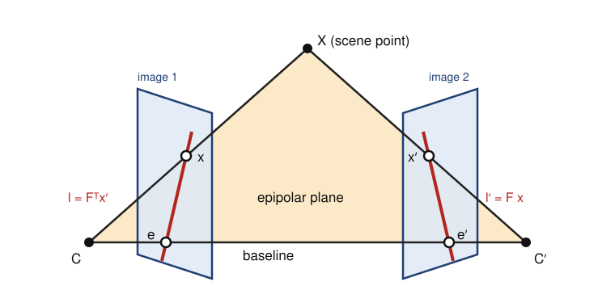

## Contents

-   [Introduction and overview](#intro)
-   [0. Review: projective geometry and numerical linear algebra](#ch0)
-   [1. Camera geometry and panoramas](#ch1)
-   [2. Calibration and the projection matrix](#ch2)
-   [3. Interest points, SIFT and matching](#ch3)
-   [4. Two-view geometry: essential and fundamental matrices, RANSAC](#ch4)
-   [5. Disparity maps with local methods and filtering](#ch5)
-   [6. Disparity maps with global methods and graph cuts](#ch6)
-   [7. Structure from motion and bundle adjustment](#ch7)
-   [8. Multiple view stereo](#ch8)
-   [9. Research directions and open problems](#ch9)
-   [Exercises](#ex)
-   [Projects and assessment](#projects)
-   [References](#refs)

## Introduction and overview {#intro}

  -------------------- ------------------------------------------------------------------------------------------------------------------------
  Module               3D Computer Vision
  Official title       3D computer vision
  Instructors          P. MONASSE, L. LANDRIEU (master-mva.com, 2026–2027)
  Period               Semester 1 · period 1 (28/09/2026 – 08/01/2027)
  Credits and volume   5 ECTS · 21 h (lectures 18 h, tutorials 3 h) per the Université Paris-Saclay programme table
  Label                [Modelling]{.badge .label} · domains on master-mva.com: Computer Vision
  Language             not displayed on the official pages (the master-mva.com course description is written in English)
  Assessment           Written exam; weekly reports and source code of the practical sessions; a written exam for the re-take (master-mva.com, “Mode de validation”). The Université Paris-Saclay course detail states “Evaluation Continue non Intégrale” (continuous assessment that is not the only component of the grade); no weighting displayed
  Prerequisites        Linear algebra, optimization, basic programming in C, C++ or Java (master-mva.com, “Prè-requis”)
  -------------------- ------------------------------------------------------------------------------------------------------------------------

**Audience**: a student with a good M1 in mathematics or computer science, at ease with linear algebra and a little optimisation, who wants to recover the three-dimensional shape of a scene from its photographs.

**Empirical first**: take two photographs of a desk with a phone moved 10 cm sideways, with a focal length of 1000 pixels. A mug 1 m away shifts by 100 pixels between the two images, the wall 5 m away by only 20 pixels: this shift, the disparity, is the depth signal of binocular stereo (Example 5.2). Yet a naive matcher returns noise on the white wall and swells the mug beyond its outline, and many automatic point matches between the photographs are wrong. The course explains each failure and its remedy; Code 4.10, for instance, recovers the camera motion despite 30 % of wrong matches.

The course builds the geometry of image formation and of multiple views, then the algorithms that turn pixels into 3D measurements. A camera is a projective map from space to the image plane; two cameras are tied by the epipolar constraint; matched points give the cameras and a sparse set of 3D points; and dense matching along epipolar lines gives a depth for every pixel. Binocular stereo receives most of the attention, as announced by the official objective, together with the practical limits of the algorithms.

The tools are projective geometry, the singular value decomposition, robust estimation and discrete optimisation. They reappear in [Point Clouds and 3D Modelling (NPM3D)](../s2-point-clouds-3d/index.html), [Remote Sensing Data](../s2-remote-sensing/index.html) (satellite stereo), [Graphical Models: Discrete Inference and Learning](../s2-graphical-models-discrete/index.html) (graph cuts), [Robotics](../s1-robotics/index.html) and [Object Recognition and Computer Vision](../s1-object-recognition-cv/index.html).

### What you will be able to do

-   Write the projection matrix of a camera, decompose it into intrinsic and extrinsic parameters, and compute vanishing points and camera centres.
-   Prove when two images are related by a homography, estimate it with the normalised DLT, and assemble a panorama.
-   Calibrate a camera from several views of a planar target with Zhang's method, and refine the estimate by minimising the reprojection error.
-   Detect corners and blobs at their characteristic scale, describe them with SIFT and match them with the ratio test.
-   Derive the epipolar constraint, estimate fundamental and essential matrices, and recover the relative pose and 3D points.
-   Size a RANSAC run from the inlier ratio and the sample size, and choose its threshold from the noise level.
-   Rectify a stereo pair, convert disparities into depths, and predict the depth error.
-   Compute disparity maps with local methods (window costs, edge-aware filtering, left–right check) and explain their failure modes.
-   Formulate stereo as an energy, minimise it by dynamic programming, semi-global matching and graph cuts, and state what each method guarantees.
-   Explain the main families of multiple view stereo — plane sweep, volumetric fusion, patch-based methods — and how bundle adjustment provides their cameras.

### Official objectives and syllabus (2026–2027)

The course description on master-mva.com sets the objective of exploring the theoretical foundations of 3D computer vision from multiple views, with an emphasis on binocular stereo, and of showing the practical limitations of the algorithmic state of the art. It announces six lectures of 3 h and one session for the exam, and encourages students to bring a personal laptop to the practical sessions.

The official references are the textbooks of Hartley and Zisserman and of Szeliski. The table matches each official item with the section of these notes that teaches it.

| Official topic (master-mva.com, “Thèmes abordés” and course page) | Course section |
|---|---|
| Camera geometry, panorama construction | ch. 1: pinhole model and projection matrix (1.1), vanishing points (1.2), homographies of a rotating camera and of a plane (Theorem 1.6), normalised DLT (1.4), panorama construction (1.5); projective tools in ch. 0 |
| Calibration, projection matrix | ch. 2: estimation of the projection matrix from a rig (2.1), its decomposition (Theorem 2.2), Zhang's planar calibration (2.3, Code 2.6), lens distortion and reprojection error (2.4) |
| Interest points, including SIFT, matching | ch. 3: Harris corners (3.1), scale space and characteristic scale (3.2), SIFT (Algorithm 3.6), matching and the ratio test (3.4) |
| Essential and fundamental matrices, RANSAC algorithm | ch. 4: epipolar constraint (Theorem 4.1), properties of F (Proposition 4.3), characterisation of E (Theorem 4.4), the four poses (Theorem 4.5), eight-point algorithm (4.2), triangulation (4.3), RANSAC and its iteration count (4.4, Code 4.10) |
| Disparity maps with local methods and filtering | ch. 5: rectification and depth from disparity (5.1), matching costs (5.2), aggregation and fattening (5.3), adaptive weights and the guided filter (5.4), left–right check and post-processing (5.5, Code 5.8) |
| Disparity maps with global methods, graph cuts | ch. 6: stereo energies (6.1), dynamic programming and semi-global matching (6.2), max-flow min-cut and binary energies (6.3), Ishikawa's construction and α-expansion (6.4) |
| Multiple view stereo | ch. 8: plane sweep (8.1), multi-baseline stereo (8.2, Code 8.2), depth-map fusion and space carving (8.3), patch-based methods and evaluation (8.4); the cameras it needs come from ch. 7 (structure from motion and bundle adjustment, self-study) |
| Objective: practical limitations of the state of the art | notes at the end of ch. 5 and 6 (texture, occlusions, slanted surfaces, model versus optimiser), Code 6.8; ch. 9 (self-study) |
| Organisation: six 3-hour lectures, one exam session; a laptop for the practical sessions | session plan below; every session has a practical part built on the code blocks |
| Assessment: written exam; weekly reports and source code of the practical sessions; written re-take exam | [Projects and assessment](#projects): written-exam proposal and rubric; the session codes serve as weekly practicals |
| References: Hartley and Zisserman; Szeliski | [References](#refs), cited chapter by chapter |
| “Présentation : here” and “More information…” | not covered: links to a presentation and to further information, not topics |
| “Les intervenants” | not covered: links to the instructors' pages (Pascal Monasse and Loïc Landrieu, ENPC, per master-mva.com), not a topic |

Beyond the syllabus, these notes add three self-study chapters: the review of [ch. 0](#ch0), structure from motion with the Schur-complement structure of bundle adjustment ([ch. 7](#ch7)), and research directions — learned matching and stereo, neural scene representations, feed-forward reconstruction ([ch. 9](#ch9)). They also add the multi-baseline argument of Okutomi and Kanade ([ch. 8.2](#ch8)).

### Where this course fits in the programme

The official prerequisites are linear algebra, optimization, and basic programming in C, C++ or Java. These notes use Python with NumPy and SciPy instead; the algorithms carry over line by line.

-   **Preparation** — the refresher [Linear Algebra, Analysis and Optimization](../s0-refresher-linear-algebra-optimization/index.html) covers the SVD, least squares and Newton-type methods; [Scientific Python, NumPy and PyTorch](../s0-refresher-python-scientific-computing/index.html) covers the array programming of every code block; [Probability and Statistics](../s0-refresher-probability-statistics/index.html) covers the Gaussian likelihood behind the reprojection error and the binomial computations of RANSAC.
-   **Related courses of the same semester** — [Sub-Pixel Image Processing](../s1-sub-pixel-image-processing/index.html) (interpolation, sub-pixel registration), [Mathematical Models for Digital Photography](../s1-digital-photography/index.html) (the camera pipeline), [Object Recognition and Computer Vision](../s1-object-recognition-cv/index.html), [The Machine Intelligence of Images](../s1-machine-intelligence-images/index.html), [Robotics](../s1-robotics/index.html) (camera pose and localisation), [Geometry Processing and Geometric Deep Learning](../s1-geometry-processing-gdl/index.html) (meshes and surfaces) and [Convex Optimization and Applications in Machine Learning](../s1-convex-optimization/index.html).
-   **Courses that build on it (semester 2)** — [Point Clouds and 3D Modelling (NPM3D)](../s2-point-clouds-3d/index.html), [Remote Sensing Data](../s2-remote-sensing/index.html), [Graphical Models: Discrete Inference and Learning](../s2-graphical-models-discrete/index.html), [Deformable Models and Geodesic Methods for Image Analysis](../s2-deformable-models-geodesics/index.html), [Geometry and Shape Spaces](../s2-shape-spaces/index.html) and [Generative Models for Images](../s2-generative-models-images/index.html).

### Course outline

-   **Review: projective geometry and numerical linear algebra** — homogeneous coordinates, the SVD solution of homogeneous systems, low-rank approximation and Levenberg–Marquardt.
-   **Camera geometry and panoramas** — the pinhole camera and its projection matrix, homographies of rotating cameras and planes, the normalised DLT and panorama construction.
-   **Calibration and the projection matrix** — estimating and decomposing the projection matrix, Zhang's planar calibration, distortion and the reprojection error.
-   **Interest points, SIFT and matching** — corners, scale space, the SIFT detector and descriptor, nearest-neighbour matching.
-   **Two-view geometry** — the epipolar constraint, fundamental and essential matrices, the eight-point algorithm, relative pose, triangulation and RANSAC.
-   **Disparity maps with local methods and filtering** — rectification, depth from disparity, window costs, edge-aware cost filtering and consistency checks.
-   **Disparity maps with global methods and graph cuts** — stereo energies, dynamic programming, semi-global matching, minimum cuts and α-expansion.
-   **Structure from motion and bundle adjustment** — self-study: the incremental pipeline that estimates many cameras, and the sparse least squares that refines them.
-   **Multiple view stereo** — plane sweep, multi-baseline stereo, depth-map fusion, space carving and patch-based methods.
-   **Research directions and open problems** — self-study: learned matching and stereo, neural scene representations, feed-forward reconstruction, open questions.

### Session plan {#sessions}

**21 h in class = 7 sessions of 3 h.** The volume is the official one of the Université Paris-Saclay programme table (lectures 18 h, tutorials 3 h); master-mva.com organises the course as six 3-hour lectures and one exam session. The split below is a proposal: it gives one session to each of the seven official themes, in the official order, and pairs about 2 h of lecture with 1 h of practice in every session. On the official calendar two themes share a lecture to free the exam slot.

Level 1 = foundations, 2 = core results and algorithms, 3 = advanced and research-level material; the level never decreases.

| Session | Hours | Level | Content | Practice |
|---|---|---|---|---|
| 1 | 3 h | 1 | ch. 1 Camera geometry: pinhole model, projection matrix, vanishing points, homographies, normalised DLT, panoramas | Ex. 1–4; lab: Codes 0.6 and 1.9 (review chapter read beforehand) |
| 2 | 3 h | 1 | ch. 2 Calibration: DLT for the projection matrix, decomposition, Zhang's method, distortion and reprojection error | Ex. 10; lab: Code 2.6 |
| 3 | 3 h | 2 | ch. 3 Interest points: Harris corners, scale space, SIFT, matching and the ratio test | Ex. 11; lab: Code 3.5 |
| 4 | 3 h | 2 | ch. 4 Two-view geometry: epipolar constraint, F and E, eight-point algorithm, pose, triangulation, RANSAC | Ex. 5, 8, 12, 14; lab: Code 4.10 |
| 5 | 3 h | 2 | ch. 5 Local stereo: rectification, depth from disparity, costs, aggregation, adaptive weights, guided filter, left–right check | Ex. 6, 7; lab: Code 5.8 |
| 6 | 3 h | 3 | ch. 6 Global stereo: energies, dynamic programming, SGM, max-flow min-cut, binary energies, α-expansion | Ex. 13, 15; lab: Codes 6.4 and 6.8 |
| 7 | 3 h | 3 | ch. 8 Multiple view stereo: plane sweep, multi-baseline stereo, depth-map fusion, space carving, patch-based methods and evaluation | Ex. 9, 16; lab: Code 8.2 |

**Self-study, outside the 21 h** (about 7 h in total): ch. 0 Review: projective geometry and numerical linear algebra (≈ 2 h, before session 1) · ch. 7 Structure from motion and bundle adjustment (≈ 2 h, before session 7, with Code 7.3) · ch. 9 Research directions and open problems (≈ 3 h, with Ex. 17).

### How to study this module

-   Read [ch. 0](#ch0) before the first session: the SVD solution of Theorem 0.4 is used by every estimation algorithm of the course. Read [ch. 7](#ch7) before session 7: it explains where the cameras of multiple view stereo come from.
-   Run every code block and change one parameter at a time; the numbers quoted in the text were produced by these blocks. They need Python 3 with NumPy and SciPy, and NetworkX for Code 6.8; no data is downloaded.
-   Write a short report after each session, as the official weekly practicals require: what the code computes, one experiment you changed, and what you observed.
-   Keep the synthetic stereo pair of Code 5.8: chapters 5 and 6 use it to compare local and global methods on the same data.
-   Do the exercises listed for each session before the next one; the ★★ proofs of ch. 4 and 6 are typical exam questions.

## 0. Review: projective geometry and numerical linear algebra {#ch0}

Every estimation problem of this course — a homography, a projection matrix, a fundamental matrix, a 3D point — follows the same route. The geometry is written in homogeneous coordinates, where projections become linear; the resulting homogeneous system is solved with the singular value decomposition; the estimate is then refined by nonlinear least squares. This chapter collects these three tools.

### 0.1 Homogeneous coordinates and the projective plane

::: def
[Definition 0.1 — Projective plane]{.tag} The projective plane $\mathbb{P}^2$ is the set of non-zero vectors of $\mathbb{R}^3$ up to a non-zero factor: $x \sim \lambda x$ for every $\lambda \neq 0$.

A point $(u, v)$ of the image plane is represented by $x = (u, v, 1)$. Conversely, $x = (x_1, x_2, x_3)$ with $x_3 \neq 0$ represents the point $(x_1 / x_3, x_2 / x_3)$, and the vectors with $x_3 = 0$ are the **points at infinity**, one per direction.

A **line** is also a non-zero vector $l \in \mathbb{R}^3$ up to scale, and incidence is linear:
$$
x \in l \iff l^\top x = 0 .
$$
:::

The same construction one dimension higher gives $\mathbb{P}^3$, where a point of space $(X_1, X_2, X_3)$ is represented by $(X_1, X_2, X_3, 1)$.

:::: prop
[Proposition 0.2 — Joins and intersections]{.tag} The line through two distinct points $x, y$ and the intersection point of two distinct lines $l, m$ are
$$
l = x \times y, \qquad x = l \times m .
$$

::: proof
The vector $x \times y$ is orthogonal to $x$ and to $y$, so it satisfies both incidence equations, and it is non-zero because $x$ and $y$ are not proportional.

The two incidence equations are independent, so the line is unique. The second formula is the same computation with the roles of points and lines exchanged. [∎]{.qed}
:::
::::

::: ex
[Example 0.3 — Parallel lines meet at infinity]{.tag} The lines $y = 0$ and $y = 1$ are $l = (0, 1, 0)$ and $m = (0, 1, -1)$. Their intersection is
$$
l \times m = (-1, 0, 0) \sim (1, 0, 0),
$$
the point at infinity in the direction of the $x$ axis.

The line through $(1, 2)$ and $(3, 5)$ is $(1, 2, 1) \times (3, 5, 1) = (-3, 2, -1)$, that is $3u - 2v + 1 = 0$. Code 0.6 checks both computations.
:::

The cross product is linear in each argument. For $a \in \mathbb{R}^3$, the **cross-product matrix** turns it into a matrix product:
$$
[a]_\times = \begin{pmatrix} 0 & -a_3 & a_2 \\ a_3 & 0 & -a_1 \\ -a_2 & a_1 & 0 \end{pmatrix}, \qquad [a]_\times\, b = a \times b .
$$
It is skew-symmetric, and for $a \neq 0$ it has rank 2 with kernel spanned by $a$. Chapter 4 builds the essential matrix from it.

An invertible $3 \times 3$ matrix $H$ acts on $\mathbb{P}^2$ by $x \mapsto Hx$. Lines then transform by $l \mapsto H^{-\top} l$, because $(H^{-\top} l)^\top (Hx) = l^\top x$: incidence is preserved.

### 0.2 Homogeneous least squares and the SVD

The equations of this course take the form $Ah = 0$. The unknown $h$ is defined up to scale (a homography, a fundamental matrix), and the matrix $A$ is built from the data. With noisy data there is no exact solution, and the natural problem is
$$
\min_{\|h\| = 1} \|A h\|^2 .
$$

:::: thm
[Theorem 0.4 — Homogeneous least squares]{.tag} Let $A \in \mathbb{R}^{m \times n}$, $m \ge n$, have the SVD $A = U \Sigma V^\top$, with singular values $\sigma_1 \ge \dots \ge \sigma_n \ge 0$ and right singular vectors $v_1, \dots, v_n$. Then
$$
\min_{\|h\| = 1} \|A h\| = \sigma_n, \quad \text{attained at } h = v_n .
$$
The minimiser is unique up to sign when $\sigma_{n-1} > \sigma_n$.

::: proof
Write $h = \sum_i c_i v_i$. Since $V$ is orthogonal, $\|h\| = 1$ means $\sum_i c_i^2 = 1$, and
$$
\|A h\|^2 = \sum_i \sigma_i^2 c_i^2 \ \ge\ \sigma_n^2 \sum_i c_i^2 = \sigma_n^2 .
$$
Equality holds if and only if $c_i = 0$ whenever $\sigma_i > \sigma_n$. [∎]{.qed}
:::
::::

::: key
[Key result — Homogeneous least squares]{.tag}
$$
\arg\min_{\|h\| = 1} \|A h\| = v_n , \quad \text{the last right singular vector of } A
$$
:::

:::: thm
[Theorem 0.5 — Eckart–Young, Frobenius norm]{.tag} Among the matrices of rank at most $r$, the closest to $A$ in Frobenius norm is the truncated SVD:
$$
A_r = \sum_{i \le r} \sigma_i\, u_i v_i^\top, \qquad \|A - A_r\|_F^2 = \sum_{i > r} \sigma_i^2 .
$$

::: proof
Let $B$ have rank at most $r$, so $\sigma_{r+1}(B) = 0$. Weyl's inequality for singular values gives
$$
\sigma_{i+r}(A) \le \sigma_i(A - B) + \sigma_{r+1}(B) = \sigma_i(A - B) .
$$
Summing the squares over $i$ gives $\|A - B\|_F^2 \ge \sum_{i > r} \sigma_i(A)^2$, and $A_r$ attains the bound. [∎]{.qed}
:::
::::

Chapter 4 uses Theorem 0.5 to force the fundamental matrix to have rank two.

The solution of Theorem 0.4 is reliable when the gap between $\sigma_{n-1}$ and $\sigma_n$ is large compared with the noise. When the entries of $A$ have very different magnitudes, for instance products of pixel coordinates of order $10^5$ next to entries equal to 1, the matrix is badly conditioned. This is why the data are normalised first (Algorithm 1.8).

**Code 0.6 — Joins, intersections and a fitted line.** The script repeats Example 0.3 and fits a line to 20 noisy points with Theorem 0.4.

```python
import numpy as np

def cross_matrix(a):
    """[a]_x such that cross_matrix(a) @ b == np.cross(a, b)."""
    return np.array([[0, -a[2], a[1]], [a[2], 0, -a[0]], [-a[1], a[0], 0]])

# Two parallel lines y = 0 and y = 1, written l = (a, b, c) with a u + b v + c = 0
l1, l2 = np.array([0., 1., 0.]), np.array([0., 1., -1.])
print("intersection of the parallel lines:", np.cross(l1, l2))      # (-1, 0, 0): at infinity

# Line through (1, 2) and (3, 5), then a homogeneous least-squares fit through noisy points
p, q = np.array([1., 2., 1.]), np.array([3., 5., 1.])
l = np.cross(p, q)
print("line through p and q:", l, " checks:", l @ p, l @ q)
rng = np.random.default_rng(0)
x = np.linspace(0, 4, 20)
pts = np.stack([x, 1.5 * x + 0.5 + 0.05 * rng.standard_normal(20), np.ones(20)], axis=1)
_, s, Vt = np.linalg.svd(pts)
l_hat = Vt[-1] / -Vt[-1][1]                     # scale so that the line reads v = a u + c
print("fitted line (a, -1, c):", np.round(l_hat, 3), " smallest singular value:", round(s[-1], 4))
print("[a]_x b == a x b:", np.allclose(cross_matrix(p) @ q, np.cross(p, q)))
```

The fit returns $v = 1.494\, u + 0.504$ for the true line $v = 1.5\, u + 0.5$.

### 0.3 Nonlinear least squares

The algebraic residual $\|Ah\|$ has no physical meaning. Final estimates minimise a geometric error instead, a sum of squared distances in pixels, which is a nonlinear function of the parameters $\theta$:
$$
f(\theta) = \frac12 \sum_i \|r_i(\theta)\|^2 = \frac12 \|r(\theta)\|^2 .
$$

::: def
[Definition 0.7 — Gauss–Newton and Levenberg–Marquardt]{.tag} Let $J$ be the Jacobian of $r$ at the current $\theta$. Gauss–Newton linearises $r$ and solves $J^\top J\, \delta = -J^\top r$.

Levenberg–Marquardt adds a damping $\mu > 0$:
$$
(J^\top J + \mu I)\, \delta = -J^\top r .
$$
It increases $\mu$ when a step fails to decrease $f$, and decreases it otherwise.
:::

:::: prop
[Proposition 0.8 — The damped step descends]{.tag} For $\mu > 0$ and a gradient $g = J^\top r \neq 0$, the Levenberg–Marquardt step satisfies
$$
g^\top \delta < 0 .
$$

::: proof
We have $g^\top \delta = -g^\top (J^\top J + \mu I)^{-1} g$, and the matrix is positive definite. [∎]{.qed}
:::
::::

For large $\mu$ the step is close to the gradient step $-g / \mu$, which is safe far from the minimum. For small $\mu$ it is the Gauss–Newton step, which converges fast near a minimum with small residuals.

:::: recap
::: recap-title
Key takeaways — chapter 0
:::

-   Points and lines of the plane are vectors of $\mathbb{R}^3$ up to scale; joins and intersections are cross products, and points at infinity are directions.
-   A homogeneous system $Ah = 0$ is solved, with $\|h\| = 1$, by the last right singular vector of $A$ (Theorem 0.4).
-   The closest matrix of lower rank is a truncated SVD (Theorem 0.5).
-   Algebraic estimates initialise a Levenberg–Marquardt minimisation of a geometric error.
::::

## 1. Camera geometry and panoramas {#ch1}

How does a camera turn a point of space into a pixel, and when are two photographs related by a simple transformation of the image plane? This chapter builds the pinhole model and its $3 \times 4$ projection matrix. It then shows that a camera turning about its centre produces images related by homographies, which is the basis of panoramas.

### 1.1 The pinhole camera

In the camera frame, with the centre at the origin and the optical axis along $Z$, a point $(X, Y, Z)$ with $Z > 0$ projects onto the image plane at distance $f$ at the point $(fX/Z, fY/Z)$. In homogeneous coordinates the division by the depth disappears:
$$
\begin{pmatrix} fX \\ fY \\ Z \end{pmatrix} = \begin{pmatrix} f & 0 & 0 & 0 \\ 0 & f & 0 & 0 \\ 0 & 0 & 1 & 0 \end{pmatrix} \begin{pmatrix} X \\ Y \\ Z \\ 1 \end{pmatrix} .
$$

::: def
[Definition 1.1 — Intrinsic matrix]{.tag} Pixel coordinates are obtained with the upper-triangular matrix
$$
K = \begin{pmatrix} f_x & s & c_x \\ 0 & f_y & c_y \\ 0 & 0 & 1 \end{pmatrix} .
$$
Here $f_x$ and $f_y$ are the focal length divided by the pixel pitch in each direction, $(c_x, c_y)$ is the principal point where the optical axis meets the sensor, and $s$ is a skew, zero for modern sensors.
:::

::: def
[Definition 1.2 — Projection matrix]{.tag} A point with world coordinates $X_w$ has camera coordinates $X_c = R X_w + t$, with $R \in SO(3)$ and $t \in \mathbb{R}^3$. The camera is the $3 \times 4$ matrix
$$
P = K\, [R \mid t], \qquad x \sim P \begin{pmatrix} X_w \\ 1 \end{pmatrix} .
$$
It has 11 degrees of freedom: 5 intrinsic parameters in $K$ and 6 extrinsic ones in $(R, t)$.
:::

:::: prop
[Proposition 1.3 — Centre and depth]{.tag} Let $P = K[R \mid t]$ and $C = -R^\top t$.

1.  The centre spans the kernel of $P$:
    $$
    P \begin{pmatrix} C \\ 1 \end{pmatrix} = 0 .
    $$
2.  If $x = P\, (X_w, 1)$, then $x_3$ is the depth $Z$ of the point in the camera frame, so the point is in front of the camera if and only if $x_3 > 0$.

::: proof
For item 1, $K[R \mid t](C, 1) = K(RC + t) = K(-t + t) = 0$, and $P$ has rank 3 because $KR$ is invertible, so the kernel is one-dimensional.

For item 2, the third row of $K$ is $(0, 0, 1)$, so $x_3$ is the third coordinate of $R X_w + t$. [∎]{.qed}
:::
::::

::: ex
[Example 1.4 — From a point to a pixel]{.tag} Take $f_x = f_y = 800$, $(c_x, c_y) = (320, 240)$, $s = 0$, $R = I$ and $t = 0$. The point $(0.5, -0.2, 4)$ m gives
$$
x = (800 \cdot 0.5 + 320 \cdot 4,\ 800 \cdot (-0.2) + 240 \cdot 4,\ 4) = (1680, 800, 4) ,
$$
so the pixel is
$$
(u, v) = (420, 200) .
$$
Moving the point by 1 cm parallel to the image plane at 4 m moves the pixel by $800 \times 0.01 / 4 = 2$ pixels.
:::

::: key
[Key result — The pinhole camera]{.tag}
$$
x \sim K\, [R \mid t] \begin{pmatrix} X_w \\ 1 \end{pmatrix}, \qquad \text{centre } C = -R^\top t, \qquad x_3 = \text{depth}
$$
:::

### 1.2 Points at infinity and vanishing points

:::: prop
[Proposition 1.5 — Vanishing points]{.tag} The images of all lines of space with direction $d$ pass through the image of the point at infinity $(d, 0)$, the **vanishing point**
$$
v \sim K R\, d ,
$$
which does not depend on the translation $t$.

::: proof
A line through $X_0$ with direction $d$ has points $X_0 + \lambda d$. Their images are $P(X_0, 1) + \lambda\, KRd$, a pencil of vectors that tends, up to scale, to $KRd$ as $\lambda \to \infty$. [∎]{.qed}
:::
::::

The optical axis, $d = R^\top (0, 0, 1)$, vanishes at the principal point. The vanishing points of three orthogonal directions, read on the edges of a building, constrain $K$; [ch. 2.3](#ch2) formalises such constraints.

### 1.3 Homographies between images

A **homography** is an invertible $3 \times 3$ matrix acting on $\mathbb{P}^2$, up to scale: it has 8 degrees of freedom. It maps lines to lines but does not preserve parallelism.

:::: thm
[Theorem 1.6 — When two images are related by a homography]{.tag} Let $P = K[I \mid 0]$ and $P' = K'[R \mid t]$ be two cameras, and let $x, x'$ be the images of a scene point.

1.  *Pure rotation.* If $t = 0$, the camera turns about its centre, and for every scene point
    $$
    x' \sim K' R K^{-1} x .
    $$
2.  *Planar scene.* If the point lies on the plane $n^\top X = \delta$ of the first camera frame, with $\delta > 0$, then
    $$
    x' \sim K' \Big( R + \frac{t\, n^\top}{\delta} \Big) K^{-1} x .
    $$

::: proof
A point with image $x$ in the first camera is $X = Z K^{-1} x$ for its depth $Z > 0$.

In case 1, $x' \sim K' R X = Z\, K' R K^{-1} x$.

In case 2, the plane equation gives $n^\top X / \delta = 1$, hence $t = t\, n^\top X / \delta$. Therefore
$$
x' \sim K'(RX + t) = K' \Big( R + \frac{t\, n^\top}{\delta} \Big) X = Z\, K' \Big( R + \frac{t\, n^\top}{\delta} \Big) K^{-1} x .
$$

[∎]{.qed}
:::
::::

A camera turning about its centre sees no parallax: both images contain the same rays and reveal nothing about depth. Panoramas rely on this; reconstruction needs a translation (ch. 4).

### 1.4 Estimating a homography: the normalised DLT

The relation $x' \sim Hx$ is equivalent to $x' \times Hx = 0$. Write $h \in \mathbb{R}^9$ for the rows of $H$ stacked, and $x' = (u', v', w')$.

:::: prop
[Proposition 1.7 — Two equations per correspondence]{.tag} Each correspondence gives the two linear equations
$$
\begin{pmatrix} 0^\top & -w' x^\top & v' x^\top \\ w' x^\top & 0^\top & -u' x^\top \end{pmatrix} h = 0 ,
$$
and the third row of $x' \times Hx = 0$ is a combination of these two. Four correspondences, no three of them collinear, determine $H$ up to scale.

::: proof
The third component of $x' \times Hx$ is $u' (h^{2\top} x) - v' (h^{1\top} x)$. It equals $-(u' / w')$ times the first row plus $-(v' / w')$ times the second, when $w' \neq 0$.

Four points in general position and their images determine a unique projective map of the plane: send each quadruple to the standard frame $(1,0,0), (0,1,0), (0,0,1), (1,1,1)$, then compose. [∎]{.qed}
:::
::::

Stacking $n \ge 4$ correspondences gives a $2n \times 9$ matrix $A$, and Theorem 0.4 gives $h$. With raw pixel coordinates the entries of $A$ range from 1 to about $10^5$; Hartley (1997) showed that normalising the data first fixes this conditioning problem.

::: def
[Algorithm 1.8 — Normalised DLT]{.tag}

1.  Compute similarities $T$ and $T'$ that move the centroid of each point set to the origin and scale it to a mean distance of $\sqrt 2$.
2.  Run the DLT on the normalised points $Tx$ and $T'x'$, which gives $\hat H$.
3.  Return $H = T'^{-1} \hat H\, T$.
4.  Optionally, refine $H$ with Levenberg–Marquardt on the symmetric transfer error
    $$
    \sum_i d(x_i', H x_i)^2 + d(x_i, H^{-1} x_i')^2 .
    $$
:::

**Code 1.9 — Homography of a panning camera, with and without normalisation.** A camera with $f = 800$ pans by $20°$; $H = KRK^{-1}$ is estimated 200 times from 30 matches with 1 pixel of noise.

```python
import numpy as np

def normalise(x):
    """Similarity T moving the centroid to 0 and the mean distance to sqrt(2)."""
    c = x.mean(axis=0)
    s = np.sqrt(2) / np.linalg.norm(x - c, axis=1).mean()
    return np.array([[s, 0, -s * c[0]], [0, s, -s * c[1]], [0, 0, 1]])

def dlt_homography(x, y, normalised=True):
    """H with y ~ H x from n >= 4 correspondences (n x 2 arrays); also returns cond(A)."""
    T, U = (normalise(x), normalise(y)) if normalised else (np.eye(3), np.eye(3))
    xh = np.c_[x, np.ones(len(x))] @ T.T
    yh = np.c_[y, np.ones(len(y))] @ U.T
    rows = []
    for (a, b, c), (u, v, w) in zip(xh, yh):        # two rows of y x (H x) = 0
        rows.append([0, 0, 0, -w * a, -w * b, -w * c, v * a, v * b, v * c])
        rows.append([w * a, w * b, w * c, 0, 0, 0, -u * a, -u * b, -u * c])
    _, s, Vt = np.linalg.svd(np.array(rows))
    H = np.linalg.inv(U) @ Vt[-1].reshape(3, 3) @ T     # Theorem 0.4, then undo T and U
    return H / H[2, 2], s[0] / s[-2]

def apply(H, x):
    y = np.c_[x, np.ones(len(x))] @ H.T
    return y[:, :2] / y[:, 2:]

# A camera panning by 20 degrees about its centre: H = K R K^{-1} (Theorem 1.6)
K = np.array([[800., 0, 320], [0, 800, 240], [0, 0, 1]])
a = np.deg2rad(20)
R = np.array([[np.cos(a), 0, np.sin(a)], [0, 1, 0], [-np.sin(a), 0, np.cos(a)]])
H_true = K @ R @ np.linalg.inv(K)
print("image of the principal point:", apply(H_true, np.array([[320., 240.]])).round(1))

rng = np.random.default_rng(1)
x = rng.uniform([0, 0], [640, 480], size=(30, 2))
grid = np.stack(np.meshgrid(np.linspace(0, 640, 9), np.linspace(0, 480, 7)), -1).reshape(-1, 2)
for norm in (True, False):
    errs, conds = [], []
    for trial in range(200):
        y = apply(H_true, x) + 1.0 * rng.standard_normal(x.shape)   # 1 px of noise
        H, cond = dlt_homography(x, y, norm)
        errs.append(np.sqrt(np.mean(np.sum((apply(H, grid) - apply(H_true, grid))**2, 1))))
        conds.append(cond)
    print(f"normalised={norm}: condition number {np.mean(conds):.1e}, "
          f"RMS transfer error {np.mean(errs):.3f} px")
```

The principal point moves to $u = 611.2 = 320 + 800 \tan 20°$. The ratio $\sigma_1 / \sigma_8$ of $A$ is 3 with normalisation and $1.4 \times 10^6$ without. The transfer errors stay close here (0.664 and 0.679 pixel); for the fundamental matrix, Exercise 14 finds a factor of 3.

### 1.5 Panorama construction

By Theorem 1.6, photographs taken by a camera turning about its centre are related by homographies $K R K^{-1}$, whatever the depth of the scene.

1.  Rotate the camera about its centre, on a panoramic head, or by hand when the scene is far away.
2.  Match interest points between overlapping images ([ch. 3](#ch3)) and estimate the homographies with RANSAC ([ch. 4.4](#ch4)).
3.  Compose the homographies to map every image into the frame of a reference image.
4.  Warp by inverse mapping: sample the input at $H^{-1} y$ for each output pixel $y$, with bilinear interpolation, so that no output pixel stays empty.
5.  Blend the overlaps with feathering weights, or with multi-band blending (Burt and Adelson, 1983), which mixes low frequencies over wide zones and high frequencies over narrow ones.

::: ex
[Example 1.10 — How wide can a planar panorama be?]{.tag} With $f = 800$ pixels, a pan by $\theta$ sends the principal point to $u = c_x + f \tan\theta$. The offset is 291 pixels at 20°, 800 at 45°, 2198 at 70° and 9144 at 85°.

The horizontal stretch at angle $\theta$ is $du/d\theta = f / \cos^2\theta$, that is $1 / \cos^2 70° = 8.5$ times the central one at $70°$. A planar panorama is therefore limited to well below $180°$.

Wide panoramas use cylindrical coordinates instead:
$$
(\theta, h) = \Big( \arctan \frac{u}{f},\ \frac{v}{\sqrt{u^2 + f^2}} \Big) ,
$$
in which a pan is a horizontal translation and the stretch is uniform.
:::

Brown and Lowe (2007) automate the whole pipeline, with a bundle adjustment of the rotations and focal lengths ([ch. 7](#ch7)); Szeliski (2006) surveys image stitching.

:::: recap
::: recap-title
Key takeaways — chapter 1
:::

-   A camera is $P = K[R \mid t]$, a $3 \times 4$ matrix with 11 degrees of freedom; its kernel is the centre and the third homogeneous coordinate of an image point is the depth.
-   Vanishing points $KRd$ do not depend on the translation.
-   Images are related by a homography when the camera only rotates ($K'RK^{-1}$) or when the scene is a plane.
-   The DLT gives two equations per correspondence; normalise the coordinates before solving.
-   Panoramas warp all images into a reference frame by inverse mapping and blend the overlaps; beyond about $120°$ a cylindrical projection is needed.
::::

## 2. Calibration and the projection matrix {#ch2}

Calibration estimates the intrinsic matrix $K$, the lens distortion and the camera poses from images of a known object: either a 3D rig, whose projection matrix is estimated and decomposed, or a planar pattern seen in several orientations (Zhang, 2000), the standard method today.

### 2.1 Estimating P from 3D–2D correspondences

For known points $X_i$ of a calibration rig and their images $x_i = (u_i, v_i, w_i)$, the relation $x_i \times P (X_i, 1) = 0$ gives two equations in the 12 entries $p$ of $P$, exactly as in Proposition 1.7:
$$
\begin{pmatrix} 0^\top & -w_i \tilde X_i^\top & v_i \tilde X_i^\top \\ w_i \tilde X_i^\top & 0^\top & -u_i \tilde X_i^\top \end{pmatrix} p = 0, \qquad \tilde X_i = (X_i, 1) .
$$
Since $P$ has 11 degrees of freedom, six points in general position suffice. As for homographies, the image points are normalised to a mean distance $\sqrt 2$ and the 3D points to $\sqrt 3$.

:::: prop
[Proposition 2.1 — Coplanar points are degenerate]{.tag} If all the points $X_i$ lie on one plane, the projection matrix is not determined: the solutions of $Ap = 0$ form a space of dimension at least 4.

::: proof
Choose world coordinates in which the plane is $X_3 = 0$. Then $P \tilde X_i = p_1 X_{i,1} + p_2 X_{i,2} + p_4$, where $p_j$ is the $j$-th column of $P$.

The third column $p_3$ never appears, so it can be changed freely: three dimensions are added to the one-dimensional true solution. [∎]{.qed}
:::
::::

The plane-to-image map is then a homography, with 8 degrees of freedom instead of 11; Zhang's method (2.3) combines several such views.

### 2.2 Decomposing a projection matrix

:::: thm
[Theorem 2.2 — Decomposition of P]{.tag} Let $P = [M \mid p_4]$ with $M$ invertible.

There are a unique upper-triangular $K$ with positive diagonal and $K_{33} = 1$, a unique $R \in SO(3)$, a unique $t \in \mathbb{R}^3$ and a unique $\lambda \neq 0$ such that
$$
P = \lambda\, K\, [R \mid t] .
$$
The camera centre is $C = -M^{-1} p_4$.

::: proof
By the RQ decomposition, obtained by Gram–Schmidt on the rows of $M$ starting from the last one, $M = K' Q$ with $K'$ upper triangular with positive diagonal and $Q$ orthogonal, uniquely.

Let $\epsilon = \det Q = \pm 1$. Set $\lambda = \epsilon K'_{33}$, $K = K' / K'_{33}$ and $R = \epsilon Q \in SO(3)$. Then $\lambda K R = K' Q = M$, and $t = (\lambda K)^{-1} p_4$.

Uniqueness follows from that of the RQ decomposition. The centre solves $MC + p_4 = 0$. [∎]{.qed}
:::
::::

Numerically, `scipy.linalg.rq` computes the RQ decomposition; its diagonal signs are then fixed as in the proof.

### 2.3 Calibration from a plane: Zhang's method

Put the target in the plane $X_3 = 0$ of its own frame. A target point $(X_1, X_2, 0)$ projects as
$$
x \sim K [r_1\ r_2\ r_3\ t] \begin{pmatrix} X_1 \\ X_2 \\ 0 \\ 1 \end{pmatrix} = K [r_1\ r_2\ t] \begin{pmatrix} X_1 \\ X_2 \\ 1 \end{pmatrix} .
$$
Each view therefore gives a homography $H = [h_1\ h_2\ h_3] \sim K [r_1\ r_2\ t]$, estimated by Algorithm 1.8.

::: def
[Definition 2.3 — Image of the absolute conic]{.tag} The symmetric positive definite matrix
$$
\omega = K^{-\top} K^{-1}
$$
depends only on the intrinsic parameters. Defined up to scale, it has 5 degrees of freedom, and $K$ is recovered from it by a Cholesky factorisation.
:::

:::: prop
[Proposition 2.4 — Zhang's constraints]{.tag} Each view of the plane gives two linear equations on $\omega$:
$$
h_1^\top \omega\, h_2 = 0, \qquad h_1^\top \omega\, h_1 = h_2^\top \omega\, h_2 .
$$

::: proof
For $i = 1, 2$, $h_i = \mu K r_i$ for one scale $\mu$, so $K^{-1} h_i = \mu r_i$ and $h_i^\top \omega h_j = \mu^2 r_i^\top r_j$.

The columns $r_1$ and $r_2$ of a rotation are orthonormal: $r_1^\top r_2 = 0$ and $\|r_1\| = \|r_2\| = 1$. [∎]{.qed}
:::
::::

::: def
[Algorithm 2.5 — Zhang's calibration]{.tag}

1.  Take $n \ge 3$ views of the plane in different orientations, and estimate the homographies $H_j$.
2.  Write $h_i^\top \omega h_j$ as a linear form in the vector $b$ of the six distinct entries of $\omega$, ordered $(\omega_{11}, \omega_{12}, \omega_{22})$ then $(\omega_{13}, \omega_{23}, \omega_{33})$. Stack the $2n$ equations of Proposition 2.4 and solve by Theorem 0.4.
3.  Factor $\omega = L L^\top$ (Cholesky, $L$ lower triangular); then $K^{-1} \sim L^\top$.
4.  For each view, set $\mu = 1 / \|K^{-1} h_1\|$ and
    $$
    r_1 = \mu K^{-1} h_1, \quad r_2 = \mu K^{-1} h_2, \quad r_3 = r_1 \times r_2, \quad t = \mu K^{-1} h_3 ;
    $$
    then project $[r_1\ r_2\ r_3]$ onto $SO(3)$ with an SVD.
5.  Refine all parameters, distortion included, by minimising the reprojection error (2.4).
:::

Five unknowns and two equations per view explain the three views; with zero skew, two suffice (Exercise 10). Views differing by a translation of the target give the same equations.

**Code 2.6 — Zhang's method on synthetic data.** Five views of a $9 \times 7$ grid with 3 cm squares, seen by a camera with $f_x = 1000$, $f_y = 980$, $s = 0.5$ and $(c_x, c_y) = (320, 250)$, with 0.2 pixel of noise.

```python
import numpy as np

def homography(x, y):
    """Normalised DLT (Code 1.9, condensed): y ~ H x for n x 2 arrays."""
    def T(p):
        c = p.mean(0); s = np.sqrt(2) / np.linalg.norm(p - c, axis=1).mean()
        return np.array([[s, 0, -s * c[0]], [0, s, -s * c[1]], [0, 0, 1]])
    Tx, Ty = T(x), T(y)
    xh = np.c_[x, np.ones(len(x))] @ Tx.T
    yh = np.c_[y, np.ones(len(y))] @ Ty.T
    A = []
    for p, (u, v, w) in zip(xh, yh):
        A += [np.r_[0 * p, -w * p, v * p], np.r_[w * p, 0 * p, -u * p]]
    H = np.linalg.inv(Ty) @ np.linalg.svd(np.array(A))[2][-1].reshape(3, 3) @ Tx
    return H / H[2, 2]

def v(H, i, j):
    """Row such that v(H, i, j) @ b = h_i^T omega h_j, b = (w11, w12, w22, w13, w23, w33)."""
    a, c = H[:, i], H[:, j]
    return np.array([a[0] * c[0], a[0] * c[1] + a[1] * c[0], a[1] * c[1],
                     a[2] * c[0] + a[0] * c[2], a[2] * c[1] + a[1] * c[2], a[2] * c[2]])

def rot(rx, ry):
    cx, sx, cy, sy = np.cos(rx), np.sin(rx), np.cos(ry), np.sin(ry)
    return np.array([[1, 0, 0], [0, cx, -sx], [0, sx, cx]]) @ np.array([[cy, 0, sy], [0, 1, 0], [-sy, 0, cy]])

K_true = np.array([[1000., 0.5, 320], [0, 980, 250], [0, 0, 1]])
g = np.stack(np.meshgrid(np.arange(9), np.arange(7)), -1).reshape(-1, 2) * 0.03   # 3 cm squares
rng = np.random.default_rng(0)
rows = []
for k in range(5):                                         # five views of the planar target
    R = rot(rng.uniform(-0.5, 0.5), rng.uniform(-0.5, 0.5))
    t = np.array([-0.12, -0.09, 0.6 + 0.1 * k])
    X = np.c_[g, np.zeros(len(g))] @ R.T + t               # target points in the camera frame
    x = X @ K_true.T
    x = x[:, :2] / x[:, 2:] + 0.2 * rng.standard_normal((len(g), 2))   # 0.2 px of noise
    H = homography(g, x)                                    # H ~ K [r1 r2 t]
    rows += [v(H, 0, 1), v(H, 0, 0) - v(H, 1, 1)]           # Proposition 2.4
b = np.linalg.svd(np.array(rows))[2][-1]
W = np.array([[b[0], b[1], b[3]], [b[1], b[2], b[4]], [b[3], b[4], b[5]]])
W = W if W[0, 0] > 0 else -W                                # omega is positive definite
L = np.linalg.cholesky(W)                                   # omega = K^{-T} K^{-1} = L L^T
K = np.linalg.inv(L.T)
K = K / K[2, 2]
print(f"f_x = {K[0, 0]:.1f}, f_y = {K[1, 1]:.1f}, skew = {K[0, 1]:.1f}, "
      f"principal point = ({K[0, 2]:.1f}, {K[1, 2]:.1f})")
```

The closed form returns $f_x = 1009.4$, $f_y = 988.5$, a skew of $1.5$ and a principal point $(319.2, 252.0)$: within 1 % of the truth, which is what the refinement of 2.4 needs as a starting point.

### 2.4 Lens distortion and the reprojection error

Real lenses bend straight lines. The standard radial model acts on the normalised coordinates $x_n = (X_c / Z_c, Y_c / Z_c)$, with $r = \|x_n\|$:
$$
x_d = x_n \big( 1 + k_1 r^2 + k_2 r^4 \big), \qquad \text{pixel} \sim K \begin{pmatrix} x_d \\ 1 \end{pmatrix} .
$$
Barrel distortion has $k_1 < 0$ and pincushion distortion $k_1 > 0$. With $f = 800$ and $k_1 = -0.2$, a point at $r = 0.5$, which is 400 pixels from the centre, moves inwards by $0.2 \times 0.25 \times 400 = 20$ pixels. This is far above the noise, so distortion must be part of the model.

:::: prop
[Proposition 2.7 — Reprojection error and maximum likelihood]{.tag} Let $\pi_{ij}(\theta)$ be the predicted image of point $j$ in view $i$, for all the parameters $\theta$ (intrinsics, distortion, poses).

If the observations are $x_{ij} = \pi_{ij}(\theta) + \varepsilon_{ij}$ with independent $\varepsilon_{ij} \sim \mathcal{N}(0, \sigma^2 I_2)$, the maximum-likelihood estimate of $\theta$ minimises the reprojection error
$$
\sum_{i, j} \big\| x_{ij} - \pi_{ij}(\theta) \big\|^2 .
$$

::: proof
The log-likelihood equals a constant minus the sum above divided by $2\sigma^2$. [∎]{.qed}
:::
::::

The model is nonlinear (division by the depth, distortion polynomial, rotations), so Levenberg–Marquardt (Definition 0.7) is started from the closed form of Algorithm 2.5 with $k_1 = k_2 = 0$. Rotations are parametrised by a rotation vector $\phi = \theta u$, through Rodrigues' formula:
$$
R = I + \sin\theta\, [u]_\times + (1 - \cos\theta)\, [u]_\times^2 .
$$

:::: recap
::: recap-title
Key takeaways — chapter 2
:::

-   The DLT estimates $P$ from six or more 3D–2D correspondences, provided the points are not coplanar.
-   The RQ decomposition splits $P$ into $K$, $R$ and $t$; the centre is $-M^{-1} p_4$.
-   Each view of a plane gives a homography and two linear constraints on $\omega = K^{-\top} K^{-1}$; three views determine $K$ (Zhang).
-   The final estimate minimises the reprojection error, the maximum-likelihood criterion under Gaussian pixel noise, with distortion in the model.
::::

## 3. Interest points, SIFT and matching {#ch3}

The previous estimates need correspondences, pairs of pixels that see the same scene point. This chapter detects distinctive points — corners, and blobs at their characteristic scale — describes them with SIFT across changes of viewpoint and illumination, and pairs them.

### 3.1 Corners: the Harris detector

Shift a window by a small vector $u$ and measure the change of the image with Gaussian weights $w$:
$$
E(u) = \sum_p w(p) \big( I(p + u) - I(p) \big)^2 \approx u^\top M u .
$$
The approximation is Taylor's formula $I(p + u) \approx I(p) + \nabla I(p)^\top u$.

::: def
[Definition 3.1 — Structure tensor]{.tag} The structure tensor at a pixel is the $2 \times 2$ positive semi-definite matrix
$$
M = \sum_p w(p)\, \nabla I(p)\, \nabla I(p)^\top ,
$$
with gradients computed at a derivation scale $\sigma_d$ and Gaussian weights at an integration scale $\sigma_i$. Its eigenvalues are $\lambda_1 \ge \lambda_2 \ge 0$.
:::

:::: prop
[Proposition 3.2 — Flat areas, edges and corners]{.tag} In a flat area both eigenvalues are small. Along a straight edge, $M$ has rank one, so $E$ is flat along the edge: this is the aperture problem. At a corner both eigenvalues are large. The Harris and Stephens (1988) response avoids the eigen-decomposition:
$$
R = \det M - k\, (\operatorname{tr} M)^2 = \lambda_1 \lambda_2 - k (\lambda_1 + \lambda_2)^2, \qquad k \in [0.04, 0.06] .
$$
It is negative on an edge and positive at a corner.

::: proof
Along a straight edge the gradient is parallel to a fixed normal $n$, so $M = \big( \sum_p w(p) |\nabla I(p)|^2 \big)\, n n^\top$ has rank one.

On an edge, $\lambda_2 = 0$ gives $R = -k \lambda_1^2 < 0$. At a corner with $\lambda_1 = \lambda_2 = \lambda$, $R = (1 - 4k) \lambda^2 > 0$. [∎]{.qed}
:::
::::

When the image rotates, $M$ becomes $Q M Q^\top$ for the rotation $Q$, so the eigenvalues and $R$ are rotation invariant. They are not scale invariant: a rounded corner seen at a fine scale looks like an edge.

### 3.2 Scale space and the characteristic scale

::: def
[Definition 3.3 — Gaussian scale space]{.tag} The scale space of an image $I$ is
$$
L(\cdot, \sigma) = G_\sigma * I, \qquad G_\sigma(x) = \frac{1}{2\pi\sigma^2}\, e^{-|x|^2 / (2\sigma^2)} .
$$
It satisfies $\partial_\sigma L = \sigma\, \Delta L$, a heat equation in the variable $\sigma^2 / 2$. The **normalised Laplacian** $\sigma^2 \Delta L$ responds to blobs (Lindeberg, 1998).
:::

:::: prop
[Proposition 3.4 — Characteristic scale of a blob]{.tag} For the Gaussian blob $I = G_s$, the normalised Laplacian at the centre is
$$
\sigma^2 \Delta L(0, \sigma) = -\frac{\sigma^2}{\pi\, (s^2 + \sigma^2)^2} ,
$$
and its magnitude is largest at $\sigma = s$.

::: proof
Variances add under convolution, so $L(\cdot, \sigma) = G_\tau$ with $\tau^2 = s^2 + \sigma^2$.

Differentiating twice, $\Delta G_\tau(x) = (|x|^2 / \tau^4 - 2 / \tau^2)\, G_\tau(x)$, hence $\Delta G_\tau(0) = -1 / (\pi \tau^4)$.

The function $\varphi(\sigma) = \sigma^2 / (s^2 + \sigma^2)^2$ has derivative zero when $2\sigma (s^2 + \sigma^2) = 4 \sigma^3$, that is when $\sigma = s$. [∎]{.qed}
:::
::::

If the image is zoomed by a factor $a$, the characteristic scale is multiplied by $a$. Detecting extrema of the normalised Laplacian jointly in position and scale therefore makes the detector follow changes of scale.

The relation $\partial_\sigma G_\sigma = \sigma \Delta G_\sigma$ also gives, for $k$ close to 1,
$$
G_{k\sigma} - G_\sigma \approx (k - 1)\, \sigma^2 \Delta G_\sigma .
$$
A difference of Gaussians at consecutive scales is a normalised Laplacian up to the constant $k - 1$. SIFT computes it this way, by subtracting adjacent levels of a Gaussian pyramid.

**Code 3.5 — Harris corners and the characteristic scale.** A bright square rotated by $30°$, blurred and slightly noisy; then the normalised Laplacian of a Gaussian blob of size $s = 4$ over a range of scales.

```python
import numpy as np
from scipy import ndimage as ndi

# A synthetic image: a bright square rotated by 30 degrees, plus mild noise
n = 128
yy, xx = np.mgrid[:n, :n] - n / 2
c, s = np.cos(np.pi / 6), np.sin(np.pi / 6)
I = ((np.abs(c * xx + s * yy) < 30) & (np.abs(-s * xx + c * yy) < 30)).astype(float)
I = ndi.gaussian_filter(I, 1.0) + 0.01 * np.random.default_rng(0).standard_normal(I.shape)

def harris(I, sigma_d=1.0, sigma_i=2.0, k=0.05):
    """Harris response det(M) - k tr(M)^2 with the structure tensor M of Definition 3.1."""
    Ix = ndi.gaussian_filter(I, sigma_d, order=(0, 1))
    Iy = ndi.gaussian_filter(I, sigma_d, order=(1, 0))
    Mxx, Myy, Mxy = (ndi.gaussian_filter(a, sigma_i) for a in (Ix * Ix, Iy * Iy, Ix * Iy))
    return Mxx * Myy - Mxy**2 - k * (Mxx + Myy)**2

R = harris(I)
peaks = (R == ndi.maximum_filter(R, size=9)) & (R > 0.1 * R.max())   # non-maximum suppression
corners = [tuple(int(v) for v in p) for p in np.argwhere(peaks)]
print("corners found (row, col):", corners)
edge = (64 + 15, 64 + 26)                       # midpoint of a side: 30 (sin 30, cos 30) from the centre
print(f"R at a corner {R[corners[0]]:.1e}, mid-edge {R[edge]:.1e}, flat area {R[5, 5]:.1e}")

# Scale selection (Proposition 3.4): normalised Laplacian at the centre of a Gaussian blob
s_blob = 4.0
blob = np.exp(-(xx**2 + yy**2) / (2 * s_blob**2))
sigmas = np.arange(1.0, 8.01, 0.25)
resp = [-sg**2 * ndi.gaussian_laplace(blob, sg)[n // 2, n // 2] for sg in sigmas]
print("characteristic scale:", sigmas[int(np.argmax(resp))], " (blob size", s_blob, ")")
```

The four corners are found at (25, 53), (53, 103), (75, 25) and (103, 75), each about 2 pixels inside the true corners, which the blur rounds. The response is $2.0 \times 10^{-4}$ at a corner, $-6.2 \times 10^{-5}$ in the middle of a side and about $10^{-11}$ in a flat area, as Proposition 3.2 predicts. The scale search returns $\sigma = 4.0$.

### 3.3 The SIFT detector and descriptor

::: def
[Algorithm 3.6 — SIFT (Lowe, 2004)]{.tag}

1.  *Scale space.* Build octaves of Gaussian images, halving the resolution at each octave, with 3 intervals per octave ($k = 2^{1/3}$) and a base scale $\sigma = 1.6$. Subtract adjacent levels to obtain the difference of Gaussians $D$.
2.  *Extrema.* Keep the points that are larger or smaller than their 26 neighbours in position and scale.
3.  *Refinement.* Fit the quadratic Taylor expansion of $D$ and move to its extremum, at the offset $-(\nabla^2 D)^{-1} \nabla D$. Reject low contrast, $|D| < 0.03$ for images in $[0, 1]$, and edge responses (Proposition 3.7).
4.  *Orientation.* Build a 36-bin histogram of gradient orientations around the point, weighted by gradient magnitude and a Gaussian window. Its highest peak gives the orientation; any peak above 80 % of it creates another keypoint.
5.  *Descriptor.* In the frame of the keypoint (position, scale, orientation), divide the neighbourhood into $4 \times 4$ cells with an 8-bin orientation histogram each: 128 numbers. Normalise to unit length, clip at 0.2, and normalise again.
:::

:::: prop
[Proposition 3.7 — Edge test and invariances]{.tag} Let $\alpha \ge \beta > 0$ be the eigenvalues of the spatial Hessian $H$ of $D$, with $\alpha = r\beta$. Then
$$
\frac{(\operatorname{tr} H)^2}{\det H} = \frac{(r + 1)^2}{r} ,
$$
an increasing function of $r \ge 1$. Lowe rejects the point when $r > 10$, a strongly elongated response.

The descriptor is invariant to translations, rotations, changes of scale, and affine changes of intensity $I \mapsto aI + b$ with $a > 0$.

::: proof
The first identity is $(\alpha + \beta)^2 / (\alpha\beta)$ written with $\alpha = r\beta$.

Position, scale and orientation are measured on the image and the descriptor is computed in the corresponding frame. Gradients ignore $b$, and the normalisation removes $a$. [∎]{.qed}
:::
::::

A change of viewpoint deforms the patch by an approximately affine map, which SIFT tolerates only in part. Clipping at 0.2 limits large gradients due to saturation. Rey-Otero and Delbracio (2014) analyse every step, with a reference implementation.

### 3.4 Matching descriptors

A descriptor of the first image is matched to its nearest neighbour in the second, for the Euclidean distance. Three rules filter the result.

-   *Ratio test* (Lowe, 2004). Let $d_1 \le d_2$ be the distances to the two nearest neighbours; accept when $d_1 / d_2 < 0.8$. On Lowe's data, this removed 90 % of the false matches and less than 5 % of the correct ones.
-   *Mutual nearest neighbours.* Keep a pair only if each descriptor is the nearest neighbour of the other.
-   *Fast search.* Exact search costs $O(nm)$ distance computations; k-d trees with approximate search reduce it in practice (Muja and Lowe, 2009).

Wrong matches survive, many on repetitive structures; geometric consistency removes them (RANSAC, [ch. 4.4](#ch4)).

:::: recap
::: recap-title
Key takeaways — chapter 3
:::

-   The structure tensor separates flat areas, edges (rank one, aperture problem) and corners; the Harris response is $\det M - k (\operatorname{tr} M)^2$.
-   The normalised Laplacian $\sigma^2 \Delta L$ peaks at the characteristic scale of a blob ($\sigma = s$ for a Gaussian of size $s$); a difference of Gaussians approximates it.
-   SIFT detects scale-space extrema, refines them, rejects edges, assigns an orientation and builds a 128-dimensional histogram descriptor.
-   Matches are nearest neighbours filtered by the ratio test; wrong matches remain and must be removed geometrically.
::::

## 4. Two-view geometry: essential and fundamental matrices, RANSAC {#ch4}

Two photographs taken from different centres are not related by a homography: points at different depths move differently (parallax). A weaker, universal constraint remains: the match of a point lies on its epipolar line. This chapter derives it, estimates it from contaminated matches, and recovers the relative pose and the 3D points.

{width="100%" fig-alt="Two image planes with camera centres C and C' joined by the baseline; the rays from C and C' to a scene point X cross the image planes at x and x'; the baseline crosses them at the epipoles e and e'; the epipolar lines join e to x and e' to x' inside the shaded epipolar plane."}

### 4.1 The epipolar constraint

Take two cameras $P = K[I \mid 0]$ and $P' = K'[R \mid t]$, and write $\hat x = K^{-1} x$ and $\hat x' = K'^{-1} x'$ for the normalised image coordinates.

:::: thm
[Theorem 4.1 — Epipolar constraint (Longuet-Higgins, 1981)]{.tag} If $x$ and $x'$ are images of the same scene point, then
$$
\hat x'^\top E\, \hat x = 0 \quad \text{and} \quad x'^\top F\, x = 0 ,
$$
with the **essential** and **fundamental** matrices
$$
E = [t]_\times R, \qquad F = K'^{-\top} E\, K^{-1} .
$$

::: proof
In the first camera frame the point is $X = Z \hat x$ with $Z > 0$, and in the second $Z' \hat x' = RX + t = Z R \hat x + t$.

Take the cross product with $t$: $Z' [t]_\times \hat x' = Z [t]_\times R \hat x$. Take the scalar product with $\hat x'$: the left side vanishes, since $t \times \hat x'$ is orthogonal to $\hat x'$.

Hence $Z\, \hat x'^\top [t]_\times R\, \hat x = 0$ with $Z > 0$. The second form follows from $\hat x = K^{-1} x$ and $\hat x' = K'^{-1} x'$. [∎]{.qed}
:::
::::

::: key
[Key result — The epipolar constraint]{.tag}
$$
x'^\top F\, x = 0, \qquad F = K'^{-\top} [t]_\times R\, K^{-1}
$$
:::

Geometrically, the two rays and the baseline $CC'$ lie in one plane, the epipolar plane of the figure.

::: def
[Definition 4.2 — Epipoles and epipolar lines]{.tag} The **epipole** $e$ is the image of $C'$ in the first view, and $e'$ the image of $C$ in the second.

The **epipolar line** of $x$ in the second view is $l' = Fx$, and that of $x'$ in the first view is $l = F^\top x'$.
:::

:::: prop
[Proposition 4.3 — Properties of F]{.tag}

1.  $F$ has rank 2, with $F e = 0$ and $F^\top e' = 0$; every epipolar line passes through the epipole.
2.  $F$ has 7 degrees of freedom: 9 entries, minus the scale, minus the constraint $\det F = 0$. $E$ has 5: 3 for the rotation and 2 for the direction of $t$.
3.  If $K$ and $K'$ are known, $E = K'^\top F K$.

::: proof
$[t]_\times$ has rank 2 and $R$, $K$, $K'$ are invertible.

The second centre is $C' = -R^\top t$, so $e \sim K C' = -K R^\top t$ and
$$
F e \sim K'^{-\top} [t]_\times R R^\top t = K'^{-\top} (t \times t) = 0 .
$$

Similarly $e' \sim K' t$ and $F^\top e' = -K^{-\top} R^\top [t]_\times t = 0$. Every epipolar line passes through $e'$ because $e'^\top F x = (F^\top e')^\top x = 0$. [∎]{.qed}
:::
::::

Replacing $(X, t)$ by $(\lambda X, \lambda t)$ leaves every image unchanged: from two views, the reconstruction is determined only up to a global scale, and $t$ only up to its norm.

:::: thm
[Theorem 4.4 — Characterisation of essential matrices]{.tag} A real $3 \times 3$ matrix can be written $E = [t]_\times R$ with $R \in SO(3)$ and $t \neq 0$ if and only if its singular values are $(\sigma, \sigma, 0)$ with $\sigma > 0$.

::: proof
($\Rightarrow$) Since $[t]_\times^\top [t]_\times = \|t\|^2 I - t t^\top$, the matrix $E^\top E = R^\top (\|t\|^2 I - t t^\top) R$ has eigenvalues $\|t\|^2, \|t\|^2, 0$.

($\Leftarrow$) Write $E = \sigma\, U \mathrm{diag}(1, 1, 0) V^\top$ with $U, V \in SO(3)$; the signs of the last singular vectors can be changed freely because the last singular value is zero.

Let $W$ be the rotation by $90°$ about the $z$ axis. A direct computation gives $[e_3]_\times W^\top = \mathrm{diag}(1, 1, 0)$. Since $U [a]_\times U^\top = [Ua]_\times$ for a rotation $U$,
$$
E = \sigma\, U [e_3]_\times U^\top\, U W^\top V^\top = [\sigma u_3]_\times\, (U W^\top V^\top) .
$$

[∎]{.qed}
:::
::::

:::: thm
[Theorem 4.5 — The four poses]{.tag} Let $E = U \mathrm{diag}(1, 1, 0) V^\top$ with $U, V \in SO(3)$, and let $W$ be as above. The pairs $(R, t)$ with $\|t\| = 1$ and $[t]_\times R \sim E$ are
$$
R \in \{ U W V^\top,\ U W^\top V^\top \}, \qquad t = \pm u_3 .
$$
Exactly one of the four places the reconstructed points in front of both cameras.

::: proof
*Sketch.* $t$ spans the left kernel of $E$, so $t = \pm u_3$. For a given $t$, the solutions $R$ of $[t]_\times R \sim E$ differ by a rotation of 180° about the baseline, which gives the two choices.

The four configurations differ by exchanging the sides of the cameras and by this rotation. A point in front of both cameras in one configuration is behind at least one camera in the other three (Hartley and Zisserman, 2004, sec. 9.6). [∎]{.qed}
:::
::::

In practice, keep the pose that gives the most triangulated points of positive depth in both cameras (Proposition 1.3).

### 4.2 The eight-point algorithm

With $x = (u, v, 1)$ and $x' = (u', v', 1)$, each match gives one linear equation in the entries $f$ of $F$, stacked row by row:
$$
(u'u,\ u'v,\ u',\ v'u,\ v'v,\ v',\ u,\ v,\ 1) \cdot f = 0 .
$$

::: def
[Algorithm 4.6 — Normalised eight-point algorithm]{.tag}

1.  Normalise both point sets as in Algorithm 1.8, with similarities $T$ and $T'$.
2.  Stack $n \ge 8$ equations; $\hat f$ is the last right singular vector (Theorem 0.4).
3.  Force rank 2: set the smallest singular value of $\hat F$ to zero (Theorem 0.5).
4.  Return $F = T'^\top \hat F\, T$.
:::

With 7 matches the solution space is two-dimensional, $F = \alpha F_1 + (1 - \alpha) F_2$. The condition $\det F = 0$ is then a cubic in $\alpha$, with one or three real roots: this is the minimal seven-point algorithm. For calibrated cameras, the five-point algorithm of Nistér (2004) estimates $E$ from five matches, with up to ten solutions.

A geometric measure of the fit of a match is the Sampson distance, a first-order approximation of its reprojection error:
$$
d_S(x, x')^2 = \frac{(x'^\top F x)^2}{(Fx)_1^2 + (Fx)_2^2 + (F^\top x')_1^2 + (F^\top x')_2^2} .
$$

### 4.3 Triangulation

:::: prop
[Proposition 4.7 — Linear triangulation]{.tag} Let $p^{i\top}$ be the rows of $P$. The relation $x \sim P\tilde X$ with $x = (u, v, 1)$ gives two linear equations,
$$
(u\, p^{3\top} - p^{1\top})\, \tilde X = 0, \qquad (v\, p^{3\top} - p^{2\top})\, \tilde X = 0 .
$$
Two views give a $4 \times 4$ homogeneous system, solved by Theorem 0.4.

::: proof
These are two components of $x \times P \tilde X = 0$ (Proposition 1.7 with the roles of the unknowns exchanged). [∎]{.qed}
:::
::::

The maximum-likelihood triangulation minimises the reprojection error instead of an algebraic one; for two views it reduces to a polynomial of degree 6 (Hartley and Sturm, 1997). Nearly parallel rays, from a short baseline, make triangulation ill-conditioned ([ch. 5.1](#ch5)).

### 4.4 RANSAC

::: def
[Algorithm 4.8 — RANSAC (Fischler and Bolles, 1981)]{.tag}

1.  Draw a minimal sample of $s$ matches: 4 for a homography, 7 or 8 for $F$, 5 for $E$.
2.  Fit the model to the sample and count its inliers, the matches whose error (Sampson distance, transfer error) is below a threshold $\tau$.
3.  Repeat $N$ times and keep the model with the most inliers.
4.  Refit on all its inliers by least squares, and classify again.
:::

:::: prop
[Proposition 4.9 — Number of iterations]{.tag} Let $w$ be the fraction of inliers. If the samples are drawn independently, at least one of $N$ samples contains only inliers with probability at least $p$ as soon as
$$
N \ge \frac{\log(1 - p)}{\log(1 - w^s)} .
$$

::: proof
With replacement, a sample contains only inliers with probability $w^s$, so all $N$ samples are contaminated with probability $(1 - w^s)^N$. Requiring $(1 - w^s)^N \le 1 - p$ and taking logarithms, which are negative, gives the bound. Sampling without replacement lowers the probability slightly, so the bound is mildly optimistic. [∎]{.qed}
:::
::::

For $p = 0.99$ the bound grows quickly with the sample size:

| Inlier ratio $w$ | $s = 4$ (H) | $s = 5$ (E) | $s = 7$ (F) | $s = 8$ (F) |
|---|---|---|---|---|
| 0.5 | 72 | 146 | 588 | 1177 |
| 0.7 | 17 | 26 | 54 | 78 |

The inlier ratio is unknown in advance. Adaptive RANSAC updates $N$ with the best ratio found so far and stops when the number of iterations reaches it.

The threshold follows from the noise. If each coordinate has Gaussian noise of standard deviation $\sigma$, the squared distance of an inlier to its epipolar line is $\sigma^2 \chi^2_1$, and $\tau^2 = 3.84\, \sigma^2$ keeps 95 % of the inliers. For a homography, the transfer error has two dimensions and $\tau^2 = 5.99\, \sigma^2$.

**Code 4.10 — Relative pose from contaminated matches.** 200 points 4 to 8 m away; the second camera is turned by $10°$ and moved about 1 m sideways. The image noise is 0.5 pixel and 30 % of the matches are replaced by random points.

```python
import numpy as np
rng = np.random.default_rng(0)

def eight_point(x1, x2):
    """Normalised eight-point algorithm (Algorithm 4.6): F with x2^T F x1 = 0, rank 2."""
    def T(p):
        c = p.mean(0); s = np.sqrt(2) / np.linalg.norm(p - c, axis=1).mean()
        return np.array([[s, 0, -s * c[0]], [0, s, -s * c[1]], [0, 0, 1]])
    T1, T2 = T(x1), T(x2)
    a = np.c_[x1, np.ones(len(x1))] @ T1.T
    b = np.c_[x2, np.ones(len(x2))] @ T2.T
    A = (b[:, :, None] * a[:, None, :]).reshape(len(a), 9)    # rows of b^T F a = 0
    F = np.linalg.svd(A)[2][-1].reshape(3, 3)
    U, s, Vt = np.linalg.svd(F)
    F = U @ np.diag([s[0], s[1], 0]) @ Vt                     # closest rank-2 matrix
    return T2.T @ F @ T1

def sampson(F, x1, x2):
    """First-order geometric distance (in pixels) of each pair to the epipolar constraint."""
    a, b = np.c_[x1, np.ones(len(x1))], np.c_[x2, np.ones(len(x2))]
    Fa, Fb = a @ F.T, b @ F
    num = np.sum(b * Fa, 1)
    return np.abs(num) / np.sqrt(Fa[:, 0]**2 + Fa[:, 1]**2 + Fb[:, 0]**2 + Fb[:, 1]**2)

def ransac_F(x1, x2, thr=1.5, p=0.99, max_iter=5000):
    best, n_iter, it = np.zeros(len(x1), bool), max_iter, 0
    while it < n_iter:
        sample = rng.choice(len(x1), 8, replace=False)
        inl = sampson(eight_point(x1[sample], x2[sample]), x1, x2) < thr
        if inl.sum() > best.sum():
            best = inl
            w = inl.mean()                                     # Proposition 4.9 with s = 8
            n_iter = min(max_iter, int(np.ceil(np.log(1 - p) / np.log(1 - w**8))))
        it += 1
    F = eight_point(x1[best], x2[best])                       # refit on all inliers,
    best = sampson(F, x1, x2) < thr                            # re-classify, refit once more
    return eight_point(x1[best], x2[best]), best, it

def triangulate(P1, P2, x1, x2):
    """Linear triangulation (Proposition 4.7), one SVD per point."""
    out = []
    for (u1, v1), (u2, v2) in zip(x1, x2):
        A = np.array([u1 * P1[2] - P1[0], v1 * P1[2] - P1[1], u2 * P2[2] - P2[0], v2 * P2[2] - P2[1]])
        X = np.linalg.svd(A)[2][-1]
        out.append(X[:3] / X[3])
    return np.array(out)

def pose_from_E(E, x1n, x2n):
    """The four (R, t) of Theorem 4.5; keep the one with most points in front (cheirality)."""
    U, _, Vt = np.linalg.svd(E)
    U, Vt = U * np.sign(np.linalg.det(U)), Vt * np.sign(np.linalg.det(Vt))
    W = np.array([[0, -1, 0], [1, 0, 0], [0, 0, 1]])
    best = None
    for R in (U @ W @ Vt, U @ W.T @ Vt):
        for t in (U[:, 2], -U[:, 2]):
            X = triangulate(np.eye(3, 4), np.c_[R, t], x1n, x2n)
            front = np.sum((X[:, 2] > 0) & ((X @ R.T + t)[:, 2] > 0))
            if best is None or front > best[0]:
                best = (front, R, t)
    return best[1], best[2]

# Scene: 200 points 4-8 m away; second camera turned by 10 degrees and moved 1 m sideways
K = np.array([[800., 0, 320], [0, 800, 240], [0, 0, 1]])
a = np.deg2rad(10)
R_true = np.array([[np.cos(a), 0, -np.sin(a)], [0, 1, 0], [np.sin(a), 0, np.cos(a)]])
t_true = np.array([-1.0, 0.0, 0.1]); t_true /= np.linalg.norm(t_true)
X = np.c_[rng.uniform(-2, 2, (200, 2)), rng.uniform(4, 8, 200)]
proj = lambda P, X: (lambda y: y[:, :2] / y[:, 2:])(np.c_[X, np.ones(len(X))] @ P.T)
x1 = proj(K @ np.eye(3, 4), X) + 0.5 * rng.standard_normal((200, 2))
x2 = proj(K @ np.c_[R_true, t_true], X) + 0.5 * rng.standard_normal((200, 2))
out = rng.random(200) < 0.3                                    # 30 % of wrong matches
x2[out] = rng.uniform([0, 0], [640, 480], (out.sum(), 2))

F, inl, iters = ransac_F(x1, x2)
print(f"RANSAC: {iters} iterations; inliers kept {np.sum(inl & ~out)}/{np.sum(~out)}, "
      f"wrong matches kept {np.sum(inl & out)}/{out.sum()}")
E = K.T @ F @ K                                                # Proposition 4.3
sv = np.linalg.svd(E)[1]
print("singular values of E / largest:", np.round(sv / sv[0], 4))
Kinv = np.linalg.inv(K)
n1 = (np.c_[x1, np.ones(200)] @ Kinv.T)[inl, :2]
n2 = (np.c_[x2, np.ones(200)] @ Kinv.T)[inl, :2]
R, t = pose_from_E(E, n1, n2)
ang = np.degrees(np.arccos(np.clip((np.trace(R.T @ R_true) - 1) / 2, -1, 1)))
print(f"rotation error {ang:.2f} deg, translation direction error "
      f"{np.degrees(np.arccos(abs(t @ t_true))):.2f} deg")
```

RANSAC stops after 184 iterations, keeping 140 of the 141 correct matches and 1 of the 59 wrong ones. The singular values of $E$, $(1, 0.9993, 0)$, follow Theorem 4.4, and the pose errors are $0.08°$ on the rotation and $0.51°$ on the direction of translation.

:::: recap
::: recap-title
Key takeaways — chapter 4
:::

-   Matches satisfy $x'^\top F x = 0$, with $F = K'^{-\top} [t]_\times R K^{-1}$ of rank 2 and 7 degrees of freedom; the epipolar lines pass through the epipoles.
-   Essential matrices are exactly the matrices with singular values $(\sigma, \sigma, 0)$; they give four poses, of which cheirality keeps one.
-   The normalised eight-point algorithm solves a homogeneous system and then forces rank 2.
-   RANSAC needs about $\log(1 - p) / \log(1 - w^s)$ samples; minimal samples and a threshold set from the noise make it efficient.
::::

## 5. Disparity maps with local methods and filtering {#ch5}

Binocular stereo computes a depth for every pixel. After rectification, the search for a match is one-dimensional and depth depends on one number per pixel, the disparity. This chapter computes it by comparing windows and filtering the cost volume, and measures where such local methods fail.

### 5.1 Rectification and depth from disparity

A pair is **rectified** when the two cameras have the same intrinsic matrix and the same orientation, and the second centre is translated along the $x$ axis: $P = K[I \mid 0]$ and $P' = K[I \mid -b e_1]$, with baseline $b$. Then $E = [t]_\times$ with $t = (-b, 0, 0)$, and the epipolar constraint reads
$$
\hat x'^\top E\, \hat x = b\, (\hat v' - \hat v) = 0 :
$$
matches lie on the same image row.

:::: prop
[Proposition 5.1 — Depth from disparity]{.tag} In a rectified pair with focal length $f$ (pixels) and baseline $b$, a point at depth $Z$ appears on the same row of both images, with disparity
$$
d = u - u' = \frac{f b}{Z} .
$$
A disparity error $\delta d$ produces the depth error
$$
|\delta Z| \approx \frac{Z^2}{f b}\, |\delta d| .
$$

::: proof
With $u = fX/Z + c_x$ and $u' = f(X - b)/Z + c_x$, the difference is $fb/Z$. Differentiating $Z = fb/d$ gives $dZ/dd = -fb/d^2 = -Z^2/(fb)$. [∎]{.qed}
:::
::::

::: key
[Key result — Depth from disparity]{.tag}
$$
Z = \frac{f b}{d}, \qquad |\delta Z| \approx \frac{Z^2}{f b}\, |\delta d|
$$
:::

::: ex
[Example 5.2 — A phone moved by 10 cm]{.tag} With $f = 1000$ pixels and $b = 0.1$ m, a point at 1 m has disparity 100 pixels and a point at 5 m has disparity 20 pixels.

A matching error of a quarter of a pixel gives a depth error of
$$
\frac{25}{100} \times 0.25 = 0.0625 \text{ m at 5 m}, \qquad \frac{1}{100} \times 0.25 = 0.0025 \text{ m at 1 m} .
$$
The error grows with the square of the depth: stereo is precise nearby and coarse far away.
:::

A calibrated pair is rectified by rotating both cameras virtually about their centres to a common orientation whose $x$ axis is the baseline; by Theorem 1.6, each image undergoes a homography (Fusiello, Trucco and Verri, 2000). For uncalibrated pairs, Loop and Zhang (1999) derive rectifying homographies from $F$ that limit distortion.

### 5.2 Matching costs and the cost volume

::: def
[Definition 5.3 — Cost volume]{.tag} For a pixel $p = (u, v)$ of the reference (left) image and a candidate disparity $d \in \{0, \dots, D - 1\}$, a pixel cost compares $I(u, v)$ with $I'(u - d, v)$, for instance the absolute difference
$$
c(p, d) = |I(u, v) - I'(u - d, v)| .
$$
The array $c(p, d)$ is the **cost volume**. Window costs sum or correlate over a window $W(p)$: SAD, SSD, the normalised cross-correlation (NCC), or the census transform of Zabih and Woodfill (1994), which encodes the window as the bit string of comparisons $I(q) < I(p)$ and compares bit strings by the Hamming distance.
:::

The normalised cross-correlation of the two windows is
$$
\mathrm{NCC}(p, d) = \frac{\sum_{q} (I_q - \bar I)(I'_{q - d} - \bar I')}{\sqrt{\sum_q (I_q - \bar I)^2\ \sum_q (I'_{q - d} - \bar I')^2}} \in [-1, 1] .
$$

:::: prop
[Proposition 5.4 — Photometric invariances]{.tag} NCC is unchanged when $I'$ is replaced by $aI' + b$ with $a > 0$. The census cost is unchanged by any increasing transformation of the intensities.

::: proof
Subtracting the mean removes $b$; the factor $a$ appears once in the numerator and once in the denominator. An increasing transformation preserves every comparison $I(q) < I(p)$. [∎]{.qed}
:::
::::

Real cameras differ in gain and exposure, which is why SAD on raw intensities is rarely used alone.

### 5.3 Aggregation and the fattening effect

A local method aggregates the pixel costs over a window, then chooses for each pixel the disparity of lowest cost, the **winner-takes-all** rule:
$$
C(p, d) = \sum_{q \in W(p)} c(q, d), \qquad d(p) = \arg\min_d C(p, d) .
$$
With running sums or integral images, a box window costs $O(1)$ per pixel and disparity, whatever its size.

The window size is a trade-off. A large window averages the noise, but it assumes a constant disparity. Near a depth discontinuity it mixes foreground and background pixels, and the foreground usually wins, because part of the background is occluded: objects appear enlarged by up to half the window width. This is **foreground fattening**.

### 5.4 Edge-aware filtering of the cost volume

The remedy is to aggregate with weights that follow the image edges, on the assumption that depth discontinuities coincide with intensity discontinuities.

::: def
[Definition 5.5 — Adaptive support weights (Yoon and Kweon, 2006)]{.tag} The aggregated cost is the weighted mean
$$
C(p, d) = \frac{\sum_{q \in W(p)} w(p, q)\, c(q, d)}{\sum_{q \in W(p)} w(p, q)}, \qquad w(p, q) = \exp\Big( -\frac{|I_p - I_q|}{\gamma_c} - \frac{\|p - q\|}{\gamma_p} \Big) .
$$
Yoon and Kweon also multiply by the weights computed in the second image; the version used here keeps the reference image only. The cost is $O(|W|)$ per pixel and disparity.
:::

The guided filter of He, Sun and Tang (2013) is edge-aware in $O(1)$ per pixel; Hosni and co-authors (2013) apply it to each slice $c(\cdot, d)$, guided by the reference image.

:::: prop
[Proposition 5.6 — The guided filter]{.tag} Let $I$ be the guide and $p$ the input. In each window $\omega_k$, minimise over $(a_k, b_k)$
$$
\sum_{i \in \omega_k} \big[ (a_k I_i + b_k - p_i)^2 + \varepsilon\, a_k^2 \big] .
$$
The minimiser is
$$
a_k = \frac{\operatorname{cov}_{\omega_k}(I, p)}{\operatorname{var}_{\omega_k}(I) + \varepsilon}, \qquad b_k = \bar p_k - a_k \bar I_k ,
$$
and the output averages the local models of the windows that contain $i$: $q_i = \bar a_i I_i + \bar b_i$. Every term is a box filter, hence $O(1)$ per pixel.

::: proof
The derivative in $b_k$ vanishes when $b_k = \bar p_k - a_k \bar I_k$. Substituting, the objective becomes
$$
\sum_i \big( a_k (I_i - \bar I_k) - (p_i - \bar p_k) \big)^2 + |\omega_k|\, \varepsilon\, a_k^2 .
$$

Its derivative in $a_k$, divided by $2|\omega_k|$, vanishes when
$$
a_k \big( \operatorname{var} I + \varepsilon \big) = \operatorname{cov}(I, p) .
$$

[∎]{.qed}
:::
::::

Near an edge of the guide, $\operatorname{var} I \gg \varepsilon$ and the output follows that edge; in flat areas $a_k \approx 0$ and the filter averages.

### 5.5 Occlusions, consistency check and refinement

:::: prop
[Proposition 5.7 — Occlusions in a rectified pair]{.tag} Let a foreground object occupy the columns $[\alpha, \beta)$ of the left image at disparity $d_f$, in front of a background at disparity $d_b < d_f$, with $d_f - d_b \le \beta - \alpha$. Then the background pixels of the columns
$$
[\alpha - (d_f - d_b),\ \alpha)
$$
of the left image are hidden in the right image. They have no correct match.

::: proof
In the right image, the object occupies the columns $[\alpha - d_f, \beta - d_f)$. A background pixel of column $u$ has its match at $u - d_b$, which falls inside this interval exactly when $u \in [\alpha - d_f + d_b, \beta - d_f + d_b)$. The part of this interval that lies to the left of $\alpha$ is background in the left image. [∎]{.qed}
:::
::::

Occluded pixels and mismatches are detected by the **left–right consistency check**. Compute $d_L$ with the left image as reference and $d_R$ with the right one, then keep $p$ only if
$$
|d_L(p) - d_R(p - d_L(p))| \le 1 .
$$
Rejected pixels take the smaller of the nearest valid disparities on their row, since occluded pixels belong to the background (Proposition 5.7); a median filter removes isolated errors.

Sub-pixel disparities are obtained by fitting a parabola through the costs at $d - 1$, $d$ and $d + 1$:
$$
d^\ast = d + \frac{C(d - 1) - C(d + 1)}{2\, \big( C(d - 1) - 2 C(d) + C(d + 1) \big)} .
$$
The estimate is biased towards integer values, a phenomenon called pixel locking.

**Code 5.8 — Local stereo on a synthetic pair.** A textured background at disparity 4 and a brighter textured square at disparity 12, with noise of standard deviation 0.03. The script compares box windows with adaptive weights, then runs the left–right check.

```python
import numpy as np
from scipy.ndimage import uniform_filter, binary_dilation

# Synthetic rectified pair: textured background at disparity 4, brighter square at disparity 12
rng = np.random.default_rng(0)
h, w, D = 100, 140, 16
back = 0.3 + 0.1 * rng.random((h, w + D))
front = 0.7 + 0.1 * rng.random((h, w + D))
in_sq = lambda x, y: (x >= 50) & (x < 100) & (y >= 25) & (y < 75)
Y, X = np.mgrid[:h, :w]
left = np.where(in_sq(X, Y), front[Y, X], back[Y, X])
right = np.where(in_sq(X + 12, Y), front[Y, X + 12], back[Y, X + 4])   # x' = x - d
left += 0.03 * rng.standard_normal((h, w))
right += 0.03 * rng.standard_normal((h, w))
gt = np.where(in_sq(X, Y), 12, 4)

def cost_volume(L, R, sign=1):
    """C[d, y, x] = |L(x, y) - R(x - sign * d, y)|, absolute differences (Definition 5.3)."""
    C = np.ones((D, h, w))
    for d in range(D):
        if sign == 1:
            C[d, :, d:] = np.abs(L[:, d:] - R[:, :w - d])
        else:
            C[d, :, :w - d] = np.abs(L[:, :w - d] - R[:, d:])
    return C

def adaptive_weights(C, I, r=7, gc=0.1, gp=7.0):
    """Aggregation with the support weights of Definition 5.5 (reference image I only)."""
    P = np.pad(I, r, mode="edge")
    Cp = np.pad(C, ((0, 0), (r, r), (r, r)), mode="edge")
    num, den = np.zeros_like(C), np.zeros((h, w))
    for dy in range(-r, r + 1):
        for dx in range(-r, r + 1):
            wq = np.exp(-np.abs(I - P[r + dy:r + dy + h, r + dx:r + dx + w]) / gc
                        - np.hypot(dx, dy) / gp)
            num += wq * Cp[:, r + dy:r + dy + h, r + dx:r + dx + w]
            den += wq
    return num / den

C = cost_volume(left, right)
valid = X >= D                                              # skip the left border strip
jump = (np.diff(gt, axis=1, prepend=gt[:, :1]) != 0) | (np.diff(gt, axis=0, prepend=gt[:1]) != 0)
near = binary_dilation(jump, iterations=7) & valid          # within 7 px of a depth edge
results = {}
for name, Cagg in [("box 3x3", uniform_filter(C, (1, 3, 3))),
                   ("box 9x9", uniform_filter(C, (1, 9, 9))),
                   ("box 15x15", uniform_filter(C, (1, 15, 15))),
                   ("adaptive 15x15", adaptive_weights(C, left))]:
    d = results[name] = np.argmin(Cagg, axis=0)             # winner takes all
    bad = np.abs(d - gt) > 1
    print(f"{name:15s} bad pixels {100 * bad[valid].mean():5.1f} %  "
          f"(near depth edges {100 * bad[near].mean():5.1f} %, elsewhere {100 * bad[valid & ~near].mean():4.1f} %)")

# Left-right consistency check (Proposition 5.7) on the adaptive-weight result
dL = results["adaptive 15x15"]
dR = np.argmin(adaptive_weights(cost_volume(right, left, sign=-1), right), axis=0)
keep = (np.abs(dL - dR[Y, np.clip(X - dL, 0, w - 1)]) <= 1) & valid
occluded = valid & ~in_sq(X, Y) & in_sq(X + 8, Y)          # background hidden from the right camera
print(f"left-right check: keeps {100 * keep[valid].mean():.1f} % of pixels, "
      f"{100 * (np.abs(dL - gt) > 1)[keep].mean():.1f} % of them bad; "
      f"rejects {100 * (~keep[occluded]).mean():.0f} % of the {occluded.sum()} occluded pixels")
```

The $3 \times 3$ window is drowned by noise: 56.3 % of bad pixels (error above one level). The $9 \times 9$ and $15 \times 15$ boxes give 11.3 % and 13.4 %, but 28.6 % and 38.9 % near depth edges: fattening. Adaptive weights reach 8.9 %, and 17.6 % near the edges.

The left–right check keeps 81.8 % of the pixels, only 0.5 % of them wrong, and rejects 97 % of the 400 occluded pixels of Proposition 5.7.

::: note
[Limits of local methods]{.tag} Window matching fails on textureless walls, repetitive patterns and specular reflections, and it assumes fronto-parallel surfaces; PatchMatch stereo (Bleyer, Rhemann and Rother, 2011) fits a slanted plane per pixel instead. Global methods ([ch. 6](#ch6)) propagate information from textured to untextured areas.
:::

:::: recap
::: recap-title
Key takeaways — chapter 5
:::

-   After rectification, matches share a row and depth is $Z = fb/d$; the depth error grows like $Z^2 \delta d / (fb)$.
-   The cost volume $c(p, d)$ is aggregated over windows and decided by winner-takes-all; NCC and census resist photometric changes.
-   Large windows suppress noise but fatten the foreground; edge-aware weights (adaptive weights, guided filter) reduce fattening.
-   The left–right check detects occlusions, which lie on the background side of each depth edge.
::::

## 6. Disparity maps with global methods and graph cuts {#ch6}

Global methods choose the whole disparity map at once, as the minimiser of an energy that adds matching costs and a penalty on disparity changes between neighbours. This chapter minimises it exactly on a scanline (dynamic programming), approximately in 2D (semi-global matching), and with graph cuts, exact for two labels and guaranteed for many.

### 6.1 Energy formulation

::: def
[Definition 6.1 — Stereo energy]{.tag} Let $\mathcal{N}$ be the set of pairs of 4-neighbours of the pixel grid. For a disparity map $d$,
$$
E(d) = \sum_p D_p(d_p) + \sum_{(p, q) \in \mathcal{N}} V(d_p, d_q) ,
$$
where the data term $D_p(d)$ is a matching cost, and the smoothness term is for instance the Potts model $\lambda\, [d_p \neq d_q]$ or the truncated linear model $\lambda \min(|d_p - d_q|, T)$.
:::

The energy is, up to a constant, minus the log-posterior of a Markov random field: its minimiser is a maximum a posteriori estimate. Truncation matters: an untruncated convex penalty charges large depth jumps heavily and smooths discontinuities away.

Minimising $E$ with the Potts model and three or more labels is NP-hard (Boykov, Veksler and Zabih, 2001). Exact algorithms exist only on special graphs or for special energies.

### 6.2 Dynamic programming and semi-global matching

:::: prop
[Proposition 6.2 — Exact minimisation on a scanline]{.tag} On one row of $n$ pixels, the energy $\sum_x D_x(d_x) + \sum_{x < n} V(d_x, d_{x+1})$ is minimised exactly in $O(n D^2)$ operations by the recursion
$$
M_1(d) = D_1(d), \qquad M_x(d) = D_x(d) + \min_{d'} \big[ M_{x-1}(d') + V(d', d) \big] ,
$$
followed by backtracking from $\arg\min_d M_n(d)$.

::: proof
By induction, $M_x(d)$ is the smallest energy of the first $x$ pixels under the constraint $d_x = d$. Indeed, the chain couples only consecutive pixels, so the best labelling of the first $x - 1$ pixels given $d_{x-1} = d'$ does not depend on $d_x$: this is Bellman's principle. [∎]{.qed}
:::
::::

Rows optimised independently disagree with each other, and the maps show horizontal streaks.

::: def
[Definition 6.3 — Semi-global matching (Hirschmüller, 2008)]{.tag} For each direction $r$ among 4, 8 or 16 image directions, define path costs recursively along $r$:
$$
L_r(p, d) = C(p, d) + \min\Big( L_r(p - r, d),\ L_r(p - r, d \pm 1) + P_1,\ \min_k L_r(p - r, k) + P_2 \Big) - \min_k L_r(p - r, k) .
$$
Sum them, $S(p, d) = \sum_r L_r(p, d)$, and choose $d(p) = \arg\min_d S(p, d)$.
:::

Each $L_r$ is the dynamic programming of Proposition 6.2 along one direction, with $V = P_1$ for unit jumps and $P_2 > P_1$ for larger ones; $P_1$ allows slanted surfaces. SGM does not minimise the 2D energy, but it costs $O(D)$ per pixel and direction and is widely used in cars, robots and satellite imagery.

**Code 6.4 — Scanline dynamic programming.** The pair of Code 5.8 with a $3 \times 3$ data term and a truncated linear penalty, $\lambda = 0.05$ and $T = 2$.

```python
import numpy as np
from scipy.ndimage import uniform_filter

# The synthetic pair of Code 5.8
rng = np.random.default_rng(0)
h, w, D = 100, 140, 16
back = 0.3 + 0.1 * rng.random((h, w + D))
front = 0.7 + 0.1 * rng.random((h, w + D))
in_sq = lambda x, y: (x >= 50) & (x < 100) & (y >= 25) & (y < 75)
Y, X = np.mgrid[:h, :w]
left = np.where(in_sq(X, Y), front[Y, X], back[Y, X]) + 0.03 * rng.standard_normal((h, w))
right = np.where(in_sq(X + 12, Y), front[Y, X + 12], back[Y, X + 4]) + 0.03 * rng.standard_normal((h, w))
gt = np.where(in_sq(X, Y), 12, 4)
C = np.ones((D, h, w))
for d in range(D):
    C[d, :, d:] = np.abs(left[:, d:] - right[:, :w - d])
C = uniform_filter(C, (1, 3, 3))                              # data term D_p(d): 3x3 SAD

labels = np.arange(D)
V = 0.05 * np.minimum(np.abs(labels[:, None] - labels[None, :]), 2)   # truncated linear prior

def scanline_dp(Crow):
    """Exact minimiser of sum_x D_x(d_x) + sum_x V(d_x, d_x+1) on one row (Proposition 6.2)."""
    n = Crow.shape[1]
    M = np.empty((n, D)); arg = np.empty((n, D), int)
    M[0] = Crow[:, 0]
    for x in range(1, n):
        tot = M[x - 1][:, None] + V                # tot[a, b]: previous label a, current b
        arg[x] = np.argmin(tot, axis=0)
        M[x] = Crow[:, x] + tot[arg[x], labels]
    d = np.empty(n, int); d[-1] = np.argmin(M[-1])
    for x in range(n - 1, 0, -1):                  # backtracking
        d[x - 1] = arg[x, d[x]]
    return d

valid = X >= D
d_wta = np.argmin(C, axis=0)
d_dp = np.array([scanline_dp(C[:, y, :]) for y in range(h)])
for name, d in [("winner takes all", d_wta), ("scanline DP", d_dp)]:
    print(f"{name:17s} bad pixels {100 * (np.abs(d - gt) > 1)[valid].mean():5.1f} %")
```

With the same $3 \times 3$ data term, winner-takes-all has 56.3 % of bad pixels and the scanline optimisation 6.9 %. Semi-global matching with four directions reaches 5.0 % (Exercise 15).

### 6.3 Minimum cuts and binary energies

::: def
[Definition 6.5 — s–t cut]{.tag} Let $G$ be a directed graph with a source $s$, a sink $t$ and capacities $c(u, v) \ge 0$.

An s–t cut is a partition $(S, T)$ of the nodes with $s \in S$ and $t \in T$. Its capacity counts the edges from $S$ to $T$ only:
$$
c(S, T) = \sum_{u \in S,\ v \in T} c(u, v) .
$$
:::

:::: thm
[Theorem 6.6 — Max-flow min-cut (Ford and Fulkerson, 1956)]{.tag} The largest value of a flow from $s$ to $t$ equals the smallest capacity of an s–t cut.

::: proof
*Sketch.* Every unit of flow crosses every cut, so a flow value never exceeds a cut capacity.

Conversely, augment the flow along paths of the residual graph until none remains (integer capacities guarantee termination).

Let $S$ be the set of nodes still reachable from $s$ in the residual graph, and $T$ the others. Every edge from $S$ to $T$ is saturated and every edge back carries no flow, so the flow value equals $c(S, T)$. [∎]{.qed}
:::
::::

Push–relabel algorithms are polynomial. On the grid graphs of vision, the algorithm of Boykov and Kolmogorov (2004) is the fastest in practice.

:::: thm
[Theorem 6.7 — Binary energies representable by a cut (Kolmogorov and Zabih, 2004)]{.tag} Let $E(x) = \sum_p E_p(x_p) + \sum_{(p,q)} E_{pq}(x_p, x_q)$ with $x \in \{0, 1\}^{\mathcal{P}}$. If every pairwise term is **submodular**,
$$
E_{pq}(0, 0) + E_{pq}(1, 1) \le E_{pq}(0, 1) + E_{pq}(1, 0) ,
$$
then $E$ is minimised exactly by a minimum s–t cut of a graph with one node per pixel.

::: proof
Encode $x_p = 0$ by $p \in S$ and $x_p = 1$ by $p \in T$.

A unary term becomes two edges: $s \to p$ with capacity $E_p(1)$, cut when $x_p = 1$; and $p \to t$ with capacity $E_p(0)$, cut when $x_p = 0$. Adding the same constant to both keeps them non-negative.

For a pairwise term, let $A, B, C, D$ be its values at $(0,0), (0,1), (1,0), (1,1)$. Checking the four cases gives
$$
E_{pq}(x_p, x_q) = A + (C - A)\, x_p + (D - C)\, x_q + (B + C - A - D)\, (1 - x_p)\, x_q .
$$

The first three terms are a constant and unary terms. The last is an edge $p \to q$ of capacity $B + C - A - D \ge 0$, cut exactly when $x_p = 0$ and $x_q = 1$. Every cut therefore has capacity $E(x)$ plus a constant. [∎]{.qed}
:::
::::

::: key
[Key result — Exact binary minimisation by a cut]{.tag}
$$
E_{pq}(0, 0) + E_{pq}(1, 1) \le E_{pq}(0, 1) + E_{pq}(1, 0) \ \Longrightarrow\ \min E = \text{min cut} + \text{const}
$$
:::

Greig, Porteous and Seheult (1989) computed the first exact maximum a posteriori estimates of binary images this way.

**Code 6.8 — Two planes, one cut.** Suppose the scene of Code 5.8 is known to consist of two planes, at disparities 4 and 12. Choosing a plane for each pixel is a binary problem with the Potts term $\lambda [x_p \neq x_q]$, which is submodular.

```python
import numpy as np
import networkx as nx
from scipy.ndimage import uniform_filter

# The synthetic pair of Code 5.8
rng = np.random.default_rng(0)
h, w, D = 100, 140, 16
back = 0.3 + 0.1 * rng.random((h, w + D))
front = 0.7 + 0.1 * rng.random((h, w + D))
in_sq = lambda x, y: (x >= 50) & (x < 100) & (y >= 25) & (y < 75)
Y, X = np.mgrid[:h, :w]
left = np.where(in_sq(X, Y), front[Y, X], back[Y, X]) + 0.03 * rng.standard_normal((h, w))
right = np.where(in_sq(X + 12, Y), front[Y, X + 12], back[Y, X + 4]) + 0.03 * rng.standard_normal((h, w))
gt = np.where(in_sq(X, Y), 12, 4)

def sad(d):
    """3x3 SAD cost of disparity d at every pixel (left border padded with cost 1)."""
    c = np.ones((h, w))
    c[:, d:] = np.abs(left[:, d:] - right[:, :w - d])
    return uniform_filter(c, 3)

D0, D1 = sad(4), sad(12)                               # unary costs of the labels 0 and 1
lam = 0.05                                             # Potts weight lam * [x_p != x_q]
G = nx.DiGraph()
for (y, x), _ in np.ndenumerate(D0):
    p = (y, x)
    G.add_edge("s", p, capacity=float(D1[y, x]))       # cut if p is on the sink side (x_p = 1)
    G.add_edge(p, "t", capacity=float(D0[y, x]))       # cut if p is on the source side (x_p = 0)
    for q in [(y, x + 1), (y + 1, x)]:
        if q[0] < h and q[1] < w:
            G.add_edge(p, q, capacity=lam); G.add_edge(q, p, capacity=lam)
cut, (S, T) = nx.minimum_cut(G, "s", "t")
x_lab = np.zeros((h, w), int)
for node in T - {"t"}:
    x_lab[node] = 1

def energy(xl):
    return (np.where(xl == 1, D1, D0).sum()
            + lam * (np.sum(xl[:, 1:] != xl[:, :-1]) + np.sum(xl[1:] != xl[:-1])))

valid = X >= D
print(f"min cut value {cut:.3f} = energy of the labelling {energy(x_lab):.3f}")
print(f"energy of the true labelling {energy((gt == 12).astype(int)):.3f}")
print(f"bad pixels: graph cut {100 * (np.where(x_lab == 1, 12, 4) != gt)[valid].mean():.1f} %, "
      f"pixelwise choice {100 * (np.where(D1 < D0, 12, 4) != gt)[valid].mean():.1f} %")
```

The minimum cut, 878.824, equals the energy of its labelling (Theorem 6.7), which has 4.5 % of bad pixels against 20.7 % for the pixelwise choice.

The true labelling has a higher energy, 1018.961: on occluded pixels and in the border strip the data term favours the wrong plane. Accuracy is then limited by the model, not the optimiser. NetworkX, in pure Python, takes a few seconds.

### 6.4 Many labels: Ishikawa's construction and α-expansion

When $V(d_p, d_q) = g(d_p - d_q)$ with $g$ convex, Ishikawa (2003) builds a graph with one column of $D$ nodes per pixel, in which the position of the cut along each column is the label. One minimum cut then gives the exact minimiser. Convex priors, however, smooth discontinuities away (6.1).

::: def
[Definition 6.9 — Expansion move (Boykov, Veksler and Zabih, 2001)]{.tag} Given a labelling $d$ and a label $\alpha$, an α-expansion lets every pixel either keep its label or switch to $\alpha$. The best move is a binary problem, with $x_p = 1$ when $p$ switches to $\alpha$.
:::

:::: thm
[Theorem 6.10 — Expansion moves]{.tag}

1.  If $V$ is a metric on the labels (zero exactly on the diagonal, symmetric, triangle inequality), every expansion move is a submodular binary problem, solved exactly by one minimum cut.
2.  Let $\hat d$ be a labelling that no expansion move improves, and $d^\ast$ a global minimiser. Then
    $$
    E(\hat d) \le 2c\, E(d^\ast), \qquad c = \frac{\max_{a \neq b} V(a, b)}{\min_{a \neq b} V(a, b)} .
    $$
    For the Potts model, $c = 1$ and the factor is 2.

::: proof
For item 1, take neighbours $p, q$ with current labels $a, b$. The pairwise term of the move takes the values
$$
E(0, 0) = V(a, b), \quad E(1, 1) = V(\alpha, \alpha) = 0, \quad E(0, 1) = V(a, \alpha), \quad E(1, 0) = V(\alpha, b) .
$$
Submodularity therefore reads $V(a, b) \le V(a, \alpha) + V(\alpha, b)$, the triangle inequality.

Item 2 is proved by Boykov, Veksler and Zabih (2001), by comparing $\hat d$ with the expansion of $\alpha$ restricted to the pixels where $d^\ast = \alpha$. [∎]{.qed}
:::
::::

The truncated linear penalty is a metric; the truncated quadratic is not and needs swap moves. The algorithm cycles over the labels, applies improving expansions, and stops when none helps. Kolmogorov and Zabih (2001) add explicit occlusions and unique matches to the energy.

::: note
[Model versus optimiser]{.tag} Szeliski and co-authors (2008) found that graph cuts and tree-reweighted message passing reach stereo energies close to the optimum, often below that of the ground truth. As in Code 6.8, the remaining errors come from the energy itself, which learned costs try to improve ([ch. 9](#ch9)).
:::

:::: recap
::: recap-title
Key takeaways — chapter 6
:::

-   Global stereo minimises data costs plus a truncated smoothness penalty; with Potts and three or more labels this is NP-hard.
-   Dynamic programming is exact on a scanline; SGM combines one-dimensional optimisations along several directions.
-   Max-flow equals min-cut, and binary energies with submodular pairwise terms are minimised exactly by one cut.
-   Expansion moves handle many labels with metric penalties, within a factor $2c$ of the optimum (2 for Potts).
::::

## 7. Structure from motion and bundle adjustment {#ch7}

Multiple view stereo, the subject of [ch. 8](#ch8), assumes that every camera is known. With many uncalibrated photographs, the cameras and a sparse set of 3D points are first estimated together: this is structure from motion. This chapter, which goes beyond the official syllabus and is meant for self-study before session 7, assembles the tools of chapters 2–4 into that pipeline and studies its final step, bundle adjustment.

### 7.1 Incremental structure from motion

The incremental pipeline of Snavely, Seitz and Szeliski (2006), refined by Schönberger and Frahm (2016), proceeds as follows.

1.  *Matching.* Detect and match features between image pairs ([ch. 3](#ch3)), and keep the matches that RANSAC validates on $F$ or $E$ ([ch. 4](#ch4)).
2.  *Initialisation.* Choose a pair with many matches and a wide baseline; recover $(R, t)$ from $E$ (Theorem 4.5) and triangulate (Proposition 4.7).
3.  *Registration.* Add the image that sees the most reconstructed points. Estimate its pose from 3D–2D matches, with the DLT of [ch. 2.1](#ch2) or a minimal pose solver inside RANSAC.
4.  *Triangulation and bundle adjustment.* Triangulate the new points, then refine all cameras and points (7.2). Repeat from step 3.

Errors accumulate along the sequence, which is why bundle adjustment is run after every few additions and not only at the end.

### 7.2 Bundle adjustment

::: def
[Definition 7.1 — Bundle adjustment]{.tag} Let $\mathcal{O}$ be the set of pairs $(i, j)$ such that point $j$ is observed in image $i$, at $x_{ij}$.

Bundle adjustment minimises the total reprojection error over the camera parameters $\theta_i$ (pose, possibly intrinsics) and the points $X_j$:
$$
\min_{\theta, X} \sum_{(i, j) \in \mathcal{O}} \big\| x_{ij} - \pi(\theta_i, X_j) \big\|^2 .
$$
Under Gaussian pixel noise, this is the maximum-likelihood estimate of the whole scene (Proposition 2.7).
:::

The error is unchanged when a similarity transformation is applied to the world and to the cameras. This 7-dimensional freedom (rotation, translation, scale) is called the **gauge**. It is fixed by holding, for instance, the first camera and one distance.

:::: prop
[Proposition 7.2 — Sparsity and the Schur complement]{.tag} Order the unknowns as cameras $\delta_c$ then points $\delta_p$. The damped normal equations of Levenberg–Marquardt have the block form
$$
\begin{pmatrix} U & W \\ W^\top & V \end{pmatrix} \begin{pmatrix} \delta_c \\ \delta_p \end{pmatrix} = \begin{pmatrix} g_c \\ g_p \end{pmatrix} ,
$$
where $V$ is block diagonal with one $3 \times 3$ block per point. Eliminating the points gives the reduced camera system
$$
\big( U - W V^{-1} W^\top \big)\, \delta_c = g_c - W V^{-1} g_p ,
$$
then $\delta_p = V^{-1} (g_p - W^\top \delta_c)$, point by point.

::: proof
Each residual involves one camera and one point, so the Jacobian has one camera block and one point block per row. Hence two different points never share a residual, and $V$ is block diagonal.

The second block row gives $\delta_p$; substituting it into the first gives the reduced system. [∎]{.qed}
:::
::::

Inverting $V$ costs $O(n)$ for $n$ points. With $m \ll n$ cameras, the cost is dominated by the reduced system, of size $6m$ instead of $6m + 3n$. Triggs and co-authors (2000) review these techniques.

**Code 7.3 — A small bundle adjustment.** Four cameras on an arc observe 80 points 4 to 6 m away, with 0.5 pixel of noise. The cameras and points are perturbed, then refined by SciPy's trust-region least squares with the sparsity pattern of Proposition 7.2; camera 0 is held fixed.

```python
import numpy as np
from scipy.optimize import least_squares
from scipy.sparse import lil_matrix
from scipy.spatial.transform import Rotation

# Synthetic scene: 4 cameras on an arc looking at 80 points; known K
rng = np.random.default_rng(0)
K = np.array([[800., 0, 320], [0, 800, 240], [0, 0, 1]])
m, n = 4, 80
pts = rng.uniform([-1, -1, 4], [1, 1, 6], (n, 3))
rvecs = np.array([[0, -0.1 * i, 0] for i in range(m)])              # rotation vectors
cams_true = np.hstack([rvecs, np.array([[0.5 * i, 0, 0.05 * i] for i in range(m)])])

def project(cams, X, ci, pi):
    """Pixels of points X[pi] in cameras cams[ci] (rotation vector + translation)."""
    Xc = Rotation.from_rotvec(cams[ci, :3]).apply(X[pi]) + cams[ci, 3:]
    x = Xc @ K.T
    return x[:, :2] / x[:, 2:]

ci, pi = np.repeat(np.arange(m), n), np.tile(np.arange(n), m)       # every point seen by every camera
obs = project(cams_true, pts, ci, pi) + 0.5 * rng.standard_normal((m * n, 2))

def residuals(theta):
    cams = np.vstack([cams_true[:1], theta[:6 * (m - 1)].reshape(m - 1, 6)])   # camera 0 fixed (gauge)
    X = theta[6 * (m - 1):].reshape(n, 3)
    return (project(cams, X, ci, pi) - obs).ravel()

# Jacobian sparsity: each residual depends on one camera (6) and one point (3)
S = lil_matrix((2 * m * n, 6 * (m - 1) + 3 * n), dtype=int)
for k, (c, p) in enumerate(zip(ci, pi)):
    if c > 0:
        S[2 * k:2 * k + 2, 6 * (c - 1):6 * c] = 1
    S[2 * k:2 * k + 2, 6 * (m - 1) + 3 * p:6 * (m - 1) + 3 * p + 3] = 1

theta0 = np.r_[(cams_true[1:] + 0.02 * rng.standard_normal((m - 1, 6))).ravel(),
               (pts + 0.1 * rng.standard_normal((n, 3))).ravel()]   # perturbed initialisation
rms = lambda th: np.sqrt(np.mean(residuals(th)**2))                  # per coordinate
fit = least_squares(residuals, theta0, jac_sparsity=S, method="trf", x_scale="jac")
print(f"RMS reprojection error: initial {rms(theta0):.1f} px, after bundle adjustment {rms(fit.x):.3f} px")
p = theta0.size
print(f"{fit.nfev} evaluations; expected residual 0.5 * sqrt(1 - {p}/{2 * m * n}) = "
      f"{0.5 * np.sqrt(1 - p / (2 * m * n)):.3f} px")
X_hat = fit.x[6 * (m - 1):].reshape(n, 3)
s = np.sum(X_hat * pts) / np.sum(X_hat**2)          # remaining gauge: a scale about camera 0
print(f"scale factor {s:.4f}; median 3D error after rescaling "
      f"{1000 * np.median(np.linalg.norm(s * X_hat - pts, axis=1)):.1f} mm")
```

The reprojection error drops from 17.7 to 0.386 pixel per coordinate in 6 evaluations. This is below the noise level of 0.5 pixel, as it should be: the 258 free parameters absorb part of the noise, and the expected residual is
$$
0.5 \sqrt{1 - 258 / 640} \approx 0.386 \text{ pixel} .
$$
Holding camera 0 fixes 6 of the 7 gauge parameters. The scale stays free, and the reconstruction comes out scaled by 0.9951; after rescaling, the median 3D error is 10 mm.

:::: recap
::: recap-title
Key takeaways — chapter 7
:::

-   Incremental structure from motion chains feature matching, relative pose, triangulation, registration of new images and bundle adjustment.
-   Bundle adjustment is the maximum-likelihood estimate of all cameras and points, defined up to a 7-parameter similarity (the gauge).
-   Its normal equations are sparse; the Schur complement reduces them to a system in the cameras only.
::::

## 8. Multiple view stereo {#ch8}

With many calibrated views, depth is measured with several baselines at once, two-view ambiguities disappear, and the result can be a complete 3D model. This chapter presents plane sweep and multi-baseline matching, depth-map fusion and volumetric methods, and patch-based methods. The cameras are known, for instance from [ch. 7](#ch7).

### 8.1 Plane sweep

Take a reference camera $P_0 = K[I \mid 0]$ and other cameras $P_k = K_k [R_k \mid t_k]$. For the fronto-parallel plane $Z = z$ of the reference frame, Theorem 1.6 says that image $k$ maps into the reference by the homography
$$
H_k(z) = K_k \Big( R_k + \frac{t_k\, n^\top}{z} \Big) K^{-1}, \qquad n = (0, 0, 1) .
$$
If the plane passes through the scene point seen at pixel $p$, all the warped images agree at $p$: they are **photo-consistent**.

The **plane sweep** of Collins (1996) follows. For each depth $z$ of a list, warp every image $I_k$ into the reference frame by sampling it at $H_k(z)\, p$, and sum the dissimilarities (SAD, SSD or $1 - \mathrm{NCC}$) between the reference window and the warped ones into a cost $C(p, z)$. Then choose the depth by winner-takes-all or by the methods of [ch. 6](#ch6). Warps suit graphics hardware.

:::: prop
[Proposition 8.1 — Sample the depths in inverse depth]{.tag} For a fixed pixel $p$, the homogeneous image point $H_k(z)\, p$ is an affine function of $1/z$. For rectified cameras placed along a line at positions $B_k b$, the disparity in view $k$ is
$$
d_k = \frac{B_k f b}{z} .
$$
Planes evenly spaced in $1/z$ therefore move every image by even steps. A step that moves the longest baseline by at most one pixel is
$$
\Delta\Big( \frac1z \Big) \le \frac{1}{f b \max_k B_k} .
$$

::: proof
By Theorem 1.6,
$$
H_k(z)\, p = K_k R_k K^{-1} p + \frac{1}{z}\, K_k t_k\, n^\top K^{-1} p .
$$
The disparity formula is Proposition 5.1 with baseline $B_k b$. [∎]{.qed}
:::
::::

### 8.2 Multi-baseline stereo

A long baseline gives precise depths (Proposition 5.1) but ambiguous matches over a wide disparity range; a short one the reverse. Okutomi and Kanade (1993) write every matching cost as a function of the inverse depth $\zeta = fb/z$ and sum over the pairs:
$$
\mathrm{SSSD}(p, \zeta) = \sum_k \mathrm{SSD}_k(p, B_k \zeta) .
$$

On a texture of period $P$ pixels, pair $k$ has false minima at $\zeta_0 + mP / B_k$. The sum is minimal only where all pairs agree: the short baseline cancels the false minima of the long one, whose precision is kept.

**Code 8.2 — Multi-baseline stereo on a periodic texture.** A texture of period 9 pixels, seen by a reference camera and two cameras at baselines $B = 1$ and $B = 3$ (in units of $b$). The true inverse depth is $\zeta_0 = 4$, and the noise has standard deviation 0.6.

```python
import numpy as np
from scipy.ndimage import uniform_filter

# Three rectified cameras on a line: reference, then baselines B = 1 and B = 3 (units of b)
rng = np.random.default_rng(0)
h, w, P, zeta0 = 40, 160, 9, 4                 # texture period 9 px; true inverse depth 4 px/b
xs = np.arange(w + 40)
texture = np.sin(2 * np.pi * xs / P) + 0.5 * np.sin(4 * np.pi * xs / P + 1.0)   # 9-periodic
row = lambda shift: np.tile(texture[shift:shift + w], (h, 1))
images = {B: row(B * zeta0) + 0.6 * rng.standard_normal((h, w)) for B in (0, 1, 3)}

zetas = np.arange(0, 9)                        # search range of length < P
def ssd(B):
    """SSD over 5x5 windows as a function of the inverse depth (disparity B * zeta)."""
    out = np.zeros((len(zetas), h, w))
    for i, z in enumerate(zetas):
        s = B * z
        diff = np.zeros((h, w))                  # columns x < s are never used below
        diff[:, s:] = (images[0][:, s:] - images[B][:, :w - s])**2
        out[i] = uniform_filter(diff, 5)
    return out

S1, S3 = ssd(1), ssd(3)
cols = slice(30, w - 5)                         # columns where every candidate is defined
for name, S in [("short baseline B=1", S1), ("long baseline B=3", S3), ("sum (SSSD)", S1 + S3)]:
    z = zetas[np.argmin(S, axis=0)][:, cols]
    vals, counts = np.unique(z, return_counts=True)
    top = ", ".join(f"{v}: {100 * c / z.size:.0f} %" for v, c in zip(vals, counts) if c / z.size > 0.02)
    print(f"{name:19s} correct {100 * np.mean(z == zeta0):5.1f} %   chosen values {top}")
```

The short baseline finds $\zeta_0$ at 81 % of the pixels, its errors being the neighbours 3 and 5. The long baseline is right at 32 % only: it hesitates between 1, 4 and 7, one period apart in its disparity ($3 \times 3 = 9$ pixels). The sum is right at 98.9 %.

### 8.3 Depth-map fusion and volumetric methods

A depth map per reference view is not yet a model: the maps overlap, are noisy and contain outliers. Volumetric methods merge them in a grid of voxels.

::: def
[Definition 8.3 — Truncated signed distance fusion (Curless and Levoy, 1996)]{.tag} For each depth map $i$ and voxel $v$, let $d_i(v)$ be the depth measured along the ray through $v$ minus the depth of $v$, positive in front of the surface, truncated to $[-\mu, \mu]$.

Let $w_i(v) \ge 0$ be a confidence weight, zero far behind the measured surface. The fused field is
$$
D(v) = \frac{\sum_i w_i(v)\, d_i(v)}{\sum_i w_i(v)} ,
$$
and the surface is its zero level set, extracted by marching cubes (Lorensen and Cline, 1987).
:::

:::: prop
[Proposition 8.4 — Fusion is a weighted least-squares estimate]{.tag} At each voxel, $D(v)$ minimises
$$
\sum_i w_i(v)\, \big( D - d_i(v) \big)^2 ,
$$
and the running update below processes the depth maps one at a time, in constant memory:
$$
D \leftarrow \frac{W D + w_i d_i}{W + w_i}, \qquad W \leftarrow W + w_i .
$$

::: proof
The derivative in $D$ vanishes at the weighted mean. By induction, after $k$ updates $W = \sum_{i \le k} w_i$ and $D$ is the weighted mean of the first $k$ values. [∎]{.qed}
:::
::::

Space carving starts from a volume containing the scene and removes the voxels that are not photo-consistent, whose projections in the images that see them have inconsistent colours. Visibility changes as voxels go, so the images are swept in a careful order.

:::: thm
[Theorem 8.5 — The photo hull (Kutulakos and Seitz, 2000)]{.tag} Among the shapes contained in the initial volume, there is a largest photo-consistent one, the **photo hull**. It contains every photo-consistent shape, the true scene included, and space carving computes it.

::: proof
See Kutulakos and Seitz (2000). The key step is monotonicity: a voxel that is inconsistent for a shape stays inconsistent for every smaller shape, because removing voxels can only reveal more of its views. [∎]{.qed}
:::
::::

The photo hull can be strictly larger than the scene, for instance on uniformly coloured objects. With silhouettes only, the same construction gives the **visual hull** (Laurentini, 1994).

### 8.4 Patch-based methods and evaluation

PMVS (Furukawa and Ponce, 2010) represents the surface by small oriented patches, seeded from matched features, expanded to neighbouring image cells and filtered by visibility. Each patch maximises the mean NCC between the views that see it, which suits slanted surfaces.

PatchMatch methods give every pixel a plane (depth and normal): random initial planes, propagation of good planes to neighbours, random refinement. Good planes are spatially coherent, so they spread fast (Barnes and co-authors, 2009). Bleyer, Rhemann and Rother (2011) use two views; Schönberger and co-authors (2016) select source views per pixel in large collections.

Seitz and co-authors (2006) defined the standard evaluation. *Accuracy* is the distance within which a given fraction, say 90 %, of the reconstruction lies from the ground truth; *completeness* is the fraction of the ground truth within a given distance of the reconstruction. Benchmarks include Middlebury (2006), DTU (Aanæs and co-authors, 2016) and Tanks and Temples (Knapitsch and co-authors, 2017).

:::: recap
::: recap-title
Key takeaways — chapter 8
:::

-   The plane sweep warps every image by plane-induced homographies and scores photo-consistency; depths are sampled evenly in $1/z$.
-   Summing matching costs over several baselines, as functions of inverse depth, cancels the ambiguities of long baselines.
-   Signed-distance fusion is a per-voxel weighted mean of depth maps; space carving converges to the photo hull, which contains the scene.
-   Patch-based methods optimise oriented patches or per-pixel planes; accuracy and completeness measure the result.
::::

## 9. Research directions and open problems {#ch9}

This chapter is for self-study. It surveys how learning has entered each step of the pipeline of chapters 1–8, and which questions remain open. Each item names published work; the classical geometry of the course remains the reference that these methods are measured against.

### 9.1 Learned features and matching

-   SuperPoint (DeTone, Malisiewicz and Rabinovich, 2018) trains a detector and descriptor jointly, using synthetic shapes and homographic adaptation of real images for supervision.
-   SuperGlue (Sarlin and co-authors, 2020) matches two sets of keypoints with a graph neural network and an optimal-transport layer (Sinkhorn iterations) that handles unmatched points. LightGlue (Lindenberger, Sarlin and Pollefeys, 2023) makes it adaptive and faster.
-   LoFTR (Sun and co-authors, 2021) drops the detector and matches dense features with transformers, which helps on weakly textured surfaces where corners are rare.
-   Robust estimation keeps evolving: MAGSAC (Barath, Matas and Noskova, 2019) removes the need for a fixed inlier threshold by marginalising over the noise scale. The a contrario approach of Moisan and Stival (2004) answers the same question with a number of false alarms (Exercise 17).

*Open questions*: guarantees on the generalisation of learned matchers to new domains (night, aerial, medical images), and the joint design of matchers and robust estimators.

### 9.2 Learned stereo

-   Žbontar and LeCun (2016) learned the matching cost with a convolutional network and kept the classical aggregation (SGM, [ch. 6.2](#ch6)): with the learned cost alone they reported state-of-the-art results on the KITTI and Middlebury benchmarks of the time.
-   GC-Net (Kendall and co-authors, 2017) builds a cost volume of learned features, regularises it with 3D convolutions, and reads the disparity with a differentiable soft argmin.
-   RAFT-Stereo (Lipson, Teed and Deng, 2021) refines the disparity iteratively with a recurrent unit that looks up a correlation pyramid.

*Open questions*: networks trained on synthetic data still degrade on new domains; calibrated confidence and uncertainty estimates remain rare; occlusions and thin structures stay difficult.

### 9.3 Learned multi-view stereo and neural scene representations

-   MVSNet (Yao and co-authors, 2018) makes the plane sweep of [ch. 8.1](#ch8) differentiable: features are warped by the homographies $H_k(z)$, their variance across views forms the cost, and a 3D network regularises it.
-   Neural radiance fields (Mildenhall and co-authors, 2020) fit a network that maps a point and a direction to a density and a colour, rendered by volume integration along rays, to a set of posed images. NeuS (Wang and co-authors, 2021) represents the surface by a signed distance function, which gives cleaner geometry.
-   3D Gaussian splatting (Kerbl and co-authors, 2023) replaces the network by explicit anisotropic Gaussians that are rasterised, which makes training and rendering real-time.

*Open questions*: these methods are optimised for view synthesis, and good images do not imply accurate geometry; few-view and dynamic scenes remain hard.

### 9.4 Feed-forward reconstruction

-   DUSt3R (Wang and co-authors, 2024) regresses, from two uncalibrated images, a point map per image in a common frame. Cameras, depths and matches are then read off the point maps; a global alignment handles more views.
-   MASt3R (Leroy, Cabon and Revaud, 2024) adds a matching head for accurate correspondences, and VGGT (Wang and co-authors, 2025) predicts cameras, depth maps and point maps for many views in one forward pass.

*Open questions*: metric accuracy and consistency guarantees, and the division of labour between learned predictions and the geometric refinement of chapters 4 and 7, which these systems often still use at the end.

### 9.5 From geometry to semantics

Reconstructions are increasingly interpreted, not only measured. Landrieu and Simonovsky (2018) segment large point clouds by partitioning them into geometrically simple superpoints and reasoning on the graph that links them. This line of work continues in [Point Clouds and 3D Modelling (NPM3D)](../s2-point-clouds-3d/index.html).

*Open questions* that span the whole course:

-   textureless, specular and transparent surfaces, where photo-consistency is uninformative;
-   principled uncertainty for depth maps and poses;
-   certified global optimality for pose estimation and bundle adjustment;
-   detection thresholds with statistical guarantees, as in a contrario methods, versus learned confidences.

:::: recap
::: recap-title
Key takeaways — chapter 9
:::

-   Learning has replaced hand-designed components step by step: features, matchers, matching costs, cost regularisation and, recently, the whole reconstruction.
-   The geometry of chapters 1–8 remains the reference: plane-sweep volumes, epipolar constraints and bundle adjustment appear inside the learned systems.
-   Generalisation across domains, calibrated uncertainty and difficult materials are the main open problems.
::::

## Exercises {#ex}

1.  **★ Points and lines of the projective plane.** (a) Intersect the lines $u + v = 2$ and $u = v$. (b) Find the line through $(2, 0)$ and the point at infinity of direction $(1, 1)$. (c) Show that an affine map, whose last row is $(0, 0, 1)$, maps the line at infinity $l_\infty = (0, 0, 1)$ to itself, and explain why a general homography does not preserve parallelism.

    *Solution*: (a) $(1, 1, -2) \times (1, -1, 0) = (-2, -2, -2) \sim (1, 1, 1)$, the point $(1, 1)$. (b) $(2, 0, 1) \times (1, 1, 0) = (-1, 1, 2)$, the line $v = u - 2$.

    (c) Lines transform by $H^{-\top}$. For an affine $H$, the last column of $H^\top$ is $(0, 0, 1)$, so $H^\top l_\infty = l_\infty$, hence $H^{-\top} l_\infty = l_\infty$.

    Parallel lines meet on the line at infinity, so their images meet there too: they stay parallel. A general homography moves the line at infinity to a finite line, the horizon, where the images of parallel lines meet.

2.  **★ Projecting with a camera.** Let $f_x = f_y = 1000$, $(c_x, c_y) = (500, 400)$, $s = 0$, $R = I$ and $t = (-1, 0, 1)$. Project the world point $(1, 0.5, 3)$, give the camera centre, and find the world point seen at the principal point at depth 2.

    *Solution*: $X_c = X_w + t = (0, 0.5, 4)$, so $x = (2000, 2100, 4)$ and the pixel is $(500, 525)$, at depth 4, in front of the camera.

    The centre is $C = -R^\top t = (1, 0, -1)$, and indeed $K(C + t) = 0$. The principal point at depth 2 is $X_c = (0, 0, 2)$, that is $X_w = X_c - t = (1, 0, 1)$.

3.  **★ A panning camera.** A camera with $f = 600$ and images 800 pixels wide ($c_x = 400$) takes three photographs, panned by $-30°$, $0°$ and $30°$. Where does the principal point of the third image land in the frame of the second? How wide is the planar panorama, and how much are its borders stretched?

    *Solution*: by Theorem 1.6, at $u = 400 + 600 \tan 30° = 746.4$. One image covers $2 \arctan(400 / 600) = 67.4°$, so the panorama spans $\pm 63.7°$.

    Its half-width is $600 \tan 63.7° = 1213$ pixels, a total of about 2427 pixels, and the horizontal stretch at the borders is $1 / \cos^2 63.7° = 5.1$. A cylindrical projection would keep it at 1.

4.  **★ Vanishing points.** With $f = 800$, $(c_x, c_y) = (320, 240)$, zero skew and $R$ a pan of 30° about the vertical axis, compute the vanishing points of the world directions $(1, 0, 0)$, $(0, 1, 0)$ and $(0, 0, 1)$.

    Check that the two horizontal ones, $v_1$ and $v_2$, satisfy
    $$
    (v_1 - c) \cdot (v_2 - c) = -f^2 ,
    $$
    and prove this identity for any two orthogonal directions, with square pixels and zero skew.

    *Solution*: $KR(1, 0, 0) = (532.8, -120, -0.5)$ gives $v_1 = (-1065.6, 240)$; $KR(0, 0, 1)$ gives $v_2 = (781.9, 240)$; the vertical direction gives $(0, 800, 0)$, a point at infinity, because the camera is not tilted. The product is $(-1385.6)(461.9) = -640\,000 = -800^2$.

    In general, write $R d_i = (p_i, q_i, r_i)$. Then $v_i - c = f\, (p_i / r_i, q_i / r_i)$, and orthogonality, $p_1 p_2 + q_1 q_2 + r_1 r_2 = 0$, gives the identity after division by $r_1 r_2$.

5.  **★ A RANSAC budget.** Using Proposition 4.9 with $w = 0.4$, compute the number of iterations for $s \in \{4, 5, 7, 8\}$, with $p = 0.99$ and then $p = 0.999$. Which estimator would you use for $F$?

    *Solution*: for $p = 0.99$: 178, 448, 2809 and 7025; for $p = 0.999$: 267, 672, 4213 and 10537.

    Going from 8 to 7 points divides the budget by 2.5, at the cost of up to three solutions per sample. With calibrated cameras, the five-point solver needs six times fewer samples than the seven-point one.

6.  **★ Designing a stereo rig.** A rig has $f = 700$ pixels, $b = 0.12$ m and a disparity range of 0 to 63. What is the closest measurable depth? What is the depth and its error at $d = 10$ for a matching error of 0.5 pixel? Which baseline gives an error of 5 cm at that depth, and what happens to the closest depth?

    *Solution*: $Z_{\min} = fb / 63 = 1.33$ m. At $d = 10$, $Z = 8.4$ m and $\delta Z = Z^2 \delta d / (fb) = 0.42$ m.

    The baseline must be $b = Z^2 \delta d / (f\, \delta Z) = 1.008$ m, and then $Z_{\min} = 11.2$ m: the target depth falls outside the range unless more disparities are searched (Proposition 5.1).

7.  **★ Photometric invariance.** Prove Proposition 5.4 in detail. Then take the windows $(1, 2, 3)$ and $(2, 4, 6)$: compute their SAD and their NCC, and comment.

    *Solution*: subtracting the means removes the offset; the gain $a > 0$ factors out of the numerator and, as $|a| = a$, out of the square root of the denominator.

    For the example, SAD $= 1 + 2 + 3 = 6$, while NCC $= 1$: the second window is the first with a gain of 2. SAD would reject a correct match between two cameras with different exposures.

8.  **★ Counting degrees of freedom.** Give the number of degrees of freedom and the minimal number of correspondences for: a homography, a projection matrix, a fundamental matrix, an essential matrix, the intrinsic matrix from views of a plane. Why does triangulation from two views give four equations for three unknowns?

    *Solution*: 8 and 4 matches; 11 and 6 points (5.5); 7 and 7 matches; 5 and 5 matches; 5 and 3 views (2 views with zero skew).

    The four equations of Proposition 4.7 are consistent only if the two rays meet, which is exactly the epipolar constraint. With noisy matches they are not, and the linear solution is a least-squares compromise.

9.  **★ How many planes for a plane sweep?** Cameras with $f = 1000$ pixels and a longest baseline of 0.3 m observe depths between 2 and 20 m. Using Proposition 8.1, how many planes are needed for steps of at most one pixel? How many would a uniform spacing in depth need, with the same step at 2 m?

    *Solution*: the step in inverse depth is $1 / (fb) = 1/300$ per metre, and the range of $1/z$ is $0.5 - 0.05 = 0.45$: 135 planes, plus one for the end point.

    A uniform depth step must be $z^2 / (fb) = 4 / 300$ m at 2 m, hence 1350 planes, ten times more, most of them wasted at large depths.

10. **★★ Zhang's method with fewer views.** (a) Show that zero skew gives $\omega_{12} = 0$, so that two views of the plane suffice. (b) With zero skew, square pixels and a known principal point at the origin, show that one view gives the focal length in closed form:
    $$
    f^2 = -\frac{h_{11} h_{12} + h_{21} h_{22}}{h_{31} h_{32}} .
    $$

    *Solution*: (a) the first two columns of $K^{-1}$ are $(1/f_x, 0, 0)$ and $(0, 1/f_y, 0)$, and $\omega_{12}$ is their scalar product, 0. This adds one linear equation to the four of two views: five equations for the five degrees of freedom of $\omega$.

    (b) Here $\omega \sim \mathrm{diag}(1/f^2, 1/f^2, 1)$, and the first equation of Proposition 2.4 reads $(h_{11} h_{12} + h_{21} h_{22}) / f^2 + h_{31} h_{32} = 0$. It fails when $h_{31} h_{32} = 0$, for instance a target parallel to the image plane.

11. **★★ Characteristic scale in any dimension.** (a) In $\mathbb{R}^n$, show that $\partial_\sigma G_\sigma = \sigma \Delta G_\sigma$.

    (b) For a Gaussian blob $G_s$ in $\mathbb{R}^n$, show that $\sigma^2 \Delta L(0, \sigma)$ is extremal at $\sigma = s \sqrt{2/n}$, which gives $\sigma = s$ in 2D. (c) Why does the factor $k - 1$ of the difference of Gaussians not move the extrema?

    *Solution*: (a) both sides equal $(|x|^2 / \sigma^3 - n / \sigma)\, G_\sigma(x)$.

    (b) In $\mathbb{R}^n$, $\Delta G_\tau(0) = -n\, \tau^{-2}\, G_\tau(0)$ is proportional to $\tau^{-(n+2)}$, with $\tau^2 = s^2 + \sigma^2$. Maximising
    $$
    \sigma^2 (s^2 + \sigma^2)^{-(n+2)/2}
    $$
    gives $2(s^2 + \sigma^2) = (n + 2) \sigma^2$, that is $\sigma^2 = 2s^2 / n$.

    (c) With a constant ratio $k$ between levels, $k - 1$ multiplies every level by the same constant, which changes neither the position nor the scale of an extremum.

12. **★★ Essential matrices and rectified pairs.** (a) Show that every essential matrix satisfies the cubic constraint
    $$
    2\, E E^\top E - \operatorname{tr}(E E^\top)\, E = 0 .
    $$
    (b) For a rectified pair, $K' = K$ with zero skew, $R = I$ and $t = (-b, 0, 0)$, compute $F$ and the epipoles.

    *Solution*: (a) $EE^\top = [t]_\times [t]_\times^\top = \|t\|^2 I - tt^\top$, whose trace is $2\|t\|^2$. Then $EE^\top E = \|t\|^2 E - t\, (t^\top [t]_\times) R = \|t\|^2 E$, since $t^\top [t]_\times = 0$.

    (b) A direct computation gives
    $$
    F = \frac{b}{f} \begin{pmatrix} 0 & 0 & 0 \\ 0 & 0 & 1 \\ 0 & -1 & 0 \end{pmatrix}, \qquad x'^\top F x = \frac{b}{f} (v' - v) .
    $$
    Both epipoles are $(1, 0, 0)$, at infinity: the epipolar lines are the image rows.

13. **★★ Graphs for pairwise terms and expansion moves.** (a) Apply the decomposition of Theorem 6.7 to the Potts term $\lambda [x_p \neq x_q]$, and compare with the two edges of capacity $\lambda$ used in Code 6.8. (b) Show that the truncated quadratic $\min((a - b)^2, T)$ is not a metric when $T \ge 4$, and find an expansion move that is not submodular.

    *Solution*: (a) $A = D = 0$ and $B = C = \lambda$ give $\lambda x_p - \lambda x_q + 2\lambda (1 - x_p) x_q$: an edge $p \to q$ of capacity $2\lambda$, plus unary terms.

    The two edges $p \to q$ and $q \to p$ of capacity $\lambda$ used in Code 6.8 are cut once whenever the labels differ, which gives $\lambda [x_p \neq x_q]$ directly: both graphs represent the same energy.

    (b) $V(0, 2) = 4 > V(0, 1) + V(1, 2) = 2$. With $d_p = 0$, $d_q = 2$ and $\alpha = 1$, the move has $E(0, 0) + E(1, 1) = 4 + 0 > E(0, 1) + E(1, 0) = 1 + 1$.

14. **★★ Why normalise? (Python).** Run the eight-point algorithm with and without the normalisation of Algorithm 4.6, on 20 noisy matches between two $1920 \times 1080$ images, and measure the distance of test points to their epipolar lines. Explain the difference with the condition number of Code 1.9.

    *Hints and expected result*: the script below prints a median epipolar error of 0.12 against 0.36 pixel at 0.1 pixel of noise, 0.59 against 1.69 at 0.5 pixel, and 1.20 against 3.09 at 1 pixel: a factor of about 3. Unnormalised, the rows of $A$ mix entries near $10^6$ ($u'u$) with entries equal to 1, so the small singular values are dominated by the large coordinates and the last singular vector is perturbed.

    ```python
    import numpy as np
    rng = np.random.default_rng(0)

    def T(p):
        c = p.mean(0); s = np.sqrt(2) / np.linalg.norm(p - c, axis=1).mean()
        return np.array([[s, 0, -s * c[0]], [0, s, -s * c[1]], [0, 0, 1]])

    def eight_point(x1, x2, normalised):
        T1, T2 = (T(x1), T(x2)) if normalised else (np.eye(3), np.eye(3))
        a = np.c_[x1, np.ones(len(x1))] @ T1.T
        b = np.c_[x2, np.ones(len(x2))] @ T2.T
        F = np.linalg.svd((b[:, :, None] * a[:, None, :]).reshape(len(a), 9))[2][-1].reshape(3, 3)
        U, s, Vt = np.linalg.svd(F)
        return T2.T @ U @ np.diag([s[0], s[1], 0]) @ Vt @ T1

    def epipolar_rms(F, x1, x2):
        """RMS distance (px) of x2 to the epipolar line F x1, on noise-free test points."""
        a, b = np.c_[x1, np.ones(len(x1))], np.c_[x2, np.ones(len(x2))]
        l = a @ F.T
        return np.sqrt(np.mean((np.sum(b * l, 1) / np.hypot(l[:, 0], l[:, 1]))**2))

    K = np.array([[1500., 0, 960], [0, 1500, 540], [0, 0, 1]])        # a 1920 x 1080 camera
    c, s = np.cos(0.15), np.sin(0.15)
    R, t = np.array([[c, 0, -s], [0, 1, 0], [s, 0, c]]), np.array([-1.0, 0.05, 0.1])
    proj = lambda P, X: (lambda y: y[:, :2] / y[:, 2:])(np.c_[X, np.ones(len(X))] @ P.T)
    X = np.c_[rng.uniform(-3, 3, (1000, 2)), rng.uniform(5, 10, 1000)]
    x1, x2 = proj(K @ np.eye(3, 4), X), proj(K @ np.c_[R, t], X)
    train, test = slice(0, 20), slice(20, None)
    for sigma in [0.1, 0.5, 1.0]:
        res = {True: [], False: []}
        for trial in range(100):
            n1 = x1[train] + sigma * rng.standard_normal((20, 2))
            n2 = x2[train] + sigma * rng.standard_normal((20, 2))
            for norm in (True, False):
                res[norm].append(epipolar_rms(eight_point(n1, n2, norm), x1[test], x2[test]))
        print(f"noise {sigma} px: median epipolar error, normalised {np.median(res[True]):.2f} px, "
              f"unnormalised {np.median(res[False]):.2f} px")
    ```

15. **★★ Semi-global matching (Python).** Implement Definition 6.3 with four directions and apply it to the pair of Code 5.8, with the $3 \times 3$ data term of Code 6.4, $P_1 = 0.03$ and $P_2 = 0.1$. Compare with winner-takes-all and with the scanline dynamic programming of Code 6.4. Then vary $P_1$, $P_2$ and the number of directions.

    *Hints and expected result*: the script prints 56.3 % of bad pixels for winner-takes-all and 5.0 % for SGM, against 6.9 % for the scanline optimisation: the vertical paths remove the streaks. Too large a $P_2$ rounds the corners of the square; too small a one lets noise through.

    ```python
    import numpy as np
    from scipy.ndimage import uniform_filter

    # The synthetic pair of Code 5.8
    rng = np.random.default_rng(0)
    h, w, D = 100, 140, 16
    back = 0.3 + 0.1 * rng.random((h, w + D))
    front = 0.7 + 0.1 * rng.random((h, w + D))
    in_sq = lambda x, y: (x >= 50) & (x < 100) & (y >= 25) & (y < 75)
    Y, X = np.mgrid[:h, :w]
    left = np.where(in_sq(X, Y), front[Y, X], back[Y, X]) + 0.03 * rng.standard_normal((h, w))
    right = np.where(in_sq(X + 12, Y), front[Y, X + 12], back[Y, X + 4]) + 0.03 * rng.standard_normal((h, w))
    gt = np.where(in_sq(X, Y), 12, 4)
    C = np.ones((D, h, w))
    for d in range(D):
        C[d, :, d:] = np.abs(left[:, d:] - right[:, :w - d])
    C = uniform_filter(C, (1, 3, 3))

    def sgm_direction(C, P1, P2, axis, reverse):
        """Path costs L_r of Definition 6.3 along one image axis, in one direction."""
        Cm = np.moveaxis(C, axis, 1)                      # (D, n_steps, n_lines)
        if reverse:
            Cm = Cm[:, ::-1]
        L = np.empty_like(Cm)
        L[:, 0] = Cm[:, 0]
        for i in range(1, Cm.shape[1]):
            prev = L[:, i - 1]
            m = prev.min(axis=0)
            up = np.vstack([prev[1:], np.full((1, prev.shape[1]), np.inf)]) + P1     # from d + 1
            down = np.vstack([np.full((1, prev.shape[1]), np.inf), prev[:-1]]) + P1  # from d - 1
            L[:, i] = Cm[:, i] + np.minimum.reduce([prev, up, down, np.broadcast_to(m + P2, prev.shape)]) - m
        if reverse:
            L = L[:, ::-1]
        return np.moveaxis(L, 1, axis)

    S = sum(sgm_direction(C, 0.03, 0.1, axis, rev) for axis in (1, 2) for rev in (False, True))
    valid = X >= D
    for name, d in [("winner takes all", np.argmin(C, 0)), ("SGM, 4 paths", np.argmin(S, 0))]:
        print(f"{name:17s} bad pixels {100 * (np.abs(d - gt) > 1)[valid].mean():5.1f} %")
    ```

16. **★★★ Choosing the baselines.** (a) For a texture of period $P$ and two integer baselines $B_1, B_2$, show that the common false minima of the two costs in Code 8.2 lie at
    $$
    \zeta_0 + j\, \frac{P}{\gcd(B_1, B_2)}, \qquad j \in \mathbb{Z} \setminus \{0\} .
    $$
    (b) Change Code 8.2 to a period $P = 8$ and the baselines $(2, 4)$, then $(2, 3)$; predict and check the result. (c) Discuss how noise and non-periodic textures change the picture, and how you would choose three baselines for a given depth range.

    *Hints and expected result*: (a) pair $k$ has minima where $B_k (\zeta - \zeta_0)$ is a multiple of $P$; the common values of $m / B_1$ and $k / B_2$ are the multiples of $1 / \gcd(B_1, B_2)$.

    (b) With $(2, 4)$ the sum is ambiguous: it chooses 0, 4 and 8 about equally often, about 33 % each. With $(2, 3)$ it is right at about 99 % of the pixels.

    (c) Noise blurs the minima, so false minima need not coincide exactly to compete; choose baselines with $\gcd = 1$ and a longest one set by the precision required (Example 5.2).

17. **★★★ An a contrario threshold for RANSAC.** Consider a fundamental matrix supported by $k$ of $n$ matches, at a precision for which a random match is compatible with probability $\alpha$, and the number of false alarms
    $$
    \mathrm{NFA}(k, \alpha) = 3 (n - 7) \binom{n}{k} \binom{k}{7}\, \alpha^{k - 7} ,
    $$
    where 3 bounds the number of solutions of the seven-point algorithm. This is the structure of the criterion of Moisan and Stival (2004); the model is accepted when $\mathrm{NFA} < 1$. (a) For $n = 200$ and $\alpha = 0.01$, find the smallest $k$ that gives $\mathrm{NFA} < 1$. (b) Explain why minimising the NFA over the threshold, rather than fixing $\tau$, adapts RANSAC to an unknown noise level. (c) Read Moisan, Moulon and Monasse (2012) and compare with MAGSAC ([ch. 9.1](#ch9)).

    *Hints and expected result*: (a) $\log_{10} \mathrm{NFA}$ is 8.86 for $k = 20$, 0.92 for $k = 28$ and −0.19 for $k = 29$: 29 consistent matches out of 200 already exclude chance at that precision.

    (b) Each candidate threshold changes both $k$ and $\alpha$. The NFA trades them against each other, and the selected threshold is the one at which the inlier set is least likely to be a coincidence, with no noise parameter to set.

## Projects and assessment {#projects}

The official assessment combines a written exam with weekly reports and the source code of the practical sessions, and a written exam for the re-take (master-mva.com, “Mode de validation”). The Université Paris-Saclay course detail describes it as “Evaluation Continue non Intégrale”, a continuous assessment that is not the only component of the grade; no weighting is displayed. The projects below are proposals for an extended practical report or for personal training, in the MVA tradition of studying and reimplementing a research paper. The written-exam proposal shows what a final exam on these notes could look like.

### Solo projects {#projects-solo}

1.  **[Solo · ≈ 20 h] Paper study: camera calibration from a plane (Zhang, 2000).** How does the calibration error depend on the noise, the number of views and the orientation of the target?
    -   *Implement*: Algorithm 2.5, then the Levenberg–Marquardt refinement of Proposition 2.7 with radial distortion $(k_1, k_2)$ and rotation vectors.
    -   *Data*: synthetic views of a checkerboard as in Code 2.6; optionally 15 phone photographs of a printed checkerboard, with corners clicked or detected with Harris (Code 3.5).
    -   *Experiments*: reproduce the three synthetic studies of the paper — error against the noise level, the number of views and the angle of the target plane.
    -   *Success criterion*: after refinement, the focal length within 0.5 % with 0.5 pixel of noise and 10 views; a reprojection error close to the noise level.
    -   *Deliverables and evaluation*: code, a 4–6 page report and a 10-minute talk, graded with the rubric below. Chapters used: [ch. 0](#ch0), 1, 2.
2.  **[Solo · ≈ 20 h] Paper study: in defence of the eight-point algorithm (Hartley, 1997).** How much does normalisation matter, and how close does the normalised linear estimate come to the maximum-likelihood one?
    -   *Implement*: the unnormalised and normalised eight-point algorithms, the seven-point algorithm inside RANSAC, and a Levenberg–Marquardt refinement of $F$ on the Sampson distance.
    -   *Data*: synthetic scenes as in Code 4.10 and Exercise 14, varying the noise, the number of matches, the image size and the depth range.
    -   *Success criterion*: reproduce the gain of normalisation (a factor of 3 or more in epipolar error at 1 pixel of noise); after refinement, an error within 10 % of the noise-limited value.
    -   *Deliverables and evaluation*: code, report, talk; rubric below. Chapters used: [ch. 0](#ch0), 1, 4.
3.  **[Solo · ≈ 15 h] Panorama of a rotating camera.** Can the rotations of a camera be recovered from its images alone, and the images stitched without visible seams?
    -   *Implement*: Harris corners with normalised cross-correlation of patches as descriptors, RANSAC on homographies, inverse warping, cylindrical projection, feathering and multi-band blending.
    -   *Data*: views rendered from a scikit-learn sample photograph (`sklearn.datasets.load_sample_image("china.jpg")`) by homographies $K R_i K^{-1}$, with pans of $\pm 15°$ and $\pm 30°$, then cropped.
    -   *Success criterion*: pan angles recovered within $0.1°$; in the overlaps, an RMS difference with the source image below 2 grey levels.
    -   *Deliverables and evaluation*: code, report, talk; rubric below. Chapters used: [ch. 1](#ch1), 3, 4.

### Group projects {#projects-group}

1.  **[Group of 2–3 · ≈ 30 h each] Paper study: graph cuts versus semi-global matching (Boykov, Veksler and Zabih, 2001; Hirschmüller, 2008).** Which optimiser gives the better disparity maps, and is the difference due to the optimiser or to the energy?
    -   *Implement*: a cost volume (absolute differences and census), SGM with 8 paths, α-expansion with a max-flow library, and the left–right check.
    -   *Data*: the Middlebury stereo pairs with ground truth — Tsukuba and Venus (Scharstein and Szeliski, 2002), Teddy and Cones (Scharstein and Szeliski, 2003).
    -   *Measure*: bad pixels at threshold 1 in non-occluded areas and near discontinuities, run time, and the energy of each result against that of the ground truth.
    -   *Success criterion*: both methods at least halve the error of a window-based baseline on non-occluded pixels; the energy comparison of Code 6.8 reproduced on real data.
    -   *Split*: cost volume and evaluation; SGM; α-expansion.
    -   *Deliverables and evaluation*: code, a joint 6-page report, a 15-minute talk; rubric below, with an individual question per member. Chapters used: [ch. 5](#ch5), 6.
2.  **[Group of 2–3 · ≈ 30 h each] Paper study: plane sweep and volumetric fusion (Collins, 1996; Curless and Levoy, 1996).** How complete and accurate is a model built from fused plane-sweep depth maps?
    -   *Implement*: a plane sweep with NCC over several views and depths sampled by Proposition 8.1, one depth map per reference view, the fusion of Definition 8.3, and marching cubes.
    -   *Data*: a synthetic scene (textured sphere and plane) rendered by ray casting, with exact depth; then a few scans of the DTU data set (Aanæs and co-authors, 2016), downsampled.
    -   *Measure*: accuracy and completeness as defined by Seitz and co-authors (2006).
    -   *Success criterion*: on the synthetic scene, 90 % of the reconstructed points within 1 % of the depth range of the true surface, with a completeness above 90 %.
    -   *Split*: rendering and evaluation; plane sweep; fusion and meshing.
    -   *Deliverables and evaluation*: code, joint report, talk; rubric below. Chapters used: [ch. 1](#ch1), 5, 8.
3.  **[Group of 3 · ≈ 30 h each] A minimal structure-from-motion pipeline (Snavely, Seitz and Szeliski, 2006).** Can a sparse model and all camera poses be recovered from an unordered set of images?
    -   *Implement*: pairwise matching and RANSAC (Code 4.10), initialisation from $E$, registration of new views by DLT resection in RANSAC, triangulation, and sparse bundle adjustment (Code 7.3).
    -   *Data*: synthetic trajectories of 10 to 30 cameras with 20 % of wrong matches; then 10–20 photographs of an object taken by the group, with $K$ calibrated as in Solo project 1.
    -   *Success criterion*: on synthetic data, a reprojection error close to the noise level and camera centres within 1 % of the trajectory length after a similarity alignment.
    -   *Split*: matching and two-view geometry; registration and triangulation; bundle adjustment and evaluation.
    -   *Deliverables and evaluation*: code, joint report, talk; rubric below. Chapters used: [ch. 2](#ch2), 3, 4, 7.

### Written exam (proposal) {#projects-exam}

Two hours, one handwritten A4 sheet allowed, no electronic device; four exercises on 20 points.

1.  **Question (5 points).** Two cameras are $P = K[I \mid 0]$ and $P' = K'[R \mid t]$. Define the essential and fundamental matrices and prove the epipolar constraint. Give the rank of $F$, its epipoles and its number of degrees of freedom. Explain why a two-view reconstruction is determined only up to scale.

    *Expected*: Theorem 4.1 with the coplanarity proof; Proposition 4.3 (rank 2, $Fe = 0$, $F^\top e' = 0$, 7 degrees of freedom, 5 for $E$); replacing $(X, t)$ by $(\lambda X, \lambda t)$ leaves every image unchanged.
2.  **Question (5 points).** A rectified rig has $f = 800$ pixels and $b = 0.2$ m. (a) Give the depths for disparities of 32 and 8 pixels, and their errors for a matching error of 0.5 pixel. (b) The matches contain 40 % of outliers: how many RANSAC iterations are needed for $p = 0.99$ with the seven-point and the eight-point algorithms? (c) Give the inlier threshold that keeps 95 % of the inliers for a noise of 0.7 pixel.

    *Expected*: (a) 5 m and 20 m, with errors of 0.078 m and 1.25 m (Proposition 5.1). (b) 163 and 272 iterations (Proposition 4.9). (c) $\tau = \sqrt{3.84} \times 0.7 = 1.37$ pixel.
3.  **Question (5 points).** (a) Prove that $\min_{\|h\| = 1} \|Ah\|$ is the smallest singular value of $A$, attained at the last right singular vector. (b) For $x' \sim Hx$, derive the two linear equations given by one correspondence, and explain why four points, no three collinear, suffice. (c) Explain why the DLT is applied to normalised coordinates and how $H$ is recovered.

    *Expected*: (a) Theorem 0.4 with the expansion in the right singular vectors. (b) Proposition 1.7 from $x' \times Hx = 0$. (c) Entries of $A$ from 1 to about $10^5$ make the problem ill-conditioned and the result depends on the coordinate frame; normalise with $T$, $T'$, and return $H = T'^{-1} \hat H T$.
4.  **Question (5 points).** (a) State the max-flow min-cut theorem. (b) For a binary energy with submodular pairwise terms, construct a graph whose cuts have capacity equal to the energy plus a constant, and prove it. (c) Show that an α-expansion move is submodular when the smoothness term is a metric, and state the approximation guarantee for the Potts model.

    *Expected*: (a) Theorem 6.6. (b) The construction and the decomposition of Theorem 6.7, with $B + C - A - D \ge 0$ as the capacity of the edge $p \to q$. (c) The triangle inequality $V(a, b) \le V(a, \alpha) + V(\alpha, b)$; a factor 2 for Potts (Theorem 6.10).

### Grading rubric (proposal) {#projects-rubric}

| Criterion | Weight | What earns the marks |
|---|---|---|
| Mathematical correctness | 30 % | statements and proofs are right, with their hypotheses explicit (general position, rank constraints, submodularity, noise model) |
| Implementation and reproducibility | 25 % | runnable code with fixed seeds, tested against synthetic ground truth (known $K$, $R$, $t$ or disparity) before any real data |
| Experimental protocol and analysis | 25 % | the success criterion is reached or its failure is explained; errors in pixels and in metres; failure cases (occlusions, textureless areas, degenerate configurations) shown, not hidden |
| Communication | 20 % | a 4–6 page report and a talk with one message per figure and units on every axis |

## References {#refs}

**Official references of the course (master-mva.com)**

-   R. Hartley and A. Zisserman. *Multiple View Geometry in Computer Vision*, 2nd edition. Cambridge University Press, 2004.
-   R. Szeliski. *Computer Vision: Algorithms and Applications*. Springer, 2011.

**Textbooks and surveys**

-   O. Faugeras. *Three-Dimensional Computer Vision: A Geometric Viewpoint*. MIT Press, 1993.
-   Y. Ma, S. Soatto, J. Košecká and S. S. Sastry. *An Invitation to 3-D Vision: From Images to Geometric Models*. Springer, 2004.
-   D. A. Forsyth and J. Ponce. *Computer Vision: A Modern Approach*, 2nd edition. Pearson, 2012.
-   R. Szeliski. *Computer Vision: Algorithms and Applications*, 2nd edition. Springer, 2022.
-   R. Szeliski. Image alignment and stitching: a tutorial. *Foundations and Trends in Computer Graphics and Vision*, 2(1):1–104, 2006.
-   Y. Furukawa and C. Hernández. Multi-view stereo: a tutorial. *Foundations and Trends in Computer Graphics and Vision*, 9(1–2):1–148, 2015.
-   B. Triggs, P. McLauchlan, R. Hartley and A. Fitzgibbon. Bundle adjustment — a modern synthesis. In *Vision Algorithms: Theory and Practice*, Lecture Notes in Computer Science 1883, Springer, 2000.

**Camera geometry, calibration and panoramas**

-   R. I. Hartley. In defense of the eight-point algorithm. *IEEE Transactions on Pattern Analysis and Machine Intelligence*, 19(6):580–593, 1997.
-   Z. Zhang. A flexible new technique for camera calibration. *IEEE Transactions on Pattern Analysis and Machine Intelligence*, 22(11):1330–1334, 2000.
-   P. J. Burt and E. H. Adelson. A multiresolution spline with application to image mosaics. *ACM Transactions on Graphics*, 2(4):217–236, 1983.
-   M. Brown and D. G. Lowe. Automatic panoramic image stitching using invariant features. *International Journal of Computer Vision*, 74(1):59–73, 2007.

**Interest points and matching**

-   C. Harris and M. Stephens. A combined corner and edge detector. *Proceedings of the Alvey Vision Conference*, 147–151, 1988.
-   T. Lindeberg. Feature detection with automatic scale selection. *International Journal of Computer Vision*, 30(2):79–116, 1998.
-   D. G. Lowe. Distinctive image features from scale-invariant keypoints. *International Journal of Computer Vision*, 60(2):91–110, 2004.
-   M. Muja and D. G. Lowe. Fast approximate nearest neighbors with automatic algorithm configuration. *International Conference on Computer Vision Theory and Applications (VISAPP)*, 2009.
-   I. Rey-Otero and M. Delbracio. Anatomy of the SIFT method. *Image Processing On Line*, 4:370–396, 2014.

**Two-view geometry and robust estimation**

-   H. C. Longuet-Higgins. A computer algorithm for reconstructing a scene from two projections. *Nature*, 293:133–135, 1981.
-   M. A. Fischler and R. C. Bolles. Random sample consensus: a paradigm for model fitting with applications to image analysis and automated cartography. *Communications of the ACM*, 24(6):381–395, 1981.
-   R. I. Hartley and P. Sturm. Triangulation. *Computer Vision and Image Understanding*, 68(2):146–157, 1997.
-   D. Nistér. An efficient solution to the five-point relative pose problem. *IEEE Transactions on Pattern Analysis and Machine Intelligence*, 26(6):756–770, 2004.
-   L. Moisan and B. Stival. A probabilistic criterion to detect rigid point matches between two images and estimate the fundamental matrix. *International Journal of Computer Vision*, 57(3):201–218, 2004.
-   L. Moisan, P. Moulon and P. Monasse. Automatic homographic registration of a pair of images, with a contrario elimination of outliers. *Image Processing On Line*, 2:56–73, 2012.
-   D. Barath, J. Matas and J. Noskova. MAGSAC: marginalizing sample consensus. *IEEE/CVF Conference on Computer Vision and Pattern Recognition (CVPR)*, 2019.

**Binocular stereo**

-   R. Zabih and J. Woodfill. Non-parametric local transforms for computing visual correspondence. *European Conference on Computer Vision (ECCV)*, 1994.
-   C. Loop and Z. Zhang. Computing rectifying homographies for stereo vision. *IEEE Conference on Computer Vision and Pattern Recognition (CVPR)*, 1999.
-   A. Fusiello, E. Trucco and A. Verri. A compact algorithm for rectification of stereo pairs. *Machine Vision and Applications*, 12(1):16–22, 2000.
-   D. Scharstein and R. Szeliski. A taxonomy and evaluation of dense two-frame stereo correspondence algorithms. *International Journal of Computer Vision*, 47(1–3):7–42, 2002.
-   D. Scharstein and R. Szeliski. High-accuracy stereo depth maps using structured light. *IEEE Conference on Computer Vision and Pattern Recognition (CVPR)*, 2003.
-   K.-J. Yoon and I. S. Kweon. Adaptive support-weight approach for correspondence search. *IEEE Transactions on Pattern Analysis and Machine Intelligence*, 28(4):650–656, 2006.
-   H. Hirschmüller. Stereo processing by semiglobal matching and mutual information. *IEEE Transactions on Pattern Analysis and Machine Intelligence*, 30(2):328–341, 2008.
-   M. Bleyer, C. Rhemann and C. Rother. PatchMatch stereo — stereo matching with slanted support windows. *British Machine Vision Conference (BMVC)*, 2011.
-   K. He, J. Sun and X. Tang. Guided image filtering. *IEEE Transactions on Pattern Analysis and Machine Intelligence*, 35(6):1397–1409, 2013.
-   A. Hosni, C. Rhemann, M. Bleyer, C. Rother and M. Gelautz. Fast cost-volume filtering for visual correspondence and beyond. *IEEE Transactions on Pattern Analysis and Machine Intelligence*, 35(2):504–511, 2013.

**Graph cuts and discrete optimisation**

-   L. R. Ford and D. R. Fulkerson. Maximal flow through a network. *Canadian Journal of Mathematics*, 8:399–404, 1956.
-   D. M. Greig, B. T. Porteous and A. H. Seheult. Exact maximum a posteriori estimation for binary images. *Journal of the Royal Statistical Society, Series B*, 51(2):271–279, 1989.
-   Y. Boykov, O. Veksler and R. Zabih. Fast approximate energy minimization via graph cuts. *IEEE Transactions on Pattern Analysis and Machine Intelligence*, 23(11):1222–1239, 2001.
-   V. Kolmogorov and R. Zabih. Computing visual correspondence with occlusions using graph cuts. *IEEE International Conference on Computer Vision (ICCV)*, 2001.
-   H. Ishikawa. Exact optimization for Markov random fields with convex priors. *IEEE Transactions on Pattern Analysis and Machine Intelligence*, 25(10):1333–1336, 2003.
-   V. Kolmogorov and R. Zabih. What energy functions can be minimized via graph cuts? *IEEE Transactions on Pattern Analysis and Machine Intelligence*, 26(2):147–159, 2004.
-   Y. Boykov and V. Kolmogorov. An experimental comparison of min-cut/max-flow algorithms for energy minimization in vision. *IEEE Transactions on Pattern Analysis and Machine Intelligence*, 26(9):1124–1137, 2004.
-   R. Szeliski, R. Zabih, D. Scharstein, O. Veksler, V. Kolmogorov, A. Agarwala, M. Tappen and C. Rother. A comparative study of energy minimization methods for Markov random fields with smoothness-based priors. *IEEE Transactions on Pattern Analysis and Machine Intelligence*, 30(6):1068–1080, 2008.

**Structure from motion and multiple view stereo**

-   W. E. Lorensen and H. E. Cline. Marching cubes: a high resolution 3D surface construction algorithm. *Computer Graphics (Proceedings of SIGGRAPH)*, 21(4):163–169, 1987.
-   M. Okutomi and T. Kanade. A multiple-baseline stereo. *IEEE Transactions on Pattern Analysis and Machine Intelligence*, 15(4):353–363, 1993.
-   A. Laurentini. The visual hull concept for silhouette-based image understanding. *IEEE Transactions on Pattern Analysis and Machine Intelligence*, 16(2):150–162, 1994.
-   R. T. Collins. A space-sweep approach to true multi-image matching. *IEEE Conference on Computer Vision and Pattern Recognition (CVPR)*, 1996.
-   B. Curless and M. Levoy. A volumetric method for building complex models from range images. *Proceedings of SIGGRAPH*, 1996.
-   K. N. Kutulakos and S. M. Seitz. A theory of shape by space carving. *International Journal of Computer Vision*, 38(3):199–218, 2000.
-   N. Snavely, S. M. Seitz and R. Szeliski. Photo tourism: exploring photo collections in 3D. *ACM Transactions on Graphics*, 25(3):835–846, 2006.
-   S. M. Seitz, B. Curless, J. Diebel, D. Scharstein and R. Szeliski. A comparison and evaluation of multi-view stereo reconstruction algorithms. *IEEE Conference on Computer Vision and Pattern Recognition (CVPR)*, 2006.
-   C. Barnes, E. Shechtman, A. Finkelstein and D. B. Goldman. PatchMatch: a randomized correspondence algorithm for structural image editing. *ACM Transactions on Graphics*, 28(3), 2009.
-   Y. Furukawa and J. Ponce. Accurate, dense, and robust multiview stereopsis. *IEEE Transactions on Pattern Analysis and Machine Intelligence*, 32(8):1362–1376, 2010.
-   J. L. Schönberger and J.-M. Frahm. Structure-from-motion revisited. *IEEE Conference on Computer Vision and Pattern Recognition (CVPR)*, 2016.
-   J. L. Schönberger, E. Zheng, J.-M. Frahm and M. Pollefeys. Pixelwise view selection for unstructured multi-view stereo. *European Conference on Computer Vision (ECCV)*, 2016.
-   H. Aanæs, R. R. Jensen, G. Vogiatzis, E. Tola and A. B. Dahl. Large-scale data for multiple-view stereopsis. *International Journal of Computer Vision*, 120(2):153–168, 2016.
-   A. Knapitsch, J. Park, Q.-Y. Zhou and V. Koltun. Tanks and temples: benchmarking large-scale scene reconstruction. *ACM Transactions on Graphics*, 36(4), 2017.

**Research directions (ch. 9)**

-   J. Žbontar and Y. LeCun. Stereo matching by training a convolutional neural network to compare image patches. *Journal of Machine Learning Research*, 17(65):1–32, 2016.
-   A. Kendall, H. Martirosyan, S. Dasgupta, P. Henry, R. Kennedy, A. Bachrach and A. Bry. End-to-end learning of geometry and context for deep stereo regression. *IEEE International Conference on Computer Vision (ICCV)*, 2017.
-   D. DeTone, T. Malisiewicz and A. Rabinovich. SuperPoint: self-supervised interest point detection and description. *CVPR Workshops*, 2018.
-   Y. Yao, Z. Luo, S. Li, T. Fang and L. Quan. MVSNet: depth inference for unstructured multi-view stereo. *European Conference on Computer Vision (ECCV)*, 2018.
-   L. Landrieu and M. Simonovsky. Large-scale point cloud semantic segmentation with superpoint graphs. *IEEE Conference on Computer Vision and Pattern Recognition (CVPR)*, 2018.
-   P.-E. Sarlin, D. DeTone, T. Malisiewicz and A. Rabinovich. SuperGlue: learning feature matching with graph neural networks. *IEEE/CVF Conference on Computer Vision and Pattern Recognition (CVPR)*, 2020.
-   B. Mildenhall, P. P. Srinivasan, M. Tancik, J. T. Barron, R. Ramamoorthi and R. Ng. NeRF: representing scenes as neural radiance fields for view synthesis. *European Conference on Computer Vision (ECCV)*, 2020.
-   J. Sun, Z. Shen, Y. Wang, H. Bao and X. Zhou. LoFTR: detector-free local feature matching with transformers. *IEEE/CVF Conference on Computer Vision and Pattern Recognition (CVPR)*, 2021.
-   L. Lipson, Z. Teed and J. Deng. RAFT-Stereo: multilevel recurrent field transforms for stereo matching. *International Conference on 3D Vision (3DV)*, 2021.
-   P. Wang, L. Liu, Y. Liu, C. Theobalt, T. Komura and W. Wang. NeuS: learning neural implicit surfaces by volume rendering for multi-view reconstruction. *Advances in Neural Information Processing Systems (NeurIPS)*, 2021.
-   B. Kerbl, G. Kopanas, T. Leimkühler and G. Drettakis. 3D Gaussian splatting for real-time radiance field rendering. *ACM Transactions on Graphics*, 42(4), 2023.
-   P. Lindenberger, P.-E. Sarlin and M. Pollefeys. LightGlue: local feature matching at light speed. *IEEE/CVF International Conference on Computer Vision (ICCV)*, 2023.
-   S. Wang, V. Leroy, Y. Cabon, B. Chidlovskii and J. Revaud. DUSt3R: geometric 3D vision made easy. *IEEE/CVF Conference on Computer Vision and Pattern Recognition (CVPR)*, 2024.
-   V. Leroy, Y. Cabon and J. Revaud. Grounding image matching in 3D with MASt3R. *European Conference on Computer Vision (ECCV)*, 2024.
-   J. Wang, M. Chen, N. Karaev, A. Vedaldi, C. Rupprecht and D. Novotny. VGGT: visual geometry grounded transformer. *IEEE/CVF Conference on Computer Vision and Pattern Recognition (CVPR)*, 2025.
