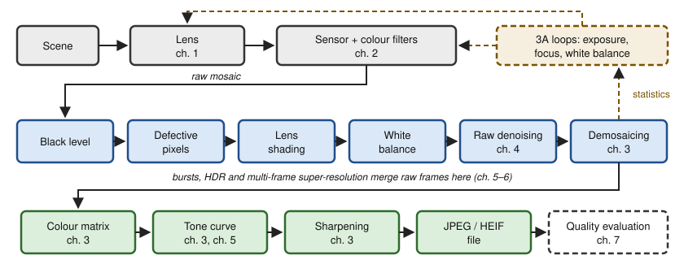

## Contents

-   [Introduction and overview](#intro)
-   [0. Review: sampling, photon counts and estimation](#ch0)
-   [1. Camera optics and the camera system](#ch1)
-   [2. The image sensor: from photons to raw values](#ch2)
-   [3. The image processing chain](#ch3)
-   [4. Denoising](#ch4)
-   [5. Computational photography: bursts and high dynamic range](#ch5)
-   [6. Super-resolution](#ch6)
-   [7. Image quality evaluation](#ch7)
-   [8. Artificial intelligence in processing and quality evaluation](#ch8)
-   [9. Research directions and open problems](#ch9)
-   [Exercises](#ex)
-   [Projects and assessment](#projects)
-   [References](#refs)

## Introduction and overview {#intro}

  -------------------- ------------------------------------------------------------------------------------------------------------------------------------------------------
  Module               The Machine Intelligence of Images
  Official title       The machine intelligence of images
  Instructors          F. GUICHARD, B. POCHON, W. HAUSER (master-mva.com, 2026–2027)
  Period               Semester 1 · period 1 (28/09/2026 – 08/01/2027)
  Credits and volume   5 ECTS · 30 h (lectures 12 h, labs 18 h) per the Université Paris-Saclay programme table
  Label                [Modelling]{.badge .label}[Track I&I]{.badge .track}
  Language             Lectures in French with slides in English; labs, presentations and evaluations may be handed in in English or French (master-mva.com)
  Assessment           “Evaluation Continue non Intégrale”, i.e. non-integral continuous assessment (Université Paris-Saclay); components and weights not displayed
  Prerequisites        Basics of image processing (master-mva.com)
  -------------------- ------------------------------------------------------------------------------------------------------------------------------------------------------

**Audience**: a student with a good M1 in applied mathematics, computer science or physics, who knows the basics of image processing and wants to understand what happens between the photons and the image file of a modern camera, and how its quality is measured.

**Empirical first**: photograph a dim room handheld with a phone. The picture is clean, yet a single raw frame of the same scene is grainy with shot noise: the phone silently merged a burst of frames. A camera can also score well on a sharpness chart while the grass of a landscape looks like watercolour, because its denoiser keeps edges and erases texture. Chapters 2, 5 and 7 explain both.

The course follows light from the lens to the file. It covers optics, the sensor and its noise, then the processing chain that turns a raw mosaic into a picture, the computational photography that compensates for tiny cameras, and the measurement of image quality, with the place of machine learning in each step. It sits next to [Mathematical Models for Digital Photography](../s1-digital-photography/index.html) and [Image Denoising: the Human–Machine Competition](../s1-image-denoising/index.html), taught in the same semester.

### What you will be able to do

-   Compute the light budget, diffraction limit and depth of field of a camera from its focal length, f-number and sensor size.
-   Explain why small cameras collect fewer photons, using the equivalence between sensor formats.
-   Model a raw pixel with the Poisson–Gaussian noise model and measure its parameters from a photon transfer curve.
-   Describe each block of an image processing chain, from black level to JPEG, and justify its position in the chain.
-   Analyse demosaicing in the Fourier domain and explain where false colours come from.
-   Implement and compare denoisers: Wiener filtering, wavelet shrinkage, non-local means and burst averaging.
-   Merge bracketed or burst exposures optimally and tone-map the result for a display.
-   Reconstruct a higher-resolution image from shifted frames and state when it is possible.
-   Measure sharpness with the slanted-edge method, texture with the dead leaves chart, and colour with CIELAB differences.
-   Design and criticise learned image processing and learned quality metrics, including how their training data is built.

### Official objectives and syllabus (2026–2027)

The course description on master-mva.com starts from an estimate of more than 5 billion photos taken per day in 2022. Cameras are everywhere and have reached unprecedented sophistication, notably in smartphones. The course is announced as a complete introduction to how cameras work and to their industrial ecosystem.

It follows the light from its entry through the lens to the production of an image file, describing current systems and the technical challenges of good performance. It shows how miniaturisation led to computational photography, with analytical algorithms or artificial intelligence. It covers the techniques used for this processing (denoising, high dynamic range, super-resolution) and for evaluating the quality of the images produced.

The page announces “18 h de cours + 9 h de TP” and lists as themes: camera operation, image processing chain, computational photography, denoising, image quality, and artificial intelligence in image processing and in image quality evaluation. The Université Paris-Saclay course detail displays no programme, only the type of assessment.

| Official topic (source) | Course section |
|---|---|
| How cameras work, from the light entering the lens to the image file (objective; theme “fonctionnement des caméras”) | [ch. 1](#ch1) optics, [ch. 2](#ch2) sensor, [ch. 3](#ch3) processing up to compression |
| The industrial ecosystem of cameras (objective) | [ch. 1](#ch1), “The camera module and its industrial ecosystem” |
| Current systems and the technical challenges of good performance (objective) | Proposition 1.3 and Example 1.7 (small sensors, diffraction), Example 2.4 (dynamic range), “The 3A loops” in ch. 3 |
| Image processing chain (theme “chaîne de traitement des images”) | [ch. 3](#ch3), boxes 3.1–3.12 and the code of the chapter |
| Miniaturisation and computational photography, with analytical algorithms or AI (objective; theme “photographie computationnelle”) | Proposition 1.3, [ch. 5](#ch5) bursts and HDR, [ch. 6](#ch6) multi-frame super-resolution, [ch. 8](#ch8) learned blocks |
| Denoising (objective; theme “débruitage”) | [ch. 4](#ch4) (variance stabilisation, Wiener, shrinkage, non-local means, BM3D, bursts, Tweedie); learned denoisers in [ch. 8](#ch8) |
| High dynamic range (objective) | [ch. 5](#ch5), Theorem 5.2 (merge), Proposition 5.4 (bursts), Proposition 5.6 and local operators (tone mapping) |
| Super-resolution (objective) | [ch. 6](#ch6), Proposition 6.2, Theorem 6.5 |
| Evaluation of the quality of the images produced (objective; theme “qualité image”) | [ch. 7](#ch7): SSIM, slanted edge, dead leaves, CIELAB, subjective tests |
| Artificial intelligence in image processing (theme) | [ch. 8](#ch8), Propositions 8.1–8.3 and learned pipeline blocks |
| Artificial intelligence in image quality evaluation (theme) | [ch. 8](#ch8), Definition 8.4 (LPIPS), no-reference metrics, Proposition 8.6 |
| “Les intervenants” (last item of the themes list) | Not a topic: a heading that introduces the three speakers named in the fiche |

Every official topic is taught on this page. Its extensions beyond the syllabus are the Fourier-optics derivation of the diffraction limit, the frequency analysis of demosaicing, Tweedie's formula, the perception–distortion trade-off, the statistical models of paired comparisons and a research chapter ([ch. 9](#ch9)).

### Where this course fits in the programme

The official prerequisite is the basics of image processing. The course is labelled Modelling and belongs to the I&I track; the speakers come from industry, F. Guichard and B. Pochon from DXOMARK and W. Hauser from DXO (master-mva.com).

-   **Refreshers** — [Probability and Statistics](../s0-refresher-probability-statistics/index.html) for Poisson counts and estimation, [Linear Algebra, Analysis and Optimization](../s0-refresher-linear-algebra-optimization/index.html) for least squares and the Fourier transform, [Scientific Python](../s0-refresher-python-scientific-computing/index.html) for the labs.
-   **Related courses in the same semester** — [Mathematical Models for Digital Photography](../s1-digital-photography/index.html), [Image Denoising](../s1-image-denoising/index.html), [Sub-Pixel Image Processing](../s1-sub-pixel-image-processing/index.html), [Deep Learning](../s1-deep-learning/index.html) and [Object Recognition and Computer Vision](../s1-object-recognition-cv/index.html).
-   **Courses that build on it in semester 2** — [Deep Learning for Image Restoration and Synthesis](../s2-dl-image-restoration-synthesis/index.html), [Inverse Problems and Imaging](../s2-inverse-problems-imaging/index.html), [Generative Models for Images](../s2-generative-models-images/index.html) and [Remote Sensing Data](../s2-remote-sensing/index.html), which follows another kind of sensor down to the data.

### Course outline

-   **Review: sampling, photon counts and estimation** — aliasing, Poisson statistics, PSNR and the minimum mean-square error estimator.
-   **Camera optics and the camera system** — exposure, equivalence between formats, diffraction and the MTF, aberrations, and the industry that builds camera modules.
-   **The image sensor** — the pixel model, the Poisson–Gaussian noise law, photon transfer, dynamic range and the colour filter array.
-   **The image processing chain** — raw corrections, white balance, demosaicing, colour, tone, sharpening, compression and the 3A loops.
-   **Denoising** — variance stabilisation, Wiener filtering, sparsity, non-local means, BM3D, bursts and Tweedie's formula.
-   **Computational photography** — optimal merging of exposures, burst photography, alignment and tone mapping.
-   **Super-resolution** — when shifted frames carry new information, how to invert the observation model, and the price of learned priors.
-   **Image quality evaluation** — full-reference metrics, MTF and texture measurement, colour differences and subjective tests.
-   **Artificial intelligence in processing and quality evaluation** — learned denoisers and pipelines, their training data, and learned quality metrics.
-   **Research directions and open problems** — generative restoration, self-supervision, new sensors and quality evaluation with large models (self-study).

### Session plan {#sessions}

**30 h in class = 10 sessions of 3 h.** The volume is the official one of the Université Paris-Saclay programme table (12 h of lectures and 18 h of labs); master-mva.com announces a different split, “18 h de cours + 9 h de TP”. The division into ten sessions, each mixing a lecture and a lab, is a proposal of these notes.

Level 1 = foundations, 2 = core methods, 3 = learned methods and recent research; the level never goes down from one session to the next.

| Session | Hours | Level | Content | Practice |
|---|---|---|---|---|
| 1 | 3 h | 1 | ch. 0 Review: sampling and aliasing, Poisson counts, PSNR, MMSE and Wiener shrinkage (0.1–0.8) | Ex. 1 (a, b); lab: code of ch. 0 |
| 2 | 3 h | 1 | ch. 1 Thin lens, camera equation, equivalence, PSF and MTF, diffraction, aberrations, the camera module and its ecosystem | Ex. 1 (c), 2, 3; lab: diffraction MTF at the pixel Nyquist frequency |
| 3 | 3 h | 1 | ch. 2 Pixel model, Poisson–Gaussian noise, photon transfer, dynamic range, binning and gain, colour filter array | Ex. 4, 10; lab: photon transfer curve |
| 4 | 3 h | 2 | ch. 3 first half: the chain, raw corrections, white balance, demosaicing (3.1–3.6) | Ex. 5, 9 |
| 5 | 3 h | 2 | ch. 3 second half: colour correction, tone curve, sharpening, compression, 3A loops (3.7–3.12) | Ex. 6, 11, 17; lab: a mini processing chain |
| 6 | 3 h | 2 | ch. 4 Denoising: variance stabilisation, Wiener, shrinkage, non-local means, BM3D, bursts, Tweedie | Ex. 12, 13; lab: non-local means |
| 7 | 3 h | 2 | ch. 5 Optimal exposure merging, bursts, alignment, tone mapping | Ex. 7, 14; lab: HDR merge |
| 8 | 3 h | 2 | ch. 6 Observation model, two-frame sampling theorem, regularised reconstruction, learned super-resolution | Ex. 15, 19; lab: shift-and-add |
| 9 | 3 h | 2 | ch. 7 SSIM, slanted-edge MTF, dead leaves texture, CIELAB, subjective tests | Ex. 8, 16, 18; lab: slanted edge |
| 10 | 3 h | 3 | ch. 8 Learned denoisers and pipelines, training data, Noise2Noise, learned quality metrics | Ex. 20; lab: Noise2Noise and blind noise estimation |

**Self-study, outside the 30 h** (about 3 h in total): ch. 9 Research directions and open problems (≈ 3 h).

### How to study this module

-   Read the chapters in order: each block of the processing chain is only understood once the noise model of ch. 2 is known.
-   Do the starred exercises of the Practice column right after the session; the ★★★ ones are project seeds.
-   Run every code block. They need NumPy, SciPy and scikit-learn only, use the two photographs bundled with scikit-learn, and finish in a few seconds on a laptop.
-   Keep a notebook of orders of magnitude: photons per pixel, stops of dynamic range, cycles per pixel. Most design decisions in a camera follow from them.

::: note
[Independent notes]{.tag} These notes reconstruct the official programme from its public description; they are not the instructors' material. Numbers in the examples are computed in the text or by the code, not taken from any product.
:::

## 0. Review: sampling, photon counts and estimation {#ch0}

A camera measures light with a grid of pixels and a finite number of photons. Two M1 tools explain most of what follows: sampling theory says what a grid of pixels can represent, and elementary probability says what a finite number of photons can tell. This chapter recalls both, with the estimation result on which every denoiser of the course is built.

::: def
[Definition 0.1 — Fourier transform and sampling]{.tag} For an integrable image $u : \mathbb{R}^2 \to \mathbb{R}$, the Fourier transform uses frequencies $\xi$ in cycles per unit length:
$$
\hat u(\xi) = \int_{\mathbb{R}^2} u(x)\, e^{-2i\pi \langle x, \xi \rangle}\, dx .
$$

Sampling on a square grid of step $p$ (the pixel pitch) keeps the values $u(pk)$, $k \in \mathbb{Z}^2$. The **Nyquist frequency** of the grid is $1/(2p)$ in each direction.
:::

:::: thm
[Theorem 0.2 — Poisson summation, aliasing and the sampling theorem]{.tag} If $\hat u$ decays fast enough, the spectrum of the samples is the periodisation of $\hat u$:
$$
\sum_{k \in \mathbb{Z}^2} u(pk)\, e^{-2i\pi p \langle k, \xi \rangle} \;=\; \frac{1}{p^2} \sum_{m \in \mathbb{Z}^2} \hat u\Big(\xi - \frac{m}{p}\Big).
$$

If $\hat u$ vanishes outside the square $|\xi_1|, |\xi_2| < 1/(2p)$, the copies do not overlap and $u$ is recovered exactly by sinc interpolation.

Otherwise a component at frequency $\xi$ is seen at $\xi - m/p$, inside the band: this is **aliasing**.

::: proof
1.  Sampling multiplies $u$ by the Dirac comb $\sum_k \delta(x - pk)$.
2.  The Fourier transform of this comb is the comb $p^{-2} \sum_m \delta(\xi - m/p)$, so the product becomes a convolution of spectra, which is the periodisation above.
3.  When the copies are disjoint, multiplying the periodised spectrum by the indicator of the band returns $\hat u$; in space this is a convolution with a product of sinc functions. [∎]{.qed}
:::
::::

A pixel is not a point: it integrates light over its area, and the lens blurs before that. Both act as low-pass filters before sampling ([ch. 1](#ch1)), which limits aliasing but never removes it completely.

::: ex
[Example 0.3 — Moiré on a fabric]{.tag} A cosine at 0.7 cycle per pixel is above the Nyquist frequency of 0.5 cycle per pixel. Its samples coincide with those of a cosine at $|0.7 - 1| = 0.3$ cycle per pixel, which the code below finds.

On a sensor of pitch 1.4 µm, the Nyquist frequency is
$$
\frac{1}{2 \times 1.4\ \mu\text{m}} \approx 357 \text{ cycles/mm},
$$
and a fine fabric pattern at 450 cycles/mm appears as a coarse moiré at $714 - 450 = 264$ cycles/mm.
:::

::: def
[Definition 0.4 — Poisson distribution]{.tag} Photons arrive independently in time. The number $N$ that hits a pixel during an exposure follows a Poisson law of mean $\lambda$:
$$
\mathbb{P}(N = n) = e^{-\lambda} \frac{\lambda^n}{n!}, \qquad n \in \mathbb{N}.
$$
:::

:::: prop
[Proposition 0.5 — Shot noise]{.tag} If $N \sim \mathcal{P}(\lambda)$, then $\mathbb{E} N = \operatorname{Var} N = \lambda$. A sum of independent Poisson variables is Poisson, with the sum of the means. The signal-to-noise ratio of a photon count is therefore

::: key
[Key result — the shot-noise law]{.tag}
$$
\mathrm{SNR} = \frac{\mathbb{E} N}{\sqrt{\operatorname{Var} N}} = \sqrt{\lambda}.
$$
:::

::: proof
1.  The generating function is $G(z) = \mathbb{E} z^N = e^{\lambda (z - 1)}$.
2.  Then $G'(1) = \lambda = \mathbb{E} N$ and $G''(1) = \lambda^2 = \mathbb{E}[N(N-1)]$, so $\operatorname{Var} N = G''(1) + G'(1) - G'(1)^2 = \lambda$.
3.  For independent counts the generating functions multiply, and $e^{\lambda_1 (z-1)} e^{\lambda_2 (z-1)}$ is the generating function of $\mathcal{P}(\lambda_1 + \lambda_2)$. [∎]{.qed}
:::

Quadrupling the light only doubles the SNR. Averaging $n$ independent frames divides the standard deviation by $\sqrt{n}$, which is the same law seen from the other side.
::::

::: def
[Definition 0.6 — MSE and PSNR]{.tag} For an estimate $\hat u$ of an image $u$ with $n$ pixels and peak value $P$ (1 for normalised images, 255 for 8-bit images):
$$
\mathrm{MSE} = \frac{1}{n} \sum_{i=1}^n (\hat u_i - u_i)^2, \qquad \mathrm{PSNR} = 10 \log_{10} \frac{P^2}{\mathrm{MSE}} \ \text{dB}.
$$

An 8-bit image with a root-mean-square error of 5 grey levels has a PSNR of $10 \log_{10}(255^2 / 25) \approx 34.15$ dB. Halving the error adds 6.02 dB.
:::

:::: thm
[Theorem 0.7 — The minimum mean-square error estimator]{.tag} Let $X$ be square-integrable and $Y$ an observation. Among all measurable functions $f$, the one that minimises $\mathbb{E}\|X - f(Y)\|^2$ is the conditional expectation:
$$
f^\star(Y) = \mathbb{E}[X \mid Y].
$$

If $X \sim \mathcal{N}(\mu, s^2)$ and $Y = X + B$ with independent noise $B \sim \mathcal{N}(0, \sigma^2)$, it is a linear **shrinkage** towards the mean:
$$
\mathbb{E}[X \mid Y] = \mu + \frac{s^2}{s^2 + \sigma^2}\,(Y - \mu), \qquad \mathrm{MMSE} = \frac{s^2 \sigma^2}{s^2 + \sigma^2}.
$$

::: proof
1.  Write $X - f(Y)$ as the sum of $X - \mathbb{E}[X \mid Y]$ and $\mathbb{E}[X \mid Y] - f(Y)$.
2.  The cross term has zero mean: conditionally on $Y$, the second factor is fixed and the first has zero mean.
3.  Hence the risk splits into two non-negative terms, and only the second depends on $f$:
    $$
    \mathbb{E}\|X - f(Y)\|^2 = \mathbb{E}\|X - \mathbb{E}[X \mid Y]\|^2 + \mathbb{E}\|\mathbb{E}[X \mid Y] - f(Y)\|^2 .
    $$
    It is minimal for $f = f^\star$.
4.  In the Gaussian case $(X, Y)$ is a Gaussian vector, so $\mathbb{E}[X \mid Y]$ is affine in $Y$. Its slope is $\operatorname{Cov}(X, Y) / \operatorname{Var} Y$, which equals $s^2 / (s^2 + \sigma^2)$, and the residual variance is $s^2 - s^4/(s^2 + \sigma^2)$. [∎]{.qed}
:::
::::

::: ex
[Example 0.8 — Shrinking a noisy pixel]{.tag} Take a pixel with prior variance $s^2 = 0.04$ and noise variance $\sigma^2 = 0.01$. The optimal estimate keeps 80 % of the deviation from the mean, and its error is lower than that of the raw observation:
$$
\frac{s^2}{s^2 + \sigma^2} = 0.8, \qquad \mathrm{MMSE} = 0.008 < 0.01 .
$$

The weaker the prior variance relative to the noise, the stronger the shrinkage. Every denoiser of [ch. 4](#ch4) is an approximation of $\mathbb{E}[X \mid Y]$ under a richer prior.
:::

The following code checks the shot-noise law, the $\sqrt{n}$ gain of averaging and the aliasing of Example 0.3.

```python
import numpy as np

rng = np.random.default_rng(0)

# 1) Shot noise: a Poisson count with mean lam has SNR = sqrt(lam)
for lam in [4, 100, 2500]:
    x = rng.poisson(lam, size=200_000)
    print(f"lam={lam:5d}  mean={x.mean():8.2f}  var={x.var():8.2f}  "
          f"SNR={x.mean()/x.std():6.2f}  sqrt(lam)={np.sqrt(lam):6.2f}")

# 2) Averaging N independent frames divides the noise std by sqrt(N)
frames = rng.poisson(100, size=(16, 100_000)).astype(float)
for N in [1, 4, 16]:
    print(f"N={N:2d}  std of the mean = {frames[:N].mean(0).std():.3f}"
          f"  (theory {10/np.sqrt(N):.3f})")

# 3) Aliasing: a cosine at 0.7 cycle/sample is seen at |0.7 - 1| = 0.3
n = np.arange(100)
x = np.cos(2 * np.pi * 0.7 * n)
spec = np.abs(np.fft.rfft(x))
print("apparent frequency:", np.fft.rfftfreq(100)[spec.argmax()], "cycle/sample")
```

The run prints an SNR of 2.00, 9.99 and 50.00 for means 4, 100 and 2500, standard deviations close to 10, 5 and 2.5, and an apparent frequency of 0.3.

:::: recap
::: recap-title
Key takeaways — chapter 0
:::

-   A grid of step $p$ represents frequencies up to $1/(2p)$; higher ones alias.
-   A photon count is Poisson: variance equals mean, SNR is its square root.
-   PSNR is a logarithmic MSE; 6 dB is a factor 2 on the error.
-   The MMSE estimator is the conditional expectation; under a Gaussian prior, a linear shrinkage.
::::

## 1. Camera optics and the camera system {#ch1}

The lens and the size of the camera decide how much light reaches each pixel and how sharp the image can be. This chapter derives these limits, shows why miniaturisation made computational photography necessary, and describes the industry that builds and tests camera modules.

### Exposure and the size of the camera

::: def
[Definition 1.1 — Thin lens, f-number, field of view]{.tag} A thin lens of focal length $f$ images a point at distance $s$ onto a point at distance $s'$ behind it, with
$$
\frac{1}{s} + \frac{1}{s'} = \frac{1}{f}.
$$

The **entrance pupil** is the apparent aperture, of diameter $D$. The **f-number** is $N = f / D$.

A sensor of diagonal $d$ focused at infinity sees a diagonal **field of view** $2 \arctan\big(d / (2f)\big)$.
:::

:::: prop
[Proposition 1.2 — The camera equation]{.tag} Let a distant scene patch of radiance $L$ be imaged on the optical axis by a lens of transmission $T$. The irradiance on the sensor is
$$
E = \frac{\pi L T}{4 N^2}.
$$

Off axis, at an angle $\theta$, it falls as $\cos^4 \theta$: this is natural vignetting.

::: proof
1.  A scene patch of area $A$ at distance $s$ sees the pupil under the solid angle $\pi D^2 / (4 s^2)$, so the lens collects the power $L A T \pi D^2 / (4 s^2)$.
2.  For a distant scene $s' \approx f$, and the patch is imaged on an area $A (f/s)^2$.
3.  Dividing gives $E = \pi L T D^2 / (4 f^2) = \pi L T / (4 N^2)$.
4.  Off axis, the pupil is seen foreshortened (one factor $\cos\theta$), the distance to it grows (two factors) and the light hits the sensor obliquely (one more factor). [∎]{.qed}
:::

The exposure is $H = E\, t$: it scales as $t / N^2$. One **stop** is a factor 2, which is why f-numbers progress by $\sqrt 2$: 1.4, 2, 2.8, 4.
::::

The f-number fixes the irradiance, but not the number of photons collected by the whole sensor. That number is what limits noise ([ch. 2](#ch2)), and it depends on the physical size of the camera.

:::: prop
[Proposition 1.3 — Equivalence between sensor formats]{.tag} Consider two cameras with the same field of view and exposure time. The second is the first scaled by $k$: sensor diagonal $k d$, focal length $k f$, f-number $k N$. Then:

1.  both have the same entrance pupil diameter $D$;
2.  both collect the same total number of photons from the scene;
3.  both have the same depth of field and the same diffraction blur, measured relative to the image size.

::: key
[Key result — the photon budget of a camera]{.tag}
$$
\Phi_{\text{sensor}} \;\propto\; L\, t\, \Big(\frac{d}{f}\Big)^{2} D^{2}
$$
:::

::: proof
1.  $D = f / N = k f / (k N)$.
2.  The total power is the irradiance of Proposition 1.2 times the sensor area. It is proportional to $d^2 / N^2 = (d / f)^2 D^2$, and $d / f$ is fixed by the field of view.
3.  For a lens focused at distance $s_0$, a point at distance $s$ is spread on the sensor over a disc of diameter close to $D f\, |1/s - 1/s_0|$. Divided by the image size $d$, this depends only on $D$, $f/d$ and the distances.
4.  The diffraction spot has diameter $2.44\, \lambda N$ (Theorem 1.6); relative to $d$ it scales as $N / d$, unchanged by the scaling. [∎]{.qed}
:::
::::

::: ex
[Example 1.4 — A phone camera and its full-frame equivalent]{.tag} Take a phone sensor of diagonal 12 mm behind a lens of focal length 6.5 mm at f/1.8. A full-frame sensor has a diagonal of 43.3 mm, so the scale factor is $k = 43.3 / 12 \approx 3.6$.

-   The same field of view needs a 23.4 mm lens on full frame.
-   At equal photon count and depth of field, the full-frame camera would work at f/6.5.
-   At the same f/1.8, its pupil is 13.0 mm wide against 3.6 mm for the phone, so it collects $k^2 \approx 13$ times more light, about 3.7 stops.
-   In the shot-noise regime the phone loses a factor $k \approx 3.6$ in SNR.

The hyperfocal distance $f^2 / (N c)$, beyond which everything is sharp, also scales with $k$. With the usual circle of confusion $c$ equal to the diagonal divided by 1500, it is about 2.9 m for the phone and 10.6 m for the full-frame camera at f/1.8.
:::

### Blur: PSF, MTF and diffraction

::: def
[Definition 1.5 — PSF, OTF, MTF]{.tag} In a region where the blur does not depend on the position, the irradiance on the sensor is the ideal image convolved with the **point spread function** $h$, normalised to $\int h = 1$.

Its Fourier transform $\hat h$ is the **optical transfer function** (OTF). Its modulus is the **modulation transfer function**: a sinusoidal pattern of contrast $C$ and frequency $\xi$ is imaged with contrast $\mathrm{MTF}(\xi)\, C$.

The MTFs of the elements in a chain multiply: lens, pixel aperture, processing.
:::

:::: thm
[Theorem 1.6 — Diffraction-limited MTF of a circular pupil]{.tag} For an aberration-free lens of f-number $N$ in incoherent light of wavelength $\lambda$, set $\nu_c = 1 / (\lambda N)$. For a radial frequency $\nu \le \nu_c$, with $u = \nu / \nu_c$,
$$
\mathrm{MTF}(\nu) = \frac{2}{\pi} \Big( \arccos u - u \sqrt{1 - u^2} \Big),
$$
and $\mathrm{MTF}(\nu) = 0$ beyond the cut-off $\nu_c$. The PSF is the Airy pattern; its first dark ring has radius $1.22\, \lambda N$.

::: proof
1.  In Fourier optics, the coherent transfer function is the pupil function rescaled to frequencies: a disc of radius $R = 1 / (2 \lambda N)$ (Goodman, ch. 6).
2.  The incoherent PSF is the squared modulus of the coherent one, so the OTF is the autocorrelation of the pupil disc, normalised to 1 at the origin.
3.  Two discs of radius $R$ whose centres are $r = 2Ru$ apart overlap on the area $2R^2 (\arccos u - u\sqrt{1 - u^2})$. Dividing by the area $\pi R^2$ gives the formula.
4.  The discs stop overlapping when $r = 2R$, that is at $\nu = 1/(\lambda N)$. [∎]{.qed}
:::
::::

::: ex
[Example 1.7 — Small pixels are diffraction-limited]{.tag} At $\lambda = 550$ nm and f/1.8, the Airy disc measures 2.42 µm across and the cut-off is about 1010 cycles/mm. The code below evaluates the MTF at the Nyquist frequency of three pixel pitches.

-   With 0.8 µm pixels (Nyquist 625 cycles/mm), the MTF is 0.27 at f/1.8 and 0.01 at f/2.8.
-   With 1.4 µm pixels it is 0.56 at f/1.8.
-   With 4 µm pixels it stays above 0.3 even at f/8.

A smaller pixel only adds detail if the lens can deliver it, which pushes small cameras to large apertures.
:::

```python
import numpy as np

def mtf_diffraction(nu, lam_mm, N):
    """Incoherent MTF of an aberration-free circular pupil (Theorem 1.6)."""
    s = np.clip(nu * lam_mm * N, 0, 1)          # nu / nu_c with nu_c = 1/(lam N)
    return (2 / np.pi) * (np.arccos(s) - s * np.sqrt(1 - s**2))

lam = 550e-6                                     # wavelength in mm (550 nm)
for N in [1.8, 2.8, 8.0]:
    airy_um = 2.44 * lam * N * 1e3               # first-zero diameter, micrometres
    row = [f"N={N:3.1f}: Airy diameter {airy_um:5.2f} um |"]
    for pitch_um in [0.8, 1.4, 4.0]:
        nyq = 1 / (2 * pitch_um * 1e-3)          # Nyquist frequency, cycles/mm
        row.append(f" p={pitch_um} um: MTF(Nyquist)={mtf_diffraction(nyq, lam, N):.2f}")
    print("".join(row))
```

### Aberrations and their digital correction

Real lenses deviate from the ideal. Phone lenses are stacks of aspheric plastic elements, designed together with the processing that corrects their residual defects ([ch. 3](#ch3)).

::: def
[Definition 1.8 — The main aberrations seen by the pipeline]{.tag}

-   **Distortion**: a point at distance $r$ from the image centre is imaged at $r_d = r\,(1 + k_1 r^2 + k_2 r^4)$; barrel distortion has $k_1 < 0$. Correction resamples the image.
-   **Lateral chromatic aberration**: the magnification depends on the wavelength, giving colour fringes towards the corners; it is corrected by rescaling the red and blue planes.
-   **Lens shading**: vignetting, the $\cos^4$ law and the pixel micro-lenses darken the corners, differently per colour; a calibrated gain map undoes it.
-   **Field-dependent blur**: the PSF widens off axis and with defocus; deconvolution and sharpening compensate partially.
:::

### The camera module and its industrial ecosystem

A phone camera module packs a lens stack, an autofocus actuator, often an optical image stabiliser, an infrared-cut filter and a CMOS sensor with its colour filters and micro-lenses. A phone carries several modules (ultra-wide, wide, telephoto), sometimes with folded optics to fit a longer focal length in a thin body.

-   **Component makers** design sensors and lenses; module integrators assemble and calibrate them.
-   **System-on-chip vendors** provide the image signal processor (ISP), dedicated hardware that runs the processing chain of [ch. 3](#ch3) in real time, and neural accelerators for [ch. 8](#ch8).
-   **Device makers** choose the modules, tune the processing and write the computational photography software of [ch. 5](#ch5) and [ch. 6](#ch6).
-   **Test laboratories and tool makers** measure image quality with charts, lighting rigs and software ([ch. 7](#ch7)).

Standards make measurements comparable: ISO 12233 (resolution and spatial frequency response), ISO 15739 (noise), ISO 14524 (opto-electronic conversion function), EMVA 1288 (characterisation of sensors) and IEEE 1858 (Camera Phone Image Quality).

The technical challenges follow from Proposition 1.3 and Theorem 1.6: the thickness of a phone limits the focal length, hence the sensor and the pupil; pixels approach the diffraction limit; processing must fit the power and latency budget of a shutter press; and the modules of one phone must match in colour and exposure.

:::: recap
::: recap-title
Key takeaways — chapter 1
:::

-   Irradiance scales as $1/N^2$; the photon budget of the sensor scales as the pupil area $D^2$.
-   A camera scaled down by $k$ loses $k^2$ in light and $k$ in shot-noise SNR.
-   Diffraction cuts frequencies above $1/(\lambda N)$: sub-micron pixels outresolve the lens.
-   Aberrations are corrected digitally: a camera is optics plus computation.
::::

## 2. The image sensor: from photons to raw values {#ch2}

The sensor converts photons into numbers. Its noise model, derived here from first principles, is the input of every algorithm in the rest of the course: white balance, demosaicing, denoising and exposure merging all depend on it.

::: def
[Definition 2.1 — Pixel model]{.tag} During an exposure of duration $t$, a pixel receives a Poisson number of photons of mean $\phi t$.

-   Each photon frees an electron with probability $\eta$, the **quantum efficiency**.
-   The pixel stores at most $C$ electrons, its **full-well capacity**.
-   Reading the charge adds a Gaussian **read noise** $n_r \sim \mathcal{N}(0, \sigma_r^2)$, in electrons.
-   An amplifier of **conversion gain** $K$ (digital numbers per electron) and an analogue-to-digital converter produce an integer, shifted by a **black level** $b$.

The raw value is therefore
$$
y = \mathrm{round}\big(K \min(e + n_r,\, C)\big) + b, \qquad e \sim \mathcal{P}(\eta \phi t).
$$
:::

:::: prop
[Proposition 2.2 — Poisson–Gaussian noise and the photon transfer curve]{.tag} Below saturation, and neglecting dark current, let $\mu = \mathbb{E} y - b$ be the mean signal in digital numbers. Then the variance is affine in the mean:
$$
\operatorname{Var} y = K \mu + K^2 \sigma_r^2 + \tfrac{1}{12}.
$$

Raw noise is **heteroscedastic**: bright pixels are noisier in absolute terms, darker ones in relative terms. Written as $\operatorname{Var} y = a \mu + b'$, this is the model fitted on raw images by Foi et al. (2008).

::: proof
1.  *Thinning.* If $N \sim \mathcal{P}(\lambda)$ photons each survive with probability $\eta$, the survivors have generating function $\mathbb{E}(1 - \eta + \eta z)^N = e^{\eta \lambda (z - 1)}$: they are $\mathcal{P}(\eta\lambda)$.
2.  *Independence.* Shot noise and read noise are independent, so $\mathrm{Var}\, K(e + n_r) = K^2 (\mathbb{E} e + \sigma_r^2)$, and $K\, \mathbb{E} e = \mu$.
3.  *Quantisation.* Rounding to the nearest integer adds an error that is close to uniform on $[-1/2, 1/2]$ and independent of the signal; its variance is $\int_{-1/2}^{1/2} x^2\, dx = 1/12$. [∎]{.qed}
:::
::::

Plotting the variance of flat-field images against their mean gives a straight line: the **photon transfer curve** (Janesick, 2007). Its slope is the conversion gain $K$ and its intercept gives the read noise. Using the difference of two frames of the same flat field removes fixed-pattern noise, which is identical in both: $\operatorname{Var}(y_1 - y_2) / 2$ estimates the temporal noise alone.

::: def
[Definition 2.3 — Signal-to-noise ratio and dynamic range]{.tag} For a signal of $e$ electrons, the signal-to-noise ratio and the engineering dynamic range are

::: key
[Key result — SNR of a pixel]{.tag}
$$
\mathrm{SNR}(e) = \frac{e}{\sqrt{e + \sigma_r^2}}, \qquad \mathrm{DR} = \frac{C}{\sigma_r}.
$$
:::

The dynamic range is given in stops ($\log_2 \mathrm{DR}$) or in decibels ($20 \log_{10} \mathrm{DR}$). At high signal the SNR follows the shot-noise law $\sqrt{e}$; at low signal the read noise dominates and the SNR is close to $e / \sigma_r$.
:::

::: ex
[Example 2.4 — A noise budget]{.tag} Take a pixel with full well $C = 6000$ electrons, read noise $\sigma_r = 2.5$ electrons and conversion gain $K = 0.5$ DN per electron on a 12-bit converter.

-   Dynamic range: $\log_2(6000 / 2.5) \approx 11.23$ stops, or 67.6 dB.
-   Best SNR, at full well: $\sqrt{6000} \approx 77.5$, or 37.8 dB.
-   At 100 electrons: $100 / \sqrt{106.25} \approx 9.7$. At 10 electrons: $10 / \sqrt{16.25} \approx 2.5$, where the read-noise variance (6.25) is already comparable to the shot-noise variance (10).
-   One digital number is 2 electrons, so quantisation adds a standard deviation of $2 / \sqrt{12} \approx 0.58$ electron, negligible next to the read noise.

A sunlit scene with deep shadows easily spans more than 11 stops: this is the problem of [ch. 5](#ch5).
:::

:::: prop
[Proposition 2.5 — Binning]{.tag} Summing the values of four pixels that each hold $e$ electrons multiplies the SNR by exactly 2:
$$
\mathrm{SNR}_{\text{binned}} = \frac{4e}{\sqrt{4e + 4\sigma_r^2}} = 2\, \mathrm{SNR}(e).
$$

If the charges are summed before reading, the read noise is counted once instead of four times, which helps in low light.

::: proof
The four shot noises and the four read noises are independent, so their variances add: $4e + 4\sigma_r^2$. Summing charges before readout leaves $4e + \sigma_r^2$. [∎]{.qed}
:::

At equal sensor area, many small pixels that are later binned collect the same photons as fewer large pixels. They only differ by read noise and by the resolution available in good light, which is why some phone sensors group pixels by four under the same colour filter.
::::

**Gain and ISO.** The ISO setting of a camera is a gain: analogue gain raises $K$ before the converter, which reduces the relative weight of quantisation and of noise added after the amplifier. It adds no photons. Shot noise is fixed by the exposure, that is by $t$ and the pupil, never by the gain.

**Fixed-pattern noise and other defects.** Pixels differ slightly in gain (photo-response non-uniformity, proportional to the signal) and in offset (dark signal non-uniformity). Some pixels are defective, stuck bright or dark. Dark current adds thermally generated electrons, growing with exposure time and temperature. Finally, most CMOS sensors expose rows one after the other (rolling shutter), which skews fast-moving objects.

::: def
[Definition 2.6 — Colour filter array]{.tag} Each pixel carries one colour filter of spectral sensitivity $S_c(\lambda)$, $c \in \{R, G, B\}$, and records
$$
y_c \propto \int S_c(\lambda)\, \Phi(\lambda)\, d\lambda .
$$

The **Bayer pattern** (Bayer, 1976) tiles the sensor with $2 \times 2$ blocks of one red, two green and one blue filter; green is doubled because it carries most of the luminance. Raw colour values depend on the filters of the camera, not on a standard colour space.
:::

The code below simulates pairs of flat-field frames with the model of Definition 2.1 and recovers the conversion gain and the read noise from the photon transfer curve.

```python
import numpy as np

rng = np.random.default_rng(1)
K, sigma_r, black, fwc = 0.5, 2.5, 64, 6000      # DN/e-, e-, DN, e-  (12-bit raw)

def raw_frame(mean_e, shape=(200, 200)):
    """One flat-field raw frame: Poisson shot noise + Gaussian read noise, quantised."""
    e = rng.poisson(mean_e, shape) + rng.normal(0, sigma_r, shape)
    return np.clip(np.round(K * np.minimum(e, fwc) + black), 0, 4095)

means, variances = [], []
for mean_e in np.geomspace(5, 4000, 12):
    a, b = raw_frame(mean_e), raw_frame(mean_e)
    means.append(0.5 * (a.mean() + b.mean()) - black)
    variances.append(np.var(a - b) / 2)          # the difference removes fixed patterns

means, variances = np.array(means), np.array(variances)
# Var = K * mean + K^2 sigma_r^2 + 1/12 ; weights 1/Var because the error on a variance grows with it
slope, intercept = np.polyfit(means, variances, 1, w=1 / variances)
K_hat = slope
sigma_r_hat = np.sqrt(max(intercept - 1 / 12, 0)) / K_hat
print(f"conversion gain K = {K_hat:.3f} DN/e-   (true {K})")
print(f"read noise        = {sigma_r_hat:.2f} e-      (true {sigma_r})")
print(f"dynamic range     = {np.log2(fwc / sigma_r_hat):.2f} stops "
      f"= {20 * np.log10(fwc / sigma_r_hat):.1f} dB")
```

The fit returns $K = 0.500$ DN per electron and a read noise of 2.50 electrons, hence the 11.23 stops of Example 2.4. The weights matter: an unweighted fit is dominated by the brightest frames and overestimates the read noise.

:::: recap
::: recap-title
Key takeaways — chapter 2
:::

-   A raw value is a thinned Poisson count plus Gaussian read noise, amplified, quantised and offset.
-   Its variance is affine in its mean; the photon transfer curve measures gain and read noise.
-   Dynamic range is full well over read noise; gain adds no photons; binning trades resolution for SNR.
::::

## 3. The image processing chain {#ch3}

The raw mosaic has one colour per pixel, an offset, a colour cast and linear values. The image signal processor (ISP) turns it into a compressed file in a few tens of milliseconds; this chapter justifies each block and its place.

{width="100%" fig-alt="Block diagram: lens and sensor, then black level, defective pixels, lens shading, white balance, raw denoising, demosaicing, colour matrix, tone curve, sharpening and compression, with auto-exposure, autofocus and auto white balance loops back to the capture."}

The order of the blocks follows one rule: work in raw while the noise model of [ch. 2](#ch2) still holds. Every block that mixes pixels or channels (demosaicing, colour matrix, tone curve) makes the noise correlated and harder to model. A classical survey of the chain is Ramanath et al. (2005).

### Raw corrections

The **black level** is measured on masked pixels at the border of the sensor and subtracted. **Defective pixels** are detected as outliers relative to the median of their same-colour neighbours and replaced by it. **Lens shading** is undone by multiplying each channel by a gain map calibrated on a uniform target. This gain also multiplies the noise: a corner that receives one stop less light gets a gain of 2, and its SNR stays below that of the centre, by a factor $\sqrt 2$ in the shot-noise regime and 2 when read noise dominates.

### White balance

::: def
[Definition 3.1 — Diagonal model of illumination]{.tag} Under an illuminant, the raw value of a surface in channel $c$ is approximately $\ell_c\, \rho_c$, where $\rho_c$ is the response under a white light (von Kries). White balance multiplies channel $c$ by the gain
$$
g_c = \ell_G / \ell_c ,
$$
so that grey surfaces get equal values in the three channels.
:::

:::: prop
[Proposition 3.2 — The grey-world estimator]{.tag} If the average response of the scene under white light is achromatic ($\bar\rho_R = \bar\rho_G = \bar\rho_B$), then the gains computed from the channel means of the image are exact:
$$
\hat g_c = \frac{\overline{y_G}}{\overline{y_c}} = \frac{\ell_G}{\ell_c}.
$$

::: proof
Under the diagonal model, $\overline{y_c} = \ell_c\, \bar\rho_c = \ell_c\, \bar\rho$, so the common factor $\bar\rho$ cancels in the ratio. [∎]{.qed}
:::

The *white-patch* estimator uses the brightest values instead of the means, assuming that the brightest surface is white. The *grey-edge* estimator assumes that the average gradient is achromatic (van de Weijer et al., 2007).
::::

::: ex
[Example 3.3 — When grey world fails]{.tag} Channel means $(0.12, 0.20, 0.15)$ give the gains $(1.67, 1, 1.33)$.

Now photograph a lawn under neutral light: the means are $(0.08, 0.20, 0.06)$ because the scene really is green. Grey world returns the gains $(2.5, 1, 3.33)$ and paints the scene magenta.

The assumption, not the algorithm, failed. Learned estimators ([ch. 8](#ch8)) replace it by statistics of many scenes.
:::

### Demosaicing

::: def
[Definition 3.4 — Bayer sampling masks]{.tag} Put red at even rows and even columns, blue at odd rows and odd columns, green elsewhere. With pixel coordinates $(x, y)$, the masks are
$$
m_R = \tfrac{1}{4}(1 + (-1)^x)(1 + (-1)^y), \qquad m_B = \tfrac{1}{4}(1 - (-1)^x)(1 - (-1)^y),
$$
and $m_G = 1 - m_R - m_B = \frac{1}{2}(1 - (-1)^{x+y})$. The mosaic is $m = R\, m_R + G\, m_G + B\, m_B$.
:::

:::: prop
[Proposition 3.5 — Spectrum of the mosaic]{.tag} With the luminance $L = (R + 2G + B)/4$ and the two chrominances $C_1 = (R - 2G + B)/4$ and $C_2 = (R - B)/4$, the mosaic is
$$
m = L + C_1\, (-1)^{x+y} + C_2\, \big[(-1)^x + (-1)^y\big].
$$

In the Fourier domain, the luminance stays at the centre of the spectrum, $C_1$ is moved to the corner frequency $(\tfrac12, \tfrac12)$, and $C_2$ to $(\tfrac12, 0)$ and $(0, \tfrac12)$ (Alleysson, Süsstrunk and Hérault, 2005).

::: proof
1.  Expand the masks: $m_R$ and $m_B$ are $\frac14 \big(1 \pm (-1)^x \pm (-1)^y + (-1)^{x+y}\big)$ with the signs $+$ and $-$ respectively.
2.  In $R\, m_R + G\, m_G + B\, m_B$, collect the constant terms, the terms in $(-1)^{x+y}$ and the terms in $(-1)^x + (-1)^y$: their coefficients are the luminance and the two chrominances.
3.  Check: at a red site the three terms sum to $\frac{R + B}{2} + \frac{R - B}{2} = R$; at a green site the last term vanishes and $L - C_1 = G$.
4.  Multiplying by $(-1)^x = e^{i\pi x}$ shifts the spectrum by half a cycle per pixel. [∎]{.qed}
:::

Natural images have smooth chrominance and detailed luminance. When the luminance has energy near $(\tfrac12, 0)$, for instance fine vertical stripes, it is mistaken for chrominance: these are the **false colours** of demosaicing.
::::

:::: prop
[Proposition 3.6 — Bilinear demosaicing as low-pass filtering]{.tag} Bilinear demosaicing convolves each zero-filled channel with a kernel:
$$
k_G = \frac14 \begin{pmatrix} 0 & 1 & 0 \\ 1 & 4 & 1 \\ 0 & 1 & 0 \end{pmatrix}, \qquad k_{RB} = \frac14 \begin{pmatrix} 1 & 2 & 1 \\ 2 & 4 & 2 \\ 1 & 2 & 1 \end{pmatrix}.
$$

Their frequency responses vanish exactly at the centres of the modulated copies of Proposition 3.5.

::: proof
1.  The response of $k_G$ is $1 + \frac12(\cos 2\pi\xi_1 + \cos 2\pi\xi_2)$: it equals 2 at the origin and 0 at $(\tfrac12, \tfrac12)$.
2.  The zero-filled green channel is $G\, m_G$: half of $G$ at the origin and a copy at $(\tfrac12, \tfrac12)$. The gain 2 restores $G$, the zero removes the centre of the copy.
3.  $k_{RB}$ is separable, with response $(1 + \cos 2\pi\xi_1)(1 + \cos 2\pi\xi_2)$: it equals 4 at the origin, compensating the density $\frac14$ of the red sites, and vanishes when $\xi_1 = \frac12$ or $\xi_2 = \frac12$. [∎]{.qed}
:::

The filters also attenuate the true high frequencies of the image, so bilinear demosaicing blurs and leaves colour fringes at edges.
::::

Better methods exploit the correlation between channels: gradient-corrected interpolation adds a scaled Laplacian of the known channel (Malvar, He and Cutler, 2004), edge-directed methods interpolate along edges, and networks demosaic and denoise jointly ([ch. 8](#ch8)).

### Colour correction

::: def
[Definition 3.7 — Colour spaces and the colour correction matrix]{.tag} The CIE 1931 XYZ space describes colours through the colour matching functions of a standard observer. Displays use linear sRGB, a fixed linear transform of XYZ with D65 white.

After white balance, a $3 \times 3$ **colour correction matrix** $M$ maps camera RGB to linear sRGB. The map is exact for all spectra only if the camera sensitivities are linear combinations of the colour matching functions (the Luther condition), which never holds exactly.
:::

:::: prop
[Proposition 3.8 — Least-squares colour matrix that keeps white]{.tag} Measure $n$ chart patches: camera values $\mathbf{C} \in \mathbb{R}^{n \times 3}$ of rank 3 and targets $t_i \in \mathbb{R}^n$ for output channel $i$. Write $G = \mathbf{C}^\top \mathbf{C}$ and $m_i^{\text{LS}} = G^{-1} \mathbf{C}^\top t_i$.

The row $m_i$ of $M$ that minimises $\|\mathbf{C} m_i - t_i\|^2$ subject to $\mathbf{1}^\top m_i = 1$, so that white stays white, is
$$
m_i = m_i^{\text{LS}} + \frac{1 - \mathbf{1}^\top m_i^{\text{LS}}}{\mathbf{1}^\top G^{-1} \mathbf{1}}\; G^{-1} \mathbf{1}.
$$

::: proof
1.  The Lagrangian condition is $G m_i - \mathbf{C}^\top t_i + \nu \mathbf{1} = 0$, so $m_i = m_i^{\text{LS}} - \nu\, G^{-1}\mathbf{1}$.
2.  The constraint $\mathbf{1}^\top m_i = 1$ fixes $\nu$ to the value that gives the formula.
3.  The problem is a convex quadratic with a linear constraint, so this stationary point is its minimum. [∎]{.qed}
:::
::::

::: ex
[Example 3.9 — The colour matrix amplifies noise]{.tag} If the noise after white balance is white with covariance $\sigma^2 I$, the output noise has covariance $\sigma^2 M M^\top$.

A typical row $(1.6, -0.4, -0.2)$ sums to 1, as required, but has norm
$$
\sqrt{1.6^2 + 0.4^2 + 0.2^2} \approx 1.66 ,
$$
a noise gain of 4.4 dB. Sensors with strongly overlapping colour filters need larger negative coefficients, hence more noise. This is one more reason to denoise before this block.
:::

### Tone curve, sharpening and compression

::: def
[Definition 3.10 — The sRGB transfer function]{.tag} Linear values $x \in [0, 1]$ are encoded before quantisation to 8 bits by
$$
v(x) = \begin{cases} 12.92\, x & x \le 0.0031308, \\ 1.055\, x^{1/2.4} - 0.055 & \text{otherwise.} \end{cases}
$$

Perceived lightness grows roughly like a cube root of luminance, so this curve spends the 256 codes on steps of nearly equal visibility. A mid-grey of 18 % reflectance is encoded as $v(0.18) \approx 0.461$, code 118.
:::

On top of this standard curve, cameras apply a tone curve, often an S-shaped one that adds contrast, or a local tone mapping ([ch. 5](#ch5)).

**Sharpening** by unsharp masking adds back a multiple of the high frequencies:
$$
u + \alpha\, (u - G_\sigma * u), \qquad \text{response } 1 + \alpha\big(1 - e^{-2\pi^2 \sigma^2 |\xi|^2}\big).
$$
It raises the MTF at mid frequencies, but also overshoots at edges (halos) and amplifies noise, so it is applied on luminance and modulated by the local content.

**Compression.** JPEG (Wallace, 1991) converts to a luminance and two chrominance channels, usually subsamples the chrominance by 2 in each direction (consistent with Proposition 3.5: the eye, like the Bayer pattern, gives chrominance less bandwidth), and quantises the coefficients of an $8 \times 8$ discrete cosine transform. Recent phones also use HEIF, built on video intra coding.

:::: prop
[Proposition 3.11 — Error of transform quantisation]{.tag} Let the $8 \times 8$ DCT be orthonormal and coefficient $k$ be quantised with step $Q_k$. In the fine-quantisation regime, where each error is uniform on $[-Q_k/2, Q_k/2]$, the mean squared error per pixel is
$$
\mathrm{MSE} \approx \frac{1}{64} \sum_{k=1}^{64} \frac{Q_k^2}{12}.
$$

::: proof
An orthonormal transform preserves the Euclidean norm (Parseval), so the squared error of the block equals the sum of the squared coefficient errors. Each has variance $Q_k^2 / 12$ (as in Proposition 2.2); divide by the 64 pixels. [∎]{.qed}
:::

Coefficients smaller than $Q_k / 2$ are set to zero, which removes fine texture and creates blocking and ringing at low quality.
::::

### The 3A loops

Three control loops run on statistics computed by the ISP before each capture.

-   **Auto-exposure** chooses the exposure time and gain so that a weighted mean of the image reaches a target while limiting clipping. For a linear sensor without clipping, the update $t_{k+1} = t_k \cdot \text{target} / \text{measured}$ converges in one step.
-   **Contrast autofocus** moves the lens to maximise a sharpness measure such as the energy of the gradient, by hill climbing. It is slow because each step needs a frame.
-   **Auto white balance** estimates the illuminant as above.

:::: prop
[Proposition 3.12 — Phase-detection autofocus]{.tag} Some pixels see only the left or only the right half of the pupil. For a defocused point, the two half-pupil images are half discs of the blur disc of diameter $b$ (Proposition 1.3). Their centroids are separated by
$$
\Delta = \frac{4}{3\pi}\, b \approx 0.42\, b ,
$$
with a sign that tells on which side of the focus the object lies.

::: proof
In geometric optics, the defocus blur is the pupil projected on the sensor at scale $b / D$. Rays through the left half of the pupil land on one half of that disc. The centroid of a half disc of radius $\rho$ is at distance $4\rho/(3\pi)$ from its centre, so the two centroids are $8\rho/(3\pi)$ apart, with $\rho = b/2$. Crossing the focus inverts the projection, hence the sign. [∎]{.qed}
:::

Since $b$ is close to $D f\, |1/s - 1/s_0|$, one measurement of $\Delta$ gives both the direction and the amount of lens motion: phase detection focuses in one step.
::::

The code below runs a minimal chain on one of the photographs bundled with scikit-learn: it linearises the image, simulates a colour cast, a Bayer mosaic and Poisson–Gaussian noise, then applies grey-world white balance, bilinear demosaicing and sRGB encoding.

```python
import numpy as np
from scipy.ndimage import convolve
from sklearn.datasets import load_sample_image

rng = np.random.default_rng(2)

def srgb_to_linear(v):
    return np.where(v <= 0.04045, v / 12.92, ((v + 0.055) / 1.055) ** 2.4)

def linear_to_srgb(x):
    x = np.clip(x, 0, 1)
    return np.where(x <= 0.0031308, 12.92 * x, 1.055 * x ** (1 / 2.4) - 0.055)

def psnr(a, b):
    return 10 * np.log10(1 / np.mean((a - b) ** 2))

ref = load_sample_image("china.jpg")[100:356, 200:456] / 255.0   # 256 x 256 sRGB
scene = srgb_to_linear(ref)                                      # linear "truth"

# Camera: illuminant cast (diagonal gains), RGGB mosaic, Poisson-Gaussian noise
cast = np.array([0.55, 1.0, 0.70])
masks = np.zeros((3,) + scene.shape[:2])
masks[0, 0::2, 0::2] = 1                                         # R
masks[1, 0::2, 1::2] = masks[1, 1::2, 0::2] = 1                  # G (two sites)
masks[2, 1::2, 1::2] = 1                                         # B
mosaic = sum(masks[c] * scene[..., c] * cast[c] for c in range(3))
electrons = 1000.0                                               # full scale in e-
raw = (rng.poisson(mosaic * electrons) + rng.normal(0, 2.0, mosaic.shape)) / electrons

# 1) Grey-world white balance, estimated on the mosaic, channel by channel
means = [raw[masks[c] == 1].mean() for c in range(3)]
gains = np.array([means[1] / m for m in means])
print("estimated gains", gains.round(2), " ideal", (1 / cast).round(2))

# 2) Bilinear demosaicing by normalised convolution of each sparse channel
k_g = np.array([[0, 1, 0], [1, 4, 1], [0, 1, 0]]) / 4
k_rb = np.array([[1, 2, 1], [2, 4, 2], [1, 2, 1]]) / 4
rgb = np.stack([convolve(raw * masks[c] * gains[c], k_g if c == 1 else k_rb,
                         mode="mirror") for c in range(3)], axis=-1)

# 3) Output encoding and comparison with the reference
out = linear_to_srgb(rgb)
print(f"PSNR without white balance: {psnr(linear_to_srgb(rgb / gains), ref):.1f} dB")
print(f"PSNR full mini pipeline   : {psnr(out, ref):.1f} dB")

# 4) Where does the error come from? Demosaicing alone, without noise and with exact gains
clean = sum(masks[c] * scene[..., c] for c in range(3))
rgb0 = np.stack([convolve(clean * masks[c], k_g if c == 1 else k_rb,
                          mode="mirror") for c in range(3)], axis=-1)
print(f"demosaicing error alone   : {psnr(linear_to_srgb(rgb0), ref):.1f} dB")
```

Grey world finds gains $(1.74, 1, 1.45)$ against the ideal $(1.82, 1, 1.43)$. The PSNR rises from 17.9 dB without white balance to 21.9 dB with it. Demosaicing alone already limits the result to 22.0 dB on this detailed crop: on textured content, interpolation, not noise, is the main source of error. Exercise 17 improves it.

:::: recap
::: recap-title
Key takeaways — chapter 3
:::

-   The chain stays in raw as long as possible, where the noise model of ch. 2 holds.
-   White balance is a diagonal gain; grey world fails on dominant colours.
-   The mosaic is luminance plus modulated chrominance; false colours are aliasing between them.
-   The colour matrix keeps white and amplifies noise; tone curve, sharpening and JPEG shape the file; 3A steers the capture.
::::

## 4. Denoising {#ch4}

After [ch. 2](#ch2) the noise is known exactly; the difficulty is the image. A denoiser is an estimator, and Theorem 0.7 says that it needs a model of images: stationary spectra, sparsity, self-similarity, and finally the distribution of images itself.

### Noise models and variance stabilisation

In raw, the noise is Poisson–Gaussian with variance $a\mu + b$ (Proposition 2.2) and independent from pixel to pixel. After demosaicing it becomes correlated between neighbours and channels; after shading correction, colour matrix and tone curve, its variance depends on the position, the colour and the level. Denoising early keeps the model simple.

::: def
[Definition 4.1 — Variance-stabilising transform]{.tag} Consider a family of laws with mean $\mu$ and variance $v(\mu)$. A function $f$ is a variance-stabilising transform (VST) for this family if $\operatorname{Var} f(Y) \approx 1$ for every $\mu$.

A denoiser designed for unit Gaussian noise is then applied to the transformed image, and the result is mapped back by an inverse of $f$.
:::

:::: prop
[Proposition 4.2 — The Anscombe transform and its generalisation]{.tag} To first order, a VST satisfies $f'(\mu) = 1 / \sqrt{v(\mu)}$. For Poisson counts this gives $2\sqrt{y}$; Anscombe's correction $2\sqrt{y + 3/8}$ is more accurate at low counts. For the Poisson–Gaussian model $v(\mu) = a\mu + b$:
$$
f(y) = \frac{2}{a} \sqrt{a y + \tfrac{3}{8} a^2 + b}.
$$

::: proof
1.  By a first-order Taylor expansion, $f(Y) \approx f(\mu) + f'(\mu)(Y - \mu)$, whose variance is $f'(\mu)^2 v(\mu)$.
2.  Setting it to 1 and integrating $1 / \sqrt{a\mu + b}$ gives $\frac{2}{a}\sqrt{a\mu + b}$.
3.  The constant $\frac38 a^2$ is the second-order correction; it reduces to Anscombe's when $a = 1$ and $b = 0$. [∎]{.qed}
:::

The algebraic inverse of $f$ is biased at low counts, because $\mathbb{E} f(Y) \neq f(\mathbb{E} Y)$ for a non-linear $f$. Mäkitalo and Foi give exact unbiased inverses (2011 for Poisson, 2013 for Poisson–Gaussian noise).
::::

### Linear denoising: the Wiener filter

:::: thm
[Theorem 4.3 — Wiener filter]{.tag} Let $X$ be a zero-mean stationary random image with power spectrum $P(\xi)$, observed as $Y = X + B$ with independent white noise of variance $\sigma^2$. Among linear shift-invariant filters, the one that minimises the mean squared error has frequency response
$$
H(\xi) = \frac{P(\xi)}{P(\xi) + \sigma^2}.
$$

::: proof
1.  For a periodic stationary field, the Fourier coefficients at different frequencies are uncorrelated, with variances $P(\xi)$ for the signal and $\sigma^2$ for the noise.
2.  A shift-invariant filter multiplies each coefficient by $H(\xi)$, so the error is a sum of independent terms $|1 - H|^2 P + |H|^2 \sigma^2$.
3.  Each term is minimised separately; this is the scalar shrinkage of Theorem 0.7 at every frequency. [∎]{.qed}
:::
::::

Natural images have a power spectrum close to $C / |\xi|^2$. The Wiener filter is then a low-pass filter whose cut-off rises with the signal-to-noise ratio. Its weakness is to use one filter for the whole image: it blurs edges and leaves noise in flat regions.

### Sparsity: shrinkage in a transform domain

In a wavelet or local DCT basis, a natural image has a few large coefficients and many small ones, whereas white noise spreads evenly over all coefficients. An orthonormal transform keeps white noise white with the same variance, so denoising becomes: keep the large coefficients, shrink the small ones.

:::: prop
[Proposition 4.4 — Soft thresholding is a proximal operator]{.tag} For $\lambda > 0$, the minimiser of $\frac12 (z - y)^2 + \lambda |z|$ over $z \in \mathbb{R}$ is
$$
z^\star = \operatorname{sign}(y)\, \max(|y| - \lambda,\, 0).
$$

::: proof
1.  For $z > 0$ the objective has derivative $z - y + \lambda$, which vanishes at $z = y - \lambda$; this point is admissible when $y > \lambda$.
2.  The case $z < 0$ is symmetric.
3.  When $|y| \le \lambda$, zero belongs to the subdifferential $-y + \lambda[-1, 1]$ at $z = 0$, so $z^\star = 0$. [∎]{.qed}
:::
::::

:::: prop
[Proposition 4.5 — The universal threshold]{.tag} Let $n \ge 2$ and $B_1, \dots, B_n$ be independent $\mathcal{N}(0, \sigma^2)$ coefficients of pure noise and $t_n = \sigma\sqrt{2 \ln n}$. Then
$$
\mathbb{P}\Big(\max_i |B_i| > t_n\Big) \le \frac{1}{\sqrt{\pi \ln n}} \xrightarrow[n \to \infty]{} 0.
$$

::: proof
By the union bound and the Gaussian tail inequality $\mathbb{P}(Z > z) \le \varphi(z) / z$, the probability is at most $2n\, \varphi(z)/z$ with $z = \sqrt{2 \ln n}$. Since $\varphi(z) = 1 / (n \sqrt{2\pi})$, this equals $2 / (\sqrt{2\pi} \sqrt{2 \ln n})$. [∎]{.qed}
:::

Thresholding at $t_n$ therefore removes all pure-noise coefficients with high probability (Donoho and Johnstone, 1994). In practice smaller, level-dependent thresholds and averaging over shifted transforms give better images.
::::

### Non-local means and BM3D

::: def
[Definition 4.6 — Non-local means]{.tag} Let $P_i$ be the patch of the noisy image $y$ centred at pixel $i$, and $d^2(P_i, P_j)$ the mean squared difference of two patches. Non-local means (Buades, Coll and Morel, 2005) averages pixels whose patches are similar:
$$
\hat u(i) = \frac{\sum_j w(i,j)\, y(j)}{\sum_j w(i,j)}, \qquad w(i, j) = \exp\Big(-\frac{\max(d^2(P_i, P_j) - 2\sigma^2,\, 0)}{h^2}\Big).
$$

For independent noise, two noisy copies of the same clean patch have expected squared difference $2\sigma^2$, which the weight subtracts.
:::

Natural images are self-similar: a patch of a roof tile or a branch has many near-copies in the same image. If $k$ patches are true replicas, averaging them divides the noise variance by $k$, as in [ch. 0](#ch0), without blurring the structure that they share.

**BM3D** (Dabov et al., 2007) pushes the idea further. It stacks similar patches into a three-dimensional group, applies a 3D transform in which the group is very sparse, thresholds, inverts and aggregates the overlapping estimates. A second pass uses the first result as a pilot to compute Wiener coefficients (Theorem 4.3) group by group. It long remained the reference among methods without learning.

### Bursts: denoising with more photons

A burst of $n$ aligned frames of the same scene gives independent noise realisations. Their average divides the noise variance by $n$, a gain of $10 \log_{10} n$ dB, with no prior on the image at all. This is the main reason why phones take clean pictures at night; the alignment and the robustness to motion that it requires are the subject of [ch. 5](#ch5).

### The optimal denoiser and Tweedie's formula

:::: thm
[Theorem 4.7 — Tweedie's formula (see Efron, 2011)]{.tag} Let $Y = X + B$ with $B \sim \mathcal{N}(0, \sigma^2 I)$ independent of $X$, and let $p_Y$ be the density of $Y$. Then the MMSE denoiser is

::: key
[Key result — Tweedie's formula]{.tag}
$$
\mathbb{E}[X \mid Y = y] = y + \sigma^2\, \nabla \log p_Y(y).
$$
:::

::: proof
1.  The density of $Y$ is $p_Y(y) = \int p_X(x)\, \varphi_\sigma(y - x)\, dx$, with $\varphi_\sigma$ the Gaussian density.
2.  The gradient of the Gaussian density is $\varphi_\sigma(y - x)$ times $(x - y)/\sigma^2$. Differentiating under the integral and recognising the posterior mean gives
    $$
    \nabla p_Y(y) = \frac{p_Y(y)}{\sigma^2} \big(\mathbb{E}[X \mid Y = y] - y\big).
    $$
3.  Divide by $p_Y(y)$. [∎]{.qed}
:::

With a Gaussian prior $\mathcal{N}(\mu, s^2)$, $p_Y$ is $\mathcal{N}(\mu, s^2 + \sigma^2)$ and the formula returns the shrinkage of Theorem 0.7. In general, the optimal denoiser is determined by the **score** $\nabla \log p_Y$ of the noisy images: learning to denoise is learning this score ([ch. 8](#ch8)), and diffusion models run the same formula backwards ([ch. 9](#ch9)).
::::

### Evaluating a denoiser

PSNR on synthetic Gaussian noise is the usual benchmark, but it has two blind spots. First, the MMSE estimate averages over the plausible images, so it smooths fine texture where the noise makes it uncertain: the watercolour effect of the introduction, which [ch. 7](#ch7) measures. Second, real noise is not white Gaussian; data sets of real noisy and clean photographs exist for this reason (Plötz and Roth, 2017; Abdelhamed, Lin and Brown, 2018).

The code below compares a Gaussian filter, non-local means and the average of a burst of 8 frames on a textured crop.

```python
import numpy as np
from scipy.ndimage import gaussian_filter, uniform_filter
from sklearn.datasets import load_sample_image

rng = np.random.default_rng(3)
x = load_sample_image("china.jpg")[150:278, 250:378].mean(-1) / 255.0  # 128 x 128 grey
sigma = 0.08
y = x + rng.normal(0, sigma, x.shape)

def psnr(a, b):
    return 10 * np.log10(1 / np.mean((a - b) ** 2))

def nl_means(y, sigma, half_patch=2, half_search=5, h=0.9):
    """Non-local means: one shift of the search window at a time (vectorised)."""
    pad = half_search + half_patch
    yp = np.pad(y, pad, mode="reflect")
    num, den = np.zeros_like(y), np.zeros_like(y)
    H, W = y.shape
    for dy in range(-half_search, half_search + 1):
        for dx in range(-half_search, half_search + 1):
            shifted = yp[pad + dy: pad + dy + H, pad + dx: pad + dx + W]
            d2 = uniform_filter((y - shifted) ** 2, 2 * half_patch + 1, mode="reflect")
            w = np.exp(-np.maximum(d2 - 2 * sigma**2, 0) / (h * sigma) ** 2)
            num += w * shifted
            den += w
    return num / den

print(f"noisy input           : {psnr(y, x):5.2f} dB")
best = max((psnr(gaussian_filter(y, s), x), s) for s in [0.5, 0.75, 1.0, 1.5, 2.0])
print(f"best Gaussian filter  : {best[0]:5.2f} dB  (sigma_blur = {best[1]})")
print(f"non-local means       : {psnr(nl_means(y, sigma), x):5.2f} dB")
burst = x + rng.normal(0, sigma, (8,) + x.shape)                      # 8 aligned frames
print(f"average of 8 frames   : {psnr(burst.mean(0), x):5.2f} dB  "
      f"(gain 10 log10 8 = {10 * np.log10(8):.2f} dB)")
```

From a noisy input at 22.0 dB, the best Gaussian filter reaches 24.2 dB with a very small blur, because the crop is full of texture. Non-local means reaches 26.4 dB by averaging only similar patches. The burst of 8 frames reaches 30.9 dB: the 9 dB of the theory, with no image model. More photons beat a better prior.

:::: recap
::: recap-title
Key takeaways — chapter 4
:::

-   Denoise in raw; a VST turns Poisson–Gaussian noise into unit Gaussian noise.
-   Wiener shrinks each frequency by $P/(P + \sigma^2)$; sparsity, non-local means and BM3D adapt to the image.
-   A burst of $n$ frames gains $10 \log_{10} n$ dB without any prior.
-   Tweedie: the optimal denoiser is the input plus $\sigma^2$ times the score.
::::

## 5. Computational photography: bursts and high dynamic range {#ch5}

A sunlit window in a dark room spans more stops than the sensor of [ch. 2](#ch2) records and many more than a display shows. This chapter derives the optimal merge of several frames, explains why phones capture bursts of identical short frames, and compresses the result for display.

::: def
[Definition 5.1 — Scene dynamic range and bracketing]{.tag} The dynamic range of a scene is the ratio, in stops, between the largest and smallest radiances that must be rendered with detail. **Exposure bracketing** captures frames with exposure times $t_1 < \dots < t_J$; frame $j$ gives the estimate $\hat E_j = y_j / t_j$ of the radiance $E$ of each pixel, in electrons per unit time, unless the pixel is saturated.
:::

With JPEG frames, the response of the camera is unknown and must first be calibrated from the bracketed images themselves (Debevec and Malik, 1997). Raw values are linear (Proposition 2.2), so no calibration is needed: one reason why modern pipelines merge in raw.

:::: thm
[Theorem 5.2 — Minimum-variance merge]{.tag} Let $\hat E_1, \dots, \hat E_J$ be independent unbiased estimates of $E$ with variances $v_j$. Among the unbiased combinations $\sum_j w_j \hat E_j$ with $\sum_j w_j = 1$, the variance is minimal for weights proportional to $1/v_j$:

::: key
[Key result — inverse-variance merge]{.tag}
$$
\hat E = \frac{\sum_j \hat E_j / v_j}{\sum_j 1 / v_j}, \qquad \operatorname{Var} \hat E = \Big(\sum_j \frac{1}{v_j}\Big)^{-1}.
$$
:::

For the sensor of [ch. 2](#ch2), $v_j = (E t_j + \sigma_r^2) / t_j^2$, and saturated frames are left out. Without read noise, the weights are proportional to $t_j$ and the merge is simply the total charge divided by the total time, $\sum_j y_j / \sum_j t_j$.

::: proof
1.  The variance of the combination is $\sum_j w_j^2 v_j$.
2.  By Cauchy–Schwarz,
    $$
    1 = \Big(\sum_j w_j \sqrt{v_j} \cdot \frac{1}{\sqrt{v_j}}\Big)^2 \le \Big(\sum_j w_j^2 v_j\Big) \Big(\sum_j \frac{1}{v_j}\Big).
    $$
3.  Equality holds when $w_j \sqrt{v_j}$ is proportional to $1/\sqrt{v_j}$, that is $w_j \propto 1/v_j$.
4.  With $\sigma_r = 0$, $v_j = E / t_j$, so $w_j = t_j / \sum_k t_k$ and $\sum_j w_j\, y_j / t_j = \sum_j y_j / \sum_k t_k$. [∎]{.qed}
:::
::::

::: ex
[Example 5.3 — Merging two exposures]{.tag} Take $t_1 = 1$ ms and $t_2 = 4$ ms, a radiance of 100 electrons per ms and a read noise of 3 electrons.

-   Variances: $v_1 = (100 + 9)/1 = 109$ and $v_2 = (400 + 9)/16 \approx 25.6$.
-   The long frame gets the weight $0.81$; the merged variance is $(1/109 + 1/25.6)^{-1} \approx 20.7$.
-   The merged standard deviation is 4.55 against 5.06 for the best single frame, an SNR of 22.0.

The simple ratio of total charge to total time gives a variance of $(500 + 18)/25 \approx 20.7$: almost optimal when shot noise dominates.
:::

The code below merges three exposures of a synthetic scene spanning 15.3 stops and reports the SNR in four bands of radiance.

```python
import numpy as np

rng = np.random.default_rng(4)
fwc, sigma_r = 6000.0, 3.0                       # full well (e-), read noise (e-)
E = np.geomspace(0.5, 20000, 512)                # scene radiance, e- per ms: 15.3 stops
E = np.tile(E, (64, 1))                          # 64 rows of the same ramp
times = [0.25, 1.0, 4.0]                         # bracketed exposure times (ms)

def capture(t):
    e = rng.poisson(E * t) + rng.normal(0, sigma_r, E.shape)
    return np.minimum(e, fwc)                    # clipping at the full well

frames = [capture(t) for t in times]

# Inverse-variance merge (Theorem 5.2): estimate E from each frame, weight by 1/Var
num, den = np.zeros_like(E), np.zeros_like(E)
for y, t in zip(frames, times):
    valid = y < 0.95 * fwc                       # drop (nearly) saturated pixels
    var = (np.maximum(y, 0) + sigma_r**2) / t**2 # Var(y/t), photon + read noise
    num += valid * (y / t) / var
    den += valid / var
E_hat = num / den

def snr_db(est, lo, hi):
    band = (E[0] >= lo) & (E[0] < hi)
    err = est[:, band] - E[:, band]
    return 20 * np.log10(E[:, band].mean() / err.std())

print("radiance band (e-/ms)   merged   longest (4 ms)   shortest (0.25 ms)")
for lo, hi in [(0.5, 2), (10, 40), (1000, 1400), (5000, 20000)]:
    print(f"[{lo:>6}, {hi:>6})       {snr_db(E_hat, lo, hi):5.1f} dB"
          f"   {snr_db(frames[2] / times[2], lo, hi):6.1f} dB"
          f"        {snr_db(frames[0] / times[0], lo, hi):6.1f} dB")

# Global tone mapping (Reinhard et al. 2002): key scaling, then L / (1 + L)
E_pos = np.maximum(E_hat, 1e-3)                 # read noise can make E_hat < 0
L = 0.18 * E_pos / np.exp(np.mean(np.log(E_pos)))
Ld = L / (1 + L)
for e0 in [1, 30, 1000, 20000]:
    j = np.abs(E[0] - e0).argmin()
    print(f"radiance {e0:>5} e-/ms -> display value {Ld[:, j].mean():.3f}")
```

The merge is never worse than the best frame of each band. In the shadows the longest frame dominates (19.7 dB against 19.0 dB at 10 to 40 electrons per ms). In the highlights it is saturated (8.2 dB) while the merge keeps 34.5 dB thanks to the shortest frame. The tone curve then maps radiances 1, 30, 1000 and 20000 to display values 0.003, 0.058, 0.681 and 0.977: the shadows are crushed, which motivates local tone mapping below.

### Bursts of identical short exposures

Bracketing is not the only option. Hasinoff et al. (2016) capture a burst of frames with the *same* short exposure, chosen to keep the highlights unclipped, then align and merge them before tone mapping. Identical exposures make alignment robust, each frame is short enough to avoid motion blur, and nothing saturates. The price is read noise, paid once per frame.

:::: prop
[Proposition 5.4 — A burst against one long exposure]{.tag} Let each frame collect $s$ electrons in a pixel. A burst of $n$ frames and a single frame of $n$ times the duration have the SNRs
$$
\mathrm{SNR}_{\text{burst}} = \frac{n s}{\sqrt{n s + n \sigma_r^2}}, \qquad \mathrm{SNR}_{\text{single}} = \frac{n s}{\sqrt{n s + \sigma_r^2}}.
$$
The ratio tends to 1 when $s \gg \sigma_r^2$.

::: proof
The shot noises of the frames add up to the variance $n s$ in both cases; the burst reads the sensor $n$ times and adds $n$ independent read noises, the single exposure only one. [∎]{.qed}
:::

With $s = 50$, $\sigma_r = 3$ and $n = 8$, the burst loses only 0.6 dB (SNR 18.4 against 19.8). With $s = 2$ electrons it loses 5.5 dB: in very low light, night modes lengthen each frame as far as the measured motion allows (Liba et al., 2019).
::::

**Alignment and robust merging.** Frames are aligned tile by tile, coarse to fine on an image pyramid. The merge must then reject what alignment could not explain: moving objects, occlusions. Hasinoff et al. merge in the Fourier domain of each tile. Each alternate frame is pulled towards the reference by a shrinkage of their difference $D$ of the Wiener form $|D|^2 / (|D|^2 + c\sigma^2)$: small differences, attributed to noise, are averaged; large ones, attributed to motion, are replaced by the reference.

::: def
[Definition 5.5 — Lucas–Kanade alignment step]{.tag} Lucas and Kanade (1981) introduced this step. To find the translation $d$ that best maps a tile of frame $I_1$ onto the reference $I_0$, linearise $I_1(x + d) \approx I_1(x) + \nabla I_1(x)^\top d$ and minimise the squared error over the tile. The solution solves the normal equations
$$
\Big(\sum_x \nabla I_1 \nabla I_1^\top\Big)\, d = \sum_x \nabla I_1\, \big(I_0 - I_1\big),
$$
iterated and refined across scales. The $2 \times 2$ structure tensor on the left is singular on a straight edge or a flat area: the aperture problem, where the merge must fall back on the reference.
:::

### Tone mapping

:::: prop
[Proposition 5.6 — A global tone curve compresses local contrast]{.tag} Let $T$ be an increasing differentiable tone curve that maps the scene radiances $[L_{\min}, L_{\max}]$ onto the display range $[D_{\min}, D_{\max}]$. Then for some radiance $L$ the log–log slope of $T$ is at most the ratio of the ranges:
$$
\frac{d \log T}{d \log L}(L) \;\le\; \frac{\log(D_{\max} / D_{\min})}{\log(L_{\max} / L_{\min})}.
$$

::: proof
Apply the mean value theorem to $\phi(u) = \log T(e^u)$ on $[\log L_{\min}, \log L_{\max}]$: the average slope of $\phi$ equals the right-hand side, so the slope reaches it or less somewhere. [∎]{.qed}
:::

A local contrast, the ratio of two neighbouring radiances, is raised to the power of that slope. Compressing the 15.3 stops of the code into a display contrast of 100:1, about 6.6 stops, divides log-contrast by more than 2 on average.
::::

Global operators, such as the curve $L / (1 + L)$ of Reinhard et al. (2002) used in the code, apply one curve everywhere. Local operators escape Proposition 5.6 by letting the curve depend on the neighbourhood. Durand and Dorsey (2002) split the log-radiance into a base layer, computed with an edge-preserving bilateral filter, and a detail layer; they compress the base and keep the detail. Edge preservation is what avoids halos around bright windows.

**Exposure fusion** (Mertens, Kautz and Van Reeth, 2007) skips the radiance map. It blends the bracketed images directly, with per-pixel weights favouring contrast, saturation and good exposure, inside a Laplacian pyramid so that the transitions are invisible.

Portrait modes use the same tools to synthesise the shallow depth of field that a small pupil cannot produce (Proposition 1.3), from dual-pixel depth and segmentation (Wadhwa et al., 2018).

:::: recap
::: recap-title
Key takeaways — chapter 5
:::

-   Merge exposures with inverse-variance weights; without read noise, total charge over total time.
-   Bursts of identical short frames avoid clipping and blur and cost only read noise.
-   Robust merging rejects motion; a global tone curve must compress local contrast, local operators need not.
::::

## 6. Super-resolution {#ch6}

Phones have diffraction-limited pixels ([ch. 1](#ch1)) and a sparse colour mosaic ([ch. 3](#ch3)); zooming without a telephoto lens means computing detail beyond the native grid. Super-resolution does it from several frames, which carry real information, or from a learned prior, which supplies plausible information.

::: def
[Definition 6.1 — Observation model]{.tag} A high-resolution image $x$ is observed through $K$ low-resolution frames
$$
y_k = D\, B\, W_k\, x + n_k, \qquad k = 1, \dots, K,
$$
where $W_k$ is the motion of frame $k$ (a sub-pixel shift for handheld bursts), $B$ the blur of the lens and of the pixel aperture, $D$ the decimation by the zoom factor $r$, and $n_k$ the noise.

Single-image super-resolution is the case $K = 1$.
:::

With one frame, frequencies above the low-resolution Nyquist frequency are lost or folded by aliasing (Theorem 0.2). With several shifted frames, the aliasing differs from frame to frame, and the folded frequencies can be untangled.

:::: prop
[Proposition 6.2 — Two shifted samplings determine a band-limited signal]{.tag} Let $x$ be a signal on $\mathbb{R}$ whose spectrum is supported in $(-\tfrac12, \tfrac12)$, so that unit-step sampling would suffice. Take two samplings at step 2, $a_n = x(2n)$ and $b_n = x(2n + \delta)$. For each $\xi \in [0, \tfrac12)$, their spectra give
$$
A(\xi) = \tfrac12 \big[\hat x(\xi) + \hat x(\xi - \tfrac12)\big], \qquad B(\xi) = \tfrac12\, e^{2i\pi\xi\delta} \big[\hat x(\xi) + e^{-i\pi\delta}\, \hat x(\xi - \tfrac12)\big].
$$

This $2 \times 2$ system in $\hat x(\xi)$ and $\hat x(\xi - \frac12)$ is invertible if and only if $\delta$ is not an even integer. Its determinant has modulus $|\sin(\pi\delta/2)|$ up to a constant, so the noise amplification behaves like $1 / |\sin(\pi \delta / 2)|$.

::: proof
1.  Apply the Poisson summation formula of Theorem 0.2 with step 2 to the shifted signal $x(\cdot + \delta)$, whose spectrum is $e^{2i\pi\nu\delta} \hat x(\nu)$.
2.  For $\xi \in [0, \frac12)$, only the copies $m = 0$ and $m = 1$ meet the support of $\hat x$; the second carries the extra phase $e^{-i\pi\delta}$.
3.  The matrix of the system is $\begin{pmatrix} 1 & 1 \\ 1 & e^{-i\pi\delta} \end{pmatrix}$ up to the factors $\frac12$ and $e^{2i\pi\xi\delta}$; its determinant $e^{-i\pi\delta} - 1$ has modulus $2|\sin(\pi\delta/2)|$. [∎]{.qed}
:::

The best shift is half a low-resolution pixel ($\delta = 1$); shifts by whole pixels bring nothing. Papoulis (1977) generalised this to any number of channels; random hand tremor spreads the shifts of a burst and conditions the problem well on average.
::::

:::: prop
[Proposition 6.3 — Regularised reconstruction]{.tag} Write $A_k = D B W_k$. For a regularisation operator $\Gamma$ and $\lambda > 0$, the minimiser of $\sum_k \|y_k - A_k x\|^2 + \lambda \|\Gamma x\|^2$ is
$$
\hat x = \Big(\sum_k A_k^\top A_k + \lambda\, \Gamma^\top \Gamma\Big)^{-1} \sum_k A_k^\top y_k ,
$$
unique as soon as the matrix in brackets is invertible.

::: proof
The objective is a convex quadratic. Its gradient
$$
2\sum_k A_k^\top(A_k x - y_k) + 2\lambda\, \Gamma^\top \Gamma x
$$
vanishes exactly at $\hat x$. [∎]{.qed}
:::

Robust variants replace the squared data term by an $\ell^1$ norm to resist misregistration and add an edge-preserving prior (Farsiu et al., 2004). For pure translations by sub-pixel offsets, the simplest scheme is **shift-and-add**: put every sample at its place on the fine grid, then deconvolve the blur $B$. The code below does exactly this.
::::

**Super-resolution in phones.** Wronski et al. (2019) merge the raw Bayer frames of a handheld burst directly onto a full RGB grid. Natural hand tremor provides the sub-pixel shifts; each sample is spread with an anisotropic kernel adapted to the local edges; a robustness model rejects regions that moved. The merge replaces demosaicing and powers digital zoom.

**Learned single-image super-resolution.** Bicubic interpolation cannot create frequencies above the low-resolution Nyquist frequency. Networks trained on pairs of downscaled and original images can: SRCNN (Dong et al., 2016) with a squared loss, EDSR (Lim et al., 2017) with a deeper residual network. Adversarial and perceptual losses (ESRGAN, Wang et al., 2018) give sharper, more natural textures, which are partly invented. The next result explains why one cannot have both fidelity and naturalness.

::: def
[Definition 6.4 — Perception–distortion function]{.tag} An estimator produces $\hat X$ from $Y$ with a conditional law $p_{\hat X \mid Y}$. Its distortion is $\mathbb{E}\, \Delta(X, \hat X)$ for a loss $\Delta$, and its perceptual quality is a divergence $d(p_X, p_{\hat X})$ between the law of natural images and the law of its outputs. The perception–distortion function is
$$
P(D) = \inf \big\{\, d(p_X, p_{\hat X}) \;:\; \mathbb{E}\,\Delta(X, \hat X) \le D \,\big\}.
$$
:::

:::: thm
[Theorem 6.5 — The perception–distortion trade-off (Blau and Michaeli, 2018)]{.tag} $P$ is non-increasing. If $d(p, q)$ is convex in $q$, then $P$ is convex.

::: proof
1.  Raising $D$ enlarges the feasible set, so the infimum can only decrease.
2.  Take estimators with distortions at most $D_1$ and $D_2$ and output laws $q_1$ and $q_2$. Use the first with probability $\theta$ and the second otherwise, independently of everything else.
3.  The mixture has distortion at most $\theta D_1 + (1 - \theta) D_2$, by linearity of expectation, and output law $\theta q_1 + (1 - \theta) q_2$.
4.  By convexity of $d$, its divergence is at most $\theta d(p_X, q_1) + (1 - \theta) d(p_X, q_2)$. Taking infima gives the convexity of $P$. [∎]{.qed}
:::
::::

:::: prop
[Proposition 6.6 — Posterior sampling costs a factor 2]{.tag} Let $\hat X$ be drawn from the posterior $p_{X \mid Y}$, independently of $X$ given $Y$. Then $\hat X$ has exactly the law of natural images, and for the squared loss
$$
\mathbb{E}\|X - \hat X\|^2 = 2\, \mathrm{MMSE}.
$$

::: proof
Given $Y$, $X$ and $\hat X$ are independent with the same law, so the conditional expected squared distance is twice the trace of the posterior covariance; its mean is twice the MMSE. Integrating $p_{X \mid Y}$ against $p_Y$ returns $p_X$. [∎]{.qed}
:::

The MMSE estimator has the lowest distortion but outputs averages, which are blurrier than any natural image. Perfect realism is reachable at a cost of at most 3 dB of PSNR, by sampling instead of averaging, but the details are then drawn, not measured. For a camera this is the difference between resolving a texture and inventing one, and [ch. 7](#ch7) and [ch. 8](#ch8) must be able to tell them apart.
::::

The code builds four low-resolution frames from a detailed crop, each pixel averaging a $2 \times 2$ block, with the four possible half-pixel shifts. It compares one frame interpolated by bicubic splines with shift-and-add followed by Wiener deconvolution of the pixel aperture.

```python
import numpy as np
from scipy.ndimage import map_coordinates
from sklearn.datasets import load_sample_image

rng = np.random.default_rng(5)
x = load_sample_image("china.jpg")[100:356, 200:456].mean(-1) / 255.0   # 256 x 256 "truth"
sigma = 0.01                                                          # sensor noise

def psnr(a, b):
    return 10 * np.log10(1 / np.mean((a - b) ** 2))

# Low-resolution pixel = mean of a 2 x 2 block of HR pixels (periodic boundary for simplicity)
blurred = 0.25 * (x + np.roll(x, -1, 0) + np.roll(x, -1, 1) + np.roll(x, (-1, -1), (0, 1)))
# Four 128 x 128 frames shifted by one HR pixel = half a LR pixel (hand tremor)
frames = {(dy, dx): blurred[dy::2, dx::2] + rng.normal(0, sigma, (128, 128))
          for dy in (0, 1) for dx in (0, 1)}

# (a) one frame, bicubic interpolation; LR sample i sits at HR coordinate 2 i + 0.5
k = (np.arange(256) - 0.5) / 2
single = map_coordinates(frames[0, 0], np.meshgrid(k, k, indexing="ij"), order=3, mode="nearest")

# (b) shift-and-add: interleave the four frames on the HR grid ...
hr = np.zeros_like(x)
for (dy, dx), f in frames.items():
    hr[dy::2, dx::2] = f
# ... then undo the 2 x 2 aperture by Wiener deconvolution
fy, fx = np.meshgrid(np.fft.fftfreq(256), np.fft.fftfreq(256), indexing="ij")
H = 0.25 * (1 + np.exp(2j * np.pi * fy)) * (1 + np.exp(2j * np.pi * fx))
G = np.conj(H) / (np.abs(H) ** 2 + 0.03)
deblurred = np.real(np.fft.ifft2(G * np.fft.fft2(hr)))

print(f"one frame, bicubic x2      : {psnr(np.clip(single, 0, 1), x):.2f} dB")
print(f"4 frames, shift-and-add    : {psnr(hr, x):.2f} dB")
print(f"4 frames, + Wiener deblur  : {psnr(np.clip(deblurred, 0, 1), x):.2f} dB")
```

Bicubic interpolation of one frame reaches 22.21 dB and shift-and-add alone 22.30 dB, still blurred by the pixel aperture. After deconvolution, the four frames reach 28.43 dB: the 6 dB gained are frequencies that no single frame contained.

:::: recap
::: recap-title
Key takeaways — chapter 6
:::

-   Extra frames help only if their sub-pixel shifts differ; half-pixel shifts double the bandwidth.
-   Regularised least squares, or shift-and-add then deconvolution, invert the model.
-   Learned priors add plausible detail; realism and minimal distortion conflict, and posterior sampling doubles the MSE.
::::

## 7. Image quality evaluation {#ch7}

Every chapter so far traded one defect for another: noise for texture, dynamic range for halos, resolution for invented detail. Image quality evaluation makes these trade-offs measurable, with charts in the laboratory and with observers on natural scenes.

A camera is judged on many **attributes**: exposure, colour, noise, texture, sharpness, artefacts (aliasing, halos, flare, ghosts), autofocus, zoom, and for video stabilisation. *Fidelity* measures compare the image with a reference; *preference* measures ask which image people like.

### Full-reference metrics

PSNR ([ch. 0](#ch0)) treats all errors alike, whereas the eye is tolerant to a slight change of brightness and very sensitive to a loss of structure. Wang and Bovik (2009) give striking examples of images with equal MSE and very different appearance.

::: def
[Definition 7.1 — SSIM]{.tag} On a local window, let $\mu_x, \mu_y$ be the means, $\sigma_x, \sigma_y$ the standard deviations and $\sigma_{xy}$ the covariance of two images. With small constants $C_1, C_2 > 0$, the structural similarity index (Wang et al., 2004) is
$$
\mathrm{SSIM}(x, y) = \frac{(2\mu_x\mu_y + C_1)(2\sigma_{xy} + C_2)}{(\mu_x^2 + \mu_y^2 + C_1)(\sigma_x^2 + \sigma_y^2 + C_2)},
$$
averaged over all windows. The first factor compares luminances, the second contrasts and structures.
:::

:::: prop
[Proposition 7.2 — SSIM is at most 1]{.tag} For non-negative images, $\mathrm{SSIM}(x, y) \le 1$ on every window. Equality holds if and only if $\mu_x = \mu_y$, $\sigma_x = \sigma_y$ and $\sigma_{xy} = \sigma_x \sigma_y$, that is when $y = x$ on the window.

::: proof
1.  $2\mu_x\mu_y \le \mu_x^2 + \mu_y^2$, so the first factor lies in $(0, 1]$, with equality iff $\mu_x = \mu_y$.
2.  By Cauchy–Schwarz $\sigma_{xy} \le \sigma_x\sigma_y$, and $2\sigma_x\sigma_y \le \sigma_x^2 + \sigma_y^2$, so the second factor is at most 1, with equality iff both inequalities are equalities.
3.  If the second factor is negative the product is negative. Equal means, equal deviations and perfect positive correlation force $y = x$. [∎]{.qed}
:::
::::

### Sharpness: measuring the MTF

:::: prop
[Proposition 7.3 — Edge spread, line spread and the OTF]{.tag} Image a straight edge with unit normal $n$ through a linear shift-invariant system of PSF $h$. The image depends only on $\tau = \langle x, n \rangle$; it is the **edge spread function** $\mathrm{ESF}(\tau)$. Its derivative is the **line spread function**, the projection of the PSF on the normal:
$$
\mathrm{LSF}(\tau) = \mathrm{ESF}'(\tau) = \int_{\mathbb{R}} h(\tau n + s\, n^\perp)\, ds, \qquad \widehat{\mathrm{LSF}}(\nu) = \hat h(\nu\, n).
$$

::: proof
The edge is a step along $n$; convolving with $h$ and integrating along the edge direction gives the ESF as the integral of the projected PSF. Its one-dimensional Fourier transform is the restriction of $\hat h$ to the line $\mathbb{R} n$, by the projection–slice theorem (Fubini). [∎]{.qed}
:::
::::

::: def
[Definition 7.4 — The slanted-edge method (ISO 12233)]{.tag} A dark–bright edge is tilted by a few degrees from the pixel grid, so that pixel centres fall at all sub-pixel distances from it (Burns, 2000).

1.  Estimate the edge line, project every pixel on its normal and average the values in bins of a quarter pixel: a four-times oversampled ESF.
2.  Differentiate to get the LSF, apply a window, take the modulus of its Fourier transform and normalise it to 1 at zero frequency.
3.  Report the curve, or summaries such as **MTF50**, the frequency where the MTF falls to 0.5.

**Acutance** summarises the MTF for a viewing condition: its integral weighted by the contrast sensitivity function of the eye, after converting cycles per pixel to cycles per degree for a given print size and viewing distance.
:::

::: ex
[Example 7.5 — A Gaussian blur]{.tag} A Gaussian PSF of standard deviation $\sigma$ pixels has the MTF $e^{-2\pi^2\sigma^2\nu^2}$, hence
$$
\mathrm{MTF50} = \frac{1}{\sigma}\sqrt{\frac{\ln 2}{2\pi^2}} \approx \frac{0.187}{\sigma} \ \text{cycle/pixel}.
$$

For $\sigma = 1.2$ this is 0.156 cycle per pixel, and 0.152 once the sinc of the one-pixel aperture is included. The code below simulates a noisy slanted edge that includes this aperture, so the value to recover is 0.152.
:::

```python
import numpy as np
from scipy.special import erf

rng = np.random.default_rng(7)
s_psf, angle = 1.2, np.deg2rad(5.0)          # Gaussian PSF std (pixels), edge tilt

# Synthetic slanted edge: each pixel integrates a Gaussian-blurred step (via erf),
# sampled on a 4 x 4 sub-grid to include the pixel aperture
yy, xx = np.mgrid[0:100, 0:100].astype(float)
img = np.zeros_like(yy)
for oy in (-0.375, -0.125, 0.125, 0.375):
    for ox in (-0.375, -0.125, 0.125, 0.375):
        d = (xx + ox - 50) * np.cos(angle) - (yy + oy - 50) * np.sin(angle)
        img += 0.5 * (1 + erf(d / (np.sqrt(2) * s_psf))) / 16
img = 0.2 + 0.6 * img + rng.normal(0, 0.005, img.shape)

# ISO 12233-style estimate: project on the edge normal, bin at 1/4 pixel -> ESF
d = (xx - 50) * np.cos(angle) - (yy - 50) * np.sin(angle)
keep = np.abs(d) < 12
bins = np.floor(d[keep] * 4).astype(int)
bins -= bins.min()
esf = np.bincount(bins, img[keep]) / np.maximum(np.bincount(bins), 1)
lsf = np.diff(esf) * np.hanning(len(esf) - 1)           # derivative, then window
mtf = np.abs(np.fft.rfft(lsf, n=1024))                  # zero-padding: fine grid
mtf /= mtf[0]
freq = np.fft.rfftfreq(1024, d=0.25)                    # cycles per pixel

# Theory: Gaussian MTF times the sinc of the 1-pixel aperture
theory = np.exp(-2 * (np.pi * s_psf * freq) ** 2) * np.abs(np.sinc(freq))
mtf50 = freq[np.argmax(mtf < 0.5)]
mtf50_th = freq[np.argmax(theory < 0.5)]
print(f"MTF50 estimated {mtf50:.3f} cy/px, theory {mtf50_th:.3f} cy/px")
for f0 in [0.1, 0.25, 0.5]:
    j = np.argmin(np.abs(freq - f0))
    print(f"f = {freq[j]:.3f} cy/px: MTF estimated {mtf[j]:.3f}, theory {theory[j]:.3f}")
```

The estimate follows the theory closely: MTF50 of 0.156 against 0.152 cycle per pixel, and 0.745 against 0.733 at 0.1 cycle per pixel. The small excess comes from the window and the noise.

### Texture: the dead leaves chart

The slanted edge assumes a linear system, but the denoisers of [ch. 4](#ch4) and the sharpening of [ch. 3](#ch3) are adaptive. They keep strong edges sharp and smooth low-contrast texture, so an edge measurement overestimates the detail that the camera keeps in grass, hair or fabric.

::: def
[Definition 7.6 — Dead leaves model and texture MTF]{.tag} A dead leaves image is built by dropping discs at uniformly random positions, with random grey levels and radii of density proportional to $r^{-3}$ between $r_{\min}$ and $r_{\max}$; each new disc hides what lies below. Over that range of scales the model is approximately scale-invariant and its power spectrum decays like $|\xi|^{-2}$, as for natural images (Lee, Mumford and Huang, 2001).

Cao, Guichard and Hornung (2010) proposed to photograph a printed dead leaves chart and define the **texture MTF** from the radially averaged power spectra of the captured image and of the chart:
$$
\mathrm{MTF}_{\text{tex}}(\nu) = \sqrt{\mathrm{PSD}_{\text{image}}(\nu) / \mathrm{PSD}_{\text{chart}}(\nu)} .
$$
:::

At low light, the noise power must be estimated on a uniform patch and subtracted, otherwise noise is counted as texture. Exercise 18 shows the gap between the two MTFs on an adaptive denoiser.

### Noise and colour

Noise is measured on uniform grey patches, as an SNR or a noise power spectrum. **Visual noise** (ISO 15739) weights the noise spectrum by the contrast sensitivity of the eye in an opponent colour space, because fine-grained and chromatic noise are less visible than blotchy luminance noise.

::: def
[Definition 7.7 — CIELAB and colour difference]{.tag} From XYZ values and the white $(X_n, Y_n, Z_n)$, with $f(t) = t^{1/3}$ for $t > (6/29)^3$ and $f(t) = t / (3 (6/29)^2) + 4/29$ otherwise:
$$
L^* = 116 f(Y/Y_n) - 16, \quad a^* = 500\big[f(X/X_n) - f(Y/Y_n)\big], \quad b^* = 200\big[f(Y/Y_n) - f(Z/Z_n)\big].
$$

The colour difference $\Delta E^*_{ab}$ is the Euclidean distance in $(L^*, a^*, b^*)$. For instance, $(50, 10, 10)$ and $(52, 13, 7)$ differ by $\sqrt{4 + 9 + 9} \approx 4.7$. The CIEDE2000 formula corrects the remaining non-uniformities of the space (Sharma, Wu and Dalal, 2005).
:::

### Subjective evaluation

A natural scene combines all attributes, and the final judge is a human. In a **mean opinion score** (MOS) test, observers rate images under controlled viewing conditions (ITU-R BT.500); in a **paired comparison**, they choose the better of two images, an easier and more reliable task.

::: def
[Definition 7.8 — Thurstone and Bradley–Terry models]{.tag} Give each image a latent quality $q_i$. The probability that image $i$ is preferred to image $j$ is modelled as
$$
\text{Thurstone: } \Phi\Big(\frac{q_i - q_j}{\sigma\sqrt{2}}\Big), \qquad \text{Bradley–Terry: } \frac{e^{q_i}}{e^{q_i} + e^{q_j}} .
$$

A common convention sets one **just noticeable difference** (JND) at a 75 % preference rate. It corresponds to $q_i - q_j \approx 0.954\,\sigma$ for Thurstone and $\ln 3 \approx 1.10$ for Bradley–Terry.
:::

:::: prop
[Proposition 7.9 — Fitting Bradley–Terry is a concave problem]{.tag} Let $n_{ij}$ count the times $i$ was preferred to $j$. The log-likelihood
$$
\ell(q) = \sum_{i \neq j} n_{ij} \big[q_i - \log\big(e^{q_i} + e^{q_j}\big)\big]
$$
is concave, and invariant when the same constant is added to all $q_i$.

::: proof
Each term is a linear function minus a log-sum-exp, which is convex; a sum of concave functions is concave. Adding $c$ to all $q_i$ adds $c$ inside each term and $c$ to the log-sum-exp, which cancel. [∎]{.qed}
:::

So the quality scale is fitted by any convex solver after fixing $\sum_i q_i = 0$; the maximiser is unique when no group of images wins all its comparisons against the others. Scales expressed in JNDs make quality differences between cameras interpretable.
::::

:::: recap
::: recap-title
Key takeaways — chapter 7
:::

-   SSIM compares local luminance, contrast and structure, and is at most 1.
-   The slanted edge gives the MTF; the dead leaves chart reveals texture loss that edges hide.
-   Colour differences are CIELAB distances; paired comparisons are fitted by concave likelihoods and read in JNDs.
::::

## 8. Artificial intelligence in processing and quality evaluation {#ch8}

Neural networks now run inside camera pipelines and inside quality evaluation. The theory of chapters 4 to 7 says what they learn, what data they need and how they fail.

### Learned restoration is regression to the posterior mean

:::: prop
[Proposition 8.1 — What a denoiser trained with the squared loss learns]{.tag} Train $f_\theta$ on pairs (noisy $Y$, clean $X$) by minimising $\mathbb{E}\|f_\theta(Y) - X\|^2$. If the model class contains $\mathbb{E}[X \mid Y]$, the minimiser is that function.

With a residual parameterisation $f_\theta(y) = y - r_\theta(y)$ and Gaussian noise, the residual learns minus $\sigma^2$ times the score:
$$
r_\theta(y) \;\to\; -\sigma^2\, \nabla \log p_Y(y).
$$

::: proof
The first claim is Theorem 0.7 restricted to the model class; the second is Tweedie's formula (Theorem 4.7). [∎]{.qed}
:::
::::

DnCNN (Zhang et al., 2017) is such a residual convolutional network. FFDNet (Zhang, Zuo and Zhang, 2018) also takes a map of the noise level as input, which a camera can compute from its calibrated model of [ch. 2](#ch2) and its gains: one network then serves all exposures.

### Where the training data comes from

A camera cannot photograph the clean version of a noisy scene. Three answers are used.

-   **Paired real data**: short and long exposures from a tripod, as in *Learning to See in the Dark* (Chen et al., 2018), or many averaged frames, as in the SIDD smartphone data set (Abdelhamed, Lin and Brown, 2018).
-   **Synthetic raw data**: *unprocessing* (Brooks et al., 2019) inverts the tone curve, colour matrix, white balance and mosaic of ordinary photographs, then adds Poisson–Gaussian noise with parameters drawn from the calibration of the target camera.
-   **No clean data at all**, thanks to the following result.

:::: prop
[Proposition 8.2 — Noise2Noise (Lehtinen et al., 2018)]{.tag} Let $Y' = X + B'$ be a second noisy observation, with $\mathbb{E}[B' \mid X, Y] = 0$. Then for every function $f$,
$$
\mathbb{E}\|f(Y) - Y'\|^2 = \mathbb{E}\|f(Y) - X\|^2 + \mathbb{E}\|B'\|^2 ,
$$
so training with noisy targets has the same minimiser as training with clean ones.

::: proof
Expand $\|f(Y) - X - B'\|^2$. The cross term is $-2\,\mathbb{E}\langle f(Y) - X, B'\rangle$; conditioning on $(X, Y)$ replaces $B'$ by its conditional mean, zero. [∎]{.qed}
:::

The variance of the gradient is larger with noisy targets, so more data is needed for the same accuracy.
::::

The code below checks Proposition 8.2 with the simplest learned denoiser: a linear filter on $7 \times 7$ patches fitted by ridge regression, a learned Wiener filter. One copy is trained with clean targets, the other with a second noisy shot only.

```python
import numpy as np
from numpy.lib.stride_tricks import sliding_window_view
from sklearn.datasets import load_sample_image
from sklearn.linear_model import Ridge

rng = np.random.default_rng(8)
sigma, p = 0.08, 7                                   # noise level, patch size
train = load_sample_image("china.jpg")[290:].mean(-1) / 255.0        # rows disjoint from the test
test = load_sample_image("china.jpg")[150:278, 250:378].mean(-1) / 255.0   # crop of ch. 4

def patches(img):
    """All p x p patches of a reflect-padded image, one row per pixel."""
    padded = np.pad(img, p // 2, mode="reflect")
    return sliding_window_view(padded, (p, p)).reshape(-1, p * p)

def psnr(a, b):
    return 10 * np.log10(1 / np.mean((a - b) ** 2))

y1 = train + rng.normal(0, sigma, train.shape)      # noisy input
y2 = train + rng.normal(0, sigma, train.shape)      # a second, independent noisy shot
idx = rng.choice(train.size, 30_000, replace=False)
X = patches(y1)[idx]

clean_target = Ridge(alpha=1.0).fit(X, train.ravel()[idx])   # needs the clean image
noisy_target = Ridge(alpha=1.0).fit(X, y2.ravel()[idx])      # Noise2Noise: never sees it

y_test = test + rng.normal(0, sigma, test.shape)
Xt = patches(y_test)
print(f"noisy test input        : {psnr(y_test, test):.2f} dB")
for name, model in [("clean targets", clean_target), ("noisy targets", noisy_target)]:
    print(f"learned filter, {name}: {psnr(model.predict(Xt).reshape(test.shape), test):.2f} dB")
gap = np.abs(clean_target.coef_ - noisy_target.coef_).max()
print(f"largest difference between the two learned 7 x 7 filters: {gap:.3f}")
```

Both filters lift the test crop from 21.90 dB to 24.3 dB (24.32 and 24.29 dB), and their coefficients differ by less than 0.01. A linear filter stays below non-local means (26.4 dB in [ch. 4](#ch4)); the networks above replace it by a non-linear map trained on large data sets.

### Learned blocks of the pipeline

-   **Joint demosaicing and denoising** (Gharbi et al., 2016) and **raw-to-RGB** networks that replace a whole ISP (Ignatov, Van Gool and Timofte, 2020).
-   **Burst merging**: kernel prediction networks output per-pixel merging kernels (Mildenhall et al., 2018); deep HDR merging handles moving scenes (Kalantari and Ramamoorthi, 2017).
-   **Colour constancy**, where the diagonal model gives the learning problem a useful structure.
-   **Semantic processing**: segmentation of sky, skin or faces steers local tone, colour and denoising strength.

:::: prop
[Proposition 8.3 — Illuminant changes translate log-chroma histograms]{.tag} Under the diagonal model of Definition 3.1, map each pixel to $u = \log(G/R)$ and $v = \log(G/B)$. A change of illuminant translates every point $(u, v)$ by the same vector:
$$
(u, v) \mapsto \big(u + \log(\ell_G/\ell_R),\; v + \log(\ell_G/\ell_B)\big).
$$

::: proof
The illuminant multiplies $G$ by $\ell_G$, $R$ by $\ell_R$ and $B$ by $\ell_B$; the logarithm of a ratio turns these factors into additive constants. [∎]{.qed}
:::

Estimating the illuminant thus becomes locating a translated pattern, a convolution problem. Fast Fourier Color Constancy (Barron and Tsai, 2017) learns the filter and solves it with FFTs.
::::

These networks must fit the latency, power and memory of a mobile accelerator. Their risks follow from the previous chapters: generative restorers invent texture (Theorem 6.5), unbalanced training sets yield systematic errors, for instance on some skin tones, and networks can fail abruptly outside their training distribution.

### Learned quality evaluation

::: def
[Definition 8.4 — LPIPS (Zhang et al., 2018)]{.tag} Pass both images through a pretrained network, take the features $\hat y^l$ of layer $l$, normalised to unit length along the channels at each position $(h, w)$, and compare them with learned channel weights $w_l$:
$$
d(x, x_0) = \sum_l \frac{1}{H_l W_l} \sum_{h, w} \big\| w_l \odot (\hat y^l_{hw} - \hat y^l_{0,hw}) \big\|_2^2 .
$$

The weights are fitted on human judgements of which of two distorted images is closer to a reference.
:::

**No-reference** metrics predict quality without a reference, which is what evaluating a new camera needs. BRISQUE (Mittal, Moorthy and Bovik, 2012) fits the statistics of locally normalised luminance and regresses the score. NIMA (Talebi and Milanfar, 2018) predicts the whole distribution of human ratings with a network. Such models are trained on large rated data sets of photographs, such as KonIQ-10k (Hosu et al., 2020) and SPAQ, made of smartphone pictures (Fang et al., 2020).

::: def
[Definition 8.5 — Agreement with human scores]{.tag} A metric is validated by its correlation with mean opinion scores on held-out images: the Pearson correlation (PLCC), usually after fitting a monotone logistic map, and the **Spearman rank correlation** (SROCC), the Pearson correlation between the ranks of the predictions and the ranks of the scores.
:::

:::: prop
[Proposition 8.6 — Properties of the rank correlation]{.tag} SROCC is unchanged when the predictions or the scores are transformed by strictly increasing functions. Without ties, with $d_i$ the rank difference of item $i$ among $n$,
$$
\rho_S = 1 - \frac{6 \sum_i d_i^2}{n(n^2 - 1)} .
$$

::: proof
1.  Increasing maps do not change ranks.
2.  Ranks are a permutation of $1, \dots, n$: their mean is $(n+1)/2$ and their variance $(n^2 - 1)/12$.
3.  Since $2\sum_i r_i s_i = \sum_i r_i^2 + \sum_i s_i^2 - \sum_i d_i^2$, the covariance of the ranks is $(n^2-1)/12 - \sum_i d_i^2 / (2n)$; divide by the variance. [∎]{.qed}
:::

A metric only needs to order images like humans do, so SROCC is the natural criterion; PLCC adds the requirement of a calibrated scale.
::::

Learned metrics scale evaluation to thousands of scenes, but they must be validated against trained observers. They depend on content, they may not transfer to new devices and processing styles, which are precisely what is being evaluated, and a pipeline tuned against a metric eventually learns to please the metric rather than people.

The code below trains a small quality model: it predicts the noise level of a patch from robust statistics of its finest wavelet coefficients, and compares it with the classical median absolute deviation estimate on a photograph it has never seen.

```python
import numpy as np
from scipy.stats import spearmanr
from sklearn.datasets import load_sample_image
from sklearn.ensemble import GradientBoostingRegressor

rng = np.random.default_rng(9)
china = load_sample_image("china.jpg").mean(-1) / 255.0
flower = load_sample_image("flower.jpg").mean(-1) / 255.0

def haar_hh(patch):
    """Finest diagonal Haar detail: white noise of std s gives coefficients of std s."""
    a, b = patch[0::2, 0::2], patch[0::2, 1::2]
    c, d = patch[1::2, 0::2], patch[1::2, 1::2]
    return (a - b - c + d) / 2

def features(patch):
    hh = np.abs(haar_hh(patch)).ravel()
    q = np.quantile(hh, [0.1, 0.25, 0.5, 0.75])
    return np.log(np.r_[q, hh.std()] + 1e-6)

def sample(img, n):
    """n random 32 x 32 patches with a random noise level, log-uniform in [0.005, 0.1]."""
    X, s_true, s_mad = [], [], []
    for _ in range(n):
        i, j = rng.integers(0, img.shape[0] - 32), rng.integers(0, img.shape[1] - 32)
        s = np.exp(rng.uniform(np.log(0.005), np.log(0.1)))
        y = img[i:i + 32, j:j + 32] + rng.normal(0, s, (32, 32))
        X.append(features(y)); s_true.append(s)
        s_mad.append(np.median(np.abs(haar_hh(y))) / 0.6745)  # Donoho's MAD estimate
    return np.array(X), np.array(s_true), np.array(s_mad)

X_tr, s_tr, _ = sample(flower, 3000)                       # train on one photograph ...
X_te, s_te, mad_te = sample(china, 1000)                   # ... test on another
model = GradientBoostingRegressor(random_state=0).fit(X_tr, np.log(s_tr))
learned = np.exp(model.predict(X_te))

for name, est in [("MAD (Donoho)", mad_te), ("learned", learned)]:
    rel = np.median(np.abs(est / s_te - 1))
    print(f"{name:13s}: median relative error {100 * rel:5.1f} %, "
          f"SROCC {spearmanr(est, s_te)[0]:.3f}")
```

The classical estimate, $\hat\sigma = \mathrm{median}|w| / 0.6745$ on the diagonal wavelet coefficients $w$, is biased upwards by texture: its median relative error is 30.5 %. The learned model, trained on the other photograph, halves it to 16.0 % and ranks the patches slightly better (SROCC 0.670 against 0.629). Exercise 20 tests how far such a model transfers.

:::: recap
::: recap-title
Key takeaways — chapter 8
:::

-   Squared-loss training approximates the posterior mean; residual denoisers learn the score.
-   Training data: paired captures, unprocessed photographs, or pairs of noisy shots (Noise2Noise).
-   LPIPS and no-reference models are validated by rank correlation with human scores, and can be gamed.
::::

## 9. Research directions and open problems {#ch9}

This chapter is for self-study. It points to active questions that extend the course, with entry points in the literature; it is a map, not a survey.

### Generative priors and the measurement of invented detail

Diffusion models generate images by applying a learned denoiser many times, and Tweedie's formula (Theorem 4.7) is the link between the two. Work by Kawar, Elad, Ermon and Song (2022) uses a pretrained diffusion model to solve linear inverse problems such as super-resolution and deblurring without retraining; Saharia and coauthors (2023) train a diffusion model for super-resolution directly. Earlier, plug-and-play priors (Venkatakrishnan, Bouman and Wohlberg, 2013) and regularisation by denoising (Romano, Elad and Milanfar, 2017) inserted any denoiser into an iterative reconstruction.

The open problems are on the side of [ch. 6](#ch6) and [ch. 7](#ch7). How can a camera certify that a detail was measured and not drawn from the prior? How should posterior uncertainty be reported? Which metric separates a resolved texture from a plausible one, when Theorem 6.5 guarantees that realistic outputs carry distortion?

### Efficient restoration networks

Restoration architectures keep evolving: Zamir and coauthors (2022) adapt transformers to high-resolution restoration, and Chen, Chu, Zhang and Sun (2022) show that simple gated convolutional baselines without non-linear activations match them. For a camera, the open question is quality per joule and per millisecond on a mobile accelerator, with temporal consistency for video.

### Learning without clean images

Self-supervised denoisers go beyond Noise2Noise (Proposition 8.2): Noise2Void (Krull, Buchholz and Jug, 2019) and Noise2Self (Batson and Royer, 2019) learn from single noisy images by hiding the pixel to be predicted, which requires noise independent between pixels. Real raw noise in extreme low light departs from the Poisson–Gaussian model; Wei and coauthors (2020) model its additional components physically to synthesise training data. CycleISP (Zamir et al., 2020) learns the conversion between raw and RGB in both directions to generate realistic pairs. Spatially correlated noise and new sensor designs remain hard cases.

### Computational photography beyond the burst

The survey by Delbracio, Kelly, Brown and Milanfar (2021) describes the mobile pipelines of [ch. 5](#ch5) and [ch. 6](#ch6) and their open problems: merging under large motion, fusing cameras with different fields of view, and handling video at the same quality as stills. New sensors change the inputs: event cameras report brightness changes asynchronously with microsecond latency and very high dynamic range (Gallego et al., 2022), and need their own reconstruction algorithms.

### Quality evaluation with large models

Vision–language models are entering quality evaluation. Wang, Chan and Loy (2023) prompt CLIP with antonym pairs such as “good photo” and “bad photo” to score quality without training on quality labels; Wu and coauthors (2024) teach a large multimodal model to output discrete quality levels.

The open questions are those of [ch. 8](#ch8), sharper: do such judgements agree with expert panels across devices, can they explain a score in terms of the attributes of [ch. 7](#ch7), and do they resist a pipeline optimised against them? Finally, as cameras generate more of their output, the provenance and authenticity of images become an image quality question in their own right.

## Exercises {#ex}

1.  **★ Aliasing on a sensor.** A sensor has 1.4 µm pixels. (a) What is its Nyquist frequency in cycles/mm? (b) At which frequencies do patterns at 450 and 650 cycles/mm appear? (c) Behind an aberration-free f/2.8 lens at 550 nm, which of the two patterns actually reaches the sensor, and with what contrast?

    *Solution*: (a) 357 cycles/mm. (b) The sampling frequency is 714 cycles/mm, so 450 appears at 264 and 650 at 64 cycles/mm. (c) The cut-off is $1/(\lambda N) \approx 649$ cycles/mm, so the 650 pattern is removed by diffraction. The 450 pattern passes with contrast 0.19 (Theorem 1.6) and creates a moiré at 264 cycles/mm.

2.  **★ Diffraction budget.** A phone lens works at f/2.2 in front of 1.0 µm pixels, at 550 nm. Compute the Airy diameter, the cut-off frequency and the MTF at the Nyquist frequency. Up to which f-number does that MTF stay above 0.3?

    *Solution*: The Airy diameter is 2.95 µm and the cut-off 826 cycles/mm. The Nyquist frequency is 500 cycles/mm, where the MTF is 0.28. Solving Theorem 1.6 numerically, the MTF at 500 cycles/mm stays above 0.3 up to about f/2.1: this pixel is slightly finer than the lens can serve.

3.  **★ An equivalent camera.** A phone camera has a sensor of diagonal 7.7 mm and a 4.3 mm lens at f/1.8. Give its full-frame equivalent focal length and f-number, its pupil diameter, and the light it collects relative to a full-frame camera at f/1.8 with the same field of view.

    *Solution*: $k = 43.3/7.7 \approx 5.62$, so the equivalent focal length is 24.2 mm and the equivalent f-number 10.1 (Proposition 1.3). The pupil is $4.3/1.8 \approx 2.39$ mm against 13.4 mm for the full-frame camera at f/1.8. The light ratio is $k^2 \approx 31.6$, about 5 stops.

4.  **★ A noise budget.** A pixel has a full well of 4000 electrons and a read noise of 1.5 electrons. Compute its dynamic range, its SNR at 20 and at 2000 electrons, and the SNR of a $2 \times 2$ binning of pixels at 20 electrons, summed after or before readout.

    *Solution*: The dynamic range is 11.38 stops (68.5 dB). The SNR is 4.24 at 20 electrons and 44.7 at 2000. Binning gives $80/\sqrt{80 + 4 \times 2.25} = 8.48$ after readout and $80/\sqrt{82.25} = 8.82$ before (Proposition 2.5).

5.  **★ White balance two ways.** The channel means of a raw image are $(0.10, 0.18, 0.24)$ and the channel maxima $(0.62, 0.95, 0.99)$. Compute the grey-world and white-patch gains. Which illuminant does each suggest, and why can they disagree?

    *Solution*: Grey world gives $(1.80, 1, 0.75)$ and white patch $(1.53, 1, 0.96)$. Both see a bluish light, as in shade, but grey world sees a stronger cast. They rely on different assumptions: an average grey scene, or a white surface among the brightest pixels. A blue sky in the frame biases grey world; a clipped highlight biases white patch.

6.  **★ sRGB codes in the shadows.** Using the inverse of Definition 3.10, compute the linear values of the 8-bit codes 10, 11, 200 and 201, and the relative step between consecutive codes in each pair. What would a linear 8-bit encoding do to the shadows?

    *Solution*: Codes 10 and 11 decode to 0.00304 and 0.00335, a relative step of 10.3 %. Codes 200 and 201 decode to 0.578 and 0.584, a step of 1.1 %.

    A linear encoding has steps of $1/255 \approx 0.0039$: the whole range of sRGB codes 0 to 11 would fall into codes 0 and 1, and the shadows would show banding.

7.  **★ An HDR merge by hand.** Two raw frames are taken with 2 ms and 8 ms, read noise 2 electrons and full well 1000 electrons. For a radiance of 50 electrons per ms, compute the variances of both estimates, the weight of the long frame and the SNR of the merge. Redo it for 200 electrons per ms.

    *Solution*: $v_1 = 104/4 = 26$ and $v_2 = 404/64 \approx 6.31$. The long frame gets the weight 0.80, the merged variance is 5.08 and the SNR 22.2 (Theorem 5.2).

    At 200 electrons per ms the long frame would hold 1600 electrons: it saturates and is dropped. The short frame alone has variance 101 and SNR 19.9.

8.  **★ Colour difference and MTF50.** (a) Compute $\Delta E^*_{ab}$ between $(60, 20, -10)$ and $(58, 24, -6)$. (b) A camera has a Gaussian MTF with MTF50 = 0.25 cycle per pixel. What is the standard deviation of its PSF, and its MTF at the Nyquist frequency?

    *Solution*: (a) $\sqrt{4 + 16 + 16} = 6.0$. (b) By Example 7.5, $\sigma = 0.187/0.25 \approx 0.75$ pixel. Since $\mathrm{MTF}(\nu) = 0.5^{(\nu/0.25)^2}$ for a Gaussian, the MTF at 0.5 cycle per pixel is $0.5^4 = 0.0625$.

9.  **★★ False colours from grey stripes.** (a) Check the decomposition of Proposition 3.5 at a blue site. (b) A grey image of vertical stripes at 0.45 cycle per pixel is captured with the Bayer pattern and demosaiced bilinearly. Show that its chrominances are zero, yet the output shows colour bands, and find their period.

    *Solution*: (a) At odd $x$ and odd $y$ the three terms sum to $\frac{R+B}{2} - \frac{R - B}{2} = B$.

    \(b\) With $R = G = B$, both chrominances vanish. But red is sampled on even columns and blue on odd ones, at step 2: the stripes alias to 0.05 cycle per pixel in both, with phases nearly opposite. Green, present in every column, keeps the true stripes. Red and blue bands therefore alternate with a period of 20 pixels.

10. **★★ Fixed-pattern noise and the photon transfer curve.** (a) Show that a fixed pattern $P$, identical in two frames, cancels in $\operatorname{Var}(y_1 - y_2)/2$ but not in the variance of one frame. (b) Add a gain non-uniformity of 1 % to the code of [ch. 2](#ch2), multiplying the mean of each pixel by a fixed factor, and compare the fits on single frames and on differences.

    *Solution*: (a) $y_1 - y_2$ removes $P$ and keeps two independent temporal noises, hence twice the temporal variance. A single frame adds $\operatorname{Var} P$, which grows like $\mu^2$ for a gain pattern.

    \(b\) With the seed of the chapter, single frames give $K = 0.544$ and a read noise of 2.1 electrons, both biased. Differences give $K = 0.499$ and 2.48 electrons, close to the true 0.5 and 2.5.

11. **★★ A colour matrix that keeps white.** (a) Derive Proposition 3.8 from the Lagrangian. (b) A matrix has rows $(1.6, -0.4, -0.2)$, $(-0.3, 1.5, -0.2)$ and $(0, -0.5, 1.5)$. Does it keep white? What are the noise gains of its three outputs for white input noise?

    *Solution*: (a) See the proof of Proposition 3.8: the multiplier $\nu$ is $\mathbf{1}^\top m^{\text{LS}} - 1$ divided by $\mathbf{1}^\top G^{-1}\mathbf{1}$.

    \(b\) Each row sums to 1, so white is kept. The noise gains are the row norms: 1.66, 1.54 and 1.58, that is 3.8 to 4.4 dB more noise.

12. **★★ Stabilising Poisson–Gaussian noise.** (a) Derive the transform of Proposition 4.2 for $v(\mu) = a\mu + b$. (b) Simulate $Y = a\,\mathcal{P}(\mu/a) + \mathcal{N}(0, b)$ with $a = 0.5$ and $b = 4$ for means 5, 50 and 500, and compare the standard deviations of $Y$ and of $f(Y)$.

    *Solution*: (a) Integrate $f' = (a\mu + b)^{-1/2}$. (b) With $10^6$ samples, the standard deviation of $Y$ is 2.55, 5.38 and 15.9, while that of $f(Y)$ is 1.006, 1.000 and 1.000: the transform makes the noise level independent of the signal, even at low counts.

13. **★★ Tweedie beyond the Gaussian prior.** (a) Recover Theorem 0.7 from Theorem 4.7. (b) Let $X = \pm 1$ with probability $\frac12$ each and $Y = X + B$, $B \sim \mathcal{N}(0, \sigma^2)$. Compute $\mathbb{E}[X \mid Y = y]$ and describe the denoiser.

    *Solution*: (a) For $X \sim \mathcal{N}(\mu, s^2)$, $p_Y$ is Gaussian with variance $s^2 + \sigma^2$, and the score $-(y - \mu)/(s^2 + \sigma^2)$ gives the linear shrinkage.

    \(b\) $p_Y$ is a mixture of two Gaussians, and the formula gives $\mathbb{E}[X \mid Y = y] = \tanh(y / \sigma^2)$. Small observations are shrunk towards 0, large ones saturate at $\pm 1$: a smooth version of thresholding, which a non-Gaussian prior makes non-linear.

14. **★★ When is a burst as good as one long exposure?** With $n = 8$ frames and $\sigma_r = 3$ electrons, find the signal per frame above which the burst loses less than 1 dB against a single exposure of the same total duration (Proposition 5.4). What does the single exposure lose in return?

    *Solution*: The condition $(ns + \sigma_r^2)/(ns + n\sigma_r^2) \ge 10^{-0.1}$ gives $ns \ge 234$, that is about 29 electrons per frame. The single exposure is 8 times longer: it blurs moving objects and handheld motion, and it saturates 8 times sooner in the highlights.

15. **★★ Conditioning of two-frame super-resolution.** Show that the matrix of Proposition 6.2 has condition number $\cot(\pi\delta/4)$ for $0 < \delta \le 1$. Evaluate it for $\delta = 1, 0.5, 0.2, 0.1$.

    *Solution*: $M^* M$ has diagonal entries 2 and off-diagonal modulus $|1 + e^{i\pi\delta}| = 2\cos(\pi\delta/2)$, so its eigenvalues are $4\cos^2(\pi\delta/4)$ and $4\sin^2(\pi\delta/4)$. The condition number is the square root of their ratio. It equals 1, 2.41, 6.31 and 12.7. Since $\delta$ is measured in high-resolution pixels, $\delta = 0.1$ is a twentieth of a low-resolution pixel, and such a shift amplifies errors more than ten times.

16. **★★ SSIM against PSNR.** On a window of mean 0.5 and standard deviation 0.1, compare two degradations with the same MSE, hence the same PSNR of 26 dB: a brightness shift of 0.05, and white noise of standard deviation 0.05. Use $C_1 = 10^{-4}$, $C_2 = 9 \times 10^{-4}$ and compute both SSIMs.

    *Solution*: The shift leaves the structure term equal to 1, and the luminance term is $(0.55 + C_1)/(0.5525 + C_1) \approx 0.995$.

    The noise leaves the means equal; with $\sigma_{xy} = 0.01$ and $\sigma_y^2 = 0.0125$, the second factor is $0.0209/0.0234 \approx 0.893$. SSIM ranks the noise as much worse, as the eye does.

17. **★★ Gradient-corrected demosaicing.** In the code of [ch. 3](#ch3), at red and blue sites, add to the bilinear green the term $\alpha\, \Delta$, where $\Delta$ is the known value minus the mean of the four same-colour pixels at distance 2. Fit $\alpha$ by least squares on rows 360 and below of the photograph, which do not overlap the crop, then measure the PSNR of the green channel on the crop of the chapter.

    *Hints and expected result*: Work in linear values, without noise. The least-squares $\alpha$ is about 0.51, close to the value $\frac12$ of the filters of Malvar, He and Cutler (2004). The green PSNR rises from 26.4 dB to about 29.9 dB: the correlation between channels carries the fine detail that bilinear interpolation loses.

18. **★★★ Edge MTF against texture MTF.** Generate a dead leaves image (Definition 7.6) and a slanted edge, blur both with a Gaussian of 1 pixel, add noise of standard deviation 0.03, and denoise them with the non-local means of [ch. 4](#ch4) for $h \in \{0.5, 1, 2\}$. Measure the edge MTF50 and the texture MTF at 0.1, 0.2 and 0.3 cycle per pixel.

    *Hints and expected result*: Draw radii by inverting the cumulative law of the density $r^{-3}$. Estimate the residual noise power on a uniform patch denoised with the same $h$, and subtract it from the power spectrum of the denoised dead leaves image. The edge MTF50 should move by less than 5 % across $h$. At $h = 2$, the texture MTF should fall by about a fifth at 0.1 cycle per pixel and by about a half at 0.2. Discuss which number a camera maker would be tempted to optimise.

19. **★★★ A ghost-free burst.** Build a burst of 8 frames of a static photograph with random global sub-pixel shifts, plus a bright square that moves across the frames. Implement alignment (integer search, then the step of Definition 5.5) and two merges: a plain average and the Wiener-like robust merge of [ch. 5](#ch5).

    *Hints and expected result*: Measure the PSNR on static regions against the clean reference and a ghost index, the energy of the difference to the reference frame inside the moving region. The plain average should gain close to $10\log_{10} 8 \approx 9$ dB on static regions but leave a trail of ghosts; the robust merge should keep the ghost index near zero while losing little on static regions. Study the effect of the constant $c$.

20. **★★★ Does a learned quality model transfer?** Train the noise-level model of [ch. 8](#ch8) on Gaussian noise, then test it on (a) the other photograph, (b) Poisson–Gaussian noise, and (c) noise filtered by a $3 \times 3$ blur, as after demosaicing. Report the median relative error and the SROCC of both estimators in each case, and propose a fix.

    *Hints and expected result*: Case (a) is the code of the chapter. In case (b), an estimate per patch remains meaningful, but the target is now a level-dependent standard deviation. In case (c), the finest wavelet coefficients lose most of the noise energy and both estimators underestimate strongly. Training on the noise models expected at test time, or estimating the full noise curve, is the remedy; this is the dataset question of the chapter.

## Projects and assessment {#projects}

The Université Paris-Saclay course detail gives the assessment as “Evaluation Continue non Intégrale”, a non-integral continuous assessment, without listing its components or weights. master-mva.com adds that labs, presentations and evaluations may be handed in in English or French. The proposals below fit this frame: lab-sized projects with a report and a talk for the continuous part, and a two-hour written test of the kind that can complement it.

### Solo projects {#projects-solo}

1.  **[Solo · ≈ 20 h] Texture against edges: the dead leaves measurement.** A paper study of Cao, Guichard and Hornung (2010): does an adaptive denoiser keep the detail that an edge measurement attributes to it?
    -   *Work*: a dead leaves generator, the slanted-edge MTF of [ch. 7](#ch7), the texture MTF with noise-power subtraction, and a simulated camera (Gaussian blur, Poisson–Gaussian noise, non-local means at several strengths).
    -   *Success criterion*: one figure of edge MTF50 and texture MTF against denoising strength, showing edge MTF50 within 5 % while texture MTF at 0.2 cycle per pixel drops by at least 25 %.
    -   *Deliverables and evaluation*: code, a 4–6 page report, a 10-minute talk, graded with the rubric below. Chapters 2, 4 and 7.

2.  **[Solo · ≈ 20 h] Exposure fusion against radiance merging.** A paper study of Mertens, Kautz and Van Reeth (2007), compared with the inverse-variance merge of [ch. 5](#ch5).
    -   *Data*: synthetic scenes of 14 stops (ramps, and the scikit-learn photographs rescaled in radiance), with bracketed raw frames simulated by the sensor model of [ch. 2](#ch2).
    -   *Work*: Laplacian-pyramid exposure fusion; inverse-variance merge followed by the global operator of Reinhard et al. and a bilateral base–detail operator.
    -   *Measures*: the fraction of clipped pixels, the SNR of the darkest decade against the noise-free rendering by the same method, and a halo index (overshoot across a bright edge).
    -   *Success criterion*: all three methods below 1 % clipped pixels; a table of the three measures per method; the paper's comparison figure reproduced on one scene.
    -   *Deliverables and evaluation*: code, a 4–6 page report, a 10-minute talk. Chapters 2 and 5.

3.  **[Solo · ≈ 20 h] Fitting the noise curve from a single raw image.** A paper study of Foi et al. (2008): estimate the Poisson–Gaussian parameters $a$ and $b$ of Proposition 2.2 from one image instead of a photon transfer curve.
    -   *Data*: raw images simulated from the scikit-learn photographs with known $(a, b)$ at five exposure levels.
    -   *Work*: local means and variances on smooth regions selected by small wavelet details, then a robust fit of the affine law, compared with the two-frame method of [ch. 2](#ch2).
    -   *Success criterion*: relative error below 10 % on $a$ at every level, and a fitted noise curve $\sqrt{a\mu + b}$ within 10 % of the true one over the range of means present in each image.
    -   *Deliverables and evaluation*: code, a 4–6 page report, a 10-minute talk. Chapters 2 and 4.

### Group projects {#projects-group}

1.  **[Group of 2–3 · ≈ 30 h each] A complete raw-to-JPEG pipeline, evaluated.** Build raw test data by *unprocessing* photographs (Brooks et al., 2019), then write the chain of [ch. 3](#ch3) with the denoisers of [ch. 4](#ch4) and evaluate it.
    -   *Member A*: unprocessing, black level, white balance (grey world and white patch), bilinear and gradient-corrected demosaicing.
    -   *Member B*: denoising in raw (variance stabilisation and non-local means, or a BM3D implementation), and a study of where to place it.
    -   *Member C*: colour matrix fitted on a synthetic chart (Proposition 3.8), tone curve, sharpening, JPEG, and the evaluation with PSNR, SSIM, $\Delta E^*_{ab}$, edge and texture MTF.
    -   *Success criterion*: on the crop and at the noise level of the code of [ch. 3](#ch3), before sharpening and compression, a PSNR at least 2 dB above its 21.9 dB; a mean $\Delta E^*_{ab}$ below 5 on the chart.
    -   *Deliverables and evaluation*: one repository, a 6-page report with a section per member, a 15-minute talk. Chapters 2, 3, 4 and 7.

2.  **[Group of 2–3 · ≈ 30 h each] Burst photography on synthetic handheld bursts.** A paper study of Hasinoff et al. (2016), reduced to its core: align, merge robustly, tone-map.
    -   *Data*: bursts of 2 to 8 frames generated from public photographs with random sub-pixel motion, a moving object and low-light Poisson–Gaussian noise.
    -   *Member A*: tile alignment on a pyramid with Lucas–Kanade refinement (Definition 5.5). *Member B*: the frequency-domain robust merge, against plain averaging. *Member C*: tone mapping and the evaluation.
    -   *Success criterion*: an SNR gain within 1 dB of $10 \log_{10} n$ on static regions, and a ghost index (Exercise 19) below 10 % of that of the plain average.
    -   *Deliverables and evaluation*: code, a 6-page report, a 15-minute talk. Chapters 4, 5 and 6.

3.  **[Group of 2–3 · ≈ 30 h each] Learning to denoise without clean images.** A paper study of Lehtinen et al. (2018), on the public DIV2K images (Agustsson and Timofte, 2017) with synthetic noise, trained on a free GPU tier.
    -   *Member A*: a small residual network trained with clean targets. *Member B*: the same network trained with pairs of noisy realisations (Proposition 8.2). *Member C*: classical baselines (non-local means, BM3D) and the evaluation, including texture MTF on a dead leaves image.
    -   *Success criterion*: on the 100 DIV2K validation images with Gaussian noise of standard deviation 25/255, Noise2Noise within 0.3 dB of supervised training, and both at least 1 dB above non-local means.
    -   *Deliverables and evaluation*: code, a 6-page report, a 15-minute talk. Chapters 4, 7 and 8.

### Written exam (proposal) {#projects-exam}

Two hours, one handwritten A4 sheet and a calculator allowed, four exercises on 20 points.

1.  **The processing chain (5 points).** List the blocks of a camera pipeline from raw values to a JPEG file, in order. Using the noise model of [ch. 2](#ch2), explain why denoising is placed before demosaicing and the colour matrix. *Expected*: black level, defective pixels, lens shading, white balance, denoising in raw, demosaicing, colour matrix, tone curve, sharpening, compression. Raw noise is Poisson–Gaussian and independent; demosaicing correlates it, the colour matrix amplifies it by its row norms, and the tone curve makes its variance level-dependent.

2.  **A night shot (6 points).** A pixel has a full well of 5000 electrons and a read noise of 2 electrons. A shadow receives 6 electrons per frame of 1/30 s. Compute (a) the SNR of one frame, (b) that of the average of 10 frames, (c) that of one exposure of 1/3 s, and (d) the dynamic range in stops. Which capture would you choose handheld, and why? *Expected*: (a) $6/\sqrt{10} \approx 1.9$; (b) $60/\sqrt{100} = 6.0$; (c) $60/\sqrt{64} = 7.5$; (d) $\log_2 2500 \approx 11.3$ stops. The burst, which loses 1.9 dB but avoids motion blur and clipped highlights (Proposition 5.4).

3.  **A proof (5 points).** Prove Theorem 5.2 and deduce the merge of exposures when read noise is negligible. *Expected*: the variance $\sum_j w_j^2 v_j$ under $\sum_j w_j = 1$; the Cauchy–Schwarz inequality and its equality case give $w_j \propto 1/v_j$; with $v_j = E / t_j$ the weights are proportional to $t_j$ and the merge is the total charge divided by the total time.

4.  **Measuring sharpness (4 points).** (a) Why is the edge of the ISO 12233 method slanted? (b) Compute the MTF50 of a Gaussian PSF of standard deviation 0.8 pixel. (c) Why can a camera with a high MTF50 render grass poorly, and which measurement reveals it? *Expected*: (a) pixel centres fall at all sub-pixel distances from a slanted edge, giving an oversampled edge profile; (b) $0.187/0.8 \approx 0.23$ cycle per pixel; (c) adaptive denoising keeps edges and removes texture, which the dead leaves texture MTF measures.

### Grading rubric (proposal) {#projects-rubric}

| Criterion | Weight | What earns the marks |
|---|---|---|
| Correctness of the method | 30 % | The model, algorithm or proof is right and matches the cited paper or chapter; deviations are stated and justified. |
| Measurement protocol | 25 % | Baselines, metrics and data are appropriate; seeds and parameters are fixed; results can be reproduced from the code. |
| Success criterion | 15 % | The number, figure or theorem announced in the subject is reached, or the gap is measured and explained. |
| Link to the theory | 10 % | Results are interpreted with the course: noise model, sampling, MMSE, trade-offs between attributes. |
| Report | 10 % | Clear structure, honest figures with units and error bars, limits discussed. |
| Talk | 10 % | Ten or fifteen minutes on time, one key figure explained, questions answered precisely. |

## References {#refs}

The official course pages list no references. The works below are standard references for each chapter, then the papers cited in the text.

**Textbooks**

-   J. W. Goodman, *Introduction to Fourier Optics*, 3rd ed., Roberts & Company, 2005 — diffraction and the OTF (ch. 1).
-   E. Hecht, *Optics*, 5th ed., Pearson, 2017 — geometric optics and aberrations (ch. 1).
-   J. R. Janesick, *Photon Transfer: DN → λ*, SPIE Press, 2007 — sensor noise and the photon transfer curve (ch. 2).
-   R. Szeliski, *Computer Vision: Algorithms and Applications*, 2nd ed., Springer, 2022 — image formation and computational photography (ch. 1–6).

**Sensor, processing chain and colour (ch. 2–3)**

-   B. E. Bayer, “Color imaging array”, US Patent 3,971,065, 1976.
-   A. Foi, M. Trimeche, V. Katkovnik, K. Egiazarian, “Practical Poissonian-Gaussian noise modeling and fitting for single-image raw-data”, *IEEE Transactions on Image Processing* 17(10), 2008.
-   R. Ramanath, W. E. Snyder, Y. Yoo, M. S. Drew, “Color image processing pipeline”, *IEEE Signal Processing Magazine* 22(1), 2005.
-   J. van de Weijer, T. Gevers, A. Gijsenij, “Edge-based color constancy”, *IEEE Transactions on Image Processing* 16(9), 2007.
-   D. Alleysson, S. Süsstrunk, J. Hérault, “Linear demosaicing inspired by the human visual system”, *IEEE Transactions on Image Processing* 14(4), 2005.
-   H. S. Malvar, L.-W. He, R. Cutler, “High-quality linear interpolation for demosaicing of Bayer-patterned color images”, *ICASSP*, 2004.
-   M. Gharbi, G. Chaurasia, S. Paris, F. Durand, “Deep joint demosaicking and denoising”, *ACM Transactions on Graphics* 35(6), 2016.
-   G. K. Wallace, “The JPEG still picture compression standard”, *Communications of the ACM* 34(4), 1991.

**Denoising (ch. 4)**

-   F. J. Anscombe, “The transformation of Poisson, binomial and negative-binomial data”, *Biometrika* 35, 1948.
-   M. Mäkitalo, A. Foi, “Optimal inversion of the Anscombe transformation in low-count Poisson image denoising”, *IEEE Transactions on Image Processing* 20(1), 2011; and “Optimal inversion of the generalized Anscombe transformation for Poisson-Gaussian noise”, *IEEE Transactions on Image Processing* 22(1), 2013.
-   D. L. Donoho, I. M. Johnstone, “Ideal spatial adaptation by wavelet shrinkage”, *Biometrika* 81(3), 1994.
-   A. Buades, B. Coll, J.-M. Morel, “A non-local algorithm for image denoising”, *CVPR*, 2005.
-   K. Dabov, A. Foi, V. Katkovnik, K. Egiazarian, “Image denoising by sparse 3-D transform-domain collaborative filtering”, *IEEE Transactions on Image Processing* 16(8), 2007.
-   B. Efron, “Tweedie's formula and selection bias”, *Journal of the American Statistical Association* 106(496), 2011.
-   T. Plötz, S. Roth, “Benchmarking denoising algorithms with real photographs”, *CVPR*, 2017.
-   A. Abdelhamed, S. Lin, M. S. Brown, “A high-quality denoising dataset for smartphone cameras”, *CVPR*, 2018.

**Bursts, HDR and super-resolution (ch. 5–6)**

-   P. E. Debevec, J. Malik, “Recovering high dynamic range radiance maps from photographs”, *SIGGRAPH*, 1997.
-   S. W. Hasinoff, D. Sharlet, R. Geiss, A. Adams, J. T. Barron, F. Kainz, J. Chen, M. Levoy, “Burst photography for high dynamic range and low-light imaging on mobile cameras”, *ACM Transactions on Graphics* 35(6), 2016.
-   B. D. Lucas, T. Kanade, “An iterative image registration technique with an application to stereo vision”, *IJCAI*, 1981.
-   O. Liba et al., “Handheld mobile photography in very low light”, *ACM Transactions on Graphics* 38(6), 2019.
-   E. Reinhard, M. Stark, P. Shirley, J. Ferwerda, “Photographic tone reproduction for digital images”, *ACM Transactions on Graphics* 21(3), 2002.
-   F. Durand, J. Dorsey, “Fast bilateral filtering for the display of high-dynamic-range images”, *ACM Transactions on Graphics* 21(3), 2002.
-   T. Mertens, J. Kautz, F. Van Reeth, “Exposure fusion”, *Pacific Graphics*, 2007.
-   N. Wadhwa et al., “Synthetic depth-of-field with a single-camera mobile phone”, *ACM Transactions on Graphics* 37(4), 2018.
-   A. Papoulis, “Generalized sampling expansion”, *IEEE Transactions on Circuits and Systems* 24(11), 1977.
-   S. Farsiu, M. D. Robinson, M. Elad, P. Milanfar, “Fast and robust multiframe super resolution”, *IEEE Transactions on Image Processing* 13(10), 2004.
-   B. Wronski, I. Garcia-Dorado, M. Ernst, D. Kelly, M. Krainin, C.-K. Liang, M. Levoy, P. Milanfar, “Handheld multi-frame super-resolution”, *ACM Transactions on Graphics* 38(4), 2019.
-   C. Dong, C. C. Loy, K. He, X. Tang, “Image super-resolution using deep convolutional networks”, *IEEE TPAMI* 38(2), 2016.
-   B. Lim, S. Son, H. Kim, S. Nah, K. M. Lee, “Enhanced deep residual networks for single image super-resolution”, *CVPR Workshops*, 2017.
-   X. Wang et al., “ESRGAN: Enhanced super-resolution generative adversarial networks”, *ECCV Workshops*, 2018.
-   Y. Blau, T. Michaeli, “The perception-distortion tradeoff”, *CVPR*, 2018.

**Image quality (ch. 7)**

-   Z. Wang, A. C. Bovik, H. R. Sheikh, E. P. Simoncelli, “Image quality assessment: from error visibility to structural similarity”, *IEEE Transactions on Image Processing* 13(4), 2004.
-   Z. Wang, A. C. Bovik, “Mean squared error: love it or leave it? A new look at signal fidelity measures”, *IEEE Signal Processing Magazine* 26(1), 2009.
-   P. D. Burns, “Slanted-edge MTF for digital camera and scanner analysis”, *IS&T PICS Conference*, 2000.
-   A. B. Lee, D. Mumford, J. Huang, “Occlusion models for natural images: a statistical study of a scale-invariant dead leaves model”, *International Journal of Computer Vision* 41, 2001.
-   F. Cao, F. Guichard, H. Hornung, “Dead leaves model for measuring texture quality on a digital camera”, *Proc. SPIE* 7537, Digital Photography VI, 2010.
-   G. Sharma, W. Wu, E. N. Dalal, “The CIEDE2000 color-difference formula: implementation notes, supplementary test data, and mathematical observations”, *Color Research & Application* 30(1), 2005.
-   L. L. Thurstone, “A law of comparative judgment”, *Psychological Review* 34(4), 1927.
-   R. A. Bradley, M. E. Terry, “Rank analysis of incomplete block designs: I. The method of paired comparisons”, *Biometrika* 39(3/4), 1952.
-   The standards named in ch. 1 and ch. 7 (ISO 12233, ISO 14524, ISO 15739, EMVA 1288, IEEE 1858, ITU-R BT.500) are revised periodically; use their current editions.

**Learning in processing and evaluation (ch. 8)**

-   K. Zhang, W. Zuo, Y. Chen, D. Meng, L. Zhang, “Beyond a Gaussian denoiser: residual learning of deep CNN for image denoising”, *IEEE Transactions on Image Processing* 26(7), 2017.
-   K. Zhang, W. Zuo, L. Zhang, “FFDNet: toward a fast and flexible solution for CNN-based image denoising”, *IEEE Transactions on Image Processing* 27(9), 2018.
-   C. Chen, Q. Chen, J. Xu, V. Koltun, “Learning to see in the dark”, *CVPR*, 2018.
-   T. Brooks, B. Mildenhall, T. Xue, J. Chen, D. Sharlet, J. T. Barron, “Unprocessing images for learned raw denoising”, *CVPR*, 2019.
-   J. Lehtinen, J. Munkberg, J. Hasselgren, S. Laine, T. Karras, M. Aittala, T. Aila, “Noise2Noise: learning image restoration without clean data”, *ICML*, 2018.
-   A. Ignatov, L. Van Gool, R. Timofte, “Replacing mobile camera ISP with a single deep learning model”, *CVPR Workshops*, 2020.
-   B. Mildenhall, J. T. Barron, J. Chen, D. Sharlet, R. Ng, R. Carroll, “Burst denoising with kernel prediction networks”, *CVPR*, 2018.
-   N. K. Kalantari, R. Ramamoorthi, “Deep high dynamic range imaging of dynamic scenes”, *ACM Transactions on Graphics* 36(4), 2017.
-   J. T. Barron, Y.-T. Tsai, “Fast Fourier color constancy”, *CVPR*, 2017.
-   R. Zhang, P. Isola, A. A. Efros, E. Shechtman, O. Wang, “The unreasonable effectiveness of deep features as a perceptual metric”, *CVPR*, 2018.
-   A. Mittal, A. K. Moorthy, A. C. Bovik, “No-reference image quality assessment in the spatial domain”, *IEEE Transactions on Image Processing* 21(12), 2012.
-   H. Talebi, P. Milanfar, “NIMA: neural image assessment”, *IEEE Transactions on Image Processing* 27(8), 2018.
-   V. Hosu, H. Lin, T. Szirányi, D. Saupe, “KonIQ-10k: an ecologically valid database for deep learning of blind image quality assessment”, *IEEE Transactions on Image Processing* 29, 2020.
-   Y. Fang, H. Zhu, Y. Zeng, K. Ma, Z. Wang, “Perceptual quality assessment of smartphone photography”, *CVPR*, 2020.
-   E. Agustsson, R. Timofte, “NTIRE 2017 challenge on single image super-resolution: dataset and study”, *CVPR Workshops*, 2017 — the DIV2K images of the group projects.

**Research directions (ch. 9)**

-   B. Kawar, M. Elad, S. Ermon, J. Song, “Denoising diffusion restoration models”, *NeurIPS*, 2022.
-   C. Saharia, J. Ho, W. Chan, T. Salimans, D. J. Fleet, M. Norouzi, “Image super-resolution via iterative refinement”, *IEEE TPAMI*, 2023.
-   S. V. Venkatakrishnan, C. A. Bouman, B. Wohlberg, “Plug-and-play priors for model based reconstruction”, *IEEE GlobalSIP*, 2013.
-   Y. Romano, M. Elad, P. Milanfar, “The little engine that could: regularization by denoising (RED)”, *SIAM Journal on Imaging Sciences* 10(4), 2017.
-   S. W. Zamir, A. Arora, S. Khan, M. Hayat, F. S. Khan, M.-H. Yang, “Restormer: efficient transformer for high-resolution image restoration”, *CVPR*, 2022.
-   L. Chen, X. Chu, X. Zhang, J. Sun, “Simple baselines for image restoration”, *ECCV*, 2022.
-   A. Krull, T.-O. Buchholz, F. Jug, “Noise2Void: learning denoising from single noisy images”, *CVPR*, 2019.
-   J. Batson, L. Royer, “Noise2Self: blind denoising by self-supervision”, *ICML*, 2019.
-   K. Wei, Y. Fu, J. Yang, H. Huang, “A physics-based noise formation model for extreme low-light raw denoising”, *CVPR*, 2020.
-   S. W. Zamir et al., “CycleISP: real image restoration via improved data synthesis”, *CVPR*, 2020.
-   M. Delbracio, D. Kelly, M. S. Brown, P. Milanfar, “Mobile computational photography: a tour”, *Annual Review of Vision Science* 7, 2021.
-   G. Gallego et al., “Event-based vision: a survey”, *IEEE TPAMI* 44(1), 2022.
-   J. Wang, K. C. K. Chan, C. C. Loy, “Exploring CLIP for assessing the look and feel of images”, *AAAI*, 2023.
-   H. Wu et al., “Q-Align: teaching LMMs for visual scoring via discrete text-defined levels”, *ICML*, 2024.
