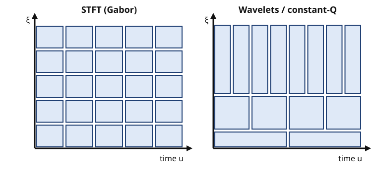

## Contents

-   [Introduction and overview](#intro)
-   [0. Review: Fourier analysis, sampling and random signals](#ch0)
-   [1. Digital audio and filtering](#ch1)
-   [2. The short-time Fourier transform and the uncertainty principle](#ch2)
-   [3. Wavelets and constant-Q analysis](#ch3)
-   [4. The analytic signal and instantaneous frequency](#ch4)
-   [5. Fundamental frequency estimation](#ch5)
-   [6. Linear prediction coding (LPC)](#ch6)
-   [7. Psychoacoustics and perceptual coding](#ch7)
-   [8. Audio modification: time stretching and pitch shifting](#ch8)
-   [9. Audio synthesis](#ch9)
-   [10. Denoising and restoration of old recordings](#ch10)
-   [11. Speech and music recognition](#ch11)
-   [12. Complements for self-study](#ch12)
-   [13. Research directions and open problems](#ch13)
-   [Exercises](#ex)
-   [Projects and assessment](#projects)
-   [References](#refs)

## Introduction and overview {#intro}

  -------------------- ----------------------------------------------------------------------------------------------------------------------------------------------------------------------------
  Module               Audio Signal Processing: Time–Frequency Analysis
  Official title       Audio signal processing – Time-frequency analysis
  Instructors          E. BACRY (master-mva.com, 2026–2027)
  Period               Semester 2 · period 2 (04/01/2027 – 02/04/2027)
  Credits and volume   5 ECTS · 21 h (lectures 21 h) per the Université Paris-Saclay programme table
  Label                [Modelling]{.badge .label} · domains on master-mva.com: Signal processing
  Language             not displayed on the official pages
  Assessment           Oral and written report on an academic paper (master-mva.com); Université Paris-Saclay: “Evaluation Continue non Intégrale” (partial continuous assessment)
  Prerequisites        Basics of linear algebra, calculus and Fourier transform (master-mva.com)
  Organisation         Lectures only (“Only Courses”, master-mva.com)
  -------------------- ----------------------------------------------------------------------------------------------------------------------------------------------------------------------------

**Audience**: a student with a good M1 in mathematics, computer science or physics, who knows the Fourier transform and wants to understand how audio is analysed, modified, synthesised, cleaned and recognised.

**Empirical first**: play the notes A4 (440 Hz) and A♯4 (466.2 Hz) together and compute a spectrogram with a 23 ms window: it shows one blurred peak. With a 93 ms window the two notes separate, but a click lasting 2 ms is now smeared over 93 ms. No window gives both, and [ch. 2](#ch2) proves that no window can.

The course is a tour of the signal-processing techniques specific to audio. It starts from filters and from the time–frequency plane: the short-time Fourier transform, wavelets and instantaneous frequency.

It then uses these representations for the classical audio tasks: estimating a pitch, coding speech by linear prediction, exploiting the limits of hearing, stretching time or shifting pitch, synthesising sounds, removing noise and clicks from old recordings, and recognising words or pieces of music. The lecturer listed on master-mva.com is Emmanuel Bacry (CNRS, CMAP, École Polytechnique).

The page shares tools with [Audio Signal Analysis, Indexing and Transformations](../s2-audio-analysis-indexing/index.html), which goes further into indexing, effects, spatial audio and source separation. It also connects with [Algorithms for Speech and Natural Language Processing](../s2-speech-nlp/index.html) and [Machine Learning for Time Series](../s1-time-series/index.html).

### What you will be able to do

-   Design FIR and IIR audio filters, check their stability, and remove a mains hum with a notch filter.
-   Compute and invert a short-time Fourier transform, and choose its window, length and hop for a given sound.
-   State and prove the Heisenberg uncertainty principle, and explain the trade-off it imposes on every spectrogram.
-   Compute a continuous wavelet transform, read a scalogram, and use the decay of wavelet coefficients to locate transients.
-   Build the analytic signal of a sound and estimate its instantaneous frequency, from the Hilbert transform or from the ridges of a time–frequency representation.
-   Estimate a fundamental frequency with the autocorrelation, YIN and the cepstrum, and diagnose octave errors.
-   Fit a linear prediction model with the Levinson–Durbin recursion, read formants from its poles, and explain why the synthesis filter is stable.
-   Use the absolute threshold of hearing, critical bands and masking to decide how many bits a perceptual coder needs.
-   Stretch a sound in time or shift its pitch with a phase vocoder, and explain its artefacts.
-   Synthesise sounds by additive, subtractive, FM and Karplus–Strong methods, and predict their spectra.
-   Denoise a recording with Wiener filtering, spectral subtraction or thresholding, and repair clicks by autoregressive interpolation.
-   Recognise isolated words with MFCC features and dynamic time warping, and explain how audio fingerprinting identifies music.

### Official objectives and syllabus (2026–2027)

The course description on master-mva.com gives as its objective an initiation to several signal-processing techniques specific to audio processing. The prerequisites are basics of linear algebra, calculus and the Fourier transform. The sessions are lectures only (“Only Courses”), and the assessment is an oral and written report on an academic paper.

On master-mva.com, the list of topics appears under the heading “Références”. It names topics rather than bibliographic works, so the table below treats each item as an official topic. The list ends with “Les intervenants” (the teachers), a heading rather than a topic, which has no row.

The item “Estimation of instantaneous frequency / fréquence fondamentale” joins two subjects, instantaneous frequency and fundamental frequency, and gets two rows. The Université Paris-Saclay course detail gives only the type of assessment, “Evaluation Continue non Intégrale” (partial continuous assessment), and no programme of its own.

| Official topic | Course section |
|---|---|
| Objective: an initiation to several signal-processing techniques specific to audio | The whole page: [ch. 1](#ch1)–[ch. 11](#ch11), one chapter per technique |
| Time-Frequency Analysis | [ch. 2](#ch2) (Definition 2.1 STFT, Theorem 2.2 energy and inversion, Proposition 2.4 overlap-add, Theorem 2.5 Heisenberg); [ch. 3](#ch3) (wavelets, Theorem 3.2 Calderón, constant-Q); [ch. 12](#ch12) (frames, Wigner–Ville, reassignment) |
| Denoising (old/bad recordings) | [ch. 10](#ch10): Theorem 10.2 (Wiener filter), Definition 10.3 (spectral subtraction), Proposition 10.4 (musical noise), Proposition 10.5 (wavelet thresholding), Algorithm 10.6 (click detection and AR interpolation); hum removal by the notch filter of ch. 1 |
| Audio signal modification (pitch shifting, slowing down, …) | [ch. 8](#ch8): Proposition 8.1 (resampling), Proposition 8.3 (phase vocoder), Proposition 8.4 (least-squares resynthesis), pitch shifting and formant preservation |
| Audio Synthesis | [ch. 9](#ch9): additive and sinusoidal synthesis, subtractive synthesis, Proposition 9.2 (FM spectrum), Proposition 9.3 (Karplus–Strong) |
| Speech or Music recognition | [ch. 11](#ch11): Definition 11.1 (MFCC), Proposition 11.3 (dynamic time warping), Definition 11.4 (hidden Markov models), Proposition 11.5 (audio fingerprinting) |
| Estimation of instantaneous frequency | [ch. 4](#ch4): Definition 4.1 (analytic signal), Theorem 4.2 (Bedrosian), Proposition 4.4 (ridge of a chirp); the phase-vocoder estimator of ch. 8; reassignment and synchrosqueezing in ch. 12 |
| Estimation of the fundamental frequency (“fréquence fondamentale”) | [ch. 5](#ch5): Proposition 5.2 (autocorrelation), Algorithm 5.3 (YIN), Proposition 5.4 (cepstrum) |
| Psycho-acoustic | [ch. 7](#ch7): Definition 7.1 (sound pressure level), threshold of hearing, Definition 7.2 (critical bands), Definition 7.3 (masking), loudness and pitch perception, Proposition 7.4 (bit allocation) |
| Audio Filtering | [ch. 1](#ch1): Definition 1.2 (LTI filters), Theorem 1.3 (stability), Proposition 1.4 (linear phase), Proposition 1.5 (notch filter); [ch. 2](#ch2): the STFT as a filter bank |
| LPC: Linear Prediction Coding | [ch. 6](#ch6): Definition 6.1, Proposition 6.2 (normal equations), Theorem 6.3 (Levinson–Durbin), Theorem 6.4 (minimum phase), formants, the LPC vocoder |
| Prerequisites: linear algebra, calculus, Fourier transform | [ch. 0](#ch0) (self-study review) |
| Organisation: lectures only | [Session plan](#sessions): 7 lectures of 3 h |
| Assessment: oral and written report on an academic paper | [Projects and assessment](#projects): paper-study subjects, report and talk |

Every official topic is taught on this page. The extensions beyond the syllabus are the review of ch. 0, the complements of ch. 12 (Gabor frames, orthonormal wavelet bases, the Wigner–Ville distribution, reassignment and synchrosqueezing, Griffin–Lim phase reconstruction, the MDCT, the Ephraim–Malah estimator) and the research directions of ch. 13.

### Where this course fits in the programme

Official prerequisites: basics of linear algebra, calculus and the Fourier transform. The course also uses some probability (Gaussian noise, stationary processes) and Python; [ch. 0](#ch0) reviews what is needed.

-   **Refreshers** — [Linear Algebra, Analysis and Optimization](../s0-refresher-linear-algebra-optimization/index.html) (Fourier series, least squares, Toeplitz systems), [Probability and Statistics](../s0-refresher-probability-statistics/index.html) (Gaussian vectors, conditional expectation) and [Scientific Python](../s0-refresher-python-scientific-computing/index.html) (NumPy and SciPy, used by every code block).
-   **Semester 1 courses that prepare it** — [Machine Learning for Time Series](../s1-time-series/index.html) (spectral analysis, autoregressive models), [Deep Learning and Signal Processing](../s1-deep-learning-signal-industry/index.html) (filters, spectrograms) and [Introduction to Probabilistic Graphical Models](../s1-probabilistic-graphical-models/index.html) (hidden Markov models, used in ch. 11).
-   **Related courses of semester 2** — [Audio Signal Analysis, Indexing and Transformations](../s2-audio-analysis-indexing/index.html) (indexing, effects, source separation, high-resolution analysis), [Algorithms for Speech and Natural Language Processing](../s2-speech-nlp/index.html) (speech recognition), [Detection Theory](../s2-detection-theory/index.html), [Inverse Problems and Imaging](../s2-inverse-problems-imaging/index.html) (sparsity and thresholding) and [Diffusion and Multiscale Models](../s2-diffusion-multiscale/index.html) (multiscale analysis).
-   **Afterwards** — the [Research Internship](../s3-research-internship/index.html), for which the paper-study assessment is a rehearsal.

### Course outline

-   **0. Review** — Fourier transform, Plancherel, convolution, sampling and aliasing, the DFT, windows, stationary random signals (self-study).
-   **1. Digital audio and filtering** — quantisation, LTI filters, the z-transform, stability, FIR and IIR design, notch filters.
-   **2. The short-time Fourier transform** — definition, energy conservation and inversion, overlap-add, the uncertainty principle, the choice of window.
-   **3. Wavelets and constant-Q analysis** — the continuous wavelet transform, its inversion, constant-Q resolution, transients and regularity.
-   **4. The analytic signal and instantaneous frequency** — the Hilbert transform, AM–FM signals, Bedrosian's theorem, ridges.
-   **5. Fundamental frequency estimation** — harmonic signals, autocorrelation, YIN, the cepstrum, octave errors.
-   **6. Linear prediction coding** — the source–filter model, the normal equations, Levinson–Durbin, stability, formants, the LPC vocoder.
-   **7. Psychoacoustics and perceptual coding** — levels, the threshold of hearing, critical bands, masking, loudness and pitch, bit allocation.
-   **8. Audio modification** — resampling, the phase vocoder, least-squares resynthesis, pitch shifting.
-   **9. Audio synthesis** — additive, subtractive, FM and physical-model synthesis.
-   **10. Denoising and restoration** — Wiener filtering, spectral subtraction, musical noise, thresholding, clicks and hum.
-   **11. Speech and music recognition** — MFCC, dynamic time warping, hidden Markov models, audio fingerprinting.
-   **12. Complements for self-study** — frames, wavelet bases, Wigner–Ville, reassignment, Griffin–Lim, MDCT, Ephraim–Malah.
-   **13. Research directions and open problems** — a map of current work, for self-study.

### Session plan {#sessions}

**21 h in class = 7 sessions of 3 h.** The 21 h of lectures come from the Université Paris-Saclay programme table; master-mva.com announces lectures only, with no further organisation. The split into sessions is a proposal.

Level 1 = foundations, 2 = core methods, 3 = advanced and research-level material. The level never goes down from one session to the next.

| Session | Hours | Level | Content | Practice |
|---|---|---|---|---|
| 1 | 3 h | 1 | ch. 1 Digital audio, LTI filters, z-transform and stability, FIR and IIR design, notch filters | Ex. 1, 2 |
| 2 | 3 h | 2 | ch. 2 STFT, energy conservation and inversion, overlap-add, the uncertainty principle, window choice | Ex. 3, 4, 10 |
| 3 | 3 h | 2 | ch. 3 Continuous wavelet transform, constant-Q analysis, transients; ch. 4 Analytic signal, Bedrosian's theorem, instantaneous frequency and ridges | Ex. 5, 6, 11 |
| 4 | 3 h | 2 | ch. 5 Harmonic signals, autocorrelation, YIN, cepstrum; ch. 6 Linear prediction, Levinson–Durbin, stability, formants, LPC vocoder | Ex. 7, 12, 17, 19 |
| 5 | 3 h | 2 | ch. 7 Sound levels, threshold of hearing, critical bands, masking, loudness and pitch, perceptual coding | Ex. 8, 9 |
| 6 | 3 h | 3 | ch. 8 Resampling, phase vocoder, pitch shifting; ch. 9 Additive, subtractive, FM and Karplus–Strong synthesis | Ex. 13, 14, 15 |
| 7 | 3 h | 3 | ch. 10 Wiener filtering, spectral subtraction, thresholding, declicking; ch. 11 MFCC, DTW, HMMs, fingerprinting | Ex. 16, 18, 20 |

**Self-study, outside the 21 h** (about 10 h in total): ch. 0 Review of the prerequisites, before session 1 (≈ 3 h) · ch. 12 Complements: frames, wavelet bases, Wigner–Ville, reassignment, Griffin–Lim, MDCT, Ephraim–Malah (≈ 5 h, with Ex. 21) · ch. 13 Research directions and open problems (≈ 2 h, with Ex. 22).

### How to study this module

-   Work through ch. 0 before session 1. Every later chapter uses the Fourier transform, the DFT and windows without warning.
-   After each session, do the exercises listed in its row, then run the code of the chapter and change one parameter: window length, hop, model order, signal-to-noise ratio.
-   Listen to what you compute. Write the signals of the code to WAV files with `scipy.io.wavfile.write` and compare them by ear.
-   The code uses NumPy and SciPy on synthetic signals, with fixed seeds; every block runs in a few seconds on a laptop.
-   Choose a paper for the assessment after session 4, from the [Projects and assessment](#projects) section or from the references of a chapter.

## 0. Review: Fourier analysis, sampling and random signals {#ch0}

Every chapter of this course moves between a signal and its spectrum, between continuous time and samples, and between deterministic sounds and noise. This review collects the facts used later, with the conventions of the page. It is self-study, to be read before session 1.

### The Fourier transform

::: def
[Definition 0.1 — Fourier transform]{.tag} For $f \in L^1(\mathbb{R})$, the Fourier transform is
$$
\hat f(\omega) = \int_{\mathbb{R}} f(t)\, e^{-i \omega t}\, dt, \qquad \omega \in \mathbb{R} \text{ in radians per second}.
$$
When $\hat f$ is also integrable, the inversion formula holds:
$$
f(t) = \frac{1}{2\pi} \int_{\mathbb{R}} \hat f(\omega)\, e^{i \omega t}\, d\omega .
$$
A frequency $\nu$ in hertz corresponds to $\omega = 2\pi\nu$.
:::

Three transforms recur. A translation becomes a phase, a modulation becomes a translation, and a dilation acts inversely on the two axes:
$$
f(t - u) \mapsto e^{-i\omega u} \hat f(\omega), \qquad e^{i\xi t} f(t) \mapsto \hat f(\omega - \xi), \qquad f(t/s) \mapsto s\, \hat f(s\omega) \quad (s > 0).
$$

The Gaussian is its own transform up to scale, which makes it the reference window of [ch. 2](#ch2):
$$
g(t) = e^{-t^2/2} \quad \Longrightarrow \quad \hat g(\omega) = \sqrt{2\pi}\, e^{-\omega^2/2}.
$$

:::: thm
[Theorem 0.2 — Convolution and Plancherel]{.tag} For $f, h \in L^1$, the convolution $(f \star h)(t) = \int f(u) h(t - u)\, du$ satisfies
$$
\widehat{f \star h} = \hat f\, \hat h .
$$
The transform extends to $L^2(\mathbb{R})$, and for $f, h \in L^2$ the Parseval and Plancherel identities hold:
$$
\int f(t)\, \overline{h(t)}\, dt = \frac{1}{2\pi} \int \hat f(\omega)\, \overline{\hat h(\omega)}\, d\omega, \qquad \|f\|^2 = \frac{1}{2\pi} \|\hat f\|^2 .
$$

::: proof
For the convolution, Fubini's theorem gives
$$
\widehat{f \star h}(\omega) = \iint f(u)\, h(t - u)\, e^{-i\omega t}\, du\, dt .
$$
Substitute $t = u + v$: the double integral factorises into $\hat f(\omega)\, \hat h(\omega)$.

For Parseval, take first $f, h$ in $L^1 \cap L^2$ with integrable transforms. Insert the inversion formula for $h$ and exchange the integrals. The extension to $L^2$ follows by density, which is how the transform is defined on $L^2$ (Mallat, 2009, ch. 2). [∎]{.qed}
:::
::::

### Sampling and aliasing

A digital recording keeps the values $f(nT)$ at a sampling period $T = 1/f_s$. Typical rates are 8 or 16 kHz for speech and 44.1 or 48 kHz for music.

:::: thm
[Theorem 0.3 — Sampling theorem (Shannon)]{.tag} If the support of $\hat f$ lies in the band $[-\pi/T, \pi/T]$, then $f$ is determined by its samples:
$$
f(t) = \sum_{n \in \mathbb{Z}} f(nT)\, \mathrm{sinc}\!\Big(\frac{t - nT}{T}\Big), \qquad \mathrm{sinc}(x) = \frac{\sin \pi x}{\pi x}.
$$
Without this condition, the samples have the spectrum of the periodised transform, and the frequencies above $f_s / 2$ fold back into the band.

::: proof
The discrete signal $f_d = \sum_n f(nT)\, \delta(t - nT)$ has, by the Poisson summation formula, the transform
$$
\hat f_d(\omega) = \frac{1}{T} \sum_{k \in \mathbb{Z}} \hat f\Big(\omega - \frac{2\pi k}{T}\Big).
$$
If $\hat f$ vanishes outside $[-\pi/T, \pi/T]$, the copies do not overlap. An ideal low-pass filter of gain $T$ on that band keeps only the copy $k = 0$, which gives back $\hat f$.

The impulse response of that filter is $\mathrm{sinc}(t/T)$, and filtering $f_d$ is the stated sum. When the copies overlap, the frequency $\omega$ and all the $\omega - 2\pi k/T$ become indistinguishable: this is aliasing. [∎]{.qed}
:::
::::

A tone at 30 kHz sampled at 44.1 kHz produces exactly the samples of a tone at $44.1 - 30 = 14.1$ kHz. This is why an analogue low-pass filter precedes every converter.

### The discrete Fourier transform and windows

::: def
[Definition 0.4 — DFT]{.tag} The discrete Fourier transform of a block $x(0), \dots, x(N-1)$ is
$$
X(k) = \sum_{n=0}^{N-1} x(n)\, e^{-2i\pi k n / N}, \qquad 0 \le k < N,
$$
with inverse $x(n) = \frac{1}{N} \sum_k X(k)\, e^{2i\pi kn/N}$. The fast Fourier transform (FFT) computes it in $O(N \log N)$ operations.
:::

Bin $k$ corresponds to the frequency $k f_s / N$ hertz, so the bins are $f_s / N$ apart. The DFT turns circular convolution into a product; a linear convolution of lengths $N_1$ and $N_2$ is obtained exactly with DFTs of size at least $N_1 + N_2 - 1$.

:::: prop
[Proposition 0.5 — Windowing and leakage]{.tag} Multiplying a signal by a window $w$ of $N$ samples convolves its spectrum with $\hat w$. A pure tone of frequency $\omega_0$ therefore appears as a copy of $\hat w$ centred at $\omega_0$:

-   the main lobe of $\hat w$ limits the resolution: two tones closer than about its half-width merge;
-   the sidelobes cause leakage: a strong tone hides weak ones far from it.

The rectangular window has a main lobe of half-width one bin and sidelobes at −13.3 dB. The Hann window, $w(n) = \sin^2(\pi n / N)$, has a half-width of two bins and sidelobes at −31.5 dB.

::: proof
The product formula is the dual of Theorem 0.2. For the rectangular window, the transform is a Dirichlet kernel with zeros at multiples of $2\pi/N$.

The Hann window is the sum of three complex exponentials, with weights $\frac12, -\frac14, -\frac14$. Its transform is the same combination of three shifted Dirichlet kernels, which doubles the main lobe and cancels most of the sidelobes. The sidelobe levels are computed numerically below. [∎]{.qed}
:::
::::

```python
import numpy as np
from scipy import signal

fs, N = 8000, 64
n = np.arange(N)
# Aliasing: a 7 kHz tone sampled at 8 kHz has the same samples as a 1 kHz tone
x7 = np.cos(2 * np.pi * 7000 * n / fs)
x1 = np.cos(2 * np.pi * 1000 * n / fs)
print("max |x7 - x1| =", np.abs(x7 - x1).max().round(12))

# Leakage: peak sidelobe of the rectangular and Hann windows
M = 64 * N  # dense zero-padded DFT
for name in ["boxcar", "hann"]:
    w = signal.get_window(name, N)
    W = np.abs(np.fft.rfft(w, M))
    W_db = 20 * np.log10(W / W.max() + 1e-300)
    k = 1
    while W[k + 1] < W[k]:      # walk down the main lobe to the first null
        k += 1
    print(f"{name:6s}: first null {k / 64:.0f} bins, peak sidelobe {W_db[k:].max():.1f} dB")
```

The output confirms the two windows: first nulls at 1 and 2 bins, sidelobes at −13.3 and −31.5 dB. The 7 kHz and 1 kHz tones give identical samples at 8 kHz.

### Stationary random signals

Noise, the excitation of unvoiced speech and the residual of a predictor are modelled as random signals.

::: def
[Definition 0.6 — Wide-sense stationarity and power spectrum]{.tag} A discrete random signal $x(n)$ with zero mean is wide-sense stationary when its autocorrelation depends only on the lag:
$$
r_x(\tau) = \mathbb{E}[x(n)\, x(n + \tau)] .
$$
When $\sum_\tau |r_x(\tau)| < \infty$, its power spectral density is
$$
S_x(\omega) = \sum_{\tau \in \mathbb{Z}} r_x(\tau)\, e^{-i \omega \tau}.
$$
White noise of variance $\sigma^2$ has $r_x(\tau) = \sigma^2 \mathbb{1}[\tau = 0]$ and a flat spectrum $S_x = \sigma^2$.
:::

:::: prop
[Proposition 0.7 — Filtering a stationary signal]{.tag} If $y = h \star x$ with $\sum_n |h(n)| < \infty$, then $y$ is stationary and
$$
S_y(\omega) = |H(\omega)|^2\, S_x(\omega), \qquad H(\omega) = \sum_n h(n)\, e^{-i\omega n}.
$$
In particular, the autocorrelation matrix $R = [r_x(i - j)]_{i,j}$ is symmetric, Toeplitz and positive semi-definite.

::: proof
Expand the product and use the stationarity of $x$:
$$
\mathbb{E}[y(n)\, y(n + \tau)] = \sum_{k, l} h(k)\, h(l)\, r_x(\tau + k - l).
$$
It depends only on $\tau$; taking the transform in $\tau$ factorises the double sum into $\overline{H(\omega)}\, H(\omega)\, S_x(\omega)$.

For any vector $c$, the quadratic form $c^\top R c$ equals $\mathbb{E}[(\sum_i c_i x(i))^2] \ge 0$. [∎]{.qed}
:::
::::

::: recap
Key takeaways — chapter 0

-   Translation, modulation and dilation act on $\hat f$ as a phase, a shift and an inverse dilation; the Gaussian keeps its shape.
-   Convolution becomes a product; the energy is $\|f\|^2 = \|\hat f\|^2 / 2\pi$.
-   Sampling at $f_s$ keeps the band below $f_s / 2$; anything above aliases.
-   A window of $N$ samples resolves about $f_s / N$ hertz; the Hann window trades a doubled main lobe for sidelobes at −31.5 dB.
-   A stationary signal is described by its autocorrelation or its power spectrum; filtering multiplies the spectrum by $|H|^2$.
:::

## 1. Digital audio and filtering {#ch1}

A recording is a sequence of quantised samples, and almost every audio operation is a filter applied to it. This chapter fixes the precision of the samples, then gives the tools to design filters and to check that they are stable.

### Samples and quantisation

:::: prop
[Proposition 1.1 — Quantisation noise]{.tag} A uniform quantiser with $b$ bits on $[-1, 1]$ has step $\Delta = 2^{1-b}$. Model its error as uniform on $[-\Delta/2, \Delta/2]$ and independent of the signal. A full-scale sinusoid then has the signal-to-noise ratio
$$
\mathrm{SNR} = 6.02\, b + 1.76 \ \text{dB}.
$$

::: proof
The error variance is $\Delta^2 / 12$, and the sinusoid has power $1/2$. Their ratio is $6 / \Delta^2 = 1.5 \cdot 2^{2b}$. In decibels, $10 \log_{10} 1.5 = 1.76$ and $20 \log_{10} 2 = 6.02$ per bit. [∎]{.qed}
:::
::::

A compact disc stores 16 bits at 44.1 kHz, which gives 98.1 dB; studio formats use 24 bits.

### Linear filters and stability

::: def
[Definition 1.2 — LTI filter and transfer function]{.tag} A linear time-invariant filter maps $x$ to $y = h \star x$, where $h$ is its impulse response. A recursive filter is given by a difference equation:
$$
\sum_{q=0}^{Q} a_q\, y(n - q) = \sum_{p=0}^{P} b_p\, x(n - p), \qquad a_0 = 1 .
$$
Its transfer function is $H(z) = B(z)/A(z)$, with $B(z) = \sum_p b_p z^{-p}$ and $A(z) = \sum_q a_q z^{-q}$. The frequency response is $H(e^{i\omega})$. The filter is FIR when $Q = 0$, and IIR otherwise.
:::

:::: thm
[Theorem 1.3 — Stability]{.tag} A filter is stable (bounded inputs give bounded outputs) if and only if $\sum_n |h(n)| < \infty$. For a causal rational filter, with $B$ and $A$ coprime, this holds if and only if

all the poles (roots of $A$) lie strictly inside the unit circle.

::: proof
If $h$ is summable, then $|y(n)| \le \|h\|_1 \sup |x|$. Conversely, the bounded input $x(n) = \mathrm{sign}\, h(-n)$ gives $y(0) = \sum |h(n)|$, which must be finite.

For a rational filter, a partial-fraction expansion writes $h(n)$, for $n$ large, as a sum of terms $c\, n^m p^n$, one family per pole $p$. Such a term is summable if and only if $|p| < 1$. [∎]{.qed}
:::
::::

:::: prop
[Proposition 1.4 — Linear-phase FIR filters]{.tag} If an FIR filter of length $N$ is symmetric, $h(n) = h(N - 1 - n)$, then
$$
H(e^{i\omega}) = e^{-i\omega (N-1)/2}\, A(\omega), \qquad A(\omega) \in \mathbb{R}.
$$
Every frequency is delayed by the same $(N-1)/2$ samples, so the filter does not distort the shape of transients.

::: proof
Pair the terms $n$ and $N - 1 - n$, and factor out $e^{-i\omega(N-1)/2}$. Each pair becomes $2h(n) \cos\big(\omega (n - \frac{N-1}{2})\big)$, which is real. [∎]{.qed}
:::
::::

The window method designs such filters. Take the ideal low-pass response $h_d(n) = \sin(\omega_c n) / \pi n$, centre it, truncate it to $N$ samples and multiply it by a window. The window's main lobe sets the width of the transition band, and its sidelobes set the ripple (Proposition 0.5).

### Resonators and notch filters

Poles close to the unit circle create resonances; zeros on the circle create exact cancellations. An audio equaliser is a cascade of such second-order sections.

:::: prop
[Proposition 1.5 — Notch filter]{.tag} For $0 < r < 1$, the filter
$$
H(z) = \frac{1 - 2\cos\omega_0\, z^{-1} + z^{-2}}{1 - 2r\cos\omega_0\, z^{-1} + r^2 z^{-2}}
$$
is stable and cancels the frequency $\omega_0$ exactly. Its gain is close to 1 away from $\omega_0$, and its −3 dB bandwidth is approximately
$$
\Delta\omega \approx 2(1 - r) \ \text{rad/sample}, \qquad \text{that is} \quad \Delta f \approx (1 - r)\, f_s / \pi \ \text{Hz}.
$$

::: proof
The zeros are $e^{\pm i\omega_0}$ and the poles $r e^{\pm i \omega_0}$, inside the circle, so Theorem 1.3 applies. Near $\omega = \omega_0 + \delta$, the factor with the other pole and zero is close to 1, and
$$
|H(e^{i\omega})| \approx \frac{|e^{i\delta} - 1|}{|e^{i\delta} - r|} \approx \frac{|\delta|}{\sqrt{\delta^2 + (1 - r)^2}} .
$$
This ratio equals $1/\sqrt 2$ when $|\delta| = 1 - r$. [∎]{.qed}
:::
::::

::: ex
[Example 1.6 — Removing mains hum]{.tag} A recording at $f_s = 16$ kHz carries a 50 Hz hum. With $r = 0.995$, the predicted bandwidth is $0.005 \times 16000 / \pi \approx 25$ Hz. The exact gains are −4.2 dB at 40 and 60 Hz, −0.26 dB at 100 Hz and +0.04 dB at 440 Hz.

The code below removes the hum and leaves a 440 Hz tone almost untouched. Hum usually has harmonics at 100, 150, … Hz; a cascade of notches, one per harmonic, removes them.
:::

```python
import numpy as np
from scipy import signal

fs = 16000
t = np.arange(2 * fs) / fs
tone = 0.5 * np.sin(2 * np.pi * 440 * t)
hum = 0.2 * np.sin(2 * np.pi * 50 * t)
y = tone + hum

r, w0 = 0.995, 2 * np.pi * 50 / fs
b = [1, -2 * np.cos(w0), 1]                  # zeros on the unit circle at +-w0
a = [1, -2 * r * np.cos(w0), r ** 2]         # poles just inside, same angle
print("poles inside the unit circle:", np.all(np.abs(np.roots(a)) < 1))
z = signal.lfilter(b, a, y)

def level(x, f):
    """Amplitude of the component at f Hz over the last second (DFT bin)."""
    seg = x[-fs:]
    return 2 * np.abs(np.sum(seg * np.exp(-2j * np.pi * f * np.arange(fs) / fs))) / fs

for f in [50, 440]:
    print(f"{f:3d} Hz: before {level(y, f):.3f}, after {level(z, f):.4f}")
```

The hum amplitude falls from 0.200 to below $10^{-4}$, while the tone goes from 0.500 to 0.502.

::: recap
Key takeaways — chapter 1

-   Each bit of quantisation adds 6.02 dB of signal-to-noise ratio.
-   A filter is stable when its impulse response is summable; a rational causal filter is stable when its poles lie inside the unit circle.
-   Symmetric FIR filters have linear phase and preserve transients.
-   A pole close to the circle makes a resonance; a zero on the circle makes a notch, of bandwidth about $(1 - r) f_s / \pi$ hertz.
:::

## 2. The short-time Fourier transform and the uncertainty principle {#ch2}

The Fourier transform of a whole recording says which frequencies occur, but not when. The short-time Fourier transform (STFT) looks at the signal through a sliding window. This chapter shows that it loses no information, how to invert it in practice, and why its resolution is limited.

### Definition and inversion

::: def
[Definition 2.1 — STFT and spectrogram]{.tag} Let $g$ be a real, even window with $\|g\| = 1$. The short-time Fourier transform of $f \in L^2(\mathbb{R})$ is
$$
V_g f(u, \xi) = \int_{\mathbb{R}} f(t)\, g(t - u)\, e^{-i \xi t}\, dt = \langle f, g_{u,\xi} \rangle, \qquad g_{u,\xi}(t) = g(t - u)\, e^{i\xi t}.
$$
The spectrogram is $|V_g f(u, \xi)|^2$. Gabor (1946) introduced this analysis with a Gaussian window.
:::

The STFT is also a filter bank. Since $g$ is even, $V_g f(u, \xi)$ equals $e^{-i\xi u}$ times the output at time $u$ of the band-pass filter $g(t)\, e^{i \xi t}$, centred at $\xi$.

:::: thm
[Theorem 2.2 — Energy conservation and inversion]{.tag} For $f \in L^2(\mathbb{R})$,
$$
\frac{1}{2\pi} \iint |V_g f(u, \xi)|^2\, du\, d\xi = \|f\|^2 ,
$$
and $f$ is recovered, in the weak sense, by
$$
f(t) = \frac{1}{2\pi} \iint V_g f(u, \xi)\, g(t - u)\, e^{i \xi t}\, du\, d\xi .
$$

::: proof
For fixed $u$, the function $\xi \mapsto V_g f(u, \xi)$ is the Fourier transform of $t \mapsto f(t)\, g(t - u)$. By Plancherel (Theorem 0.2),
$$
\int |V_g f(u, \xi)|^2\, d\xi = 2\pi \int |f(t)|^2\, g(t - u)^2\, dt .
$$
Integrate in $u$: the right-hand side becomes $2\pi \|f\|^2 \|g\|^2 = 2\pi \|f\|^2$.

For the inversion, the inverse Fourier transform in $\xi$ gives back $f(t)\, g(t - u)$. Multiply by $g(t - u)$ and integrate in $u$: the result is $f(t)\, \|g\|^2 = f(t)$. [∎]{.qed}
:::
::::

### The discrete STFT and overlap-add

::: def
[Definition 2.3 — Discrete STFT]{.tag} With a window $w$ of $N$ samples and a hop of $R$ samples, frame $m$ has the DFT
$$
X(m, k) = \sum_{n=0}^{N-1} x(n + mR)\, w(n)\, e^{-2i\pi kn/N}, \qquad 0 \le k < N .
$$
Bin $k$ lies at $k f_s / N$ hertz, and frame $m$ starts at time $m R / f_s$.
:::

:::: prop
[Proposition 2.4 — Weighted overlap-add]{.tag} Invert each DFT, multiply frame $m$ by a synthesis window $v$, and add the frames at their positions. This reconstructs $x$ exactly if and only if
$$
\sum_{m \in \mathbb{Z}} w(n - mR)\, v(n - mR) = 1 \quad \text{for every } n .
$$
For the periodic Hann window, $\sum_m w(n - mR) = 1$ when $R = N/2$, and $\sum_m w(n - mR)^2 = 3/2$ when $R = N/4$.

::: proof
The inverse DFT of frame $m$ is $x(n + mR)\, w(n)$ for $0 \le n < N$. After multiplication by $v$ and the shift by $mR$, the sum at time $n$ is
$$
\sum_m x(n)\, w(n - mR)\, v(n - mR) = x(n) \sum_m w(n - mR)\, v(n - mR).
$$
This equals $x(n)$ for every signal exactly under the stated condition.

For Hann, $w(n) = \frac12 - \frac12 \cos(2\pi n / N)$. With $R = N/2$, two shifted cosines have opposite signs and cancel. With $R = N/4$, the squares expand into constants and cosines at the frequencies $2\pi/N$ and $4\pi/N$; the four shifts cancel the cosines, and the constants add to $4 \times \frac38 = \frac32$. [∎]{.qed}
:::
::::

### The uncertainty principle

For $\|f\| = 1$, the time and frequency spreads are measured around the means $\bar t$ and $\bar\omega$ of $|f|^2$ and $|\hat f|^2 / 2\pi$:
$$
\sigma_t^2 = \int (t - \bar t)^2 |f(t)|^2\, dt, \qquad \sigma_\omega^2 = \frac{1}{2\pi} \int (\omega - \bar\omega)^2 |\hat f(\omega)|^2\, d\omega .
$$

:::: thm
[Theorem 2.5 — Heisenberg uncertainty]{.tag} For every $f \in L^2(\mathbb{R})$ with $\|f\| = 1$,
$$
\sigma_t\, \sigma_\omega \ \ge\ \frac12 ,
$$
with equality if and only if $f$ is a translated and modulated Gaussian, $f(t) = c\, e^{i \xi t}\, e^{-\lambda (t - u)^2}$ with $\lambda > 0$.

::: proof
Translate and modulate $f$ so that $\bar t = \bar\omega = 0$; this changes neither spread. Take $f$ smooth and rapidly decreasing; the general case follows by density (Mallat, 2009, ch. 2).

1.  The derivative has transform $i\omega \hat f$, so by Plancherel $\sigma_\omega^2 = \int |f'(t)|^2 dt$.
2.  Integrate by parts; the boundary terms vanish:
    $$
    1 = \int |f|^2\, dt = -\int t\, \frac{d}{dt}|f(t)|^2\, dt = -2\, \mathrm{Re} \int t\, \overline{f(t)}\, f'(t)\, dt .
    $$
3.  By Cauchy–Schwarz, the right-hand side is bounded by the two spreads:
    $$
    2\, \Big| \int t\, \overline{f(t)}\, f'(t)\, dt \Big| \le 2 \Big(\int t^2 |f|^2\, dt\Big)^{1/2} \Big(\int |f'|^2\, dt\Big)^{1/2} = 2\, \sigma_t\, \sigma_\omega .
    $$
4.  Equality requires $f'(t) = -2\lambda t f(t)$ with $\lambda$ real and positive, whose solutions are the Gaussians $c\, e^{-\lambda t^2}$. [∎]{.qed}
:::
::::

Each atom $g_{u,\xi}$ occupies a box centred at $(u, \xi)$, of width $\sigma_t$ and height $\sigma_\omega$, the spreads of the window. Theorem 2.5 bounds the area of this Heisenberg box from below.

::: key
[Key result — the time–frequency trade-off]{.tag}
$$
\sigma_t\, \sigma_\omega \ge \frac12 : \qquad \text{a window of } N \text{ samples separates frequencies about } \frac{f_s}{N} \text{ apart, and blurs time over } \frac{N}{f_s}.
$$
:::

::: ex
[Example 2.6 — Resolution in practice]{.tag} At 44.1 kHz, a Hann window of 1024 samples lasts 23.2 ms, with bins 43.1 Hz apart and a main-lobe half-width of 86.1 Hz. The notes A4 and A♯4 are 26.2 Hz apart, so they merge.

With 4096 samples, the window lasts 92.9 ms and the half-width is 21.5 Hz: the two notes separate. Usual choices are 20–40 ms for speech, longer windows for the harmonics of music, and a few milliseconds for percussive attacks.
:::

```python
import numpy as np
from scipy import signal

fs = 44100
rng = np.random.default_rng(0)
x = rng.standard_normal(fs)                    # 1 s of white noise

# Hann window, 75 % overlap: the shifted windows sum to a constant
N, R = 1024, 256
print("COLA:", signal.check_COLA("hann", N, N - R))
f, tt, X = signal.stft(x, fs, window="hann", nperseg=N, noverlap=N - R)
_, xr = signal.istft(X, fs, window="hann", nperseg=N, noverlap=N - R)
print("relative reconstruction error:", np.linalg.norm(xr[:fs] - x) / np.linalg.norm(x))

# Resolution: A4 (440 Hz) and A#4 (466.16 Hz) played together
t = np.arange(fs) / fs
y = np.sin(2 * np.pi * 440 * t) + np.sin(2 * np.pi * 440 * 2 ** (1 / 12) * t)
for N in [1024, 4096]:
    f, _, Y = signal.stft(y, fs, window="hann", nperseg=N, noverlap=3 * N // 4)
    S = np.abs(Y).mean(axis=1)
    band = (f > 300) & (f < 600)
    peaks, _ = signal.find_peaks(S[band], height=0.3 * S[band].max())
    print(f"N = {N}: {1000 * N / fs:.1f} ms window, peaks at {np.round(f[band][peaks], 1)} Hz")
```

The inverse STFT reconstructs the noise to $2 \times 10^{-16}$, rounding error only. The short window shows a single peak, at 473.7 Hz; the long one shows two, at 441.4 and 463.0 Hz, one bin of 10.8 Hz from the true notes.

::: recap
Key takeaways — chapter 2

-   The STFT correlates the signal with translated and modulated windows; it conserves energy and is inverted by Theorem 2.2.
-   In discrete time, weighted overlap-add reconstructs exactly when the products of shifted analysis and synthesis windows sum to one.
-   No window is sharper than $\sigma_t \sigma_\omega = 1/2$, attained only by Gaussians: the window length trades frequency resolution for time resolution.
:::

## 3. Wavelets and constant-Q analysis {#ch3}

Hearing, and music, are organised in octaves: an interval is a ratio of frequencies, not a difference. A fixed STFT window is too long for high-frequency transients and too short for low notes. Wavelets dilate a single waveform instead, so that the resolution follows the frequency.

### The continuous wavelet transform

::: def
[Definition 3.1 — Wavelet and wavelet transform]{.tag} A wavelet is a function $\psi \in L^2(\mathbb{R})$ with zero mean and $\|\psi\| = 1$. Its translated dilations, for $u \in \mathbb{R}$ and $s > 0$, are
$$
\psi_{u,s}(t) = \frac{1}{\sqrt s}\, \psi\Big(\frac{t - u}{s}\Big),
$$
and the wavelet transform of $f \in L^2$ is $Wf(u, s) = \langle f, \psi_{u,s} \rangle$. The scalogram is $|Wf(u, s)|^2$.
:::

Two wavelets are standard. The Mexican hat, $\psi(t) \propto (1 - t^2)\, e^{-t^2/2}$, is real. The Morlet wavelet, $\psi(t) = \pi^{-1/4} e^{i\eta t} e^{-t^2/2}$, is a modulated Gaussian; for $\eta \ge 5$ its mean is negligible and its transform almost vanishes at negative frequencies.

:::: thm
[Theorem 3.2 — Calderón's reconstruction (Grossmann and Morlet, 1984)]{.tag} Let $\psi$ be real, with
$$
C_\psi = \int_0^{\infty} \frac{|\hat\psi(\omega)|^2}{\omega}\, d\omega < \infty .
$$
Then, for every $f \in L^2(\mathbb{R})$,
$$
\int_0^\infty \!\! \int_{\mathbb{R}} |Wf(u, s)|^2\, du\, \frac{ds}{s^2} = C_\psi\, \|f\|^2, \qquad f(t) = \frac{1}{C_\psi} \int_0^\infty \!\! \int_{\mathbb{R}} Wf(u, s)\, \psi_{u,s}(t)\, du\, \frac{ds}{s^2}.
$$

::: proof
1.  The transform is a convolution: $Wf(u, s) = (f \star \bar\psi_s)(u)$ with $\bar\psi_s(t) = s^{-1/2} \psi(-t/s)$, whose Fourier transform is $\sqrt s\, \overline{\hat\psi(s\omega)}$.
2.  Plancherel in $u$ gives
    $$
    \int |Wf(u, s)|^2\, du = \frac{1}{2\pi} \int |\hat f(\omega)|^2\, s\, |\hat\psi(s\omega)|^2\, d\omega .
    $$
3.  Integrate against $ds/s^2$ and exchange the integrals. For $\omega > 0$, the change of variable $\xi = s\omega$ gives
    $$
    \int_0^\infty |\hat\psi(s\omega)|^2\, \frac{ds}{s} = \int_0^\infty |\hat\psi(\xi)|^2\, \frac{d\xi}{\xi} = C_\psi .
    $$
    For $\omega < 0$ the result is the same, because $|\hat\psi|$ is even when $\psi$ is real.
4.  What remains is $\frac{1}{2\pi} C_\psi \|\hat f\|^2 = C_\psi \|f\|^2$. The reconstruction formula follows by polarisation, as in Theorem 2.2. [∎]{.qed}
:::
::::

The condition $C_\psi < \infty$ forces $\hat\psi(0) = 0$: a wavelet must have zero mean, which is why it is called admissible.

### Constant-Q resolution

:::: prop
[Proposition 3.3 — Heisenberg boxes of wavelets]{.tag} Suppose $\psi$ has time spread $\sigma_t$, and $\hat\psi$ is concentrated around $\eta > 0$ with spread $\sigma_\omega$.

Then $\psi_{u,s}$ is centred at time $u$ and frequency $\eta / s$, with spreads
$$
s\, \sigma_t \quad \text{in time}, \qquad \frac{\sigma_\omega}{s} \quad \text{in frequency}.
$$
The area of the box does not depend on $s$, and neither does the quality factor $Q = \eta / \sigma_\omega$, the ratio of the centre frequency to the bandwidth.

::: proof
Apply the dilation rule of ch. 0: the transform of $\psi_{u,s}$ is $\sqrt s\, \hat\psi(s\omega)\, e^{-i\omega u}$. The spreads scale by $s$ and $1/s$, and the centre frequency becomes $\eta / s$. [∎]{.qed}
:::
::::

::: key
[Key result — constant Q]{.tag}
$$
\text{centre } \frac{\eta}{s}, \qquad \text{bandwidth } \frac{\sigma_\omega}{s}, \qquad Q = \frac{\eta}{\sigma_\omega} \ \text{ at every scale } s .
$$
:::

{width="100%" fig-alt="Two panels with time on the horizontal axis and frequency on the vertical axis. Left: a regular grid of identical rectangles. Right: three rows of rectangles; the bottom row has two wide, flat rectangles, the middle row four, and the top row eight narrow, tall ones."}

In practice the scales are sampled geometrically, $s = 2^{j/J}$, with $J$ voices per octave. The constant-Q transform of Brown (1991) uses $J = 12$ or $24$, so that the bins fall on the semitones or quarter-tones of the equal-tempered scale.

### Transients and regularity

:::: prop
[Proposition 3.4 — Decay of wavelet coefficients]{.tag} Let $\psi$ have zero mean and $\int |t|^\alpha |\psi(t)|\, dt < \infty$, with $0 \le \alpha \le 1$. If $|f(t) - f(v)| \le K |t - v|^\alpha$ for all $t$, then
$$
|Wf(v, s)| \le K\, C\, s^{\alpha + 1/2}, \qquad C = \int |x|^\alpha |\psi(x)|\, dx .
$$
If $\psi$ has $n$ vanishing moments and $f$ is smooth near $v$, the coefficients decay like $s^{n + 1/2}$.

::: proof
Since $\psi$ has zero mean, subtract $f(v)$ inside the integral:
$$
|Wf(v, s)| = \Big| \int (f(t) - f(v))\, \frac{1}{\sqrt s}\, \psi\Big(\frac{t - v}{s}\Big) dt \Big| \le \frac{K}{\sqrt s} \int |t - v|^\alpha\, \Big|\psi\Big(\frac{t - v}{s}\Big)\Big|\, dt .
$$
Substitute $t = v + s x$: the bound is $K s^{\alpha + 1/2} C$. In the smooth case, expand $f$ in a Taylor series around $v$; the vanishing moments cancel the terms of degree below $n$. [∎]{.qed}
:::
::::

A jump ($\alpha = 0$), such as a click or a sharp attack, keeps coefficients of order $s^{1/2}$ at fine scales. Smooth parts decay much faster, so transients stand out. Jaffard proved a converse: the decay across scales characterises the local regularity (Mallat, 2009, ch. 6).

::: ex
[Example 3.5 — Measuring the decay]{.tag} The Mexican hat has two vanishing moments. The code compares a jump with a point where the signal is smooth and curved, over scales from 2 to 20 ms. The predicted slopes, in log–log coordinates, are 0.5 and 2.5.
:::

```python
import numpy as np

fs = 8000
t = np.arange(-1.0, 1.0, 1 / fs)
f = np.where(t >= 0, 1.0, 0.0) + 0.3 * np.sin(2 * np.pi * 3 * t)   # jump at t = 0, smooth elsewhere

def mexican_hat(u):
    return (1 - u ** 2) * np.exp(-u ** 2 / 2)   # two vanishing moments

def cwt_at(f, t0_index, s):
    """W f(t0, s) = int f(t) s^(-1/2) psi((t - t0) / s) dt, by direct quadrature."""
    u = (t - t[t0_index]) / s
    return np.sum(f * mexican_hat(u)) / np.sqrt(s) / fs

scales = np.geomspace(2e-3, 2e-2, 8)
i_jump = np.searchsorted(t, 0.0)
i_smooth = np.searchsorted(t, -5 / 12)          # where |f''| is largest
for name, i0 in [("jump", i_jump), ("smooth", i_smooth)]:
    # maximum of |W f| over positions within 5 scales of the point
    vals = []
    for s in scales:
        idx = range(i0 - int(5 * s * fs), i0 + int(5 * s * fs) + 1, 4)
        vals.append(max(abs(cwt_at(f, i, s)) for i in idx))
    slope = np.polyfit(np.log(scales), np.log(vals), 1)[0]
    print(f"{name:6s}: log-log slope of max |Wf| = {slope:.2f}")
```

The measured slopes are 0.52 at the jump and 2.47 at the smooth point. At a scale of 2 ms the jump dominates by orders of magnitude, which is the principle of the click detectors of [ch. 10](#ch10).

::: recap
Key takeaways — chapter 3

-   The wavelet transform correlates the signal with dilations of one zero-mean waveform; Calderón's formula inverts it when $C_\psi < \infty$.
-   Its Heisenberg boxes have constant area and constant quality factor $Q$: sharp in time at high frequency, sharp in frequency at low frequency.
-   Wavelet coefficients decay like $s^{\alpha + 1/2}$ at a point of regularity $\alpha$; jumps and clicks stand out at fine scales.
:::

## 4. The analytic signal and instantaneous frequency {#ch4}

A siren, a glissando or a bird song has a frequency that changes in time. To speak of the frequency *at* time $t$, we need a phase $\varphi(t)$ and its derivative. This chapter builds them with the analytic signal, shows when they mean something, and how a time–frequency representation recovers them.

### The analytic signal

::: def
[Definition 4.1 — Hilbert transform and analytic signal]{.tag} For a real $f \in L^2(\mathbb{R})$, the Hilbert transform $Hf$ and the analytic signal $z$ are defined by
$$
\widehat{Hf}(\omega) = -i\, \mathrm{sign}(\omega)\, \hat f(\omega), \qquad z = f + i\, Hf, \qquad \hat z(\omega) = 2\, \hat f(\omega)\, \mathbb{1}[\omega > 0].
$$
Writing $z(t) = a(t)\, e^{i\varphi(t)}$ with $a = |z| \ge 0$ defines the instantaneous amplitude $a$, the phase $\varphi$ and the instantaneous frequency $\varphi'(t)$.
:::

::: key
[Key result — analytic signal]{.tag}
$$
\hat z = 2\, \hat f\, \mathbb{1}[\omega > 0], \qquad z(t) = a(t)\, e^{i\varphi(t)}, \qquad \text{instantaneous frequency } \varphi'(t).
$$
:::

Removing the negative frequencies loses nothing, since $\hat f(-\omega) = \overline{\hat f(\omega)}$ for a real signal, and $f = \mathrm{Re}\, z$. For a pure tone, $H \cos(\omega_0 t) = \sin(\omega_0 t)$, so $z(t) = e^{i\omega_0 t}$: the amplitude is 1 and the instantaneous frequency is $\omega_0$, as expected.

:::: thm
[Theorem 4.2 — Bedrosian's product theorem]{.tag} Let $a$ be real, with $\hat a$ supported in $[-\Omega, \Omega]$, and let $\omega_0 > \Omega$. Then
$$
H\big(a(t) \cos(\omega_0 t + \theta)\big) = a(t) \sin(\omega_0 t + \theta).
$$
The analytic signal is $a(t)\, e^{i(\omega_0 t + \theta)}$: when $a \ge 0$, the amplitude is the envelope $a$ and the instantaneous frequency is the carrier $\omega_0$.

::: proof
Write the cosine as a sum of two exponentials. The transform of the product is
$$
\tfrac12 e^{i\theta}\, \hat a(\omega - \omega_0) + \tfrac12 e^{-i\theta}\, \hat a(\omega + \omega_0).
$$
The first term is supported in $[\omega_0 - \Omega, \omega_0 + \Omega]$, inside $\omega > 0$; the second in $\omega < 0$.

Multiplying by $-i\, \mathrm{sign}(\omega)$ multiplies the first by $-i$ and the second by $+i$, which is the transform of $a(t) \sin(\omega_0 t + \theta)$. [∎]{.qed}
:::
::::

The condition matters: the envelope must vary more slowly than the carrier. Without it, the pair $(a, \varphi)$ is still defined, but no longer matches the intuition.

::: ex
[Example 4.3 — Two tones have one instantaneous frequency]{.tag} Take $f(t) = \cos \omega_1 t + \cos \omega_2 t$ with $\omega_1 < \omega_2$. Its analytic signal factorises:
$$
z(t) = e^{i\omega_1 t} + e^{i\omega_2 t} = 2 \cos\Big(\frac{\omega_2 - \omega_1}{2} t\Big)\, e^{i\, (\omega_1 + \omega_2) t / 2}.
$$
The instantaneous frequency is the mean $(\omega_1 + \omega_2)/2$, with phase jumps of $\pi$ where the cosine vanishes. The amplitude beats at the difference frequency.

For a chord, a single instantaneous frequency is meaningless. The components must first be separated in the time–frequency plane.
:::

### Ridges of time–frequency representations

:::: prop
[Proposition 4.4 — The STFT ridge of a chirp]{.tag} Let $f(t) = e^{i\varphi(t)}$ with $\varphi(t) = \omega_0 t + c t^2 / 2$, and use the Gaussian window $g(t) = e^{-t^2/(2\sigma^2)}$. Then, for each $u$,
$$
|V_g f(u, \xi)| = \sqrt{\frac{2\pi}{|\alpha|}}\, \exp\Big(- \frac{(\xi - \varphi'(u))^2}{2 B^2}\Big), \qquad \alpha = \frac{1}{\sigma^2} - i c, \quad B^2 = \frac{1}{\sigma^2} + c^2 \sigma^2 .
$$
The maximum over $\xi$ lies exactly at the instantaneous frequency $\varphi'(u) = \omega_0 + c u$. Its width $B$ is smallest for $\sigma^2 = 1/|c|$.

::: proof
Substitute $t = u + v$. Since $\varphi$ is quadratic, $\varphi(u + v) = \varphi(u) + \varphi'(u) v + c v^2 / 2$, so with $\beta = \varphi'(u) - \xi$,
$$
|V_g f(u, \xi)| = \Big| \int e^{-\alpha v^2 / 2 + i \beta v}\, dv \Big| = \Big| \sqrt{\frac{2\pi}{\alpha}}\, e^{-\beta^2 / (2\alpha)} \Big| .
$$
The modulus of the exponential is $e^{-\beta^2\, \mathrm{Re}(1/\alpha) / 2}$, and
$$
\mathrm{Re}\Big(\frac{1}{\alpha}\Big) = \frac{\sigma^2}{1 + c^2 \sigma^4} = \frac{1}{B^2}.
$$
Finally $B^2$ is a sum of two terms with constant product $c^2$, minimal when they are equal. [∎]{.qed}
:::
::::

For signals $a(t) \cos\varphi(t)$ with slowly varying $a$ and $\varphi'$, the same holds approximately for the STFT and for analytic wavelets. Delprat and coauthors (1992) proved it by a stationary-phase argument: the ridges, where $|V_g f|$ or $|Wf|$ is maximal in frequency, follow $\varphi'$ up to second-order corrections.

Two discrete estimators follow. The first reads the phase increment of the analytic signal, $\arg\big(z(n+1)\, \overline{z(n)}\big)$, in radians per sample. The second takes the frequency of the largest STFT coefficient in each frame. It works on chords but is quantised to the bins; [ch. 8](#ch8) refines it with the phase.

```python
import numpy as np
from scipy import signal

fs = 16000
t = np.arange(fs) / fs                          # 1 s
f0, f1 = 200.0, 2000.0                          # linear chirp 200 Hz -> 2 kHz
phase = 2 * np.pi * (f0 * t + (f1 - f0) * t ** 2 / 2)
x = np.cos(phase)
true_if = f0 + (f1 - f0) * t

# 1) analytic signal: phase increment between consecutive samples
z = signal.hilbert(x)
if_hilbert = np.angle(z[1:] * np.conj(z[:-1])) * fs / (2 * np.pi)
inner = slice(800, fs - 800)                    # avoid the edges
err1 = np.abs(if_hilbert[inner] - true_if[:-1][inner]).max()

# 2) STFT ridge: frequency of the largest coefficient in each frame
N = 512
fr, tt, X = signal.stft(x, fs, window="hann", nperseg=N, noverlap=N - 64)
ridge = fr[np.abs(X).argmax(axis=0)]
keep = (tt > 0.05) & (tt < 0.95)
err2 = np.abs(ridge[keep] - (f0 + (f1 - f0) * tt[keep])).max()
print(f"Hilbert estimate: max error {err1:.2f} Hz")
print(f"STFT ridge (bin {fs / N:.2f} Hz): max error {err2:.2f} Hz")
```

On a chirp from 200 Hz to 2 kHz, the analytic signal gives the instantaneous frequency within 0.27 Hz away from the edges. The STFT ridge stays within 15.6 Hz, half of its 31.25 Hz bin.

::: recap
Key takeaways — chapter 4

-   The analytic signal keeps the positive frequencies; its modulus and the derivative of its phase define the instantaneous amplitude and frequency.
-   Bedrosian's theorem justifies the pair (envelope, carrier) when the envelope is slower than the carrier.
-   A multicomponent signal has no meaningful single instantaneous frequency; time–frequency ridges track each component, exactly for a linear chirp with a Gaussian window.
:::

## 5. Fundamental frequency estimation {#ch5}

The pitch of a voiced sound is carried by its fundamental frequency $f_0$, the inverse of its period. Estimating $f_0$ is needed for prosody, tuning, transcription, the LPC vocoder of [ch. 6](#ch6) and the modifications of [ch. 8](#ch8). The difficulty is that every multiple of the period is also a period.

### Harmonic signals and the autocorrelation

::: def
[Definition 5.1 — Harmonic signal and fundamental frequency]{.tag} A harmonic signal is a sum of sinusoids at integer multiples of a frequency $f_0 > 0$:
$$
x(t) = \sum_{h=1}^{H} a_h \cos(2\pi h f_0 t + \theta_h), \qquad a_h \ge 0 .
$$
Its fundamental frequency is the largest $f_0$ for which such a representation exists, and its period is $T_0 = 1 / f_0$.
:::

The fundamental may be absent: the harmonics 2 to 8 of 220 Hz still repeat every $1/220$ s. The telephone band, which starts near 300 Hz, removes the fundamental of most male voices, yet the pitch is still heard.

:::: prop
[Proposition 5.2 — Autocorrelation of a harmonic signal]{.tag} The time-averaged autocorrelation of a harmonic signal is
$$
r(\tau) = \lim_{T \to \infty} \frac{1}{T} \int_0^T x(t)\, x(t + \tau)\, dt = \sum_{h=1}^{H} \frac{a_h^2}{2} \cos(2\pi h f_0 \tau).
$$
It satisfies $r(\tau) \le r(0)$, with equality exactly when $\tau$ is a multiple of $T_0$.

::: proof
Expand the product. Cross terms between different harmonics, and the terms at frequency $2hf_0$, average to zero; what remains is the stated sum.

Equality $r(\tau) = r(0)$ requires $\cos(2\pi h f_0 \tau) = 1$, that is $h f_0 \tau \in \mathbb{Z}$, for every $h$ with $a_h > 0$.

Since $f_0$ is maximal, these indices have greatest common divisor 1. A Bézout combination of them then gives $f_0 \tau \in \mathbb{Z}$. [∎]{.qed}
:::
::::

The maximum at $T_0$ is shared by $2T_0$, $3T_0$, …. On a short noisy frame, picking the largest autocorrelation peak therefore often returns $f_0 / 2$ or $f_0 / 3$. Conversely, a biased estimate that decays with the lag favours short lags, and returns $2 f_0$ when the even harmonics dominate. These are the octave errors.

### YIN

::: def
[Algorithm 5.3 — YIN (de Cheveigné and Kawahara, 2002)]{.tag} For a frame $x(1), \dots, x(2W)$:

1.  compute the difference function, which vanishes at every multiple of the period of a periodic signal:
    $$
    d(\tau) = \sum_{j=1}^{W} \big(x(j) - x(j + \tau)\big)^2 ;
    $$
2.  normalise it by its running mean, with $d'(0) = 1$:
    $$
    d'(\tau) = \frac{d(\tau)}{\frac{1}{\tau} \sum_{j=1}^{\tau} d(j)} ;
    $$
3.  take the smallest lag where $d'$ falls below a threshold, typically 0.1, and descend to the bottom of that dip; if no lag qualifies, take the global minimum;
4.  refine the lag by fitting a parabola through the minimum and its two neighbours; the estimate is $f_s / \hat\tau$.
:::

The normalisation removes the dip of $d$ at small lags, where a signal always resembles itself. The threshold then selects the first period, not a multiple of it, which removes most sub-harmonic errors. The paper adds a final step that searches the neighbourhood of each estimate for a better local minimum.

### The cepstrum

:::: prop
[Proposition 5.4 — Cepstral separation of source and filter]{.tag} The real cepstrum of a frame is the inverse DFT of its log-magnitude spectrum:
$$
c(q) = \frac{1}{N} \sum_{k=0}^{N-1} \log |X(k)|\, e^{2i\pi kq/N}.
$$
If the frame is an excitation $e$ filtered by $h$, the cepstra add: $c = c_e + c_h$.

A smooth envelope $\log|H|$ has its cepstrum at low quefrencies. A harmonic excitation makes $\log|E|$ periodic in frequency, with period $f_0$, so $c_e$ peaks at the quefrency $T_0 = f_s / f_0$ samples and its multiples.

::: proof
The DFT of $e \star h$ is $E\, H$ (for a frame long enough to neglect edge effects), and the logarithm turns the product into a sum; the inverse DFT is linear.

A function of $k$ that is periodic with period $N f_0 / f_s$ bins has a Fourier series concentrated on the multiples of $N / (N f_0 / f_s) = f_s / f_0$, which is $T_0$ in samples. [∎]{.qed}
:::
::::

The cepstral pitch detector of Noll (1967) picks the largest peak of $c(q)$ above a few milliseconds. Keeping only the low quefrencies (liftering) gives the spectral envelope; the MFCC features of [ch. 11](#ch11) are a cepstrum on a perceptual frequency scale.

::: ex
[Example 5.5 — A missing fundamental at 220 Hz]{.tag} At $f_s = 16$ kHz the period of 220 Hz is 72.73 samples. The nearest integer lag, 73, would give 219.2 Hz; parabolic interpolation removes most of this quantisation error. The code builds a 50 ms frame from harmonics 2 to 8 only, adds noise at about 20 dB SNR, and runs YIN.
:::

```python
import numpy as np

fs, f0 = 16000, 220.0
rng = np.random.default_rng(1)
t = np.arange(int(0.05 * fs)) / fs              # one 50 ms frame
# harmonics 2..8 only: the fundamental itself is missing
x = sum(np.cos(2 * np.pi * h * f0 * t + rng.uniform(0, 2 * np.pi)) / h for h in range(2, 9))
x += 0.1 * rng.standard_normal(t.size)          # about 20 dB SNR

def yin(x, fs, fmin=60, fmax=800, threshold=0.1):
    W = len(x) // 2                             # integration window
    taus = np.arange(1, int(fs / fmin) + 2)
    d = np.array([np.sum((x[:W] - x[tau:tau + W]) ** 2) for tau in taus])   # step 1
    dprime = d * taus / np.cumsum(d)            # step 2: cumulative mean normalisation
    lo = int(fs / fmax)
    below = np.where(dprime[lo:] < threshold)[0]                            # step 3
    i = lo + (below[0] if below.size else np.argmin(dprime[lo:]))
    while i + 1 < len(dprime) and dprime[i + 1] < dprime[i]:
        i += 1                                  # go down to the bottom of the dip
    a, b, c = dprime[i - 1], dprime[i], dprime[i + 1]
    shift = 0.5 * (a - c) / (a - 2 * b + c)     # step 4: parabolic interpolation
    return fs / (taus[i] + shift)

print(f"YIN estimate: {yin(x, fs):.2f} Hz (true 220 Hz, no energy at 220 Hz)")
```

The estimate is 220.07 Hz, although the frame contains no energy at 220 Hz.

::: recap
Key takeaways — chapter 5

-   The autocorrelation of a harmonic signal is maximal at every multiple of the period, which causes octave errors.
-   YIN normalises the difference function by its running mean and takes the first dip below a threshold; parabolic interpolation gives sub-sample accuracy.
-   The cepstrum separates a smooth envelope (low quefrencies) from a harmonic excitation (a peak at the period).
:::

## 6. Linear prediction coding (LPC) {#ch6}

Speech is produced by an excitation — a periodic train of glottal pulses, or turbulent noise — shaped by the resonances of the vocal tract. Linear prediction estimates that resonant filter from the signal alone. It gives a compact spectral envelope, the formants, and the classical speech coders.

### The model and the normal equations

::: def
[Definition 6.1 — Linear prediction of order p]{.tag} The prediction-error filter of order $p$ is
$$
A(z) = 1 + \sum_{k=1}^{p} a_k z^{-k}, \qquad e(n) = x(n) + \sum_{k=1}^{p} a_k\, x(n - k),
$$
so that $-\sum_k a_k x(n-k)$ predicts $x(n)$ from the $p$ previous samples. In the autocorrelation method, the frame is windowed, taken as zero outside, and $a$ minimises $E = \sum_n e(n)^2$ over all $n$.

The source–filter model reads $x = (G / A) \star u$: an excitation $u$ through the all-pole synthesis filter $G / A(z)$.
:::

:::: prop
[Proposition 6.2 — Normal equations]{.tag} Let $r(\tau) = \sum_n x(n)\, x(n + \tau)$ be the autocorrelation of the windowed frame. The optimal coefficients solve the Toeplitz system
$$
\sum_{k=1}^{p} a_k\, r(|i - k|) = -\, r(i), \qquad i = 1, \dots, p,
$$
and the minimal error is $E_p = r(0) + \sum_{k=1}^p a_k\, r(k)$.

::: proof
$E$ is a quadratic form in $a$, with Hessian $2R$, where $R = [r(|i-k|)]$ is positive definite for a nonzero frame (Proposition 0.7).

Setting $\partial E / \partial a_i = 2 \sum_n e(n)\, x(n - i)$ to zero gives the system. Substituting it back into $E = \sum_n e(n) x(n)$ gives $E_p$. [∎]{.qed}
:::
::::

### The Levinson–Durbin recursion

:::: thm
[Theorem 6.3 — Levinson–Durbin]{.tag} Start from $E_0 = r(0)$. For $i = 1, \dots, p$, compute the reflection coefficient and update:
$$
k_i = -\frac{r(i) + \sum_{j=1}^{i-1} a^{(i-1)}_j\, r(i - j)}{E_{i-1}}, \qquad a^{(i)}_j = a^{(i-1)}_j + k_i\, a^{(i-1)}_{i-j}, \qquad E_i = (1 - k_i^2)\, E_{i-1},
$$
with $a^{(i-1)}_0 = 1$ and $a^{(i-1)}_i = 0$. Then $a^{(p)}$ solves the normal equations in $O(p^2)$ operations, and

$|k_i| < 1$ at every order.

::: proof
Let $R_i$ be the $(i+1) \times (i+1)$ autocorrelation matrix. The order-$i$ solution is characterised by
$$
R_i\, (1, a^{(i)}_1, \dots, a^{(i)}_i)^\top = (E_i, 0, \dots, 0)^\top .
$$
1.  Pad the order-$(i-1)$ vector with a zero. Then $R_i$ maps it to $(E_{i-1}, 0, \dots, 0, \Delta)$, where $\Delta = r(i) + \sum_{j=1}^{i-1} a^{(i-1)}_j\, r(i - j)$ is the numerator in the definition of $k_i$.
2.  $R_i$ is symmetric and Toeplitz, so it commutes with the reversal of coordinates. The reversed padded vector is mapped to $(\Delta, 0, \dots, 0, E_{i-1})$.
3.  Add $k_i$ times the second vector to the first. The image is $(E_{i-1} + k_i \Delta, 0, \dots, 0, \Delta + k_i E_{i-1})$. The choice $k_i = -\Delta / E_{i-1}$ cancels the last entry, so the sum is the order-$i$ solution, with the stated update.
4.  Its error is $E_i = E_{i-1} - \Delta^2 / E_{i-1} = (1 - k_i^2)\, E_{i-1}$. Since $R_i$ is positive definite, $E_i > 0$, hence $k_i^2 < 1$. [∎]{.qed}
:::
::::

::: key
[Key result — Levinson–Durbin]{.tag}
$$
E_i = (1 - k_i^2)\, E_{i-1} > 0, \qquad |k_i| < 1, \qquad O(p^2) \text{ operations}.
$$
:::

:::: thm
[Theorem 6.4 — The autocorrelation method is minimum phase]{.tag} For a nonzero frame, every zero of $A(z)$ lies strictly inside the unit circle. Hence

the synthesis filter $G / A(z)$ is stable.

::: proof
1.  Let $z_0$ be a zero, and factor $A(z) = (1 - z_0 z^{-1})\, C(z)$, with $C$ monic of degree $p - 1$, possibly complex.
2.  Let $y = C(z)\, x$ be the frame filtered by $C$: a nonzero sequence of finite support. Then $e(n) = y(n) - z_0\, y(n - 1)$, and
    $$
    E = \sum_n |y(n) - z_0\, y(n-1)|^2 = \rho_0 (1 + |z_0|^2) - 2\, \mathrm{Re}(\overline{z_0}\, \rho_1),
    $$
    with $\rho_0 = \sum |y(n)|^2$ and $\rho_1 = \sum y(n)\, \overline{y(n-1)}$.
3.  The real solution $a$ also minimises $E$ among complex monic filters: $E$ is a strictly convex form with real coefficients. In particular, $z_0$ minimises this expression for fixed $C$, which gives $z_0 = \rho_1 / \rho_0$.
4.  By Cauchy–Schwarz, $|\rho_1| \le \rho_0$. Equality would require $y(n) = \lambda\, y(n-1)$ for all $n$ with $|\lambda| = 1$, impossible for a nonzero sequence of finite support. So $|z_0| < 1$. [∎]{.qed}
:::
::::

The covariance method, which sums the squared error over the frame without windowing, can return an unstable filter (Exercise 19). This is one reason why coders prefer the autocorrelation method.

### Formants and the LPC vocoder

A pair of complex poles $\rho\, e^{\pm i\theta}$ of $1/A$ creates a resonance, a formant. Its frequency and bandwidth are approximately
$$
F = \frac{\theta f_s}{2\pi}, \qquad B \approx -\frac{f_s}{\pi} \ln \rho .
$$
A common rule takes $p \approx f_s / 1000 + 2$: two poles per kilohertz for the formants, plus two for the glottal pulse and the lip radiation. The envelope $E_p / |A(e^{i\omega})|^2$ follows the peaks of the spectrum.

::: ex
[Example 6.5 — Recovering three formants]{.tag} At $f_s = 8$ kHz, three resonances at (700, 130), (1220, 70) and (2600, 160) Hz, given as (frequency, bandwidth), have pole radii 0.950, 0.973 and 0.939. The code filters a 120 Hz pulse train through them, then runs Levinson–Durbin at order 10 on a 30 ms Hamming-windowed frame.
:::

```python
import numpy as np
from scipy import signal

fs = 8000
formants = [(700, 130), (1220, 70), (2600, 160)]   # (frequency, bandwidth) in Hz
A = np.array([1.0])
for F, B in formants:
    r, th = np.exp(-np.pi * B / fs), 2 * np.pi * F / fs
    A = np.convolve(A, [1, -2 * r * np.cos(th), r ** 2])

# voiced excitation: impulse train at 120 Hz, 0.3 s
e = np.zeros(int(0.3 * fs)); e[::fs // 120] = 1.0
x = signal.lfilter([1.0], A, e)

def levinson(r, p):
    a, E, ks = np.zeros(p + 1), r[0], []
    a[0] = 1.0
    for i in range(1, p + 1):
        k = -(r[i] + a[1:i] @ r[i - 1:0:-1]) / E   # reflection coefficient
        a[1:i + 1] = a[1:i + 1] + k * a[i - 1::-1][:i]
        E *= 1 - k ** 2
        ks.append(k)
    return a, E, np.array(ks)

frame = x[800:800 + 240] * np.hamming(240)          # 30 ms frame
r = np.correlate(frame, frame, "full")[239:]
a, E, ks = levinson(r, 10)
print("all |k_i| < 1:", np.all(np.abs(ks) < 1), "| poles inside:", np.all(np.abs(np.roots(a)) < 1))
poles = np.roots(a)
poles = poles[(poles.imag > 0) & (np.abs(poles) > 0.85)]
est = sorted(np.angle(poles) * fs / (2 * np.pi))
print("estimated formants (Hz):", np.round(est).astype(int))
```

All reflection coefficients are below 1 in modulus, all poles are inside the circle, and the formants come out at 707, 1216 and 2601 Hz.

In the LPC vocoder, each frame of 20–30 ms is sent as $p$ reflection coefficients, a gain, a voiced/unvoiced decision and $f_0$ (ch. 5). The decoder filters a pulse train or white noise through $G / A$. The US standard LPC-10 coded speech this way at 2400 bit/s. Quantised reflection coefficients stay stable as long as $|k_i| < 1$, which is easy to enforce. Code-excited linear prediction (Schroeder and Atal, 1985) replaces the two excitations by a codebook, and is the basis of the speech coders of mobile telephony.

::: recap
Key takeaways — chapter 6

-   Linear prediction fits an all-pole filter by solving Toeplitz normal equations on the autocorrelation of a windowed frame.
-   Levinson–Durbin solves them in $O(p^2)$ and produces reflection coefficients with $|k_i| < 1$; the autocorrelation method always gives a stable synthesis filter.
-   The angles of the poles give the formants; the LPC vocoder sends the filter, the gain, the voicing and the pitch.
:::

## 7. Psychoacoustics and perceptual coding {#ch7}

What matters in audio is what a listener hears. Hearing has a frequency-dependent threshold, analyses sound in critical bands, and lets loud components hide weaker neighbours. This chapter turns these facts into numbers, then uses them to decide how many bits a coder needs.

### Levels and the threshold of hearing

::: def
[Definition 7.1 — Sound pressure level]{.tag} The sound pressure level of a pressure with root-mean-square value $p$ is
$$
L = 20 \log_{10} \frac{p}{p_0} \ \text{dB SPL}, \qquad p_0 = 20\ \mu\text{Pa}.
$$
Doubling the pressure adds 6 dB. Two incoherent sources of equal level add their powers, which adds $10 \log_{10} 2 = 3$ dB.
:::

The quietest audible tone depends on its frequency. Terhardt (1979) gave an approximation of this absolute threshold of hearing, with $f$ in kilohertz:
$$
T_q(f) = 3.64\, f^{-0.8} - 6.5\, e^{-0.6 (f - 3.3)^2} + 10^{-3} f^4 \ \text{dB SPL}.
$$
It is about 23 dB at 100 Hz, 3.4 dB at 1 kHz, and reaches its minimum, about −5 dB, near 3.3 kHz, where the ear canal resonates.

Loudness is not level. The loudness level in phons of a sound is the level of a 1 kHz tone judged equally loud; the equal-loudness contours are standardised in ISO 226. Above about 40 phons, loudness in sones grows roughly like the intensity to the power 0.3. A gain of 10 dB multiplies the intensity by 10, and the loudness by $10^{0.3} \approx 2$.

### Critical bands and masking

::: def
[Definition 7.2 — Critical bands and auditory scales]{.tag} The cochlea behaves like a bank of overlapping band-pass filters. Their bandwidth, the critical bandwidth, is close to 100 Hz below 500 Hz and to about 20 % of the centre frequency above. Three scales measure frequency in these units, with $f$ in hertz:
$$
z = 13 \arctan(0.00076 f) + 3.5 \arctan\big((f / 7500)^2\big) \ \text{Bark}, \qquad \mathrm{ERB}(f) = 24.7\, (4.37 f / 1000 + 1) \ \text{Hz},
$$
$$
m = 2595 \log_{10}(1 + f / 700) \ \text{mel}.
$$
The Bark formula is that of Zwicker and Terhardt (1980), and the equivalent rectangular bandwidth (ERB) that of Glasberg and Moore (1990).
:::

About 24 critical bands cover the range up to 16 kHz. The ERB is 35 Hz at 100 Hz, 133 Hz at 1 kHz and 456 Hz at 4 kHz.

::: def
[Definition 7.3 — Simultaneous and temporal masking]{.tag} A masker raises the threshold of hearing of other sounds near it in frequency. The spread of this effect is described in Bark by a spreading function, in decibels. A common choice is that of Schroeder, Atal and Hall (1979):
$$
\mathrm{SF}(\Delta z) = 15.81 + 7.5\, (\Delta z + 0.474) - 17.5 \sqrt{1 + (\Delta z + 0.474)^2} \ \text{dB}.
$$
The masking threshold is the masker level, plus the spreading function, minus an offset that depends on the nature of masker and maskee.
:::

The spreading function is asymmetric: a sound masks higher frequencies more than lower ones. Masking also acts in time. A loud sound hides what follows it for up to about 100–200 ms (forward masking), and what precedes it for a few milliseconds (backward masking).

Pitch perception also departs from physics. A sound with harmonics 2 to 8 of 220 Hz is heard at 220 Hz, the missing fundamental of [ch. 5](#ch5). Terhardt (1979) called it virtual pitch.

### Perceptual coding

:::: prop
[Proposition 7.4 — Bits needed in a band]{.tag} Let the signal-to-mask ratio (SMR) of a band be the gap, in dB, between the level of the signal and the masking threshold in that band. Quantisation noise stays below the mask if the band is quantised with
$$
b \ \ge\ \frac{\mathrm{SMR} - 1.76}{6.02} \ \text{bits}.
$$

::: proof
By Proposition 1.1, a uniform quantiser with $b$ bits, scaled to the peak of a sinusoidal signal in the band, leaves noise $6.02\, b + 1.76$ dB below the signal. This noise is masked if that gap is at least the SMR. [∎]{.qed}
:::
::::

::: key
[Key result — one bit per 6 dB of masking margin]{.tag}
$$
b \ \ge\ \frac{\mathrm{SMR} - 1.76}{6.02} \ \approx\ \frac{\mathrm{SMR}}{6} .
$$
:::

A perceptual coder splits the signal into bands and estimates the masking threshold from a short FFT. It then allocates the bits so that the noise-to-mask ratio stays below 0 dB in every band. MPEG-1 Layers I and II use a bank of 32 sub-band filters; Layer III, known as MP3, adds a modified discrete cosine transform (ch. 12) in each sub-band.

At 128 kbit/s for stereo, an MP3 file is 11 times smaller than the 1411 kbit/s of a compact disc.

::: ex
[Example 7.5 — A tone masks its neighbourhood]{.tag} A 1 kHz tone at 80 dB SPL sits at 8.5 Bark. For noise masked by a tone, Johnston (1988) uses an offset of $14.5 + z$ dB, here 23 dB. In the tone's band the threshold for noise is 57.0 dB, and at 1.2 kHz, 1.19 Bark higher, it is 51.3 dB.

The SMR in the tone's band is 23 dB, so 4 bits per sample suffice instead of 16.
:::

```python
import numpy as np

def threshold_quiet(f):                 # dB SPL, f in Hz (Terhardt's approximation)
    k = f / 1000
    return 3.64 * k ** -0.8 - 6.5 * np.exp(-0.6 * (k - 3.3) ** 2) + 1e-3 * k ** 4

def bark(f):                            # Zwicker and Terhardt (1980)
    return 13 * np.arctan(0.00076 * f) + 3.5 * np.arctan((f / 7500) ** 2)

def spreading(dz):                      # Schroeder et al. (1979), dB
    return 15.81 + 7.5 * (dz + 0.474) - 17.5 * np.sqrt(1 + (dz + 0.474) ** 2)

f = np.geomspace(20, 20000, 20001)
print(f"most sensitive frequency: {f[threshold_quiet(f).argmin()]:.0f} Hz, "
      f"threshold {threshold_quiet(f).min():.1f} dB SPL")
print(f"critical bands below 16 kHz: {bark(16000):.1f} Bark")

# a 1 kHz tone at 80 dB SPL: masking threshold for quantisation noise
z_m = bark(1000)
offset = 14.5 + z_m                     # tone-masking-noise offset (Johnston, 1988)
for f_band in [1000, 1200]:
    mask = 80 + spreading(bark(f_band) - z_m) - offset
    print(f"band at {f_band} Hz: noise below {mask:.1f} dB SPL is masked")
smr = 80 - (80 + spreading(0.0) - offset)
bits = int(np.ceil((smr - 1.76) / 6.02))  # Proposition 7.4
print(f"SMR in the masker's band = {smr:.1f} dB -> {bits} bits instead of 16")
```

The code finds the most sensitive frequency at 3324 Hz (−5.0 dB SPL), 24.1 Bark below 16 kHz, and the thresholds and bit count of Example 7.5.

::: recap
Key takeaways — chapter 7

-   Levels are measured in dB SPL; the threshold of hearing is lowest near 3.3 kHz, and loudness roughly doubles every 10 dB.
-   Hearing analyses sound in critical bands, measured in Bark, ERB or mel; their width grows with frequency.
-   A masker hides weaker sounds nearby, mostly above it in frequency; a perceptual coder spends about one bit per 6 dB of signal-to-mask ratio.
:::

## 8. Audio modification: time stretching and pitch shifting {#ch8}

Slowing down a recording without lowering its pitch, or transposing a voice without changing its tempo, requires separating time from frequency. Resampling cannot do it. The phase vocoder does it in the STFT domain, using the instantaneous frequencies of [ch. 4](#ch4).

### Resampling couples time and pitch

:::: prop
[Proposition 8.1 — Playing at another speed]{.tag} If $y(t) = x(\alpha t)$ with $\alpha > 0$, then
$$
\hat y(\omega) = \frac{1}{\alpha}\, \hat x\Big(\frac{\omega}{\alpha}\Big):
$$
the duration is divided by $\alpha$ and every frequency is multiplied by $\alpha$.

::: proof
This is the dilation rule of ch. 0, with $s = 1 / \alpha$. [∎]{.qed}
:::
::::

Transposing up by a semitone, $\alpha = 2^{1/12} \approx 1.0595$, by resampling also shortens the sound by 5.6 %.

### The phase vocoder

::: def
[Definition 8.2 — Time-scale modification]{.tag} To stretch time by a factor $\alpha$, read STFT frames with an analysis hop $R_a$ and write them with a synthesis hop $R_s = \alpha R_a$. Keep the magnitudes $|X(m, k)|$, and choose new phases $\psi(m, k)$ so that each sinusoid continues smoothly from one synthesis frame to the next.
:::

:::: prop
[Proposition 8.3 — Phase-vocoder frequency estimate]{.tag} Let $x(n) = A \cos(\omega n + \theta)$, with $\omega$ inside the main lobe of the bin $\omega_k = 2\pi k / N$. Let $\phi(m, k)$ be the phase of $X(m, k)$. If $|\omega - \omega_k|\, R_a < \pi$, then
$$
\omega = \omega_k + \frac{1}{R_a}\, \mathrm{princarg}\big(\phi(m, k) - \phi(m-1, k) - \omega_k R_a\big),
$$
where princarg maps an angle to $(-\pi, \pi]$. The synthesis phases are then accumulated as $\psi(m, k) = \psi(m-1, k) + R_s\, \omega$.

::: proof
Frame $m$ contains $A \cos(\omega n + \omega m R_a + \theta)$. Near bin $k$ only the positive-frequency part counts, so
$$
X(m, k) \approx \frac{A}{2}\, e^{i(\omega m R_a + \theta)}\, \hat w(\omega_k - \omega).
$$
The phase increases by $\omega R_a$ from one frame to the next, known modulo $2\pi$. Subtracting $\omega_k R_a$ leaves $(\omega - \omega_k) R_a$, which lies in $(-\pi, \pi)$ by assumption, so the principal argument recovers it exactly. [∎]{.qed}
:::
::::

::: key
[Key result — the phase-vocoder update]{.tag}
$$
\hat\omega_k = \omega_k + \frac{\mathrm{princarg}\big(\phi(m, k) - \phi(m-1, k) - \omega_k R_a\big)}{R_a}, \qquad \psi(m, k) = \psi(m-1, k) + R_s\, \hat\omega_k .
$$
:::

For a Hann window, the main lobe extends to $|\omega - \omega_k| < 4\pi / N$. The condition then holds for $R_a \le N/4$, which is why phase vocoders use at least 75 % overlap (Exercise 13).

:::: prop
[Proposition 8.4 — Least-squares resynthesis (Griffin and Lim, 1984)]{.tag} A modified STFT is usually not the STFT of any signal. Let $y_m$ be the inverse DFT of the modified frame $m$. The signal closest to these frames, in the sense
$$
\min_x \sum_m \sum_n \big(w(n - mR)\, x(n) - y_m(n - mR)\big)^2,
$$
is the weighted overlap-add
$$
x(n) = \frac{\sum_m w(n - mR)\, y_m(n - mR)}{\sum_m w(n - mR)^2} .
$$

::: proof
The criterion is a sum of independent quadratics, one for each $n$. Setting the derivative in $x(n)$ to zero gives the formula. [∎]{.qed}
:::
::::

### Pitch shifting and its artefacts

Pitch shifting combines the two tools: stretch by $\alpha$ with the phase vocoder, then resample by $1/\alpha$. The duration returns to the original, and the frequencies are multiplied by $\alpha$.

The formants move too, which gives the “chipmunk” voice. To preserve the timbre, divide each frame by its spectral envelope (cepstrum or LPC, ch. 5–6), shift, then multiply by the original envelope.

The basic vocoder sounds “phasy”, because the bins of one partial drift apart in phase. Laroche and Dolson (1999) lock the phases of the bins around each spectral peak to the phase of the peak. Transients are smeared, unless the phases are reset at detected onsets. In the time domain, WSOLA (Verhelst and Roelands, 1993) overlaps segments at the offsets where the waveforms match best. PSOLA (Moulines and Charpentier, 1990) moves pitch periods of speech.

```python
import numpy as np
from scipy import signal

fs = 16000
t = np.arange(fs) / fs
x = np.sin(2 * np.pi * 300 * t) + 0.5 * np.sin(2 * np.pi * 1250 * t)

def phase_vocoder(x, alpha, N=1024, Ra=256):
    """Time-stretch by alpha (> 1 slower) keeping the pitch."""
    Rs = int(round(alpha * Ra))
    w = signal.get_window("hann", N)
    omega = 2 * np.pi * np.arange(N // 2 + 1) / N            # bin centres, rad/sample
    frames = [np.fft.rfft(w * x[m:m + N]) for m in range(0, len(x) - N, Ra)]
    y = np.zeros(Rs * len(frames) + N)
    psi = np.angle(frames[0])
    for m, X in enumerate(frames):
        if m > 0:
            dphi = np.angle(X) - np.angle(frames[m - 1]) - omega * Ra
            dphi = (dphi + np.pi) % (2 * np.pi) - np.pi        # principal argument
            psi = psi + Rs * (omega + dphi / Ra)              # Proposition 8.3
        y[m * Rs:m * Rs + N] += w * np.fft.irfft(np.abs(X) * np.exp(1j * psi), N)
    return y / (np.sum(w ** 2) / Rs)        # average of the denominator of Prop. 8.4

y = phase_vocoder(x, 1.5)
f, P = signal.welch(y, fs, nperseg=8192)
top = np.sort(f[signal.find_peaks(P, height=0.01 * P.max())[0]])
print(f"duration {len(x) / fs:.2f} s -> {len(y) / fs:.2f} s; spectral peaks at {np.round(top)} Hz")
# pitch shift by a fifth up: stretch by 1.5, then resample by 1/1.5
z = signal.resample_poly(y, 2, 3)
f, P = signal.welch(z, fs, nperseg=8192)
top = np.sort(f[signal.find_peaks(P, height=0.01 * P.max())[0]])
print(f"after resampling: {len(z) / fs:.2f} s, peaks at {np.round(top)} Hz")
```

The stretched signal lasts 1.48 s instead of 1.00 s (the last partial frame is dropped), with peaks still at 301 and 1250 Hz, within the 2 Hz resolution of the measurement. After resampling it lasts 0.99 s, and the peaks have moved up a fifth, to 449 and 1875 Hz.

::: recap
Key takeaways — chapter 8

-   Resampling multiplies all frequencies by the factor that divides the duration.
-   The phase vocoder keeps the STFT magnitudes, estimates each bin's frequency from its phase increment, and re-accumulates the phases at the new hop; it needs $R_a \le N/4$ with a Hann window.
-   A modified STFT is inverted in the least-squares sense by weighted overlap-add; pitch shifting is a stretch followed by resampling, with envelope correction to keep the formants.
:::

## 9. Audio synthesis {#ch9}

Synthesis runs analysis backwards: from a few parameters, produce a sound with a prescribed spectrum and evolution. Four families cover most classical synthesisers. Each is analysed here with the tools of the previous chapters.

### Additive and subtractive synthesis

::: def
[Definition 9.1 — Additive synthesis]{.tag} Additive synthesis sums partials with time-varying amplitudes and frequencies. Each phase is obtained by integrating its instantaneous frequency:
$$
x(n) = \sum_{k} A_k(n) \cos \theta_k(n), \qquad \theta_k(n) = \theta_k(n-1) + \frac{2\pi f_k(n)}{f_s}.
$$
Integrating the frequency, rather than computing $2\pi f_k(n)\, n / f_s$, avoids phase jumps when $f_k$ changes.
:::

The sinusoidal model of McAulay and Quatieri (1986) obtains the parameters from a recording. It picks the peaks of each STFT frame, links them into tracks from frame to frame, and resynthesises. The amplitude is interpolated linearly, and the phase by a cubic polynomial that matches both the phase and the frequency at each frame boundary. Serra and Smith (1990) add a filtered-noise residual for breath and bow noise: the “sines plus noise” model.

Subtractive synthesis goes the other way: a rich source, such as a sawtooth wave or noise, through a time-varying filter. The LPC synthesiser of [ch. 6](#ch6) is its speech version.

### Frequency modulation

:::: prop
[Proposition 9.2 — The FM spectrum (Chowning, 1973)]{.tag} With carrier $\omega_c$, modulator $\omega_m$ and modulation index $I$,
$$
\sin\big(\omega_c t + I \sin \omega_m t\big) = \sum_{n \in \mathbb{Z}} J_n(I)\, \sin\big((\omega_c + n \omega_m)\, t\big),
$$
where $J_n$ is the Bessel function of the first kind of order $n$. The power is $\sum_n J_n(I)^2 = 1$, and at least about 98 % of it lies within $|n| \le I + 1$: Carson's bandwidth is $2(I + 1) f_m$.

::: proof
The generating function of the Bessel functions is the Jacobi–Anger expansion
$$
e^{i I \sin\theta} = \sum_{n \in \mathbb{Z}} J_n(I)\, e^{i n \theta} .
$$
Take $\theta = \omega_m t$, multiply by $e^{i\omega_c t}$ and keep the imaginary part. Parseval's identity for this Fourier series in $\theta$ gives $\sum_n J_n(I)^2 = 1$. [∎]{.qed}
:::
::::

::: key
[Key result — FM sidebands]{.tag}
$$
\sin(\omega_c t + I \sin \omega_m t) = \sum_{n} J_n(I) \sin\big((\omega_c + n\omega_m) t\big), \qquad B \approx 2 (I + 1) f_m .
$$
:::

Two parameters shape the sound. The ratio $f_c / f_m$ fixes the harmonicity: a rational ratio $p/q$ in lowest terms gives a harmonic spectrum of fundamental $f_m / q$, and an irrational one gives inharmonic, bell-like sounds. The index $I$ fixes the brightness, and an envelope on $I$ makes the timbre evolve, as in a brass attack.

### Physical models: the plucked string

:::: prop
[Proposition 9.3 — Karplus–Strong synthesis (Karplus and Strong, 1983)]{.tag} Fill a delay line of $L$ samples with noise, then iterate
$$
y(n) = \tfrac12 \big(y(n - L) + y(n - L - 1)\big).
$$
The sound has harmonics at the multiples of $f_s / (L + \frac12)$. A harmonic of angular frequency $\omega$ (in radians per sample) is multiplied by $\cos(\omega / 2)$ at each period, so high harmonics die first.

::: proof
The loop filter $\frac12(1 + z^{-1})$ has frequency response $e^{-i\omega/2} \cos(\omega/2)$: a gain $\cos(\omega/2)$ and a delay of half a sample. A component returns in phase after one trip around the loop when $\omega (L + \frac12) \in 2\pi\mathbb{Z}$, and each trip multiplies it by the gain. [∎]{.qed}
:::
::::

At 44.1 kHz with $L = 100$, the pitch is 438.8 Hz. The fundamental loses 60 dB in 32 s, but the tenth harmonic does so in 0.32 s, as on a real string. Digital waveguides (Smith, 1992) generalise this model to winds, bowed strings and rooms.

```python
import numpy as np
from scipy import special

fs, fc, fm, I = 48000, 1000, 200, 2.0
t = np.arange(fs) / fs                          # 1 s, so DFT bins are 1 Hz apart
x = np.sin(2 * np.pi * fc * t + I * np.sin(2 * np.pi * fm * t))
X = np.abs(np.fft.rfft(x)) * 2 / fs
for n in range(4):
    print(f"n = {n}: |X| at {fc + n * fm} Hz = {X[fc + n * fm]:.4f}, "
          f"at {fc - n * fm} Hz = {X[fc - n * fm]:.4f}, |J_n(I)| = {abs(special.jv(n, I)):.4f}")
B = int((I + 1) * fm)                       # half of Carson's bandwidth
power = np.sum(X[fc - B: fc + B + 1] ** 2) / np.sum(X ** 2)
print(f"power inside Carson's band {2 * (I + 1) * fm:.0f} Hz: {power:.3f}")

# Karplus-Strong plucked string: delay line of L samples + two-point average
fs, L = 44100, 100
rng = np.random.default_rng(0)
y = np.zeros(fs)
y[:L] = rng.uniform(-1, 1, L)                   # the pluck: a burst of noise
for n in range(L + 1, fs):
    y[n] = 0.5 * (y[n - L] + y[n - L - 1])
r = np.correlate(y[:8192], y[:8192], "full")[8191:]   # autocorrelation
k = L - 5 + np.argmax(r[L - 5:L + 6])                    # peak near one period
shift = 0.5 * (r[k - 1] - r[k + 1]) / (r[k - 1] - 2 * r[k] + r[k + 1])
print(f"Karplus-Strong period {k + shift:.2f} samples, pitch {fs / (k + shift):.1f} Hz "
      f"(prediction fs / (L + 1/2) = {fs / (L + 0.5):.1f} Hz)")
```

The measured FM amplitudes match $|J_n(2)|$ = 0.2239, 0.5767, 0.3528 and 0.1289 on both sides of the carrier, and 99.8 % of the power lies in Carson's band of 1200 Hz. The plucked string has a period of 100.50 samples, as predicted.

::: recap
Key takeaways — chapter 9

-   Additive synthesis integrates instantaneous frequencies; the sinusoidal model estimates them from STFT peaks, and a noise residual completes it.
-   FM synthesis produces Bessel-weighted sidebands: the frequency ratio fixes the harmonicity, the index fixes the brightness.
-   The Karplus–Strong string is a delay line with a low-pass loop: pitch $f_s / (L + \frac12)$, faster decay at high frequency.
:::

## 10. Denoising and restoration of old recordings {#ch10}

Old or poor recordings suffer from broadband hiss, mains hum, clicks and crackle from scratched discs, and speed fluctuations (wow and flutter). Stationary noise is attenuated in the time–frequency plane; impulsive defects are detected and interpolated. This chapter treats both.

### Short-time spectral attenuation

::: def
[Definition 10.1 — Additive noise model]{.tag} The recording is $y = x + b$, where the noise $b$ is stationary and independent of the signal $x$. In the STFT domain,
$$
Y(m, k) = X(m, k) + B(m, k), \qquad \sigma_b^2(k) = \mathbb{E}\, |B(m, k)|^2 .
$$
The noise spectrum $\sigma_b^2(k)$ is estimated on frames without signal, or by tracking the minima of the smoothed spectrum (Martin, 2001).
:::

:::: thm
[Theorem 10.2 — Wiener gain]{.tag} Let $X$ and $B$ be uncorrelated, with zero mean and variances $\sigma_x^2$ and $\sigma_b^2$. Among the estimates $\hat X = G\, Y$, the mean squared error is minimal for
$$
G = \frac{\sigma_x^2}{\sigma_x^2 + \sigma_b^2} = \frac{\xi}{1 + \xi}, \qquad \xi = \frac{\sigma_x^2}{\sigma_b^2},
$$
and the minimal error is $\sigma_x^2 \sigma_b^2 / (\sigma_x^2 + \sigma_b^2)$.

::: proof
Since $X$ and $B$ are uncorrelated,
$$
\mathbb{E}\, |X - G(X + B)|^2 = |1 - G|^2 \sigma_x^2 + |G|^2 \sigma_b^2 .
$$
An imaginary part of $G$ only adds to both terms, so $G$ is real. Setting the derivative in $G$ to zero gives the formula; substituting it back gives the minimal error. [∎]{.qed}
:::
::::

::: key
[Key result — Wiener gain]{.tag}
$$
G = \frac{\xi}{1 + \xi}, \qquad \xi = \frac{\sigma_x^2}{\sigma_b^2} \ \text{(a priori SNR)}.
$$
:::

The a priori SNR $\xi$ is unknown. The simplest estimate is $\max(|Y|^2 / \sigma_b^2 - 1, 0)$, smoothed over neighbouring frames; ch. 12 gives the decision-directed estimate of Ephraim and Malah (1984).

::: def
[Definition 10.3 — Spectral subtraction (Boll, 1979)]{.tag} Subtract the noise power, with an over-subtraction factor $\beta \ge 1$, and keep the noisy phase:
$$
|\hat X(m, k)|^2 = \max\big(|Y(m, k)|^2 - \beta\, \sigma_b^2(k),\ 0\big), \qquad \arg \hat X = \arg Y .
$$
:::

:::: prop
[Proposition 10.4 — Musical noise]{.tag} In a bin that contains only Gaussian noise, $|B|^2 / \sigma_b^2$ follows an exponential law of mean 1. A fraction $e^{-\beta}$ of these bins survives spectral subtraction: 37 % for $\beta = 1$, 13.5 % for $\beta = 2$.

::: proof
For a circular complex Gaussian coefficient, $2 |B|^2 / \sigma_b^2$ is a sum of two squared standard normals, a $\chi^2$ law with two degrees of freedom.

So $|B|^2/\sigma_b^2$ has density $e^{-u}$ on $u > 0$, and its tail beyond $\beta$ is $e^{-\beta}$. [∎]{.qed}
:::
::::

The survivors are isolated peaks scattered at random in the time–frequency plane. They are heard as short tones, the “musical noise”. Over-subtraction, smoothing $\xi$ in time and a spectral floor trade this residue against distortion of the signal.

### Thresholding in a basis

:::: prop
[Proposition 10.5 — The universal threshold (Donoho and Johnstone, 1994)]{.tag} In an orthonormal basis, white Gaussian noise of variance $\sigma^2$ has $N$ independent $\mathcal{N}(0, \sigma^2)$ coefficients. With $T = \sigma \sqrt{2 \ln N}$,
$$
\mathbb{P}\Big(\max_{i \le N} |b_i| > T\Big) \le \frac{1}{\sqrt{\pi \ln N}} \xrightarrow[N \to \infty]{} 0 .
$$
Setting to zero every coefficient below $T$ removes, with high probability, all the coefficients that contain only noise.

::: proof
For a standard normal $g$ and $t > 0$, $\mathbb{P}(|g| > t) \le \sqrt{2/\pi}\, e^{-t^2/2} / t$. With $t = \sqrt{2 \ln N}$, the right-hand side is $\sqrt{2/\pi} / (N \sqrt{2 \ln N})$. A union bound over the $N$ coefficients gives the result. [∎]{.qed}
:::
::::

For $N = 2^{16}$, $T = 4.71\, \sigma$. A sparse signal, such as a sound in a wavelet basis (ch. 3) or a tonal sound in an STFT frame, keeps its few large coefficients above $T$.

```python
import numpy as np
from scipy import signal

fs = 16000
rng = np.random.default_rng(2)
t = np.arange(2 * fs) / fs
env = np.clip(np.sin(np.pi * (t - 0.25) / 1.75), 0, None) * (t > 0.25)   # silent first 0.25 s
clean = env * sum(np.sin(2 * np.pi * h * 196 * t) / h for h in range(1, 7))
sigma = np.sqrt(np.mean(clean ** 2) / 10 ** (5 / 10))                      # 5 dB SNR
noisy = clean + sigma * rng.standard_normal(t.size)

def snr(ref, est):
    return 10 * np.log10(np.sum(ref ** 2) / np.sum((ref - est) ** 2))

N, R = 512, 128
f, tt, Y = signal.stft(noisy, fs, window="hann", nperseg=N, noverlap=N - R)
noise_psd = np.mean(np.abs(Y[:, tt < 0.2]) ** 2, axis=1, keepdims=True)   # silent frames
P = np.abs(Y) ** 2
xi = np.maximum(P / noise_psd - 1, 0.0)                     # a priori SNR estimate
xi = signal.convolve2d(xi, np.ones((1, 3)) / 3, mode="same")  # smoothed over 3 frames
gains = {"spectral subtraction": np.sqrt(np.maximum(1 - noise_psd / P, 0.0)),
         "Wiener": xi / (1 + xi)}

print(f"input SNR: {snr(clean, noisy):.1f} dB")
for name, G in gains.items():
    _, est = signal.istft(G * Y, fs, window="hann", nperseg=N, noverlap=N - R)
    print(f"{name:21s}: output SNR {snr(clean, est[:t.size]):.1f} dB")
```

From 5.0 dB, spectral subtraction reaches 9.5 dB and the smoothed Wiener gain 11.6 dB.

### Clicks and crackle

::: def
[Algorithm 10.6 — Click detection and AR interpolation]{.tag}

1.  Fit an autoregressive model of order $p$ to the degraded signal (ch. 6), and compute the residual $e = A(z)\, y$.
2.  A click on the samples $[s, s + L)$ makes $|e|$ large on $[s, s + L + p)$. Flag the samples where $|e| > \kappa\, \hat\sigma_e$, with $\kappa \approx 4$ and a robust scale:
    $$
    \hat\sigma_e = \mathrm{median}\, |e| / 0.6745 .
    $$
    Each run of flags, minus its last $p$ samples, is the corrupted segment.
3.  Replace the corrupted samples by the values that minimise $\sum_n e(n)^2$, a linear least-squares problem of the size of the gap (Janssen, Veldhuis and Vries, 1986).
:::

```python
import numpy as np
from scipy import signal, linalg, sparse

fs = 16000
rng = np.random.default_rng(3)
# a "recording": AR(2) resonance driven by white noise, plus 5 clicks of 4 samples
x = signal.lfilter([1.0], [1, -1.8 * np.cos(0.2), 0.81], rng.standard_normal(fs // 2))
y = x.copy()
starts = np.sort(rng.choice(np.arange(500, x.size - 500), 5, replace=False))
for s in starts:
    y[s:s + 4] += rng.choice([-1, 1]) * 8 * x.std()

# 1) detection on the residual of an AR(p) model fitted to the corrupted signal
p, n = 10, y.size
r = np.correlate(y, y, "full")[n - 1:n + p] / n
a = np.r_[1.0, linalg.solve_toeplitz(r[:p], -r[1:p + 1])]
e = signal.lfilter(a, [1.0], y)                       # e(i) = sum_k a_k y(i - k)
sigma = np.median(np.abs(e)) / 0.6745                 # robust scale of the residual
flags = np.where(np.abs(e) > 4 * sigma)[0]
runs = np.split(flags, np.where(np.diff(flags) > p)[0] + 1)
bad = np.zeros(n, bool)
for run in runs:                                      # a click on [s, s+L) flags e on [s, s+L+p)
    bad[run[0]:max(run[-1] - p, run[0]) + 1] = True
print("clicks at", starts.tolist(), "| detected at", [int(run[0]) for run in runs])

# 2) least-squares AR interpolation: minimise ||A y||^2 over the flagged samples
A = sparse.diags([np.full(n - p, a[k]) for k in range(p + 1)],
                 [p - k for k in range(p + 1)], shape=(n - p, n), format="csc")
miss, known = np.where(bad)[0], np.where(~bad)[0]
Au, Ak = A[:, miss], A[:, known]
z = y.copy()
z[miss] = np.linalg.solve((Au.T @ Au).toarray(), -(Au.T @ (Ak @ y[known])))
err = lambda u: np.sqrt(np.mean((u - x) ** 2)) / x.std()
print(f"{bad.sum()} samples interpolated; relative RMS error {err(y):.3f} -> {err(z):.3f}")
```

The five clicks are detected at their exact first samples, the 20 corrupted samples are interpolated, and the relative error falls from 0.400 to 0.004. Hum is removed by the notches of [ch. 1](#ch1). Wow is corrected by tracking the pitch of a stable tone (ch. 5) and resampling with the inverse speed curve (ch. 8).

::: recap
Key takeaways — chapter 10

-   The Wiener gain $\xi / (1 + \xi)$ minimises the mean squared error of a linear estimate per time–frequency coefficient.
-   Spectral subtraction leaves a fraction $e^{-\beta}$ of noise-only bins: isolated peaks heard as musical noise.
-   Thresholding at $\sigma \sqrt{2 \ln N}$ removes the noise-only coefficients of an orthonormal basis.
-   Clicks show up in the residual of an AR model and are interpolated by least squares.
:::

## 11. Speech and music recognition {#ch11}

Two utterances of the same word never have the same duration, nor the same waveform. Recognition needs features that keep what identifies a word and drop the rest, and a comparison that tolerates changes of tempo. For music, the task is often to identify a recording from a short, noisy excerpt.

### Features

::: def
[Definition 11.1 — Mel-frequency cepstral coefficients (Davis and Mermelstein, 1980)]{.tag} For each frame of 20–30 ms:

1.  compute the power spectrum $|X(m, k)|^2$;
2.  sum it with $M$ triangular filters spaced uniformly on the mel scale of [ch. 7](#ch7), typically 20 to 40;
3.  take the logarithm of the $M$ band energies $S_j$;
4.  apply a discrete cosine transform and keep the first 12 or 13 coefficients:
    $$
    c_q = \sum_{j=1}^{M} \log S_j\, \cos\Big(\frac{\pi q (j - \frac12)}{M}\Big).
    $$
:::

MFCCs are a cepstrum (ch. 5) on a perceptual frequency scale. The first coefficients describe the spectral envelope, hence the formants, and hardly depend on $f_0$. Time derivatives of the coefficients are usually appended.

### Dynamic time warping

::: def
[Definition 11.2 — Warping path and DTW distance]{.tag} Let $a_1, \dots, a_n$ and $b_1, \dots, b_m$ be two sequences of feature vectors, and $d(i, j) = \|a_i - b_j\|$.

A warping path goes from $(1, 1)$ to $(n, m)$ by steps $(1, 0)$, $(0, 1)$ or $(1, 1)$. The DTW distance is the smallest sum of $d$ along a path.
:::

:::: prop
[Proposition 11.3 — Dynamic programming (Sakoe and Chiba, 1978)]{.tag} Set $D(0, 0) = 0$ and $D(i, 0) = D(0, j) = +\infty$ otherwise. Then the recursion
$$
D(i, j) = d(i, j) + \min\big(D(i-1, j),\ D(i, j-1),\ D(i-1, j-1)\big)
$$
gives the DTW distance as $D(n, m)$, in $O(nm)$ operations. Restricting $j$ to a band of half-width $w$ around the diagonal costs $O(nw)$, and forbids degenerate alignments.

::: proof
By induction on $i + j$, $D(i, j)$ is the cost of the best path from $(1, 1)$ to $(i, j)$. The last step of such a path comes from one of the three predecessors. The part of the path before that step is itself a path to the predecessor, so it must be optimal for it; otherwise replacing it would lower the total. [∎]{.qed}
:::
::::

::: key
[Key result — the DTW recursion]{.tag}
$$
D(i, j) = d(i, j) + \min\big(D(i-1, j),\ D(i, j-1),\ D(i-1, j-1)\big).
$$
:::

An isolated-word recogniser stores one or more templates per word, and returns the word of the nearest template under DTW. The code builds five synthetic “words” from the same four vowel-like segments in different orders, with random segment durations and noise. It compares DTW with a uniform stretch of one sequence to the length of the other.

```python
import numpy as np
from scipy import signal

fs = 8000
rng = np.random.default_rng(5)
# five synthetic "words": sequences of (low, high) resonance pairs, in Hz
a, i, u, o = (700, 1200), (300, 2300), (300, 800), (500, 1000)
words = {"aiu": [a, i, u], "aui": [a, u, i], "iau": [i, a, u],
         "oia": [o, i, a], "aio": [a, i, o]}

def utter(spec, rate=1.0):
    out = []
    for lo, hi in spec:
        d = rng.uniform(0.4, 1.6) * 0.12 / rate               # random segment durations
        t = np.arange(int(d * fs)) / fs
        out.append(np.sin(2 * np.pi * lo * t) + 0.6 * np.sin(2 * np.pi * hi * t))
    x = np.concatenate(out)
    return x + 0.3 * rng.standard_normal(x.size)

def mel_features(x, n_bands=20):
    f, _, X = signal.stft(x, fs, nperseg=256, noverlap=128)
    mel = 2595 * np.log10(1 + f / 700)
    edges = np.linspace(mel[1], mel[-1], n_bands + 2)
    fb = np.maximum(0, 1 - np.abs(mel[None, :] - edges[1:-1, None]) / (edges[1] - edges[0]))
    return np.log(fb @ np.abs(X) ** 2 + 1e-8).T                # frames x bands

def dtw(A, B):
    d = np.linalg.norm(A[:, None, :] - B[None, :, :], axis=2)  # local distances
    D = np.full((len(A) + 1, len(B) + 1), np.inf); D[0, 0] = 0
    for i in range(1, len(A) + 1):
        for j in range(1, len(B) + 1):
            D[i, j] = d[i - 1, j - 1] + min(D[i - 1, j], D[i, j - 1], D[i - 1, j - 1])
    return D[-1, -1] / (len(A) + len(B))

def linear(A, B):                     # stretch B uniformly to the length of A
    idx = np.round(np.linspace(0, len(B) - 1, len(A))).astype(int)
    return np.linalg.norm(A - B[idx], axis=1).mean()

templates = {w: mel_features(utter(s)) for w, s in words.items()}
score = {"DTW": 0, "linear stretch": 0}
trials = 0
for w, s in words.items():
    for _ in range(8):
        F = mel_features(utter(s, rate=rng.uniform(0.7, 1.4)))
        trials += 1
        for name, dist in [("DTW", dtw), ("linear stretch", linear)]:
            guess = min(templates, key=lambda v: dist(F, templates[v]))
            score[name] += guess == w
for name, k in score.items():
    print(f"{name:15s}: {k}/{trials} words recognised")
```

DTW recognises all 40 test words; the uniform stretch recognises 34, because the segments of a word do not stretch by the same factor.

### Statistical models

::: def
[Definition 11.4 — Hidden Markov model of a word]{.tag} A hidden Markov model has $K$ states, a transition matrix $P$ and, in each state, a density for the feature vectors, often a Gaussian mixture. The likelihood of a sequence of $T$ frames is computed by the forward algorithm in $O(T K^2)$ operations.
:::

The Viterbi algorithm, which finds the most likely state sequence, is the same dynamic programming as Proposition 11.3, with log-probabilities in place of distances. Rabiner (1989) is the classical tutorial; [Algorithms for Speech and Natural Language Processing](../s2-speech-nlp/index.html) covers modern recognisers, and ch. 13 the neural models.

### Music identification

:::: prop
[Proposition 11.5 — Offset consistency of fingerprints (Wang, 2003)]{.tag} Reduce a spectrogram to its local maxima, the “constellation”. Pair each peak with a few later peaks, and store the hash (first frequency, second frequency, time gap) with the time of the first peak. If a query is an excerpt of a reference that starts at time $t_0$, every true match satisfies
$$
t_{\text{reference}} - t_{\text{query}} = t_0 .
$$
The matches of the right recording pile up in one bin of the histogram of time differences, while chance matches spread out.

::: proof
A time shift moves every peak by $t_0$ and changes neither frequencies nor time gaps, so the hashes are identical and each time difference equals $t_0$. [∎]{.qed}
:::
::::

Spectral peaks survive additive noise, equalisation and lossy coding, which makes the method robust. A few seconds of a noisy excerpt suffice to identify a recording in a large database.

::: recap
Key takeaways — chapter 11

-   MFCCs are a mel-scale cepstrum: a compact description of the spectral envelope, insensitive to pitch.
-   DTW aligns two feature sequences by dynamic programming, in $O(nm)$ or $O(nw)$ with a band; nearest-template recognition tolerates non-uniform tempo changes.
-   HMMs score sequences by the forward algorithm and decode them by Viterbi, the same dynamic programming.
-   Audio fingerprinting hashes pairs of spectral peaks; the true match shows up as a consistent time offset.
:::

## 12. Complements for self-study {#ch12}

This chapter completes the lectures with results that are used in practice or in research papers but did not fit in the 21 h. Each section names the chapter it extends. It is self-study, about 5 h, and Exercise 21 goes with it.

### Frames and the Balian–Low theorem (complement to ch. 2)

::: def
[Definition 12.1 — Frame]{.tag} A family $(\phi_\gamma)$ of a Hilbert space $\mathcal{H}$ is a frame if there are constants $0 < A \le B$ with
$$
A\, \|f\|^2 \ \le\ \sum_\gamma |\langle f, \phi_\gamma \rangle|^2 \ \le\ B\, \|f\|^2 \qquad \text{for every } f \in \mathcal{H}.
$$
It is tight when $A = B$, and then
$$
f = \frac1A \sum_\gamma \langle f, \phi_\gamma \rangle\, \phi_\gamma .
$$
In general, $f$ is recovered with the dual frame $\tilde\phi_\gamma = (T^* T)^{-1} \phi_\gamma$, where $T f = (\langle f, \phi_\gamma \rangle)_\gamma$.
:::

:::: prop
[Proposition 12.2 — The discrete STFT as a frame]{.tag} With a window $w$ of $N$ samples, a hop $R \le N$ and the DFT of Definition 2.3,
$$
\sum_{m, k} |X(m, k)|^2 = N \sum_n |x(n)|^2\, \sum_m w(n - mR)^2 .
$$
The frame bounds are $N$ times the minimum and the maximum over $n$ of $\sum_m w(n - mR)^2$. The frame is tight exactly when this sum is constant, as for the Hann window with $R = N/4$ (constant $3/2$, Proposition 2.4).

::: proof
For each frame, Parseval's identity for the DFT gives $\sum_k |X(m, k)|^2 = N \sum_n |x(n + mR)\, w(n)|^2$. Sum over $m$ and change the index to $n + mR$. [∎]{.qed}
:::
::::

The redundancy of a Gabor frame cannot be removed without losing localisation.

::: thm
[Theorem 12.3 — Balian–Low]{.tag} If the family $g(t - ma)\, e^{2i\pi n b t}$, for $m, n \in \mathbb{Z}$ and $ab = 1$, is a Riesz basis of $L^2(\mathbb{R})$ — in particular an orthonormal basis — then
$$
\int t^2\, |g(t)|^2\, dt \cdot \int \omega^2\, |\hat g(\omega)|^2\, d\omega = +\infty .
$$
No orthonormal Gabor basis is well localised in both time and frequency. Proofs are in Daubechies (1992, ch. 4) and Gröchenig (2001, ch. 8).
:::

This obstruction explains the three ways out used in audio: redundant Gabor frames ($ab < 1$), lapped cosine bases such as the MDCT below, and wavelet bases.

### Orthonormal wavelet bases (complement to ch. 3)

::: def
[Definition 12.4 — Multiresolution analysis (Mallat, 1989; Meyer)]{.tag} A multiresolution analysis is a sequence of closed subspaces $V_j \subset L^2(\mathbb{R})$ with these properties:

-   they are nested, $V_{j+1} \subset V_j$, with dense union and trivial intersection;
-   dilation moves between levels: $f(t) \in V_j$ if and only if $f(t/2) \in V_{j+1}$;
-   the integer translates of a scaling function $\varphi$ form an orthonormal basis of $V_0$.

The detail space $W_{j+1}$ is the orthogonal complement of $V_{j+1}$ in $V_j$. There is a wavelet $\psi$ such that the family $\psi_{j,n}(t) = 2^{-j/2} \psi(2^{-j} t - n)$ is an orthonormal basis of $L^2(\mathbb{R})$.
:::

:::: prop
[Proposition 12.5 — The fast wavelet transform]{.tag} Let $a_j$ and $d_j$ be the coefficients of a signal on the bases of $V_j$ and $W_j$. There is a low-pass filter $h$ and the high-pass filter $g(n) = (-1)^{1-n} h(1 - n)$ such that
$$
a_{j+1}(p) = \sum_n h(n - 2p)\, a_j(n), \qquad d_{j+1}(p) = \sum_n g(n - 2p)\, a_j(n).
$$
Reconstruction inserts zeros between the samples and filters with $h$ and $g$. A signal of $N$ samples is transformed in $O(N)$ operations.

::: proof
For the Haar wavelet, $h = (\frac{1}{\sqrt2}, \frac{1}{\sqrt2})$ and $g = (-\frac{1}{\sqrt2}, \frac{1}{\sqrt2})$. The formulas compute normalised averages and differences of pairs, an orthogonal $2 \times 2$ transform applied to each pair.

In general, the relation $\varphi(t/2)/\sqrt2 = \sum_n h(n)\, \varphi(t - n)$ expresses the basis of $V_1$ in that of $V_0$, and the same holds for $\psi$ with $g$. Each level halves the number of samples, so the total cost is $N + N/2 + \dots = O(N)$ (Mallat, 2009, ch. 7). [∎]{.qed}
:::
::::

Daubechies (1988) built wavelets with $p$ vanishing moments and support of length $2p - 1$. By Proposition 3.4, they give few large coefficients on smooth signals, which makes the thresholding of ch. 10 effective.

### The Wigner–Ville distribution (complement to ch. 2 and 4)

::: def
[Definition 12.6 — Wigner–Ville distribution]{.tag} For $f \in L^2(\mathbb{R})$,
$$
W_f(t, \omega) = \int f\Big(t + \frac\tau2\Big)\, \overline{f\Big(t - \frac\tau2\Big)}\, e^{-i\omega\tau}\, d\tau .
$$
:::

:::: prop
[Proposition 12.7 — Marginals, chirps and cross terms]{.tag} The distribution is real, and its marginals are the energy densities in time and in frequency:
$$
\frac{1}{2\pi} \int W_f(t, \omega)\, d\omega = |f(t)|^2, \qquad \int W_f(t, \omega)\, dt = |\hat f(\omega)|^2 .
$$
For a linear chirp $e^{i(\omega_0 t + c t^2/2)}$, it is the line $2\pi\, \delta(\omega - \omega_0 - ct)$. For a sum, $W_{f+h} = W_f + W_h + 2\, \mathrm{Re}\, W_{f,h}$: cross terms appear midway between the components.

::: proof
The time marginal is the Fourier inversion formula at $\tau = 0$. For the frequency marginal, the change of variables $u = t + \tau/2$, $v = t - \tau/2$ has Jacobian 1 and factorises the integral into $\hat f(\omega)\, \overline{\hat f(\omega)}$.

For the chirp, $(t + \tau/2)^2 - (t - \tau/2)^2 = 2t\tau$, so the integrand is $e^{i(\omega_0 + ct)\tau}$, whose transform is $2\pi\delta(\omega - \omega_0 - ct)$. The sum formula is the expansion of a sesquilinear form. [∎]{.qed}
:::
::::

The Wigner–Ville distribution localises chirps perfectly, beyond the limit of Proposition 4.4, but its cross terms make it unreadable on real sounds. Smoothing it removes them: every spectrogram is the Wigner–Ville distribution of the signal smoothed by that of the window (Moyal's formula). Cohen (1995) describes the whole class of such smoothed distributions.

### Reassignment and synchrosqueezing (complement to ch. 4)

::: def
[Definition 12.8 — Reassigned spectrogram]{.tag} Each value $|V_g f(u, \xi)|^2$ is moved to the local centroid $(\hat t, \hat\omega)$ of the energy. With the windows $t\, g(t)$ and $g'(t)$, Auger and Flandrin (1995) compute it as
$$
\hat t(u, \xi) = u + \mathrm{Re}\, \frac{V_{tg} f(u, \xi)}{V_g f(u, \xi)}, \qquad \hat\omega(u, \xi) = \xi - \mathrm{Im}\, \frac{V_{g'} f(u, \xi)}{V_g f(u, \xi)} .
$$
:::

:::: prop
[Proposition 12.9 — Exact reassignment of tones and impulses]{.tag} For a pure tone $e^{i\omega_0 t}$, $\hat\omega = \omega_0$ wherever $V_g f \ne 0$. For an impulse $\delta(t - t_0)$, $\hat t = t_0$ wherever $V_g f \ne 0$. The reassigned spectrogram of these signals is a line, whatever the window.

::: proof
For the tone, with $\hat g$ real,
$$
V_g f(u, \xi) = e^{-i(\xi - \omega_0) u}\, \hat g(\xi - \omega_0).
$$
Its phase has derivative $\omega_0 - \xi$ in $u$, and since $\partial_u V_g f = -V_{g'} f$, this derivative is $-\mathrm{Im}(V_{g'} f / V_g f)$. Hence $\hat\omega = \omega_0$.

For the impulse, $V_g f = g(t_0 - u)\, e^{-i\xi t_0}$ and $V_{tg} f = (t_0 - u)\, g(t_0 - u)\, e^{-i\xi t_0}$. Their ratio is $t_0 - u$, so $\hat t = t_0$. [∎]{.qed}
:::
::::

Reassignment sharpens the picture but cannot be inverted. Synchrosqueezing (Daubechies, Lu and Wu, 2011) moves the coefficients in frequency only, by the estimate $\hat\omega$. Summing the coefficients along a ridge then reconstructs each component of a multicomponent signal.

### Phase reconstruction: Griffin–Lim (complement to ch. 8)

A magnitude spectrogram, modified or generated, has no phase. Griffin and Lim (1984) alternate two projections, starting from any phase:
$$
x_i = \text{least-squares inverse of } X_i \ (\text{Proposition 8.4}), \qquad X_{i+1} = |S|\, e^{i \arg \mathrm{STFT}(x_i)} .
$$

:::: thm
[Theorem 12.10 — Monotone decrease of the inconsistency]{.tag} Let $\mathcal C$ be the set of STFTs of signals, and $P_{\mathcal C} X_i = \mathrm{STFT}(x_i)$. Then the distance between the iterate and $\mathcal C$ never increases:
$$
\|X_{i+1} - P_{\mathcal C} X_{i+1}\| \ \le\ \|X_i - P_{\mathcal C} X_i\| .
$$

::: proof
1.  Let $T$ be the STFT, a frame (Proposition 12.2). The least-squares inverse of Proposition 8.4 is its pseudo-inverse $(T^* T)^{-1} T^*$. Hence $P_{\mathcal C} = T (T^* T)^{-1} T^*$, the orthogonal projection onto the subspace $\mathcal C$.
2.  The set $\mathcal M$ of arrays with modulus $|S|$ is not convex. Still, keeping the phase of $Y$ and imposing $|S|$ gives the point of $\mathcal M$ closest to $Y$, entry by entry.
3.  Since $X_i \in \mathcal M$, step 2 applied to $Y = P_{\mathcal C} X_i$ gives
    $$
    \|X_{i+1} - P_{\mathcal C} X_i\| \le \|X_i - P_{\mathcal C} X_i\| .
    $$
4.  Since $P_{\mathcal C} X_{i+1}$ is the point of $\mathcal C$ closest to $X_{i+1}$,
    $$
    \|X_{i+1} - P_{\mathcal C} X_{i+1}\| \le \|X_{i+1} - P_{\mathcal C} X_i\| .
    $$
    Chaining the two inequalities gives the result. [∎]{.qed}
:::
::::

The iteration converges to a stationary point, not necessarily to the true phase. The code reconstructs a chirp plus a tone from its magnitude alone, with a Hann window at 75 % overlap.

```python
import numpy as np
from scipy import signal

fs = 16000
t = np.arange(fs) / fs
x = signal.chirp(t, 300, 1.0, 1200) + 0.5 * np.sin(2 * np.pi * 2000 * t)
kw = dict(fs=fs, window="hann", nperseg=512, noverlap=384)
target = np.abs(signal.stft(x, **kw)[2])                 # magnitude only

rng = np.random.default_rng(0)
X = target * np.exp(2j * np.pi * rng.random(target.shape))  # random initial phase
for it in range(1, 201):
    y = signal.istft(X, **kw)[1][:fs]                      # least-squares inverse (WOLA)
    Y = signal.stft(y, **kw)[2]
    X = target * np.exp(1j * np.angle(Y))                  # keep the phase, impose |X|
    if it in (1, 10, 50, 200):
        sc = np.linalg.norm(np.abs(Y) - target) / np.linalg.norm(target)
        print(f"iteration {it:3d}: spectral convergence {sc:.3f}")
```

The relative magnitude error falls from 0.649 after one iteration to 0.228, 0.105 and 0.064 after 10, 50 and 200.

### The MDCT and time-domain aliasing cancellation (complement to ch. 7)

::: def
[Definition 12.11 — Modified discrete cosine transform]{.tag} Frames of $2M$ samples, with a hop of $M$, are windowed by $w$ and transformed into $M$ coefficients:
$$
X(k) = \sum_{n=0}^{2M-1} w(n)\, x(n)\, \cos\Big[\frac{\pi}{M}\Big(n + \frac12 + \frac M2\Big)\Big(k + \frac12\Big)\Big], \qquad 0 \le k < M .
$$
There are as many coefficients as new samples: the transform is critically sampled.
:::

:::: prop
[Proposition 12.12 — Perfect reconstruction (Princen and Bradley, 1986)]{.tag} If the window satisfies the Princen–Bradley condition
$$
w(n)^2 + w(n + M)^2 = 1, \qquad 0 \le n < M,
$$
and is symmetric, then inverting each frame, windowing it again and overlap-adding reconstructs the signal exactly. The sine window $w(n) = \sin\big(\pi (n + \frac12) / 2M\big)$ qualifies.

::: proof
The inverse transform of one frame returns the windowed frame plus a time-reversed copy of each half, with opposite signs in the two halves: the time-domain aliasing. In the overlap of two consecutive frames, the aliasing terms have opposite signs and cancel once the window is applied again. The windowed signal terms add to $w(n)^2 + w(n + M)^2 = 1$ (Mallat, 2009, ch. 8). [∎]{.qed}
:::
::::

```python
import numpy as np

M = 256                                              # hop = number of coefficients
n, k = np.arange(2 * M), np.arange(M)
w = np.sin(np.pi * (n + 0.5) / (2 * M))              # sine window: w(n)^2 + w(n+M)^2 = 1
C = np.cos(np.pi / M * (n[None, :] + 0.5 + M / 2) * (k[:, None] + 0.5))   # M x 2M

rng = np.random.default_rng(0)
x = rng.standard_normal(20 * M)
xp = np.r_[np.zeros(M), x, np.zeros(M)]              # pad so every sample is in two frames
y = np.zeros_like(xp)
for start in range(0, len(xp) - 2 * M + 1, M):
    X = C @ (w * xp[start:start + 2 * M])            # M coefficients for M new samples
    y[start:start + 2 * M] += w * (2 / M) * (C.T @ X)  # aliased frame, windowed
print("Princen-Bradley condition:", np.allclose(w[:M] ** 2 + w[M:] ** 2, 1))
print("max reconstruction error:", np.abs(y[M:-M] - x).max())
```

The reconstruction error is $2.6 \times 10^{-13}$. MP3 and AAC quantise MDCT coefficients with the bit allocation of Proposition 7.4.

### The decision-directed SNR estimate (complement to ch. 10)

Ephraim and Malah (1984) derived the minimum mean-square error estimator of the spectral amplitude under a Gaussian model. Its most influential ingredient is the decision-directed estimate of the a priori SNR:
$$
\hat\xi(m, k) = \alpha\, \frac{|\hat X(m-1, k)|^2}{\sigma_b^2(k)} + (1 - \alpha) \max\big(\gamma(m, k) - 1,\ 0\big), \qquad \gamma = \frac{|Y|^2}{\sigma_b^2},
$$
with $\alpha \approx 0.98$.

In noise-only regions, $\hat\xi$ follows the previous, already attenuated, estimate and varies slowly. The gain therefore no longer flickers from frame to frame, and the musical noise of Proposition 10.4 is strongly reduced, as Cappé (1994) explained. The decision-directed $\hat\xi$ is also commonly used with the plain Wiener gain of Theorem 10.2.

::: recap
Key takeaways — chapter 12

-   The discrete STFT is a frame, tight when the squared windows sum to a constant; Balian–Low forbids well-localised orthonormal Gabor bases.
-   Orthonormal wavelet bases come from multiresolution analyses and are computed in $O(N)$ by filter banks.
-   The Wigner–Ville distribution localises chirps perfectly but creates cross terms; spectrograms are its smoothed versions; reassignment and synchrosqueezing sharpen them.
-   Griffin–Lim reconstructs a phase by alternating projections, with a monotone decrease of the inconsistency.
-   The MDCT is a critically sampled lapped transform whose aliasing cancels between frames; the decision-directed SNR estimate tames musical noise.
:::

## 13. Research directions and open problems {#ch13}

The techniques of this course are now often combined with, or replaced by, learned models. This chapter maps current research along the lines of the earlier chapters, for self-study (about 2 h, with Exercise 22). Each paragraph names a few representative papers, all listed in the references; the field moves fast, and recent proceedings of ICASSP, Interspeech, ISMIR and the DAFx conference complete the picture.

### Learned and invariant time–frequency representations

The scattering transform of Andén and Mallat (2014) cascades wavelet transforms (ch. 3) and modulus operators. It yields features that are stable to small time warps and that recover information MFCCs average out.

Other work learns the front end itself. SincNet (Ravanelli and Bengio, 2018) learns the cut-off frequencies of band-pass filters applied to the waveform. LEAF (Zeghidour and coauthors, 2021) learns a filter bank, its pooling and its compression, initialised as a mel filter bank.

An open question is when learning the filter bank helps more than a well-chosen fixed one. Another is how to keep the stability and invertibility guarantees of frames (ch. 12) in learned front ends.

### Pitch, instantaneous frequency and their uncertainty

CREPE (Kim, Salamon, Li and Bello, 2018) estimates $f_0$ with a convolutional network applied to the waveform, and reported better accuracy than the YIN-based pYIN (ch. 5) and SWIPE estimators on synthesised data sets. SPICE (Gfeller and coauthors, 2020) learns pitch without labels, from the fact that a pitch shift translates a constant-Q transform.

Polyphonic pitch estimation, reliable confidence values, and robustness to reverberation remain open. On the theoretical side, synchrosqueezing (ch. 12) has convergence guarantees for well-separated components; signals whose components cross or are close in frequency remain hard.

### Neural synthesis and vocoders

WaveNet (van den Oord and coauthors, 2016) generates the waveform sample by sample with an autoregressive network. It was followed by faster vocoders that turn a mel spectrogram into a waveform. HiFi-GAN (Kong, Kim and Bae, 2020) is adversarial, and DiffWave (Kong and coauthors, 2021) is a diffusion model.

DDSP (Engel, Hantrakul, Gu and Roberts, 2020) goes back to the models of ch. 9: a network predicts the parameters of an additive harmonic synthesiser and a filtered-noise model. The synthesiser is differentiable and trained end to end.

Open problems include modelling the phase rather than reconstructing it, controllability, and real-time synthesis on small devices.

### Phase retrieval

Griffin–Lim (ch. 12) converges slowly and only to stationary points. The fast Griffin–Lim algorithm of Perraudin, Balazs and Søndergaard (2013) adds an inertial step. Phase-gradient heap integration (Průša, Balazs and Søndergaard, 2017) reconstructs the phase without iterations, from the relations between the phase derivatives and the log-magnitude of a Gaussian STFT.

When is a signal determined by its spectrogram, up to a global phase, and how stably? This is a topic of current mathematical research; the review of Grohs, Koppensteiner and Rathmair (2020) shows that the stability can be arbitrarily poor for signals whose energy splits into separated regions of the time–frequency plane.

### Enhancement, restoration and evaluation

Deep networks now dominate speech enhancement and separation. Conv-TasNet (Luo and Mesgarani, 2019) replaces the STFT by a learned encoder and estimates masks in that domain. Défossez, Synnaeve and Adi (2020) enhance speech in real time directly on the waveform.

The evaluation of these methods is itself a research question. The SNR of ch. 10 correlates imperfectly with perceived quality; standardised metrics such as PESQ (Rix and coauthors, 2001) and STOI (Taal and coauthors, 2011) approximate listening tests, and their limits on generated audio are debated.

Noise also has structure in the time–frequency plane. The zeros of the spectrogram of white noise form a point process studied by Bardenet, Flamant and Chainais (2020), and Flandrin (2015) proposed a filtering method based on them.

### Neural audio coding and recognition

Neural codecs learn the analysis, quantisation and synthesis of ch. 7 jointly. SoundStream (Zeghidour and coauthors, 2022) and EnCodec (Défossez, Copet, Synnaeve and Adi, 2023) use a convolutional encoder, residual vector quantisation and adversarial training. Their discrete codes are also used as tokens by generative audio models.

For recognition, self-supervised models such as wav2vec 2.0 (Baevski, Zhou, Mohamed and Auli, 2020) learn speech representations from unlabelled audio. Whisper (Radford and coauthors, 2023) is trained on a very large weakly supervised corpus. Open questions include low-resource languages, robustness to noise and accents, and the energy cost of these models compared with the DTW and HMM recognisers of ch. 11.

::: recap
Key takeaways — chapter 13

-   Learned front ends, scattering transforms and self-supervised models revisit the choice of time–frequency representation.
-   Neural pitch estimators, vocoders and differentiable synthesisers build on the models of ch. 5 and 9; phase modelling and phase retrieval remain open.
-   Learned enhancement, coding and recognition have overtaken the classical pipelines in quality, while evaluation, robustness and cost remain open questions.
:::

## Exercises {#ex}

Levels: ★ apply the course, ★★ combine results or prove a short statement, ★★★ open-ended or research-flavoured. Exercises 17, 18, 20 and 21 are computational; Exercise 22 is open-ended.

1.  **★ Aliasing and quantisation.** (a) Tones at 30 kHz and 25 kHz are sampled at 44.1 kHz without an anti-aliasing filter. At which frequencies do they appear? (b) What is the SNR of a full-scale sinusoid quantised on 24 bits? (c) How many bits give a dynamic range of 120 dB?

    *Solution*: (a) They fold back to $44.1 - 30 = 14.1$ kHz and $44.1 - 25 = 19.1$ kHz (Theorem 0.3). (b) $6.02 \times 24 + 1.76 = 146.2$ dB (Proposition 1.1).

    (c) We need $6.02\, b + 1.76 \ge 120$, so $b \ge 19.6$: 20 bits.

2.  **★ A notch for 60 Hz hum.** At $f_s = 8$ kHz, design the notch filter of Proposition 1.5 for 60 Hz with a −3 dB bandwidth of 10 Hz. Give $r$, $\omega_0$ and the coefficients, and check stability.

    *Solution*: $1 - r = 10\pi / 8000$, so $r = 0.99607$, and $\omega_0 = 2\pi \times 60 / 8000 = 0.04712$ rad/sample. The coefficients are
    $$
    b = (1,\ -1.99778,\ 1), \qquad a = (1,\ -1.98993,\ 0.99216).
    $$
    The poles have modulus $r < 1$, so the filter is stable. The exact gains are −2.99 dB at 55 and 65 Hz, and 0.03 dB at 1 kHz.

3.  **★ STFT parameters and overlap-add.** At 16 kHz, take a periodic Hann window of $N = 512$ samples and a hop $R = 128$. (a) Give the frame duration, the bin spacing and the number of frames per second. (b) What do the shifted windows and their squares sum to? (c) Which synthesis windows reconstruct exactly?

    *Solution*: (a) 32 ms, 31.25 Hz and 125 frames per second. (b) $R = N/4$ splits into two lattices of hop $N/2$, each summing to 1: the windows sum to 2, and their squares to $3/2$ (Proposition 2.4).

    (c) By Proposition 2.4, $v = 1/2$ (no synthesis window) or $v = \frac23 w$ (weighted overlap-add).

4.  **★ Uncertainty of two windows.** (a) Show that $g(t) = \pi^{-1/4} e^{-t^2/2}$ has $\sigma_t = \sigma_\omega = 1/\sqrt2$. (b) Show that the rectangular window on $[-\frac12, \frac12]$ has $\sigma_\omega = +\infty$. What does this say about its sidelobes?

    *Solution*: (a) $|g|^2$ is the Gaussian density of variance $1/2$, so $\sigma_t^2 = 1/2$.

    Its transform is $\sqrt2\, \pi^{1/4} e^{-\omega^2/2}$, and $|\hat g|^2 / 2\pi$ is also a density of variance $1/2$; the product is $1/2$, the equality case of Theorem 2.5.

    (b) $\hat g(\omega) = 2 \sin(\omega/2) / \omega$, so $\omega^2 |\hat g|^2 = 4 \sin^2(\omega/2)$ is not integrable. The sidelobes decay only like $1/\omega$, which is the leakage of Proposition 0.5.

5.  **★ A constant-Q transform.** A transform has 24 bins per octave from 55 Hz (A1) to 7040 Hz (A8), at $f_s = 22.05$ kHz. (a) How many bins? (b) What is its quality factor $Q$? (c) With windows of $N_k = Q f_s / f_k$ samples, how long are the windows at 55 Hz and at 7040 Hz?

    *Solution*: (a) 7 octaves, so 168 bins (169 counting both ends). (b) Adjacent bins are $2^{1/24}$ apart, so $Q = 1 / (2^{1/24} - 1) = 34.1$.

    (c) 13 682 samples (0.62 s) at 55 Hz, and 107 samples (4.8 ms) at 7040 Hz: Proposition 3.3 in practice.

6.  **★ Analytic signal of an amplitude-modulated tone.** Let $f(t) = (1 + 0.5 \cos \Omega t) \cos \omega_0 t$. (a) For $\Omega < \omega_0$, give its analytic signal, amplitude and instantaneous frequency. (b) What changes when $\Omega > \omega_0$?

    *Solution*: (a) The envelope $a(t) = 1 + 0.5 \cos \Omega t$ is band-limited to $[-\Omega, \Omega]$, so Theorem 4.2 gives $z = a(t)\, e^{i\omega_0 t}$. Since $a \ge 0.5 > 0$, the amplitude is $a$ and the instantaneous frequency is $\omega_0$.

    (b) The term $0.25 \cos((\omega_0 - \Omega) t)$ now has a negative frequency $\omega_0 - \Omega$. In $z$ it becomes $0.25\, e^{i(\Omega - \omega_0) t}$, so $z \ne a\, e^{i\omega_0 t}$, and both the amplitude and the instantaneous frequency oscillate.

7.  **★ Formants from poles.** An LPC analysis at 8 kHz has the poles $0.97\, e^{\pm 0.55 i}$ and $0.95\, e^{\pm 1.2 i}$. Give the frequencies and bandwidths of the two formants.

    *Solution*: With $F = \theta f_s / 2\pi$ and $B \approx -(f_s/\pi) \ln \rho$ (ch. 6), the first formant is at 700 Hz with a bandwidth of 78 Hz. The second is at 1528 Hz with a bandwidth of 131 Hz.

8.  **★ Levels and loudness.** (a) One violin produces 70 dB SPL at the listener. What do ten violins playing incoherently produce? (b) Which pressure corresponds to 94 dB SPL? (c) How much louder does a sound of 80 phons seem than one of 60 phons?

    *Solution*: (a) The powers add: $70 + 10 \log_{10} 10 = 80$ dB. (b) $20\ \mu\text{Pa} \times 10^{94/20} = 1.00$ Pa, the usual calibration level.

    (c) Loudness doubles every 10 phons, so it is 4 times louder.

9.  **★ Bit allocation.** Four bands have signal-to-mask ratios of 23, 12, −3 and 35 dB. How many bits does Proposition 7.4 give each band, and what is saved compared with 16 bits per band?

    *Solution*: $(\mathrm{SMR} - 1.76) / 6.02$ is 3.53, 1.70, −0.79 and 5.52, hence 4, 2, 0 and 6 bits. The third band is entirely masked and is not sent. The total is 12 bits instead of 64.

10. **★★ The discrete STFT as a tight frame.** (a) Prove the identity of Proposition 12.2. (b) Deduce that the sine window $w(n) = \sin(\pi (n + \frac12) / N)$ with $R = N/2$ gives a tight frame, and find its bound.

    *Solution*: (a) For each frame, Parseval's identity for the DFT gives $\sum_k |X(m, k)|^2 = N \sum_n |x(n + mR)\, w(n)|^2$. Summing over $m$ and setting $n' = n + mR$ gives the identity.

    (b) $w(n + N/2) = \cos(\pi(n + \frac12)/N)$, so $\sum_m w(n - mR)^2 = \sin^2 + \cos^2 = 1$ for every $n$. The frame is tight with $A = B = N$.

11. **★★ The best window for a chirp.** A chirp sweeps linearly from 200 Hz to 2 kHz in 1 s. (a) Give its rate $c$ in rad/s². (b) Using Proposition 4.4, find the Gaussian window $\sigma$ that minimises the ridge width, and that width in hertz. (c) Compare with $\sigma = 5$ ms and $\sigma = 50$ ms.

    *Solution*: (a) $c = 2\pi \times 1800 = 11\,310$ rad/s². (b) $\sigma = c^{-1/2} = 9.4$ ms, and then $B = \sqrt{2c} = 150$ rad/s, that is 23.9 Hz.

    (c) $B^2 = 1/\sigma^2 + c^2 \sigma^2$ gives 33.1 Hz for 5 ms, where the window is too short, and 90.1 Hz for 50 ms, where the frequency moves too much within the window.

12. **★★ Levinson–Durbin by hand.** Let $r(0) = 1$, $r(1) = 0.8$ and $r(2) = 0.5$. (a) Run Theorem 6.3 to order 2. (b) Check the result against the normal equations. (c) Locate the zeros of $A(z)$.

    *Solution*: (a) Order 1: $k_1 = -0.8$, $a^{(1)}_1 = -0.8$, $E_1 = 0.36$.

    Order 2: $\Delta = 0.5 - 0.64 = -0.14$, so $k_2 = 0.389$ and $a_1 = -0.8 + 0.389 \times (-0.8) = -1.111$. Then $a_2 = 0.389$ and $E_2 = 0.36\, (1 - 0.151) = 0.306$.

    (b) The normal equations of Proposition 6.2 give the same $a = (-1.111, 0.389)$:
    $$
    \begin{pmatrix} 1 & 0.8 \\ 0.8 & 1 \end{pmatrix} a = -\begin{pmatrix} 0.8 \\ 0.5 \end{pmatrix}.
    $$

    (c) $z^2 - 1.111 z + 0.389$ has complex roots $0.556 \pm 0.283 i$, of modulus $\sqrt{0.389} = 0.624 < 1$, as Theorem 6.4 predicts.

13. **★★ Why phase vocoders overlap by 75 %.** (a) Show that Proposition 8.3 applies to every bin in the main lobe of a Hann window if and only if $R_a \le N/4$. (b) For $N = 2048$ at 44.1 kHz and $R_a = 512$, what deviation from a bin centre can be estimated? (c) What goes wrong with $R_a = 1024$?

    *Solution*: (a) The main lobe extends to $|\omega - \omega_k| < 4\pi/N$, and the proposition needs $|\omega - \omega_k|\, R_a < \pi$; both hold for the whole lobe exactly when $4\pi R_a / N \le \pi$.

    (b) $|f - f_k| < f_s / (2 R_a) = 43.1$ Hz, which is exactly two bins, the half-width of the main lobe.

    (c) Only deviations below 21.5 Hz are unambiguous. Bins farther from the partial wrap around and get a frequency wrong by 43.1 Hz, which creates spurious partials and phasiness.

14. **★★ An FM spectrum with folding.** Take $f_c = f_m = 440$ Hz and $I = 1$. (a) Using Proposition 9.2 and $J_{-n} = (-1)^n J_n$, give the amplitudes of the first four harmonics of 440 Hz. (b) Why is there no component at 0 Hz?

    *Solution*: (a) Components at negative frequencies fold back with a sign change, since $\sin(-x) = -\sin x$. Harmonic $h$ collects $n = h - 1$ and $n = -h - 1$. Its amplitude is $J_{h-1}(1) - (-1)^{h+1} J_{h+1}(1)$, which gives 0.6503, 0.4596, 0.1124 and 0.0198. An FFT of the signal confirms these values.

    (b) The term $n = -1$ is $J_{-1}(1) \sin(0) = 0$.

15. **★★ Decay of a plucked string.** For Karplus–Strong at 44.1 kHz with $L = 100$: (a) compute the time for the fundamental and for the 10th harmonic to decay by 60 dB; (b) how can the decay be shortened, and the pitch tuned between integer delays?

    *Solution*: (a) The gain per period is $\cos(\pi h f_0 / f_s)$: 0.99951 for $h = 1$ and 0.95154 for $h = 10$. A decay of 60 dB needs $\ln 10^{-3} / \ln(\text{gain})$ periods: 32.2 s and 0.32 s.

    (b) Multiply the loop by a factor $\rho < 1$ to shorten all decays. Insert an all-pass fractional delay in the loop to tune the pitch, as in the extensions of Jaffe and Smith (1983).

16. **★★ Wiener gain and musical noise.** (a) Give the Wiener gain and the minimal error, relative to $\sigma_x^2$, for an a priori SNR of 10, 0 and −10 dB. (b) Which over-subtraction factor leaves only 1 % of noise-only bins after spectral subtraction?

    *Solution*: (a) The minimal error is $\sigma_x^2 / (1 + \xi)$ (Theorem 10.2). For $\xi = 10$: gain 0.909, error 0.091. For $\xi = 1$: gain 0.5, error 0.5. For $\xi = 0.1$: gain 0.091, error 0.909, barely better than outputting zero.

    (b) $e^{-\beta} = 0.01$ gives $\beta = \ln 100 = 4.6$ (Proposition 10.4), at the cost of a strong attenuation of weak signal components.

17. **★★ YIN against the raw autocorrelation (computational).** Generate 200 frames of 50 ms with random $f_0$ between 80 and 300 Hz, 10 harmonics of amplitude $1/h$ and a little noise. Compare the gross error rate (more than 20 % off) of the raw autocorrelation maximum and of YIN. Repeat with the odd harmonics weakened, and explain the errors with Proposition 5.2.

    *Hints and expected result*: the code below gives gross errors of 48 % and 56 % for the raw autocorrelation, all of them at sub-multiples $f_0 / k$, and 0 % for YIN in both cases. The equal peaks of $r$ at $kT_0$ explain the errors; YIN's threshold picks the first period.

    ``` python
    import numpy as np

    fs = 16000
    rng = np.random.default_rng(7)

    def frame(f0, odd_weak=False):
        t = np.arange(800) / fs
        amps = [(0.2 if (odd_weak and h % 2) else 1.0) / h for h in range(1, 11)]
        x = sum(a * np.cos(2 * np.pi * h * f0 * t + rng.uniform(0, 6.3)) for h, a in enumerate(amps, 1))
        return x + 0.05 * rng.standard_normal(t.size)

    def acf_pitch(x, fmin=60, fmax=800):
        W = len(x) // 2
        taus = np.arange(int(fs / fmax), int(fs / fmin))
        r = np.array([np.dot(x[:W], x[tau:tau + W]) for tau in taus])
        return fs / taus[np.argmax(r)]

    def yin_pitch(x, fmin=60, fmax=800, thr=0.1):
        W = len(x) // 2
        taus = np.arange(1, int(fs / fmin))
        d = np.array([np.sum((x[:W] - x[tau:tau + W]) ** 2) for tau in taus])
        dp = d * taus / np.cumsum(d)
        lo = int(fs / fmax)
        cand = np.where(dp[lo:] < thr)[0]
        i = lo + (cand[0] if cand.size else np.argmin(dp[lo:]))
        while i + 1 < len(dp) and dp[i + 1] < dp[i]:
            i += 1
        return fs / taus[i]

    for odd_weak in [False, True]:
        f0s = rng.uniform(80, 300, 200)
        for name, est in [("ACF", acf_pitch), ("YIN", yin_pitch)]:
            e = np.array([est(frame(f, odd_weak)) / f for f in f0s])
            gross = np.mean(np.abs(e - 1) > 0.2)
            sub = np.mean([any(abs(v * k - 1) < 0.05 for k in range(2, 6)) for v in e])
            up = np.mean(np.abs(e - 2) < 0.1)
            print(f"weak odd harmonics {odd_weak!s:5s} {name}: gross {gross:.0%}, "
                  f"at f0/k {sub:.0%}, at 2 f0 {up:.0%}")
    ```

18. **★★ DTW with a Sakoe–Chiba band (computational).** In the recogniser of ch. 11, restrict the recursion of Proposition 11.3 to $|i - j\, n / m| \le w$. Measure the accuracy and the running time for $w = 1, 2, 5, 10$ and for no band.

    *Hints and expected result*: keep the same templates and the 40 test words. One run gives 37, 38, 40, 40 and 40 correct words: a band of 5 frames, about 80 ms, already loses nothing. The cost grows linearly with $w$. A band narrower than the tempo differences forces wrong alignments, and a band of width 0 is not even connected when the lengths differ.

19. **★★★ The covariance method can be unstable.** The covariance method minimises $\sum_{n=p}^{N-1} e(n)^2$ over the frame, without windowing. (a) For $p = 1$ and the frame $x = (1, 2)$, compute the covariance and autocorrelation solutions, and the zero of $A$ in each case. (b) Why does the proof of Theorem 6.4 fail for the covariance method? (c) Look up Burg's method and explain why it always gives $|k_i| < 1$.

    *Hints and expected result*: (a) The covariance method gives $a_1 = -x(1)x(0)/x(0)^2 = -2$, a zero at $z = 2$: the synthesis filter is unstable. The autocorrelation method gives $a_1 = -2/5 = -0.4$, a zero at 0.4.

    (b) Its error is a sum over a fixed window of $n$, not over all $n$. Step 2 of the proof no longer holds: the coefficient $\rho_1$ and the energies at the two lags are not taken over the same samples, and Cauchy–Schwarz no longer bounds $|z_0|$ by 1.

    (c) Burg (1975) chooses each $k_i$ to minimise the sum of the forward and backward prediction errors of the lattice. The solution is a ratio of the form $2 \langle f, b \rangle / (\|f\|^2 + \|b\|^2)$, at most 1 in modulus by Cauchy–Schwarz and $2 \|f\| \|b\| \le \|f\|^2 + \|b\|^2$.

20. **★★★ Restoring a degraded recording end to end (computational).** Build a synthetic “old recording”: a harmonic melody, plus 50 Hz hum with harmonics, about twenty clicks, and hiss at 15 dB SNR. Restore it with notches (ch. 1), Algorithm 10.6 and a Wiener gain (ch. 10). Report the SNR after each stage, and try the stages in several orders.

    *Hints and expected result*: each stage should raise the SNR. Remove the hum first, so that its spectral lines do not enter the noise spectrum used by the Wiener gain. Remove the clicks before estimating that spectrum: clicks are broadband and inflate it. The deliverable is the table of SNRs for each order, with an explanation of the differences.

21. **★★★ Griffin–Lim: starting phase and redundancy (computational).** With the Griffin–Lim code of ch. 12, compare a random and a zero initial phase, for a Hann window at 75 % and 50 % overlap and a square-root Hann window at 50 %. Record the spectral convergence after 100 iterations, and check that it decreases at every iteration.

    *Hints and expected result*: the decrease is monotone in every case. Theorem 12.10 needs only a frame, not a tight frame, because the least-squares inverse is the pseudo-inverse. One run gives 0.082 (random) and 0.060 (zero) at 75 %, 0.076 and 0.056 with Hann at 50 %, and 0.085 and 0.045 with square-root Hann at 50 %.

    Each configuration has its own target, so compare starting phases rather than windows. A zero phase helps here because the signal is a few slowly varying partials. Discuss why the final value is not 0: the iteration stops at a stationary point.

22. **★★★ Fixed or learned filter banks? (research).** Read Zeghidour and coauthors (2021) on LEAF and Ravanelli and Bengio (2018) on SincNet. Design an experiment comparing fixed mel log-energies with a learned band-pass filter bank initialised on the mel scale, on a small audio classification task of your choice. Predict when learning should help.

    *Hints and expected result*: a good answer fixes the classifier and changes only the front end, varies the number of filters and the amount of training data, and reports confidence intervals over several seeds. Learning should matter most when the useful information lies where the mel scale is coarse, for example at high frequencies or in fine pitch differences. A small gain on a large data set is not evidence of a better representation.

## Projects and assessment {#projects}

The official assessment, on master-mva.com, is an oral and written report on an academic paper; the Université Paris-Saclay course detail classes it as partial continuous assessment (“Evaluation Continue non Intégrale”). No weighting is displayed. Everything below is a proposal. Each project subject is a paper study that can serve as that report, and the written exam is a model for checking the lecture material.

### Solo projects {#projects-solo}

1.  **[Solo · ≈ 20 h] Reproducing YIN step by step.** How much does each step of YIN reduce the gross error rate of pitch estimation? A paper study of de Cheveigné and Kawahara, “YIN, a fundamental frequency estimator for speech and music” (*JASA*, 2002).
    -   *Implement*: the autocorrelation baseline, then the steps of the paper one at a time: difference function, normalisation, threshold, parabolic interpolation, best local estimate (Algorithm 5.3).
    -   *Data*: synthetic harmonic signals with known $f_0$, missing fundamentals and SNRs from 0 to 30 dB; then the PTDB-TUG speech corpus (Pirker and coauthors, 2011), whose reference pitch comes from laryngograph recordings.
    -   *Deliverables*: code, a 4–6 page report, a 10-minute talk. *Chapters*: ch. 4, 5.
    -   *Success*: the trend of the paper's step-by-step error table reproduced, a gross error rate below 2 % on clean synthetic signals, and failure cases analysed.
2.  **[Solo · ≈ 20 h] Phase locking in the phase vocoder.** Does locking the phases around spectral peaks remove the phasiness of time stretching? A paper study of Laroche and Dolson, “Improved phase vocoder time-scale modification of audio” (*IEEE Transactions on Speech and Audio Processing*, 1999).
    -   *Implement*: the phase vocoder of ch. 8, then identity and scaled phase locking.
    -   *Data*: synthetic harmonic and percussive signals, and a few recordings released under a CC0 licence.
    -   *Measure*: for stretch factors from 0.5 to 2, the inconsistency of the modified STFT (Theorem 12.10), and a blind listening comparison with at least five listeners.
    -   *Deliverables*: code, a 4–6 page report, a 10-minute talk. *Chapters*: ch. 2, 4, 8, 12.
    -   *Success*: lower inconsistency with locking at every factor, and a listening preference reported with its uncertainty.
3.  **[Solo · ≈ 15 h] Synchrosqueezing against reassignment.** Which sharpened representation tracks instantaneous frequencies better in noise? A paper study of Daubechies, Lu and Wu, “Synchrosqueezed wavelet transforms: an empirical mode decomposition-like tool” (*Applied and Computational Harmonic Analysis*, 2011).
    -   *Implement*: STFT-based reassignment and synchrosqueezing (ch. 12), ridge extraction, and mode reconstruction.
    -   *Data*: synthetic two-component signals (a tone and a chirp, two sinusoidal FM components), with SNRs from 0 to 20 dB.
    -   *Deliverables*: code, a 4-page report, a 10-minute talk. *Chapters*: ch. 3, 4, 12.
    -   *Success*: a figure of the paper reproduced qualitatively, and curves of instantaneous-frequency error and reconstruction SNR against the input SNR.

### Group projects {#projects-group}

1.  **[Group of 3 · ≈ 30 h each] Restoring an old recording.** How far can a classical pipeline restore a recording degraded like a 78 rpm disc? Based on Godsill and Rayner, *Digital Audio Restoration* (Springer, 1998), with Janssen, Veldhuis and Vries (1986) and Ephraim and Malah (1984).
    -   *Data*: clean speech from LibriSpeech (Panayotov and coauthors, 2015, CC BY 4.0) and CC0 music, degraded with clicks, crackle, hum, hiss and wow of known parameters.
    -   *Implement*: notch cascades (ch. 1), click detection and AR interpolation (Algorithm 10.6), Wiener and decision-directed gains (ch. 10, 12), wow correction by pitch tracking and resampling (ch. 5, 8).
    -   *Split*: impulsive defects; hum, hiss and wow; evaluation and listening test.
    -   *Deliverables*: repository, an 8–10 page report, a 15-minute defence. *Chapters*: ch. 1, 5, 6, 8, 10, 12.
    -   *Success*: the SNR gain of each stage, click detection precision and recall above 0.9 for clicks of at least 5 standard deviations, and STOI before and after.
2.  **[Group of 2–3 · ≈ 30 h each] An LPC vocoder at 2400 bit/s.** What intelligibility does a 2400 bit/s linear-prediction coder keep, and where are its bits best spent? A paper study of Atal and Hanauer, “Speech analysis and synthesis by linear prediction of the speech wave” (*JASA*, 1971), with Makhoul's tutorial (1975).
    -   *Implement*: order-10 LPC on 22.5 ms frames at 8 kHz, YIN pitch and a voicing decision, quantisation of reflection coefficients through log-area ratios, and pulse-or-noise synthesis (ch. 5, 6).
    -   *Data*: the CMU ARCTIC corpus (Kominek and Black, 2004) or LibriSpeech, resampled to 8 kHz.
    -   *Split*: analysis and pitch; quantisation and bit allocation; synthesis and evaluation.
    -   *Deliverables*: repository, an 8-page report, a 15-minute defence. *Chapters*: ch. 5, 6, 7.
    -   *Success*: a working coder at 54 bits per frame (2400 bit/s), STOI against the bit rate, and stability of every quantised frame checked by $|k_i| < 1$.
3.  **[Group of 3 · ≈ 30 h each] Isolated-word recognition from templates to networks.** How many training examples does DTW need to compete with an HMM or a small CNN? A paper study of Sakoe and Chiba, “Dynamic programming algorithm optimization for spoken word recognition” (*IEEE Transactions on ASSP*, 1978).
    -   *Data*: ten command words of the Speech Commands data set (Warden, 2018), with its speaker-disjoint split.
    -   *Implement*: MFCC features; DTW with a band and $k$ templates per word; a left-to-right HMM per word with Gaussian-mixture emissions; a small CNN on log-mel energies (ch. 7, 11).
    -   *Split*: features and DTW; HMMs; CNN and evaluation.
    -   *Deliverables*: repository, an 8-page report, a 15-minute defence. *Chapters*: ch. 7, 11.
    -   *Success*: accuracy with confidence intervals against the number of training examples per word, from 1 to several hundred, and the computing cost of each method.

### Written exam (proposal) {#projects-exam}

Two hours, one handwritten A4 sheet allowed, no electronic device; four questions, 20 points.

1.  **Question (4 points).** A recording mixes a bass line between 40 and 200 Hz and castanets whose clicks last about 2 ms. Explain why no single STFT window shows both well, with numbers. Explain what a wavelet or constant-Q transform changes.

    *Expected*:

    -   Separating bass notes a few hertz apart needs windows of several hundred milliseconds, about $2 / 5 = 0.4$ s for 5 Hz with a Hann window; resolving a 2 ms click needs a window of a few milliseconds, hence a resolution of hundreds of hertz (Theorem 2.5, Example 2.6) (2 pts).
    -   Wavelets keep the area of the Heisenberg box but scale its shape with frequency: long windows at low frequency, short ones at high frequency (Proposition 3.3). The clicks are broadband and show up at fine scales (Proposition 3.4) (2 pts).
2.  **Question (6 points).** A frame sampled at 8 kHz has the autocorrelation $r(0) = 1$, $r(1) = 0.5$, $r(2) = -0.2$. (a) Run the Levinson–Durbin recursion to order 2. (b) Find the zeros of $A(z)$, and the frequency and bandwidth of the corresponding formant. (c) Is the synthesis filter stable, and could you have known it without computing the roots?

    *Expected*:

    -   (a) $k_1 = -0.5$, $E_1 = 0.75$; $\Delta = -0.2 - 0.25 = -0.45$, so $k_2 = 0.6$, $a = (-0.8, 0.6)$ and $E_2 = 0.48$ (2.5 pts).
    -   (b) $z^2 - 0.8 z + 0.6$ has the roots $0.4 \pm 0.663 i$, of modulus 0.775 and angle 1.028 rad: a formant at 1309 Hz with a bandwidth of about 650 Hz (2 pts).
    -   (c) Yes: $|k_1|, |k_2| < 1$, and Theorem 6.4 guarantees the stability of the autocorrelation method (1.5 pts).
3.  **Question (5 points).** State and prove Bedrosian's theorem for $a(t) \cos(\omega_0 t)$, with $\hat a$ supported in $[-\Omega, \Omega]$ and $\omega_0 > \Omega$. Deduce the instantaneous amplitude and frequency of $(2 + \cos \Omega t) \cos \omega_0 t$.

    *Expected*:

    -   Statement of Theorem 4.2 (1 pt).
    -   Proof: the transform of the product is half the sum of $\hat a(\omega - \omega_0)$ and $\hat a(\omega + \omega_0)$. The two terms live in $\omega > 0$ and in $\omega < 0$. Multiplying by $-i\,\mathrm{sign}\,\omega$ gives the transform of $a(t) \sin \omega_0 t$ (3 pts).
    -   Since $2 + \cos \Omega t \ge 1 > 0$, the amplitude is $2 + \cos \Omega t$ and the instantaneous frequency is $\omega_0$ (1 pt).
4.  **Question (5 points).** A phase vocoder uses $N = 1024$, $R_a = 256$ and $f_s = 16$ kHz. For a stationary tone, bin 20 has phase 0.30 rad in the previous frame and 2.10 rad in the current one. (a) Estimate the frequency of the tone. (b) Check that Proposition 8.3 applies. (c) For a stretch by $\alpha = 1.5$, give the synthesis phase increment of that bin.

    *Expected*:

    -   (a) $\omega_k R_a = 2\pi \times 20 \times 256 / 1024 = 10\pi$, so the principal argument of $1.80 - 10\pi$ is 1.80 rad. Then $\omega = \omega_k + 1.80/256 = 0.12975$ rad/sample, that is 330.4 Hz, against a bin centre of 312.5 Hz (2.5 pts).
    -   (b) $|\omega - \omega_k|\, R_a = 1.8 < \pi$, and the deviation of 17.9 Hz is within the main-lobe half-width of 31.25 Hz (1 pt).
    -   (c) $R_s = 384$, so the increment is $384\, \omega = 49.82$ rad, or 5.84 rad modulo $2\pi$ (1.5 pts).

### Grading rubric (proposal) {#projects-rubric}

| Criterion | Weight | What earns the marks |
|---|---|---|
| Understanding of the paper | 20 % | The question, the model and the main result restated precisely, and placed against the course (which chapter, which theorem) |
| Correctness | 20 % | Derivations right, implementation checked on cases with a known answer (a pure tone, a known filter, a synthetic $f_0$) |
| Experimental protocol | 25 % | Synthetic and public data described, parameters justified, several seeds or excerpts, baselines from the course |
| Critical analysis | 15 % | Failure cases examined, limits of the paper stated, at least one experiment the paper does not report |
| Written report | 10 % | Clear within the page limit; figures with units and readable axes; code and data sources given |
| Oral presentation | 10 % | Clear within the time limit, with sound examples where relevant; questions answered precisely |

## References {#refs}

### Official references (master-mva.com)

The official course pages give no bibliographic reference. The heading “Références” of the master-mva.com page holds the list of topics, which the syllabus table of the introduction follows. Course page: <https://www.master-mva.com/cours/audio-signal-processing-time-frequency-analysis/>.

### Textbooks

-   R. Carmona, W.-L. Hwang and B. Torrésani. *Practical Time-Frequency Analysis: Gabor and Wavelet Transforms with an Implementation in S*. Academic Press, 1998.
-   L. Cohen. *Time-Frequency Analysis*. Prentice Hall, 1995.
-   I. Daubechies. *Ten Lectures on Wavelets*. SIAM, 1992.
-   P. Flandrin. *Time-Frequency/Time-Scale Analysis*. Academic Press, 1999.
-   S. J. Godsill and P. J. W. Rayner. *Digital Audio Restoration: A Statistical Model Based Approach*. Springer, 1998.
-   K. Gröchenig. *Foundations of Time-Frequency Analysis*. Birkhäuser, 2001.
-   P. C. Loizou. *Speech Enhancement: Theory and Practice*. CRC Press, 2007.
-   S. Mallat. *A Wavelet Tour of Signal Processing: The Sparse Way*. 3rd edition, Academic Press, 2009.
-   M. Müller. *Fundamentals of Music Processing*. Springer, 2015.
-   A. V. Oppenheim and R. W. Schafer. *Discrete-Time Signal Processing*. 3rd edition, Pearson, 2010.
-   L. R. Rabiner and R. W. Schafer. *Theory and Applications of Digital Speech Processing*. Pearson, 2011.
-   U. Zölzer (ed.). *DAFX: Digital Audio Effects*. 2nd edition, Wiley, 2011.
-   E. Zwicker and H. Fastl. *Psychoacoustics: Facts and Models*. 3rd edition, Springer, 2007.

### Time–frequency analysis and instantaneous frequency (ch. 2–4)

-   J. B. Allen. Short term spectral analysis, synthesis, and modification by discrete Fourier transform. *IEEE Transactions on Acoustics, Speech, and Signal Processing*, 25(3):235–238, 1977.
-   E. Bedrosian. A product theorem for Hilbert transforms. *Proceedings of the IEEE*, 51(5):868–869, 1963.
-   B. Boashash. Estimating and interpreting the instantaneous frequency of a signal. Part 1: Fundamentals. *Proceedings of the IEEE*, 80(4):520–538, 1992.
-   J. C. Brown. Calculation of a constant Q spectral transform. *Journal of the Acoustical Society of America*, 89(1):425–434, 1991.
-   N. Delprat, B. Escudié, P. Guillemain, R. Kronland-Martinet, P. Tchamitchian and B. Torrésani. Asymptotic wavelet and Gabor analysis: extraction of instantaneous frequencies. *IEEE Transactions on Information Theory*, 38(2):644–664, 1992.
-   D. Gabor. Theory of communication. *Journal of the Institution of Electrical Engineers, Part III*, 93(26):429–457, 1946.
-   A. Grossmann and J. Morlet. Decomposition of Hardy functions into square integrable wavelets of constant shape. *SIAM Journal on Mathematical Analysis*, 15(4):723–736, 1984.
-   S. Jaffard. Pointwise smoothness, two-microlocalization and wavelet coefficients. *Publicacions Matemàtiques*, 35(1):155–168, 1991.

### Pitch and linear prediction (ch. 5–6)

-   B. S. Atal and S. L. Hanauer. Speech analysis and synthesis by linear prediction of the speech wave. *Journal of the Acoustical Society of America*, 50(2B):637–655, 1971.
-   J. P. Burg. *Maximum Entropy Spectral Analysis*. PhD thesis, Stanford University, 1975.
-   A. de Cheveigné and H. Kawahara. YIN, a fundamental frequency estimator for speech and music. *Journal of the Acoustical Society of America*, 111(4):1917–1930, 2002.
-   J. Durbin. The fitting of time-series models. *Revue de l'Institut International de Statistique*, 28(3):233–244, 1960.
-   N. Levinson. The Wiener RMS (root mean square) error criterion in filter design and prediction. *Journal of Mathematics and Physics*, 25:261–278, 1947.
-   J. Makhoul. Linear prediction: a tutorial review. *Proceedings of the IEEE*, 63(4):561–580, 1975.
-   A. M. Noll. Cepstrum pitch determination. *Journal of the Acoustical Society of America*, 41(2):293–309, 1967.
-   M. R. Schroeder and B. S. Atal. Code-excited linear prediction (CELP): high-quality speech at very low bit rates. *Proceedings of ICASSP*, 1985.

### Psychoacoustics and perceptual coding (ch. 7, 12)

-   B. R. Glasberg and B. C. J. Moore. Derivation of auditory filter shapes from notched-noise data. *Hearing Research*, 47(1–2):103–138, 1990.
-   ISO 226:2003. *Acoustics — Normal equal-loudness-level contours*. International Organization for Standardization, 2003.
-   J. D. Johnston. Transform coding of audio signals using perceptual noise criteria. *IEEE Journal on Selected Areas in Communications*, 6(2):314–323, 1988.
-   T. Painter and A. Spanias. Perceptual coding of digital audio. *Proceedings of the IEEE*, 88(4):451–515, 2000.
-   J. P. Princen and A. B. Bradley. Analysis/synthesis filter bank design based on time domain aliasing cancellation. *IEEE Transactions on Acoustics, Speech, and Signal Processing*, 34(5):1153–1161, 1986.
-   M. R. Schroeder, B. S. Atal and J. L. Hall. Optimizing digital speech coders by exploiting masking properties of the human ear. *Journal of the Acoustical Society of America*, 66(6):1647–1652, 1979.
-   E. Terhardt. Calculating virtual pitch. *Hearing Research*, 1(2):155–182, 1979.
-   E. Zwicker and E. Terhardt. Analytical expressions for critical-band rate and critical bandwidth as a function of frequency. *Journal of the Acoustical Society of America*, 68(5):1523–1525, 1980.

### Modification and synthesis (ch. 8–9)

-   J. M. Chowning. The synthesis of complex audio spectra by means of frequency modulation. *Journal of the Audio Engineering Society*, 21(7):526–534, 1973.
-   M. Dolson. The phase vocoder: a tutorial. *Computer Music Journal*, 10(4):14–27, 1986.
-   J. Driedger and M. Müller. A review of time-scale modification of music signals. *Applied Sciences*, 6(2):57, 2016.
-   J. L. Flanagan and R. M. Golden. Phase vocoder. *Bell System Technical Journal*, 45(9):1493–1509, 1966.
-   D. W. Griffin and J. S. Lim. Signal estimation from modified short-time Fourier transform. *IEEE Transactions on Acoustics, Speech, and Signal Processing*, 32(2):236–243, 1984.
-   D. A. Jaffe and J. O. Smith. Extensions of the Karplus–Strong plucked-string algorithm. *Computer Music Journal*, 7(2):56–69, 1983.
-   K. Karplus and A. Strong. Digital synthesis of plucked-string and drum timbres. *Computer Music Journal*, 7(2):43–55, 1983.
-   J. Laroche and M. Dolson. Improved phase vocoder time-scale modification of audio. *IEEE Transactions on Speech and Audio Processing*, 7(3):323–332, 1999.
-   R. J. McAulay and T. F. Quatieri. Speech analysis/synthesis based on a sinusoidal representation. *IEEE Transactions on Acoustics, Speech, and Signal Processing*, 34(4):744–754, 1986.
-   E. Moulines and F. Charpentier. Pitch-synchronous waveform processing techniques for text-to-speech synthesis using diphones. *Speech Communication*, 9(5–6):453–467, 1990.
-   M. R. Portnoff. Implementation of the digital phase vocoder using the fast Fourier transform. *IEEE Transactions on Acoustics, Speech, and Signal Processing*, 24(3):243–248, 1976.
-   X. Serra and J. Smith. Spectral modeling synthesis: a sound analysis/synthesis system based on a deterministic plus stochastic decomposition. *Computer Music Journal*, 14(4):12–24, 1990.
-   J. O. Smith. Physical modeling using digital waveguides. *Computer Music Journal*, 16(4):74–91, 1992.
-   W. Verhelst and M. Roelands. An overlap-add technique based on waveform similarity (WSOLA) for high quality time-scale modification of speech. *Proceedings of ICASSP*, 1993.

### Denoising, restoration and recognition (ch. 10–11)

-   S. F. Boll. Suppression of acoustic noise in speech using spectral subtraction. *IEEE Transactions on Acoustics, Speech, and Signal Processing*, 27(2):113–120, 1979.
-   O. Cappé. Elimination of the musical noise phenomenon with the Ephraim and Malah noise suppressor. *IEEE Transactions on Speech and Audio Processing*, 2(2):345–349, 1994.
-   S. B. Davis and P. Mermelstein. Comparison of parametric representations for monosyllabic word recognition in continuously spoken sentences. *IEEE Transactions on Acoustics, Speech, and Signal Processing*, 28(4):357–366, 1980.
-   D. L. Donoho and I. M. Johnstone. Ideal spatial adaptation by wavelet shrinkage. *Biometrika*, 81(3):425–455, 1994.
-   Y. Ephraim and D. Malah. Speech enhancement using a minimum mean-square error short-time spectral amplitude estimator. *IEEE Transactions on Acoustics, Speech, and Signal Processing*, 32(6):1109–1121, 1984.
-   A. J. E. M. Janssen, R. N. J. Veldhuis and L. B. Vries. Adaptive interpolation of discrete-time signals that can be modeled as autoregressive processes. *IEEE Transactions on Acoustics, Speech, and Signal Processing*, 34(2):317–330, 1986.
-   R. Martin. Noise power spectral density estimation based on optimal smoothing and minimum statistics. *IEEE Transactions on Speech and Audio Processing*, 9(5):504–512, 2001.
-   L. R. Rabiner. A tutorial on hidden Markov models and selected applications in speech recognition. *Proceedings of the IEEE*, 77(2):257–286, 1989.
-   H. Sakoe and S. Chiba. Dynamic programming algorithm optimization for spoken word recognition. *IEEE Transactions on Acoustics, Speech, and Signal Processing*, 26(1):43–49, 1978.
-   A. Wang. An industrial-strength audio search algorithm. *Proceedings of the International Society for Music Information Retrieval Conference (ISMIR)*, 2003.

### Frames, wavelet bases and sharpened representations (ch. 12)

-   F. Auger and P. Flandrin. Improving the readability of time-frequency and time-scale representations by the reassignment method. *IEEE Transactions on Signal Processing*, 43(5):1068–1089, 1995.
-   I. Daubechies. Orthonormal bases of compactly supported wavelets. *Communications on Pure and Applied Mathematics*, 41(7):909–996, 1988.
-   I. Daubechies, A. Grossmann and Y. Meyer. Painless nonorthogonal expansions. *Journal of Mathematical Physics*, 27(5):1271–1283, 1986.
-   I. Daubechies, J. Lu and H.-T. Wu. Synchrosqueezed wavelet transforms: an empirical mode decomposition-like tool. *Applied and Computational Harmonic Analysis*, 30(2):243–261, 2011.
-   K. Kodera, R. Gendrin and C. de Villedary. Analysis of time-varying signals with small BT values. *IEEE Transactions on Acoustics, Speech, and Signal Processing*, 26(1):64–76, 1978.
-   S. Mallat. A theory for multiresolution signal decomposition: the wavelet representation. *IEEE Transactions on Pattern Analysis and Machine Intelligence*, 11(7):674–693, 1989.

### Research directions (ch. 13)

-   J. Andén and S. Mallat. Deep scattering spectrum. *IEEE Transactions on Signal Processing*, 62(16):4114–4128, 2014.
-   A. Baevski, Y. Zhou, A. Mohamed and M. Auli. wav2vec 2.0: a framework for self-supervised learning of speech representations. *Advances in Neural Information Processing Systems (NeurIPS)*, 2020.
-   R. Bardenet, J. Flamant and P. Chainais. On the zeros of the spectrogram of white noise. *Applied and Computational Harmonic Analysis*, 2020.
-   A. Camacho and J. G. Harris. A sawtooth waveform inspired pitch estimator for speech and music. *Journal of the Acoustical Society of America*, 124(3):1638–1652, 2008.
-   A. Défossez, J. Copet, G. Synnaeve and Y. Adi. High fidelity neural audio compression. *Transactions on Machine Learning Research*, 2023.
-   A. Défossez, G. Synnaeve and Y. Adi. Real time speech enhancement in the waveform domain. *Proceedings of Interspeech*, 2020.
-   J. Engel, L. Hantrakul, C. Gu and A. Roberts. DDSP: differentiable digital signal processing. *International Conference on Learning Representations (ICLR)*, 2020.
-   P. Flandrin. Time–frequency filtering based on spectrogram zeros. *IEEE Signal Processing Letters*, 22(11):2137–2141, 2015.
-   B. Gfeller, C. Frank, D. Roblek, M. Sharifi, M. Tagliasacchi and M. Velimirović. SPICE: self-supervised pitch estimation. *IEEE/ACM Transactions on Audio, Speech, and Language Processing*, 28:1118–1128, 2020.
-   P. Grohs, S. Koppensteiner and M. Rathmair. Phase retrieval: uniqueness and stability. *SIAM Review*, 62(2):301–350, 2020.
-   J. W. Kim, J. Salamon, P. Li and J. P. Bello. CREPE: a convolutional representation for pitch estimation. *Proceedings of ICASSP*, 2018.
-   J. Kong, J. Kim and J. Bae. HiFi-GAN: generative adversarial networks for efficient and high fidelity speech synthesis. *Advances in Neural Information Processing Systems (NeurIPS)*, 2020.
-   Z. Kong, W. Ping, J. Huang, K. Zhao and B. Catanzaro. DiffWave: a versatile diffusion model for audio synthesis. *International Conference on Learning Representations (ICLR)*, 2021.
-   Y. Luo and N. Mesgarani. Conv-TasNet: surpassing ideal time–frequency magnitude masking for speech separation. *IEEE/ACM Transactions on Audio, Speech, and Language Processing*, 27(8):1256–1266, 2019.
-   M. Mauch and S. Dixon. pYIN: a fundamental frequency estimator using probabilistic threshold distributions. *Proceedings of ICASSP*, 2014.
-   N. Perraudin, P. Balazs and P. L. Søndergaard. A fast Griffin–Lim algorithm. *IEEE Workshop on Applications of Signal Processing to Audio and Acoustics (WASPAA)*, 2013.
-   Z. Průša, P. Balazs and P. L. Søndergaard. A noniterative method for reconstruction of phase from STFT magnitude. *IEEE/ACM Transactions on Audio, Speech, and Language Processing*, 25(5):1154–1164, 2017.
-   A. Radford, J. W. Kim, T. Xu, G. Brockman, C. McLeavey and I. Sutskever. Robust speech recognition via large-scale weak supervision. *International Conference on Machine Learning (ICML)*, 2023.
-   M. Ravanelli and Y. Bengio. Speaker recognition from raw waveform with SincNet. *IEEE Spoken Language Technology Workshop (SLT)*, 2018.
-   A. W. Rix, J. G. Beerends, M. P. Hollier and A. P. Hekstra. Perceptual evaluation of speech quality (PESQ): a new method for speech quality assessment of telephone networks and codecs. *Proceedings of ICASSP*, 2001.
-   C. H. Taal, R. C. Hendriks, R. Heusdens and J. Jensen. An algorithm for intelligibility prediction of time–frequency weighted noisy speech. *IEEE Transactions on Audio, Speech, and Language Processing*, 19(7):2125–2136, 2011.
-   A. van den Oord, S. Dieleman, H. Zen, K. Simonyan, O. Vinyals, A. Graves, N. Kalchbrenner, A. Senior and K. Kavukcuoglu. WaveNet: a generative model for raw audio. arXiv:1609.03499, 2016.
-   N. Zeghidour, A. Luebs, A. Omran, J. Skoglund and M. Tagliasacchi. SoundStream: an end-to-end neural audio codec. *IEEE/ACM Transactions on Audio, Speech, and Language Processing*, 30:495–507, 2022.
-   N. Zeghidour, O. Teboul, F. de Chaumont Quitry and M. Tagliasacchi. LEAF: a learnable frontend for audio classification. *International Conference on Learning Representations (ICLR)*, 2021.

### Data sets used in the projects

-   J. Kominek and A. W. Black. The CMU Arctic speech databases. *5th ISCA Speech Synthesis Workshop*, 2004.
-   V. Panayotov, G. Chen, D. Povey and S. Khudanpur. Librispeech: an ASR corpus based on public domain audio books. *Proceedings of ICASSP*, 2015.
-   G. Pirker, M. Wohlmayr, S. Petrik and F. Pernkopf. A pitch tracking corpus with evaluation on multipitch tracking scenario. *Proceedings of Interspeech*, 2011.
-   P. Warden. Speech Commands: a dataset for limited-vocabulary speech recognition. arXiv:1804.03209, 2018.
