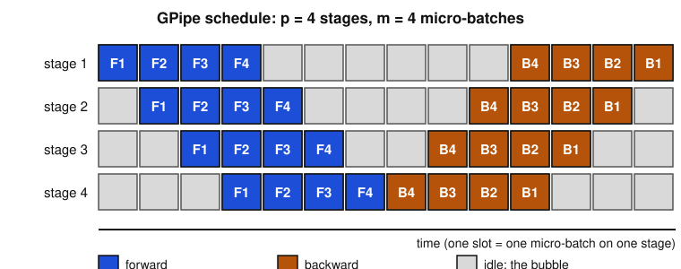

## Contents

-   [Introduction and overview](#intro)
-   [0. Review: transformers, automatic differentiation and floating point](#ch0)
-   [1. Getting started on distributed LLM training](#ch1)
-   [2. Systems for ML](#ch2)
-   [3. Multi-GPU parallelization techniques](#ch3)
-   [4. Communication-efficient distributed optimization](#ch4)
-   [5. Post-training](#ch5)
-   [6. Serving and deployment](#ch6)
-   [7. Agentic AI](#ch7)
-   [8. Research directions and open problems](#ch8)
-   [Exercises](#ex)
-   [Projects and assessment](#projects)
-   [References](#refs)

## Introduction and overview {#intro}

  -------------------- ----------------------------------------------------------------------------------------------------------------------------------------------------------------------------------------------------------------------------------------------------------------------
  Module               Training and Deploying Large-Scale Models
  Official title       Training and deploying Large-Scale Models
  Instructors          E. OYALLON (master-mva.com, 2026–2027)
  Period               Semester 2 · period 2 (04/01/2027 – 02/04/2027)
  Credits and volume   5 ECTS · 32 h (lectures 14 h, tutorials 14 h, project 4 h) per the Université Paris-Saclay programme table
  Label                [Learning]{.badge .label} · domains on master-mva.com: Deep Learning
  Language             Not displayed; the course description and the session titles on master-mva.com are written in English
  Assessment           Homework 1 (25%), Homework 2 (25%), Project (50%) (master-mva.com, “Mode de validation”); the final session is dedicated to grading; the Université Paris-Saclay page defers the details to the course element
  Prerequisites        Not displayed; master-mva.com asks students to bring a laptop and to install the required libraries from the class webpage (GPU preferred when available)
  -------------------- ----------------------------------------------------------------------------------------------------------------------------------------------------------------------------------------------------------------------------------------------------------------------

**Audience**: a student who can already train a transformer on one GPU and now has to train, adapt or serve one that does not fit on it.

**Empirical first**: a model with 7 billion parameters trained with Adam in mixed precision needs about 112 GB for its weights, gradients and optimizer states alone, more than the 80 GB of an A100 or H100 data-centre GPU. Once trained, generating a single token at batch size 1 reads all 14 GB of its weights from memory while the arithmetic units sit almost idle. This course explains these two numbers and what engineers do about them.

The course is about the whole life of a large model: estimating the cost of a training run, spreading it over many accelerators, choosing an optimizer that communicates little, adapting the pretrained model to follow instructions, and serving it cheaply, up to agents that call the model in a loop. It continues [Deep Learning](../s1-deep-learning/index.html), [Foundations of Large Language Models](../s1-foundations-llms/index.html) and [Foundations of Distributed and Large-Scale Computing Optimization](../s1-distributed-optimization/index.html), and it shares tools with [Reinforcement Learning](../s2-reinforcement-learning/index.html) and [Large Language Models for Code and Proof](../s2-llm-code-proof/index.html).

### What you will be able to do

-   Estimate the parameters, floating-point operations, memory and wall-clock time of a training run before launching it.
-   Use the compute-optimal scaling law to split a compute budget between model size and number of tokens.
-   Write and launch data-parallel training with `torch.distributed`, and explain what DDP does during the backward pass.
-   Place a kernel on the roofline and decide whether fusion, recomputation or lower precision will speed it up.
-   Price collective communications and choose a layout combining data, tensor, pipeline and sharded parallelism for a given model and cluster.
-   State and prove convergence bounds for large-batch, compressed, local and decentralized stochastic gradient methods.
-   Fine-tune a model with LoRA and align it with RLHF, DPO or GRPO, and derive the DPO loss from the KL-regularized objective.
-   Size the KV cache of a serving system, explain continuous batching and paging, and quantize weights with a controlled error.
-   Prove that speculative decoding samples exactly from the target model and predict its speed-up.
-   Build a tool-using agent loop and measure its reliability with unbiased estimators.

### Official objectives and syllabus (2026–2027)

The course description on master-mva.com introduces the foundations and practices of training modern Large Language Models (LLMs) at scale. Students learn how deep learning models are trained across multiple GPUs, nodes and clusters, and why distributed training is essential for today's largest AI systems.

The description presents the course as a series that bridges engineering and theory, giving students both the practical skills and the deeper insights needed to work with frontier AI systems. It announces 8 sessions: each of the first 7 has 2 hours of lectures followed by 2 hours of hands-on lab work, and the final session is dedicated to grading. Students bring a laptop and follow the class webpage for installation, homework and project instructions.

| Official topic | Course section |
|---|---|
| Theme: core techniques for distributed training | [ch. 1](#ch1) (data parallelism, DDP), [ch. 3](#ch3) (collectives, ZeRO and FSDP, tensor, sequence and pipeline parallelism) |
| Theme: modern frameworks and scaling strategies | [ch. 1](#ch1) (PyTorch distributed, frameworks note), [ch. 3](#ch3) (DeepSpeed ZeRO, PyTorch FSDP, Megatron-LM, 3D layouts), [ch. 6](#ch6) (serving engines) |
| Theme: practical implementations with real-world toolchains | Runnable labs in every chapter: `torch.distributed` with DDP (ch. 1), `torch.utils.checkpoint` (ch. 2), tensor-parallel and ring all-reduce simulations (ch. 3), compression and local SGD (ch. 4), LoRA and DPO (ch. 5), quantization and speculative sampling (ch. 6), an agent loop (ch. 7) |
| Theme: theoretical underpinnings of large-scale learning | [ch. 1](#ch1) (cost model and compute-optimal scaling law, Theorem 1.7), [ch. 4](#ch4) (convergence of large-batch, compressed, local, decentralized and asynchronous SGD) |
| Theme: inference and applications | [ch. 6](#ch6) (serving), [ch. 7](#ch7) (agents) |
| Session 1: Getting Started on Distributed LLM Training | [ch. 1](#ch1), with the review of [ch. 0](#ch0) |
| Session 2: Systems for ML | [ch. 2](#ch2) |
| Session 3: Multi-GPU Parallelization Techniques | [ch. 3](#ch3) |
| Session 4: Communication-Efficient Distributed Optimization | [ch. 4](#ch4) |
| Session 5: Post-training | [ch. 5](#ch5) |
| Session 6: Serving and deployment | [ch. 6](#ch6) |
| Session 7: Agentic AI (tentative) | [ch. 7](#ch7) |
| Session 8: Grading | Session 8 of the [session plan](#sessions) and the [Projects and assessment](#projects) section |
| Université Paris-Saclay course detail: “Nature de l'évaluation” deferred to the course element (no programme displayed) | Fiche above (Assessment row) |

Extensions beyond the syllabus: the review [ch. 0](#ch0), the complete convergence proofs of [ch. 4](#ch4) and the self-study research [ch. 8](#ch8).

### Where this course fits in the programme

Official prerequisites: not displayed. The course is a second-semester Learning course of 5 ECTS taught by Edouard Oyallon (CNRS, Sorbonne Université, as listed on master-mva.com).

-   **Refreshers** — [Scientific Python, NumPy and PyTorch](../s0-refresher-python-scientific-computing/index.html) for the labs, [Linear Algebra, Analysis and Optimization](../s0-refresher-linear-algebra-optimization/index.html) for ch. 3–4, and [Probability and Statistics](../s0-refresher-probability-statistics/index.html) for ch. 4–7.
-   **First-semester courses that prepare it** — [Deep Learning](../s1-deep-learning/index.html) and [Foundations of Large Language Models](../s1-foundations-llms/index.html) (transformers, pretraining); [Foundations of Distributed and Large-Scale Computing Optimization](../s1-distributed-optimization/index.html) and [Convex Optimization and Applications in Machine Learning](../s1-convex-optimization/index.html) (the analysis of ch. 4); [Theoretical Foundations of Deep Learning](../s1-theoretical-foundations-dl/index.html); [Fundamentals of Reproducible Research and Free Software](../s1-reproducible-research/index.html) (the engineering habits of the labs).
-   **Related second-semester courses** — [Reinforcement Learning](../s2-reinforcement-learning/index.html) (policy gradients of ch. 5), [Large Language Models for Code and Proof](../s2-llm-code-proof/index.html) (agents and verifiable rewards), [Deep Learning in Practice / Advanced Deep Learning](../s2-deep-learning-in-practice/index.html), [Responsible Machine Learning](../s2-responsible-ml/index.html), [Artificial Intelligence and the Environment](../s2-ai-environment/index.html) (energy of training and inference) and [Regulating AI](../s2-regulating-ai/index.html).
-   **After the course** — the [Research Internship](../s3-research-internship/index.html), where most deep-learning projects now need at least one of the techniques of ch. 1–6.

### Course outline

-   **Review: transformers, automatic differentiation and floating point** — the parameter count, the cost of a backward pass, Adam's state and the rounding model behind every later budget.
-   **Getting started on distributed LLM training** — memory and compute budgets, the compute-optimal scaling law, data parallelism and a first `torch.distributed` program.
-   **Systems for ML** — the roofline model, kernel fusion and compilation, IO-aware attention, mixed precision and activation checkpointing.
-   **Multi-GPU parallelization techniques** — collectives and their cost, sharded data parallelism (ZeRO, FSDP), tensor, sequence and pipeline parallelism, 3D layouts.
-   **Communication-efficient distributed optimization** — large batches, compression with error feedback, local SGD and DiLoCo, gossip and asynchrony, each with its convergence guarantee.
-   **Post-training** — supervised fine-tuning, LoRA, reward models, RLHF with PPO, DPO and GRPO.
-   **Serving and deployment** — prefill and decode, the KV cache, continuous batching and paging, quantization, speculative decoding.
-   **Agentic AI** — the agent loop, structured tool calls, reliability arithmetic, unbiased evaluation and the cost of serving agents.
-   **Research directions and open problems** — low-communication and asynchronous training, scaling laws, sparse and long-context models, test-time compute (self-study).

### Session plan {#sessions}

**32 h in class = 8 sessions of 4 h.**

The volume is the Université Paris-Saclay programme table (lectures 14 h, tutorials 14 h, project 4 h). It matches the master-mva.com organisation: 7 sessions of 2 h of lectures followed by 2 h of lab work, then a final session dedicated to grading. The split of the content below is a proposal that follows the official order of the sessions.

Level 1 = foundations, 2 = core results and algorithms, 3 = advanced or research-level material; the level never decreases.

| Session | Hours | Level | Content | Practice |
|---|---|---|---|---|
| 1 | 4 h | 1 | ch. 0 Review (transformer cost, backward pass, Adam, floating point); ch. 1 Getting started: budgets, scaling law, data parallelism, DDP | Ex. 1–2, 6; lab: DDP with `torch.distributed` (Code 1.11) |
| 2 | 4 h | 1 | ch. 2 Systems for ML: roofline, fusion, FlashAttention, mixed precision, activation checkpointing | Ex. 3, 7; lab: online softmax and checkpointing (Codes 2.5, 2.9) |
| 3 | 4 h | 2 | ch. 3 Multi-GPU parallelization: collectives, ZeRO and FSDP, tensor, sequence and pipeline parallelism, 3D layouts | Ex. 4, 8, 13; lab: ring all-reduce and tensor-parallel MLP (Codes 3.4, 3.11) |
| 4 | 4 h | 2 | ch. 4 Communication-efficient optimization: large batches, compression and error feedback, local SGD and DiLoCo, gossip, asynchrony | Ex. 9–10; lab: Codes 4.9, 4.12 |
| 5 | 4 h | 2 | ch. 5 Post-training: SFT, LoRA, reward models, RLHF and PPO, DPO, GRPO | Ex. 11; lab: Codes 5.4, 5.10 |
| 6 | 4 h | 3 | ch. 6 Serving and deployment: prefill and decode, KV cache, batching and paging, quantization, speculative decoding | Ex. 5, 12; lab: Codes 6.10, 6.13 |
| 7 | 4 h | 3 | ch. 7 Agentic AI: agent loop, structured outputs, reliability, evaluation, serving agents | Ex. 14; lab: Codes 7.7, 7.8 |
| 8 | 4 h | 3 | Project defences and grading (the official final session) | [Projects](#projects) |

**Self-study, outside the 32 h** (about 4 h in total): ch. 8 Research directions and open problems (≈ 3 h, with Ex. 15) · the written-exam proposal of the [Projects and assessment](#projects-exam) section as a self-test (≈ 1 h).

### How to study this module

-   Read ch. 0 even if transformers are familiar: every budget of ch. 1–6 is a consequence of Proposition 0.2 and Theorem 0.4.
-   Redo each worked example with your own numbers (your GPU, your model) before reading the next section; the course is mostly accounting, and accounting is learnt by doing it.
-   Run every code block: they use NumPy, SciPy and PyTorch on a CPU, with fixed seeds, and each runs in a few seconds. Code 1.11 starts two processes with the `gloo` backend, so it needs no GPU.
-   After each session, solve the exercises listed in the *Practice* column; the ★★★ exercises are good starting points for the project.
-   Follow the class webpage announced on master-mva.com for the installation of the libraries and for the official homework and project instructions; the subjects on this page are proposals, not the official ones.

## 0. Review: transformers, automatic differentiation and floating point {#ch0}

Everything in this course is accounting: how many parameters, how many floating-point operations, how many bytes stored and moved. This chapter fixes the three M1-level tools behind that accounting, with the notation used in the rest of the page.

The three tools are the decoder-only transformer, reverse-mode automatic differentiation with the Adam optimizer, and floating-point arithmetic.

### 0.1 The decoder-only transformer and its size

::: def
[Definition 0.1 — Decoder-only transformer]{.tag} A sequence of $T$ tokens from a vocabulary of size $V$ is embedded as a matrix $X \in \mathbb{R}^{T \times d}$. The model applies $L$ identical blocks, each made of two residual sub-layers with a normalization in front:
$$
X \leftarrow X + \mathrm{Attn}(\mathrm{LN}(X)), \qquad X \leftarrow X + \mathrm{MLP}(\mathrm{LN}(X)).
$$

Attention uses $H$ heads of dimension $d_h = d/H$. One head computes $Q = XW_Q$, $K = XW_K$ and $V = XW_V$.

With a causal mask $M$, equal to zero on and below the diagonal and to $-\infty$ above it, the head outputs
$$
\mathrm{head}(X) = \mathrm{softmax}\Big(\frac{QK^\top}{\sqrt{d_h}} + M\Big)\, V .
$$

The heads are concatenated and multiplied by $W_O \in \mathbb{R}^{d \times d}$. The MLP is $x \mapsto W_2\, \phi(W_1 x)$ with a hidden width of $4d$ and a pointwise non-linearity $\phi$ such as GeLU.

A final linear layer maps each position to one logit per vocabulary entry, and the training loss is the average next-token cross-entropy. (The letter $V$ denotes both the value matrix and the vocabulary size; the context always tells which.)
:::

:::: prop
[Proposition 0.2 — Parameter count]{.tag} Ignoring biases and normalization gains, which are $O(Ld)$, one block has $12d^2$ parameters, and the number $N$ of parameters of the whole model is

::: key
[Key result — size of a transformer]{.tag}
$$
N \approx 12\, L\, d^2 + V d
$$
:::

The last term counts a tied input embedding and output layer.

::: proof
The four attention matrices $W_Q, W_K, W_V, W_O$ are $d \times d$, which gives $4d^2$.

The MLP has $W_1 \in \mathbb{R}^{4d \times d}$ and $W_2 \in \mathbb{R}^{d \times 4d}$, which gives $8d^2$.

The sum over $L$ blocks gives $12Ld^2$, and the embedding table adds $Vd$. [∎]{.qed}
:::
::::

::: ex
[Example 0.3 — A "7B" model]{.tag} Take $d = 4096$, $L = 32$, $V = 32\,000$. Then $12Ld^2 = 6.44 \times 10^9$ and $Vd = 0.13 \times 10^9$, so
$$
N \approx 6.6 \times 10^9 \text{ parameters}.
$$

Models of this shape are marketed as "7B" models; gated MLPs with three matrices of width about $\frac{8}{3}d$ give almost the same count.
:::

### 0.2 Floating-point operations and the backward pass

A product of an $m \times k$ matrix by a $k \times n$ matrix costs $2mnk$ floating-point operations (FLOPs): one multiplication and one addition per term of each of the $mn$ inner products. Applying a linear layer with $P$ parameters to one token therefore costs $2P$ FLOPs.

:::: thm
[Theorem 0.4 — Cost of the backward pass of a linear layer]{.tag} Let $Y = XW$ with $X \in \mathbb{R}^{n \times k}$, $W \in \mathbb{R}^{k \times m}$, and let $G = \partial \ell / \partial Y$ be the gradient received from the layer above. Then
$$
\frac{\partial \ell}{\partial X} = G\, W^\top, \qquad \frac{\partial \ell}{\partial W} = X^\top G .
$$

Each of the two products costs $2nkm$ FLOPs, so the backward pass costs twice the forward pass, and it needs the input $X$ stored during the forward pass.

::: proof
Write $Y_{ij} = \sum_r X_{ir} W_{rj}$. By the chain rule,
$$
\frac{\partial \ell}{\partial X_{ir}} = \sum_j G_{ij}\, W_{rj} = (GW^\top)_{ir}, \qquad \frac{\partial \ell}{\partial W_{rj}} = \sum_i X_{ir}\, G_{ij} = (X^\top G)_{rj}.
$$

Both are matrix products whose three dimensions are $n, k, m$ in some order, hence $2nkm$ FLOPs each. The second formula uses $X$, which is why it must be kept in memory between the forward and the backward pass. [∎]{.qed}
:::
::::

More generally, reverse-mode automatic differentiation computes the gradient of any scalar function given by a program at a small constant multiple of the cost of the program (Baur and Strassen, 1983; Griewank and Walther, 2008). For transformers the multiple is very close to 2 for the backward pass alone, because almost all the work sits in linear layers.

The stored inputs of every layer are called the **activations**. Their memory grows with the batch size and the sequence length, unlike the memory of the parameters; ch. 2 shows how to trade them for recomputation.

### 0.3 Adam and its state

::: def
[Definition 0.5 — AdamW]{.tag} With gradient $g_t$, step size $\eta$, decay rates $\beta_1, \beta_2$, a small $\epsilon$ and weight decay $\lambda$:
$$
m_t = \beta_1 m_{t-1} + (1 - \beta_1) g_t, \qquad v_t = \beta_2 v_{t-1} + (1 - \beta_2)\, g_t \odot g_t,
$$
$$
x_{t+1} = x_t - \eta \Big( \frac{\hat m_t}{\sqrt{\hat v_t} + \epsilon} + \lambda x_t \Big), \qquad \hat m_t = \frac{m_t}{1 - \beta_1^t}, \ \ \hat v_t = \frac{v_t}{1 - \beta_2^t}.
$$

The optimizer therefore keeps two extra vectors, $m$ and $v$, of the size of the model (Kingma and Ba, 2015; Loshchilov and Hutter, 2019).
:::

### 0.4 Floating-point formats

::: def
[Definition 0.6 — Rounding model]{.tag} A binary floating-point format with $p$ stored fraction bits represents numbers $\pm (1.f)_2 \times 2^{e}$. Each basic operation is computed exactly and then rounded, so that
$$
\mathrm{fl}(a \circ b) = (a \circ b)(1 + \delta), \qquad |\delta| \le u = 2^{-(p+1)},
$$
as long as no overflow or underflow occurs. The number $u$ is the **unit roundoff**; the spacing between consecutive numbers in $[1, 2)$ is $2u$.
:::

The three formats of deep learning differ by how they split 16 or 32 bits between exponent (range) and fraction (precision).

| Format | Exponent bits | Fraction bits | Unit roundoff | Largest finite value | Smallest positive normal |
|---|---|---|---|---|---|
| fp32 | 8 | 23 | $2^{-24} \approx 6.0 \times 10^{-8}$ | $\approx 3.4 \times 10^{38}$ | $2^{-126}$ |
| fp16 | 5 | 10 | $2^{-11} \approx 4.9 \times 10^{-4}$ | $65\,504$ | $2^{-14} \approx 6.1 \times 10^{-5}$ |
| bf16 | 8 | 7 | $2^{-8} \approx 3.9 \times 10^{-3}$ | $\approx 3.4 \times 10^{38}$ | $2^{-126}$ |

::: ex
[Example 0.7 — Lost updates in bf16]{.tag} Near $1$, consecutive bf16 numbers are $2^{-7} \approx 0.0078$ apart.

An optimizer step that adds $10^{-3}$ to a weight equal to $1$ is therefore rounded away:
$$
\mathrm{fl}_{\mathrm{bf16}}(1 + 10^{-3}) = 1 .
$$

Thousands of such small steps are lost, and training stalls. This is why mixed-precision training (ch. 2) keeps a master copy of the weights in fp32 and applies the update there.
:::

::: ex
[Code 0.8 — Checking Proposition 0.2 and Example 0.7]{.tag}

```python
import torch
torch.manual_seed(0)
d, H = 256, 8
block = torch.nn.ModuleDict({
    "attn": torch.nn.MultiheadAttention(d, H, bias=False, batch_first=True),
    "mlp": torch.nn.Sequential(torch.nn.Linear(d, 4 * d, bias=False), torch.nn.GELU(),
                               torch.nn.Linear(4 * d, d, bias=False)),
})
n_params = sum(p.numel() for p in block.parameters())
print(n_params, 12 * d * d)                       # 786432 786432

one = torch.tensor(1.0, dtype=torch.bfloat16)
print(one + torch.tensor(1e-3, dtype=torch.bfloat16) == one)   # tensor(True): update lost
print(torch.tensor(1.0) + 1e-3 == torch.tensor(1.0))           # tensor(False) in fp32
```
:::

:::: recap
::: recap-title
Key takeaways — chapter 0
:::

-   A decoder-only transformer has about $12Ld^2$ parameters plus the embedding.
-   A matrix product costs $2mnk$ FLOPs; the backward pass of a linear layer costs twice its forward pass and needs the stored input.
-   AdamW keeps two state vectors per parameter.
-   bf16 has the range of fp32 but only 8 bits of precision: small updates to large weights are lost unless they are applied in fp32.
::::

## 1. Getting started on distributed LLM training {#ch1}

Before writing any distributed code, one must know whether a training run fits in memory, how many operations it needs and how long it will take. This chapter turns ch. 0 into three budgets, uses them to split a compute budget between model size and data, and then introduces the simplest way to use many GPUs: data parallelism.

### 1.1 The compute budget

:::: prop
[Proposition 1.1 — Training FLOPs]{.tag} Training a model with $N$ parameters on $D$ tokens costs about

::: key
[Key result — the compute budget]{.tag}
$$
C \approx 6\, N D \ \text{FLOPs}
$$
:::

This neglects the attention scores, whose share of the cost is at most $T/(6d)$ for a context of $T$ tokens.

::: proof
In the forward pass each parameter enters one multiply-add per token, hence $2N$ FLOPs per token (ch. 0.2).

By Theorem 0.4 the backward pass costs twice the forward pass, hence $4N$ FLOPs per token. The total is $6N$ per token and $6ND$ for $D$ tokens.

For the attention scores, one layer computes $QK^\top$ and multiplies by $V$: about $4Td$ FLOPs per token in the forward pass, versus $24d^2$ for the $12d^2$ weights of the block. The ratio is $T/(6d)$, and causal masking can halve it. [∎]{.qed}
:::
::::

For $T = 4096$ and $d = 4096$ the attention scores add at most about 17 %. They matter for long contexts and small widths, and they are counted exactly in the papers that report hardware utilization.

### 1.2 The memory budget

:::: prop
[Proposition 1.2 — Mixed-precision Adam needs 16 bytes per parameter]{.tag} Training with bf16 weights and gradients, an fp32 master copy and fp32 Adam moments stores, per parameter:
$$
\underbrace{2}_{\text{bf16 weight}} + \underbrace{2}_{\text{bf16 gradient}} + \underbrace{4}_{\text{fp32 master}} + \underbrace{4 + 4}_{\text{Adam } m, v} = 16 \text{ bytes},
$$
before counting the activations.

::: proof
Each item is one number per parameter in the stated format (ch. 0.4 and Definition 0.5), and bf16 uses 2 bytes, fp32 uses 4. [∎]{.qed}
:::
::::

::: ex
[Example 1.3 — A 7B model does not fit on one GPU]{.tag} For $N = 7 \times 10^9$, the model states take
$$
16 \times 7 \times 10^9 = 112 \text{ GB},
$$
more than the 80 GB of an A100 or H100 GPU.

The activations come on top. Korthikanti et al. (2023) estimate them at $sbh(34 + 5as/h)$ bytes per layer for a sequence length $s$, micro-batch $b$, width $h$ and $a$ heads in 16-bit precision.

With $s = h = 4096$, $b = 1$ and $a = 32$, this is 3.3 GB per layer and about 104 GB for 32 layers. Most of it is the $5as/h$ term, the stored attention probabilities, which ch. 2 removes.
:::

### 1.3 The time budget

::: def
[Definition 1.4 — Model FLOPs utilization]{.tag} For a run on $p$ accelerators of peak throughput $\pi$ (FLOP/s) that processes $D$ tokens in wall-clock time $t$, the **model FLOPs utilization** is
$$
\mathrm{MFU} = \frac{6ND}{p\, \pi\, t}.
$$

It counts only the FLOPs the model needs, not the recomputations of ch. 2 (Chowdhery et al., 2023). Well-tuned large runs report values of roughly 30 % to 60 %.
:::

::: ex
[Example 1.5 — How long does a 7B run take?]{.tag} Train $N = 7 \times 10^9$ parameters on $D = 2 \times 10^{12}$ tokens. Proposition 1.1 gives
$$
C = 6 \times 7 \times 10^9 \times 2 \times 10^{12} = 8.4 \times 10^{22} \text{ FLOPs}.
$$

On $p = 1024$ accelerators with a nominal peak of $10^{15}$ FLOP/s at an MFU of 40 %:
$$
t = \frac{8.4 \times 10^{22}}{1024 \times 0.4 \times 10^{15}} \approx 2.05 \times 10^5 \text{ s} \approx 57 \text{ h}.
$$

The same run on a single such accelerator would take about 6.5 years: distribution is not optional.
:::

### 1.4 Spending a compute budget: scaling laws

Given a budget $C$, should one train a large model on few tokens or a small model on many? Empirical scaling laws answer by fitting the final loss as a function of $N$ and $D$; the theorem below turns such a fit into an allocation rule.

::: def
[Definition 1.6 — Parametric loss model (Hoffmann et al., 2022)]{.tag} The final pretraining loss is modelled as
$$
\mathcal{L}(N, D) = E + \frac{A}{N^{\alpha}} + \frac{B}{D^{\beta}},
$$
with constants $E, A, B > 0$ and exponents $\alpha, \beta > 0$ fitted on many training runs.

$E$ is the irreducible loss of the data; the two other terms are the excess loss due to a finite model and to a finite data set.
:::

:::: thm
[Theorem 1.7 — Compute-optimal allocation]{.tag} Minimize $\mathcal{L}(N, D)$ subject to $6ND = C$. Write $a = \beta/(\alpha + \beta)$, $b = \alpha/(\alpha + \beta)$ and
$$
G = \Big(\frac{\alpha A}{\beta B}\Big)^{1/(\alpha+\beta)}.
$$

The unique minimizer is
$$
N^\star = G\, \Big(\frac{C}{6}\Big)^{a}, \qquad D^\star = G^{-1} \Big(\frac{C}{6}\Big)^{b}.
$$

At the optimum the two excess terms are in the fixed ratio $\alpha A / N^{\star\alpha} = \beta B / D^{\star\beta}$.

::: proof
Substitute $D = C/(6N)$ to get a function of $N$ alone:
$$
\varphi(N) = E + A N^{-\alpha} + B \Big(\frac{6N}{C}\Big)^{\beta}.
$$

Its derivative is
$$
\varphi'(N) = -\alpha A N^{-\alpha - 1} + \beta B \Big(\frac{6}{C}\Big)^{\beta} N^{\beta - 1}.
$$

Multiplying by $N > 0$, $\varphi'(N) = 0$ if and only if $\alpha A N^{-\alpha} = \beta B D^{-\beta}$, the stated ratio.

Solving for $N$ gives
$$
N^{\alpha + \beta} = \frac{\alpha A}{\beta B} \Big(\frac{C}{6}\Big)^{\beta},
$$
which is $N^\star$, and then $D^\star = (C/6)/N^\star$.

Finally $N\varphi'(N)$ is increasing in $N$, from negative to positive values, so $N^\star$ is the unique minimizer. [∎]{.qed}
:::
::::

Two consequences matter in practice. First, the exponents $a$ and $b$ depend only on $\alpha$ and $\beta$, not on the constants of the fit.

Second, if $\alpha \approx \beta$ then $a \approx b \approx 1/2$: model size and data should grow at the same rate.

Hoffmann et al. (2022) found exactly that, and concluded that earlier large models were undertrained; their 70B model Chinchilla, trained on 1.4 trillion tokens, outperformed much larger ones. Kaplan et al. (2020) had found an exponent near 0.73 for the model size; later work attributes the difference to the learning-rate schedules, the counting of embedding parameters and the small scale of the earlier experiments.

::: ex
[Example 1.8 — The "20 tokens per parameter" rule]{.tag} The rule of thumb drawn from Hoffmann et al. (2022) is $D^\star \approx 20 N^\star$. For $C = 10^{23}$ FLOPs, $6 \times 20 \times N^2 = 10^{23}$ gives
$$
N^\star \approx 2.9 \times 10^{10}, \qquad D^\star \approx 5.8 \times 10^{11} \text{ tokens}.
$$

The published parametric fit ($\alpha = 0.34$, $\beta = 0.28$) gives $a \approx 0.45$, close to $1/2$. A replication by Besiroglu et al. (2024) found that the published constants fit the data poorly: the exponents are robust, the constants are fragile.
:::

These laws optimize training compute only. A model that will serve billions of tokens should be smaller and trained longer than $N^\star$, because inference cost grows with $N$ (Exercise 15 and ch. 8).

### 1.5 Data parallelism

::: def
[Definition 1.9 — Data parallelism]{.tag} $p$ workers each hold a full copy of the model. A global batch of $B$ examples is split into $p$ shards of $B/p$ examples.

Each worker computes the gradient of the mean loss on its own shard. An **all-reduce** (ch. 3) then replaces every local gradient by the average of the $p$ gradients, and every worker applies the same optimizer step.
:::

:::: prop
[Proposition 1.10 — Data parallelism is exact]{.tag} Let the loss be a mean over examples, $\ell(x) = \frac{1}{B}\sum_{i=1}^B \ell_i(x)$, and let the shards $S_1, \dots, S_p$ have equal size $B/p$. Then
$$
\frac{1}{p} \sum_{k=1}^p \nabla \Big( \frac{p}{B} \sum_{i \in S_k} \ell_i \Big)(x) = \nabla \ell(x).
$$

Data-parallel training thus follows the same trajectory as single-device training with batch $B$, up to the order of floating-point summations.

::: proof
The left-hand side equals $\frac{1}{B} \sum_k \sum_{i \in S_k} \nabla \ell_i(x)$ by linearity of the gradient, and the shards partition the batch.

Every worker starts from the same weights and applies the same update with the same averaged gradient, so the replicas stay identical by induction. [∎]{.qed}
:::
::::

Two caveats. Batch normalization computes statistics per shard and breaks the identity, but transformers use layer normalization, which acts per example. Dropout masks must use different random seeds on different workers.

The same identity read in time instead of space is **gradient accumulation**: summing the gradients of $k$ micro-batches before one step reproduces a batch $k$ times larger on a single device.

### 1.6 A first distributed program

A distributed PyTorch job runs one process per accelerator. Each process knows its **rank** (from $0$ to $p-1$) and the **world size** $p$; the launcher `torchrun` sets them as environment variables. The processes join a **process group** through `torch.distributed.init_process_group`, with the NCCL backend on GPUs or the `gloo` backend on CPUs.

`DistributedDataParallel` (DDP) wraps the model, broadcasts the weights of rank 0 at construction and averages the gradients during `backward()`. It groups gradients into buckets (25 MB by default) and launches the all-reduce of a bucket as soon as all its gradients are ready, which overlaps communication with the rest of the backward pass (Li et al., 2020).

::: ex
[Code 1.11 — DDP on two CPU processes reproduces the full-batch run]{.tag}

```python
import os, torch, torch.distributed as dist, torch.multiprocessing as mp
from torch.nn.parallel import DistributedDataParallel as DDP

def make_data():
    g = torch.Generator().manual_seed(0)
    X = torch.randn(64, 10, generator=g)
    y = X @ torch.arange(10.0) + 0.1 * torch.randn(64, generator=g)
    return X, y

def train(model, X, y, steps=20, lr=0.05):
    opt = torch.optim.SGD(model.parameters(), lr=lr)
    for _ in range(steps):
        opt.zero_grad()
        loss = ((model(X).squeeze(-1) - y) ** 2).mean()
        loss.backward()            # under DDP, gradients are averaged across ranks here
        opt.step()
    return model

def worker(rank, world):
    os.environ["MASTER_ADDR"], os.environ["MASTER_PORT"] = "127.0.0.1", "29512"
    dist.init_process_group("gloo", rank=rank, world_size=world)
    torch.manual_seed(0)
    model = DDP(torch.nn.Linear(10, 1))
    X, y = make_data()
    shard = slice(rank * 64 // world, (rank + 1) * 64 // world)   # this rank's half
    train(model, X[shard], y[shard])
    if rank == 0:
        torch.manual_seed(0)
        ref = train(torch.nn.Linear(10, 1), X, y)                 # one process, full batch
        diff = (model.module.weight - ref.weight).abs().max().item()
        print(f"max |DDP - single process| = {diff:.1e}")           # about 1e-7
    dist.destroy_process_group()

if __name__ == "__main__":
    # "fork" avoids re-importing torch in each child (CPU only; on GPUs, launch with torchrun)
    mp.start_processes(worker, args=(2,), nprocs=2, start_method="fork")
```
:::

::: note
[Frameworks]{.tag} The techniques of ch. 1–3 are packaged in a few open-source toolchains.

-   PyTorch provides DDP and FSDP (sharded data parallelism, ch. 3).
-   DeepSpeed implements the ZeRO family (Rajbhandari et al., 2020).
-   Megatron-LM implements tensor and pipeline parallelism (Shoeybi et al., 2019; Narayanan et al., 2021).
-   In JAX, sharding annotations let the XLA compiler partition the program, following GSPMD (Xu et al., 2021).

Their interfaces change often; the cost models of this course do not.
:::

:::: recap
::: recap-title
Key takeaways — chapter 1
:::

-   Training costs about $6ND$ FLOPs and, with mixed-precision Adam, 16 bytes per parameter plus activations.
-   Wall-clock time is $6ND / (p\,\pi\,\mathrm{MFU})$: budget it before launching.
-   For a fixed compute budget, the loss-optimal model size and data size both grow roughly as $\sqrt{C}$.
-   Data parallelism with averaged gradients reproduces single-device training exactly; DDP overlaps the averaging with the backward pass.
::::

## 2. Systems for ML {#ch2}

An accelerator is fast at arithmetic and comparatively slow at moving data. This chapter gives the cost model that tells which of the two limits a computation, and the four tools that move a workload toward the arithmetic limit or shrink its memory: fusion, IO-aware attention, mixed precision and recomputation.

### 2.1 The roofline model

A GPU has many streaming multiprocessors, each with matrix units (tensor cores) that multiply small tiles in low precision. Data lives in a hierarchy: registers and a few hundred kilobytes of on-chip SRAM per multiprocessor, then tens of gigabytes of high-bandwidth memory (HBM) read at a few TB/s.

Beyond the device come the links to other GPUs: hundreds of GB/s inside a node (NVLink), tens of GB/s per GPU across nodes (InfiniBand or Ethernet). Each level is roughly ten times slower than the previous one, and the whole course is about not waiting for the slow levels.

::: def
[Definition 2.1 — Arithmetic intensity]{.tag} The **arithmetic intensity** of a kernel is the ratio of the floating-point operations it performs to the bytes it moves between HBM and the chip:
$$
I = \frac{F}{Q} \quad \text{(FLOP per byte)}.
$$
:::

:::: thm
[Theorem 2.2 — Roofline bound (Williams, Waterman and Patterson, 2009)]{.tag} On a device of peak throughput $\pi$ (FLOP/s) and memory bandwidth $\beta$ (byte/s), a kernel of intensity $I$ runs at a throughput of at most

::: key
[Key result — the roofline]{.tag}
$$
\text{throughput} \le \min(\pi,\ \beta I)
$$
:::

The kernel is **memory-bound** if $I < \pi/\beta$ and **compute-bound** otherwise; the threshold $\pi/\beta$ is the ridge point.

::: proof
The kernel performs $F$ FLOPs, which takes at least $F/\pi$ seconds, and moves $Q$ bytes, which takes at least $Q/\beta$ seconds. Its duration is therefore at least $\max(F/\pi, Q/\beta)$.

Its throughput $F/t$ is at most $F / \max(F/\pi, Q/\beta) = \min(\pi, \beta F/Q)$. [∎]{.qed}
:::
::::

::: ex
[Example 2.3 — Where common kernels sit]{.tag} Take $\pi = 10^{15}$ FLOP/s and $\beta = 3 \times 10^{12}$ byte/s, the order of magnitude of current data-centre GPUs in bf16. The ridge point is $\pi/\beta \approx 333$ FLOP per byte.

-   **Square matrix product** of size $n$ in bf16: $2n^3$ FLOPs for $3 \times 2n^2$ bytes, so $I = n/3$. It is compute-bound as soon as $n \gtrsim 1000$.
-   **Matrix–vector product** with a $d \times d$ bf16 matrix: $2d^2$ FLOPs for about $2d^2$ bytes, so $I \approx 1$. It reaches at most 0.3 % of the peak. This is token generation at batch size 1 (ch. 6).
-   **Pointwise GeLU** in bf16: a few FLOPs per element for 4 bytes read and written, so $I$ is of order 1. It is memory-bound.
:::

### 2.2 Fusion and compilation

A chain of $k$ pointwise operations run as $k$ separate kernels reads and writes the whole tensor $k$ times. A **fused** kernel reads it once, applies the $k$ operations in registers and writes once; for memory-bound operations the speed-up approaches $k$.

Compilers perform this fusion automatically. `torch.compile` captures a PyTorch program as a graph and generates fused kernels written in Triton (Tillet, Kung and Cox, 2019); XLA does the same for JAX programs. Small kernels also pay a launch overhead of a few microseconds each, which CUDA graphs remove by replaying a recorded sequence of kernels.

The practical loop is: profile one training step (`torch.profiler`), sort the kernels by time, place the largest ones on the roofline, and attack the memory-bound ones first.

### 2.3 IO-aware attention

Standard attention writes the $T \times T$ matrix of scores to HBM, reads it back for the softmax, writes the probabilities and reads them again to multiply by $V$. For long sequences this traffic, and the memory to store the probabilities for the backward pass, dominates. FlashAttention (Dao et al., 2022) never materializes the matrix, thanks to the following identity.

:::: prop
[Proposition 2.4 — Online softmax]{.tag} Let scores $s_1, \dots, s_n$ and value vectors $v_1, \dots, v_n$ arrive in blocks. Start from $m = -\infty$, $\ell = 0$, $o = 0$, and for each block $J$ update
$$
m' = \max\big(m, \max_{j \in J} s_j\big), \qquad \ell' = e^{m - m'}\ell + \sum_{j \in J} e^{s_j - m'},
$$
$$
o' = e^{m - m'} o + \sum_{j \in J} e^{s_j - m'} v_j .
$$

After the last block,
$$
\frac{o}{\ell} = \sum_{j=1}^n \frac{e^{s_j}}{\sum_k e^{s_k}}\, v_j ,
$$
the exact attention output, and every exponential computed has a non-positive argument.

::: proof
Let $S$ be the set of indices already processed. We show by induction the invariant
$$
m = \max_{j \in S} s_j, \qquad \ell = \sum_{j \in S} e^{s_j - m}, \qquad o = \sum_{j \in S} e^{s_j - m} v_j .
$$

It holds for $S = \emptyset$ with the conventions above. Assume it before a block $J$.

The first update makes $m'$ the maximum over $S \cup J$.

Since $e^{m - m'} e^{s_j - m} = e^{s_j - m'}$, rescaling the old sums by $e^{m - m'}$ re-expresses them relative to $m'$; adding the terms of $J$ gives the invariant for $S \cup J$.

At the end, $o/\ell$ is the ratio of the two sums, in which the common factor $e^{-m}$ cancels. All arguments $s_j - m'$ and $m - m'$ are non-positive by definition of $m'$. [∎]{.qed}
:::
::::

FlashAttention tiles $Q$, $K$ and $V$ so that each block fits in SRAM and applies Proposition 2.4 block by block. For the backward pass it stores only $m$ and $\ell$ per query and recomputes the probabilities, which removes the $5as/h$ term of Example 1.3.

For sequence length $T$, head dimension $d$ and SRAM size $M$, Dao et al. (2022) show that standard attention needs $\Theta(Td + T^2)$ HBM accesses and FlashAttention $\Theta(T^2 d^2 / M)$.

Since $d^2$ is several times smaller than $M$ in practice, the traffic drops several-fold, and the extra memory becomes linear in $T$.

::: ex
[Code 2.5 — Tiled attention with the online softmax is exact]{.tag}

```python
import numpy as np
rng = np.random.default_rng(0)
T, d, block = 512, 64, 64
Q, K, V = (rng.standard_normal((T, d)) for _ in range(3))

S = Q @ K.T / np.sqrt(d)                                    # naive: T x T matrix in memory
P = np.exp(S - S.max(axis=1, keepdims=True))
naive = (P / P.sum(axis=1, keepdims=True)) @ V

m = np.full((T, 1), -np.inf); l = np.zeros((T, 1)); o = np.zeros((T, d))
for j in range(0, T, block):                                # one key/value block at a time
    s = Q @ K[j:j + block].T / np.sqrt(d)                   # T x block scores only
    m_new = np.maximum(m, s.max(axis=1, keepdims=True))
    scale = np.exp(m - m_new)
    l = scale * l + np.exp(s - m_new).sum(axis=1, keepdims=True)
    o = scale * o + np.exp(s - m_new) @ V[j:j + block]
    m = m_new
print(np.abs(o / l - naive).max())                          # about 1e-15
```
:::

### 2.4 Mixed precision

::: def
[Definition 2.6 — Mixed-precision training (Micikevicius et al., 2018)]{.tag} Forward and backward passes run in a 16-bit format, with matrix products accumulated in fp32 inside the tensor cores. An fp32 master copy of the weights receives the optimizer update (Example 0.7) and is cast to 16 bits for the next step.

With fp16, the loss is multiplied by a scale $S$ before the backward pass and the gradients are divided by $S$ before the update. **Dynamic loss scaling** skips the step and halves $S$ when a gradient overflows, and doubles $S$ after a fixed number of steps without overflow.
:::

::: ex
[Example 2.7 — Why fp16 needs loss scaling and bf16 does not]{.tag} Gradients of a large model often have entries around $10^{-8}$. The smallest positive fp16 number is $2^{-24} \approx 6.0 \times 10^{-8}$, so such an entry rounds to zero and the information is lost.

With $S = 2^{16}$ the scaled entry is $6.6 \times 10^{-4}$, a normal fp16 number stored with a relative error below $4.9 \times 10^{-4}$. Dividing by $S$ in fp32 recovers it.

bf16 has the exponent range of fp32, so its gradients do not underflow and loss scaling is usually unnecessary; it pays with a coarser precision.

```python
import numpy as np
g = np.float32(1e-8)
print(np.float16(g))                                   # 0.0: underflow
S = np.float32(2.0 ** 16)
print(np.float32(np.float16(g * S)) / S)               # 1e-08 recovered (relative error < 5e-4)
```
:::

Eight-bit floating-point formats (FP8, Micikevicius et al., 2022) push the same idea further, with one scale per tensor or per block; they are used for the largest matrix products of recent training runs.

### 2.5 Activation checkpointing

:::: prop
[Proposition 2.8 — Recomputation with $\sqrt{n}$ memory (Chen et al., 2016)]{.tag} Consider a chain of $n$ layers whose activations all have the same size, counted as one unit. Store only the input of every $k$-th layer during the forward pass, and during the backward pass recompute each segment of $k$ layers from its stored input just before differentiating through it.

The peak activation memory is about $n/k + k$ units, minimized at $k = \sqrt{n}$:
$$
\text{peak memory} \approx 2\sqrt{n} \ \text{units}, \qquad \text{extra cost} = \text{one forward pass}.
$$

::: proof
The checkpoints occupy $\lceil n/k \rceil$ units throughout the backward pass. While one segment is being differentiated, its $k$ recomputed activations are alive as well, and they are freed before the next segment. The peak is therefore $n/k + k$ up to rounding.

By the inequality of arithmetic and geometric means, $n/k + k \ge 2\sqrt{n}$, with equality at $k = \sqrt{n}$.

Every layer is run forward once more during the backward pass, hence the cost of one extra forward pass. [∎]{.qed}
:::
::::

Since the backward pass costs about twice the forward pass (Theorem 0.4), a training step goes from 3 to 4 forward-pass units: about 33 % more compute. For $n = 48$ layers and $k = 7$, the peak is about 14 units instead of 48.

In transformers the activations are not uniform. **Selective recomputation** (Korthikanti et al., 2023) recomputes only the parts that are cheap in FLOPs and expensive in memory, such as the attention probabilities; FlashAttention already does exactly that for attention.

::: ex
[Code 2.9 — Checkpointing recomputes each layer once and changes no gradient]{.tag}

```python
import torch
from torch.utils.checkpoint import checkpoint
torch.manual_seed(0)
n, width = 16, 64
layers = torch.nn.ModuleList(
    [torch.nn.Sequential(torch.nn.Linear(width, width), torch.nn.Tanh()) for _ in range(n)])
calls = [0]
for layer in layers:
    layer.register_forward_pre_hook(lambda *args: calls.__setitem__(0, calls[0] + 1))

def segment(h, i, j):
    for layer in layers[i:j]:
        h = layer(h)
    return h

def forward(x, k=None):
    if k is None:
        return segment(x, 0, n)
    for i in range(0, n, k):                     # keep only the input of each segment
        x = checkpoint(segment, x, i, min(i + k, n), use_reentrant=False)
    return x

x = torch.randn(32, width)
grads = []
for k in [None, 4]:
    layers.zero_grad(); calls[0] = 0
    forward(x, k).pow(2).mean().backward()
    grads.append(torch.cat([p.grad.flatten() for p in layers.parameters()]))
    print("segment size", k, "-> layer forward calls:", calls[0])     # 16, then 32
print("same gradients:", torch.allclose(grads[0], grads[1], atol=1e-6))
```
:::

:::: recap
::: recap-title
Key takeaways — chapter 2
:::

-   A kernel runs at most at $\min(\pi, \beta I)$: below the ridge point it is memory-bound, and only reducing traffic helps.
-   Fusion and compilation cut the traffic of pointwise operations; FlashAttention cuts the traffic and memory of attention with an exact online softmax.
-   Mixed precision computes in 16 bits and updates fp32 master weights; fp16 needs loss scaling, bf16 usually does not.
-   Storing $\sqrt{n}$ checkpoints instead of $n$ activations costs one extra forward pass.
::::

## 3. Multi-GPU parallelization techniques {#ch3}

When the model states do not fit on one device, or one device is too slow, the computation must be split. There are three axes to split along: the data, the matrices inside each layer, and the sequence of layers. Each axis has a specific communication pattern; this chapter prices the patterns first and then the axes.

### 3.1 Collective communication

::: def
[Definition 3.1 — Collectives]{.tag} A group of $p$ processes, each holding a buffer, can run:

-   **broadcast**: one process sends its buffer to all;
-   **reduce**: the element-wise sum of all buffers arrives at one process;
-   **all-reduce**: every process receives the sum;
-   **reduce-scatter**: the sum is split into $p$ chunks, and process $i$ receives chunk $i$;
-   **all-gather**: each process holds one chunk, and every process receives all of them;
-   **all-to-all**: process $i$ sends a distinct chunk to every process $j$.

An all-reduce is a reduce-scatter followed by an all-gather.
:::

::: def
[Definition 3.2 — Latency–bandwidth cost model]{.tag} Sending a message of $n$ bytes over one link costs
$$
\alpha + \frac{n}{W},
$$
where $\alpha$ is the latency (microseconds) and $W$ the bandwidth of the link in bytes per second. A process can send on one link and receive on another simultaneously.
:::

:::: thm
[Theorem 3.3 — Ring all-reduce]{.tag} Arrange $p$ processes in a ring, process $i$ sending to process $i + 1 \bmod p$, and split each buffer of $n$ bytes into $p$ chunks.

The ring algorithm runs $p - 1$ reduce-scatter steps followed by $p - 1$ all-gather steps, and takes the time

::: key
[Key result — ring all-reduce]{.tag}
$$
t_{\mathrm{ring}} = 2(p-1)\Big(\alpha + \frac{n}{pW}\Big)
$$
:::

Each process sends $2(p-1)n/p$ bytes, less than $2n$ whatever $p$.

::: proof
*Reduce-scatter.* At step $s = 0, \dots, p-2$, process $i$ sends its current chunk $(i - s) \bmod p$ to process $i+1$, which adds it to its own copy of that chunk.

Invariant: the chunk sent by process $i$ at step $s$ holds the sum of the inputs of the $s + 1$ processes $i - s, \dots, i$. It holds at $s = 0$, where each process sends its own data.

If it holds at step $s$, process $i$ received at that step chunk $(i - 1 - s)$ summed over $i - 1 - s, \dots, i - 1$ and added its own input. At step $s + 1$ it sends exactly that chunk, now summed over $s + 2$ processes.

After step $p - 2$, process $j$ has added its input to a chunk summed over the $p - 1$ other processes: it holds the complete sum of chunk $(j + 1) \bmod p$.

*All-gather.* During $p - 1$ more steps, each process forwards around the ring the complete chunk it received last. After $p - 1$ steps every complete chunk has visited every process.

*Cost.* Every step moves $n/p$ bytes on every link simultaneously, hence $\alpha + n/(pW)$ per step and $2(p - 1)$ steps. [∎]{.qed}
:::
::::

::: ex
[Code 3.4 — A simulated ring all-reduce]{.tag}

```python
import numpy as np
rng = np.random.default_rng(0)
p, n = 4, 12                                     # 4 workers, buffers of 12 entries
x = [rng.standard_normal(n) for _ in range(p)]
buf = [np.split(xi.copy(), p) for xi in x]       # buf[i][c]: chunk c held by worker i
sent = np.zeros(p)
for s in range(p - 1):                           # reduce-scatter
    msgs = [(i, (i - s) % p, buf[i][(i - s) % p].copy()) for i in range(p)]
    for i, c, data in msgs:                      # the sends of one step are simultaneous
        buf[(i + 1) % p][c] += data; sent[i] += data.size
for s in range(p - 1):                           # all-gather of the complete chunks
    msgs = [(i, (i + 1 - s) % p, buf[i][(i + 1 - s) % p].copy()) for i in range(p)]
    for i, c, data in msgs:
        buf[(i + 1) % p][c] = data; sent[i] += data.size
print(all(np.allclose(np.concatenate(b), sum(x)) for b in buf))   # True
print(sent, 2 * (p - 1) * n / p)                 # every worker sent 18 entries
```
:::

::: prop
[Proposition 3.5 — The ring is bandwidth-optimal]{.tag} In the model of Definition 3.2, every all-reduce algorithm needs at least
$$
\frac{2(p-1)}{p} \cdot \frac{n}{W}
$$
seconds of transfer time, so the ring of Theorem 3.3 is optimal up to the latency term (Patarasuk and Yuan, 2009).

*Idea of the proof.* Every entry of the result depends on all $p$ inputs and must end on all $p$ processes. A counting argument on the bytes that must leave and enter each process yields $(p-1)n/p$ for the reduction part and as much for the distribution part; the paper gives the formal argument.
:::

The latency term $2(p-1)\alpha$ grows with $p$. For small messages, tree-shaped algorithms, with $O(\log p)$ steps, are faster; libraries such as NCCL choose between rings and trees according to the message size.

::: ex
[Example 3.6 — Averaging the gradients of a 7B model]{.tag} In bf16 the gradients of $7 \times 10^9$ parameters weigh $n = 14$ GB. On $p = 8$ GPUs of one node with $W = 100$ GB/s per direction:
$$
\frac{2 \times 7}{8} \times \frac{14}{100} \approx 0.25 \text{ s per step}.
$$

A central parameter server would instead receive $8 \times 14$ GB on its own link, at least 1.1 s, and the time would grow with $p$. The ring keeps the time almost constant as $p$ grows; DDP hides it behind the backward pass (ch. 1.6).
:::

### 3.2 Sharded data parallelism: ZeRO and FSDP

Data parallelism replicates all 16 bytes per parameter on every GPU (Proposition 1.2). ZeRO (Rajbhandari et al., 2020) removes the redundancy by **sharding**: each of the $N_d$ data-parallel processes keeps only $1/N_d$ of some states, and fetches the rest when needed.

:::: prop
[Proposition 3.7 — Memory per GPU]{.tag} For $\Phi$ parameters, mixed-precision Adam ($2 + 2 + 12$ bytes per parameter) and $N_d$ processes, the model states per GPU are:

| Stage | What is sharded | Bytes per GPU |
|---|---|---|
| DDP | nothing | $16\Phi$ |
| ZeRO-1 | optimizer states | $4\Phi + 12\Phi/N_d$ |
| ZeRO-2 | optimizer states and gradients | $2\Phi + 14\Phi/N_d$ |
| ZeRO-3 (FSDP) | optimizer states, gradients and weights | $16\Phi/N_d$ |

::: proof
The 12 bytes of fp32 master weights and moments, the 2 bytes of bf16 gradients and the 2 bytes of bf16 weights are each either replicated (full $\Phi$ per GPU) or divided by $N_d$. Summing the replicated and the sharded parts row by row gives the table. [∎]{.qed}
:::
::::

:::: prop
[Proposition 3.8 — Communication volume]{.tag} Count the bytes each process sends per step, in units of the size of the bf16 parameters, for large $N_d$. DDP, ZeRO-1 and ZeRO-2 send $2$ units; ZeRO-3 sends $3$ units, 1.5 times more.

::: proof
DDP runs one all-reduce of the gradients, which is a reduce-scatter (1 unit) followed by an all-gather (1 unit), by Theorem 3.3.

ZeRO-1 and ZeRO-2 run the same two halves: a reduce-scatter brings to each process the summed gradients of its shard, it updates its shard of the weights, and an all-gather redistributes the updated weights.

ZeRO-3 frees the weights of a layer after using them. It must all-gather them before the forward pass (1 unit) and again before the backward pass (1 unit), and reduce-scatter the gradients (1 unit). [∎]{.qed}
:::
::::

::: ex
[Example 3.9 — The numbers of the ZeRO paper]{.tag} For $\Phi = 7.5 \times 10^9$ and $N_d = 64$, Proposition 3.7 gives

-   DDP: 120 GB per GPU;
-   ZeRO-1: 31.4 GB;
-   ZeRO-2: 16.6 GB;
-   ZeRO-3: 1.9 GB.

DDP does not even fit on an 80 GB device, ZeRO-1 leaves it about 48 GB for activations, and only ZeRO-3 would fit on a 16 GB device.
:::

PyTorch's **FSDP** implements stage 3 (Zhao et al., 2023). It prefetches the weights of the next layer during the computation of the current one, so that the extra all-gather is hidden when the per-GPU batch is large enough. Offloading the optimizer states to CPU memory (Ren et al., 2021) trades PCIe bandwidth for GPU memory.

### 3.3 Tensor parallelism

Sharding stores the weights in pieces but still computes each layer on one device. **Tensor parallelism** (Shoeybi et al., 2019) splits the computation of each layer itself.

:::: prop
[Proposition 3.10 — The Megatron split of an MLP]{.tag} Let $Z = \phi(XA)B$ with $X \in \mathbb{R}^{b \times d}$, $A \in \mathbb{R}^{d \times 4d}$, $B \in \mathbb{R}^{4d \times d}$ and $\phi$ applied entry-wise.

Split $A$ into $t$ column blocks and $B$ into $t$ row blocks:
$$
A = [A_1 \ \cdots \ A_t], \qquad B = \begin{bmatrix} B_1 \\ \vdots \\ B_t \end{bmatrix}.
$$

Then
$$
Z = \sum_{i=1}^{t} \phi(X A_i)\, B_i .
$$

Device $i$ holds $A_i$ and $B_i$ and computes the $i$-th term with no communication; a single all-reduce sums the $t$ terms.

::: proof
The columns of $XA$ are the columns of $XA_1, \dots, XA_t$ side by side. An entry-wise function acts column by column, so $\phi(XA) = [\phi(XA_1) \cdots \phi(XA_t)]$.

A row-block times column-block product of conformal blocks is the sum of the block products, which gives the formula. [∎]{.qed}
:::
::::

In the backward pass, the gradient with respect to $X$ is a sum of $t$ contributions, which costs one more all-reduce. Attention is split the same way: each device takes $H/t$ heads, and $W_O$ is split by rows.

A transformer block therefore costs two all-reduces in the forward pass and two in the backward pass, each of the size of the activations $b \times s \times d$. These are on the critical path and cannot be overlapped as easily as DDP's, so tensor parallelism is kept inside a node, on its fastest links.

::: ex
[Code 3.11 — Tensor-parallel MLP on four simulated devices]{.tag}

```python
import torch
torch.manual_seed(0)
b, d, t = 8, 64, 4                               # batch, width, tensor-parallel degree
X = torch.randn(b, d)
A = torch.randn(d, 4 * d) / d ** 0.5
B = torch.randn(4 * d, d) / (4 * d) ** 0.5
gelu = torch.nn.functional.gelu
full = gelu(X @ A) @ B
A_parts, B_parts = A.chunk(t, dim=1), B.chunk(t, dim=0)   # column split, row split
partial = [gelu(X @ Ai) @ Bi for Ai, Bi in zip(A_parts, B_parts)]   # one per device
print(torch.allclose(full, sum(partial), atol=1e-5))      # True: sum = all-reduce
```
:::

**Sequence parallelism** (Korthikanti et al., 2023) also splits the layer normalizations and dropouts, which tensor parallelism replicates, along the sequence dimension. Each all-reduce becomes a reduce-scatter plus an all-gather of the same total volume, and the activations of those regions are divided by $t$.

For very long contexts, **context parallelism** splits the sequence across devices for attention as well; ring attention (Liu, Zaharia and Abbeel, 2024) circulates key and value blocks around a ring while each device applies the online softmax of Proposition 2.4.

### 3.4 Pipeline parallelism

::: def
[Definition 3.12 — Pipeline schedule]{.tag} The $L$ layers are cut into $p$ consecutive **stages** on $p$ devices, and each batch is cut into $m$ **micro-batches**. Stage $s$ sends its output activations to stage $s + 1$ in the forward pass and receives gradients from it in the backward pass.

In the GPipe schedule (Huang et al., 2019) all forward passes run first, then all backward passes, and the weights are updated once per batch.
:::

:::: prop
[Proposition 3.13 — The pipeline bubble]{.tag} Let each stage take $t_f$ for the forward pass and $t_b$ for the backward pass of one micro-batch. The GPipe schedule takes $(m + p - 1)(t_f + t_b)$, and each device is idle for the fraction
$$
\frac{p - 1}{m + p - 1}
$$
of the time.

::: proof
Micro-batch $j$ cannot enter stage $s$ before it has left stage $s - 1$. The first micro-batch reaches the last stage after $(p - 1)t_f$, and the last stage then processes the $m$ micro-batches one after the other, so the forward phase lasts $(m + p - 1)t_f$; the schedule achieves this.

The backward phase is symmetric and lasts $(m + p - 1)t_b$. Each device works $m(t_f + t_b)$ out of the total, and the idle fraction is $1 - m/(m + p - 1)$. [∎]{.qed}
:::
::::

{fig-alt="Grid of four rows (pipeline stages) by fourteen time slots. Forward passes F1 to F4 move diagonally down-right in the first seven slots, backward passes B4 to B1 move diagonally up-right in the last seven; the remaining cells are grey idle time." width="100%"}

::: ex
[Example 3.14 — Sizing the number of micro-batches]{.tag} With $p = 4$ stages:

-   $m = 4$ micro-batches give a bubble of $3/7 \approx 43$ %;
-   $m = 16$ give $3/19 \approx 16$ %.

The rule is $m \gg p$. But GPipe stores the activations of all $m$ micro-batches before the first backward pass, so a large $m$ costs memory.
:::

The **1F1B** schedule of PipeDream (Narayanan et al., 2019), in the synchronous form used by Megatron-LM, starts the backward pass of a micro-batch as soon as it leaves the last stage and then alternates one forward and one backward. The bubble is unchanged, but each stage keeps at most $p$ micro-batches in flight instead of $m$.

The **interleaved** schedule of Narayanan et al. (2021) gives each device $v$ non-consecutive chunks of layers. It divides the bubble by $v$, at the price of $v$ times more point-to-point messages.

::: note
[Expert parallelism]{.tag} In a mixture-of-experts layer (Lepikhin et al., 2021; Fedus, Zoph and Shazeer, 2022), a router sends each token to $k$ of $E$ expert MLPs. The experts are spread over devices, and each MoE layer runs two all-to-all collectives: one to dispatch the tokens to their experts and one to bring the results back.

The parameter count grows with $E$ while the FLOPs per token grow only with $k$; the price is the all-to-all traffic and the balancing of the load between experts.
:::

### 3.5 Combining the axes

A run on $N_{\mathrm{GPU}} = d_{\mathrm{dp}} \times t \times p$ devices combines data, tensor and pipeline parallelism ("3D parallelism"), often with ZeRO-1 along the data axis. Narayanan et al. (2021) give the usual heuristics:

-   tensor parallelism inside a node, with $t$ at most the number of GPUs per node;
-   pipeline parallelism across nodes, only as much as needed to fit the model;
-   data parallelism for the remaining factor.

::: ex
[Example 3.15 — A 70B model on 512 GPUs]{.tag} Take 64 nodes of 8 GPUs with 80 GB each. Choose $t = 8$ inside each node and $p = 4$ stages, so each GPU holds $70 \times 10^9 / 32 \approx 2.2 \times 10^9$ parameters.

Their states take $16 \times 2.2 \approx 35$ GB (Proposition 1.2). The remaining factor is $d_{\mathrm{dp}} = 512/32 = 16$.

ZeRO-1 along this axis brings the states down to $4 \times 2.2 + 12 \times 2.2/16 \approx 10.4$ GB, leaving most of the memory to activations. With $m = 16$ micro-batches of one sequence of 4096 tokens per pipeline, a step processes $16 \times 16 \times 4096 \approx 10^6$ tokens with a 16 % bubble.
:::

:::: recap
::: recap-title
Key takeaways — chapter 3
:::

-   The ring all-reduce sends $2(p-1)n/p$ bytes per process, which is optimal and almost independent of $p$.
-   ZeRO shards optimizer states, gradients and weights across data-parallel ranks; stage 3 (FSDP) divides the memory by $N_d$ for 1.5 times the communication.
-   Tensor parallelism splits each matrix product, needs an all-reduce of activations in every block and stays inside a node.
-   Pipeline parallelism splits the layers; its bubble is $(p-1)/(m+p-1)$, and 1F1B bounds its memory.
::::

## 4. Communication-efficient distributed optimization {#ch4}

Ch. 3 made each communication as fast as possible; this chapter asks how much communication the optimizer really needs. Each answer (bigger batches, compressed messages, rarer averaging, exchanges with neighbours only, no waiting) comes with a convergence guarantee that says what it costs.

### 4.1 The baseline: mini-batch SGD

::: def
[Definition 4.1 — Standing assumptions]{.tag} We minimize $f(x) = \mathbb{E}_{\xi}[F(x; \xi)]$ over $x \in \mathbb{R}^d$, with $f$ bounded below by $f^\star$.

The function $f$ is **$L$-smooth**: its gradient is $L$-Lipschitz, which implies, for all $x, y$,
$$
f(y) \le f(x) + \langle \nabla f(x), y - x \rangle + \frac{L}{2}\|y - x\|^2 .
$$

The stochastic gradient $\nabla F(x; \xi)$ is unbiased with variance at most $\sigma^2$. A mini-batch gradient averages $B$ independent samples, so its variance is at most $\sigma^2/B$. We write $\Delta = f(x_0) - f^\star$.
:::

:::: thm
[Theorem 4.2 — Mini-batch SGD on a non-convex objective]{.tag} Under Definition 4.1, SGD $x_{t+1} = x_t - \eta g_t$ with mini-batch gradients and $\eta \le 1/L$ satisfies

::: key
[Key result — the SGD bound]{.tag}
$$
\frac{1}{T}\sum_{t=0}^{T-1} \mathbb{E}\|\nabla f(x_t)\|^2 \ \le\ \frac{2\Delta}{\eta T} + \frac{\eta L \sigma^2}{B}
$$
:::

::: proof
1.  Apply smoothness with $y = x_{t+1}$:
    $$
    f(x_{t+1}) \le f(x_t) - \eta \langle \nabla f(x_t), g_t \rangle + \frac{L\eta^2}{2}\|g_t\|^2 .
    $$
2.  Take the expectation conditionally on $x_t$. Unbiasedness and the bias–variance decomposition give
    $$
    \mathbb{E}\langle \nabla f(x_t), g_t \rangle = \|\nabla f(x_t)\|^2, \qquad \mathbb{E}\|g_t\|^2 \le \|\nabla f(x_t)\|^2 + \frac{\sigma^2}{B}.
    $$
3.  Hence, using $1 - L\eta/2 \ge 1/2$ when $\eta \le 1/L$:
    $$
    \mathbb{E} f(x_{t+1}) \le \mathbb{E} f(x_t) - \frac{\eta}{2}\mathbb{E}\|\nabla f(x_t)\|^2 + \frac{L\eta^2\sigma^2}{2B}.
    $$
4.  Sum over $t = 0, \dots, T-1$; the left side telescopes and $f(x_T) \ge f^\star$. Dividing by $\eta T/2$ gives the bound. [∎]{.qed}
:::
::::

Data parallelism (ch. 1) multiplies $B$ by the number of workers. The next result says when this pays.

:::: prop
[Corollary 4.3 — Linear scaling and the critical batch size]{.tag} To make the bound of Theorem 4.2 at most $\varepsilon$, choose $\eta = \min\big(1/L,\ \varepsilon B / (2L\sigma^2)\big)$. The number of steps and of samples needed are then
$$
T = \frac{4L\Delta}{\varepsilon}\max\Big(1, \frac{B_{\mathrm{crit}}}{B}\Big), \qquad BT = \frac{4L\Delta}{\varepsilon}\max(B, B_{\mathrm{crit}}), \qquad B_{\mathrm{crit}} = \frac{2\sigma^2}{\varepsilon}.
$$

Below $B_{\mathrm{crit}}$, doubling the batch and the step size halves the number of steps at the same number of samples. Above it, the number of steps stops decreasing and extra samples are wasted.

::: proof
Each of the two terms of the bound must be at most $\varepsilon/2$. The second requires $\eta \le \varepsilon B/(2L\sigma^2)$, and the first then requires $T \ge 4\Delta/(\eta\varepsilon)$.

Substituting the chosen $\eta$ gives $T$, and multiplying by $B$ gives the number of samples. [∎]{.qed}
:::
::::

This is the **linear scaling rule** of Goyal et al. (2017), who trained an image classifier with batches of 8192 by scaling the learning rate proportionally, after a warm-up. McCandlish et al. (2018) measured a "gradient noise scale" that plays the role of $B_{\mathrm{crit}}$ and grows during training, which is why some large runs increase their batch size during training.

### 4.2 Compressed communication

::: def
[Definition 4.4 — Unbiased compressor]{.tag} A random map $\mathcal{C}: \mathbb{R}^d \to \mathbb{R}^d$ is an **$\omega$-unbiased compressor** if, for every $x$,
$$
\mathbb{E}\,\mathcal{C}(x) = x, \qquad \mathbb{E}\|\mathcal{C}(x) - x\|^2 \le \omega \|x\|^2 .
$$
:::

:::: prop
[Proposition 4.5 — Two unbiased compressors]{.tag}

1.  **Random-$k$**: keep $k$ coordinates chosen uniformly at random and multiply them by $d/k$. Then $\omega = d/k - 1$.
2.  **Ternary quantization** (QSGD with one level, Alistarh et al., 2017): send $\|x\|$ and, for each coordinate, $\mathrm{sign}(x_i)\, b_i$ with $b_i \sim \mathrm{Bernoulli}(|x_i| / \|x\|)$, decoded as $\|x\|\,\mathrm{sign}(x_i)\, b_i$. Then $\omega \le \sqrt{d} - 1$.

::: proof
1.  Coordinate $i$ is kept with probability $k/d$ and then equals $(d/k)x_i$, so its mean is $x_i$.

    Its squared error is $(d/k - 1)^2 x_i^2$ with probability $k/d$, and $x_i^2$ otherwise:
    $$
    \frac{k}{d}\Big(\frac{d}{k} - 1\Big)^2 x_i^2 + \Big(1 - \frac{k}{d}\Big) x_i^2 = \Big(\frac{d}{k} - 1\Big) x_i^2 .
    $$
    Summing over $i$ gives $\omega = d/k - 1$.
2.  The decoded coordinate has mean $\|x\| \,\mathrm{sign}(x_i)\, |x_i|/\|x\| = x_i$. Its variance is that of $\|x\| b_i$:
    $$
    \|x\|^2 \frac{|x_i|}{\|x\|}\Big(1 - \frac{|x_i|}{\|x\|}\Big) = \|x\|\,|x_i| - x_i^2 .
    $$
    Summing, the total is $\|x\|\,\|x\|_1 - \|x\|^2 \le (\sqrt{d} - 1)\|x\|^2$, by Cauchy–Schwarz. [∎]{.qed}
:::
::::

The ternary code needs about $\log_2 3 \approx 1.6$ bits per coordinate instead of 16 or 32. With more quantization levels $s$, QSGD reaches $\omega \le \min(d/s^2, \sqrt{d}/s)$ (Alistarh et al., 2017).

:::: thm
[Theorem 4.6 — SGD with an unbiased compressor]{.tag} Replace $g_t$ by $\mathcal{C}(g_t)$ in Theorem 4.2, with fresh compressor randomness at each step and $\eta \le 1/(L(1 + \omega))$. Then
$$
\frac{1}{T}\sum_{t=0}^{T-1} \mathbb{E}\|\nabla f(x_t)\|^2 \ \le\ \frac{2\Delta}{\eta T} + \frac{\eta L (1 + \omega)\sigma^2}{B}.
$$

::: proof
The compressed gradient is still unbiased. Its second moment satisfies
$$
\mathbb{E}\|\mathcal{C}(g)\|^2 = \mathbb{E}\|g\|^2 + \mathbb{E}\|\mathcal{C}(g) - g\|^2 \le (1 + \omega)\Big(\|\nabla f\|^2 + \frac{\sigma^2}{B}\Big).
$$

Steps 1–4 of the proof of Theorem 4.2 go through with $L$ replaced by $L(1 + \omega)$ in front of the second moment; the condition on $\eta$ keeps the factor $1/2$. [∎]{.qed}
:::
::::

Compression thus costs a factor $1 + \omega$ in step size and noise. When $p$ workers compress independently and the server averages, the compression variance is divided by $p$: the penalty becomes $1 + \omega/p$, negligible once $p \gtrsim \omega$.

Biased compressors such as top-$k$ (keep the $k$ largest entries) work better in practice but need a correction.

:::: prop
[Proposition 4.7 — Top-$k$ is contractive]{.tag} Let $\mathrm{top}_k(x)$ keep the $k$ entries of largest absolute value. Then
$$
\|x - \mathrm{top}_k(x)\|^2 \le \Big(1 - \frac{k}{d}\Big)\|x\|^2 .
$$

::: proof
The $k$ largest squared entries have an average at least equal to the average $\|x\|^2/d$ of all squared entries. They therefore sum to at least $(k/d)\|x\|^2$, and the discarded entries to at most $(1 - k/d)\|x\|^2$. [∎]{.qed}
:::
::::

:::: thm
[Theorem 4.8 — Error feedback]{.tag} Let $\mathcal{C}$ satisfy $\|\mathcal{C}(v) - v\|^2 \le (1 - \delta)\|v\|^2$. Start from $e_0 = 0$ and iterate
$$
v_t = e_t + \eta g_t, \qquad x_{t+1} = x_t - \mathcal{C}(v_t), \qquad e_{t+1} = v_t - \mathcal{C}(v_t).
$$

1.  The virtual iterate $\tilde x_t = x_t - e_t$ follows plain SGD:
    $$
    \tilde x_{t+1} = \tilde x_t - \eta g_t .
    $$
2.  If $\mathbb{E}\|g_t\|^2 \le G^2$ for all $t$, the memory stays small:
    $$
    \mathbb{E}\|e_t\|^2 \le \frac{4\eta^2 G^2}{\delta^2}.
    $$

::: proof
1.  By definition of the three updates,
    $$
    x_{t+1} - e_{t+1} = x_t - \mathcal{C}(v_t) - v_t + \mathcal{C}(v_t) = x_t - e_t - \eta g_t .
    $$
2.  By contraction and Young's inequality with parameter $\rho > 0$,
    $$
    \|e_{t+1}\|^2 \le (1 - \delta)\big[(1 + \rho)\|e_t\|^2 + (1 + \rho^{-1})\eta^2\|g_t\|^2\big].
    $$
    With $\rho = \delta/2$, one checks $(1 - \delta)(1 + \delta/2) \le 1 - \delta/2$ and $(1 - \delta)(1 + 2/\delta) \le 2/\delta$.
3.  Taking expectations,
    $$
    \mathbb{E}\|e_{t+1}\|^2 \le \Big(1 - \frac{\delta}{2}\Big)\mathbb{E}\|e_t\|^2 + \frac{2\eta^2 G^2}{\delta}.
    $$
    By induction from $e_0 = 0$, the bound stays below the fixed point $4\eta^2G^2/\delta^2$ of this recursion. [∎]{.qed}
:::
::::

The real iterate stays within $O(\eta G/\delta)$ of an SGD trajectory, and smoothness turns this into the usual SGD rates up to lower-order terms (Stich, Cordonnier and Jaggi, 2018; Karimireddy et al., 2019). The idea goes back to the 1-bit SGD of Seide et al. (2014).

::: ex
[Code 4.9 — Top-$k$ with and without error feedback on four workers]{.tag} Each worker owns different data, so the local gradients do not vanish at the optimum. Without memory, the sum of the compressed messages has a wrong fixed point; with error feedback, the error shrinks with the step size, as Theorem 4.8 predicts.

```python
import numpy as np
rng = np.random.default_rng(0)
p, d, m, k = 4, 50, 200, 5                       # 4 workers, dimension 50, each sends 5 entries
A = [rng.standard_normal((m, d)) for _ in range(p)]
b = [Ai @ rng.standard_normal(d) + rng.standard_normal(m) for Ai in A]   # different data
grad = lambda i, x: A[i].T @ (A[i] @ x - b[i]) / m
f = lambda x: sum(np.sum((Ai @ x - bi) ** 2) for Ai, bi in zip(A, b)) / (2 * m * p)
x_star = np.linalg.lstsq(np.vstack(A), np.concatenate(b), rcond=None)[0]

def top_k(v):
    out = np.zeros_like(v); idx = np.argsort(np.abs(v))[-k:]; out[idx] = v[idx]; return out

def run(error_feedback, eta, steps=2000):
    x, e = np.zeros(d), [np.zeros(d) for _ in range(p)]
    for _ in range(steps):
        msgs = []
        for i in range(p):
            v = e[i] + eta * grad(i, x) if error_feedback else eta * grad(i, x)
            msgs.append(top_k(v))
            if error_feedback:
                e[i] = v - msgs[-1]                  # remember what was not sent
        x = x - np.mean(msgs, axis=0)
    return f(x) - f(x_star)

for eta in [0.05, 0.02]:
    print(f"eta = {eta}: f - f* = {run(False, eta):.1e} without memory, "
          f"{run(True, eta):.1e} with error feedback")
```
:::

### 4.3 Local SGD and DiLoCo

::: def
[Definition 4.10 — Local SGD]{.tag} Each of $p$ workers runs $H$ SGD steps on its own data from the current average $\bar x$; then the models are averaged by one all-reduce. Over $T$ steps there are $T/H$ communication rounds instead of $T$.

**DiLoCo** (Douillard et al., 2023) uses AdamW for the $H$ inner steps and treats the average displacement $\bar x - \frac{1}{p}\sum_i x_i$ as an "outer gradient", applied by an outer optimizer with Nesterov momentum.
:::

:::: prop
[Proposition 4.11 — Drift between averaging rounds]{.tag} Assume $\mathbb{E}\|g\|^2 \le G^2$ for every stochastic gradient. After $k \le H$ local steps from a common point, the workers' models $x_1, \dots, x_p$ and their mean $\bar x$ satisfy
$$
\frac{1}{p}\sum_{i=1}^p \mathbb{E}\|x_i - \bar x\|^2 \le \eta^2 H^2 G^2 .
$$

::: proof
Write $x_i = x_0 - \eta \sum_{s<k} g_i^s$ and $\bar x = x_0 - \eta \sum_{s<k} \bar g^s$, where $\bar g^s$ is the mean of the $g_i^s$ over workers.

The average squared deviation from a mean is at most the average squared norm, so the left side is at most
$$
\frac{\eta^2}{p}\sum_i \mathbb{E}\Big\|\sum_{s<k} g_i^s\Big\|^2 \le \frac{\eta^2}{p}\sum_i k \sum_{s<k}\mathbb{E}\|g_i^s\|^2 \le \eta^2 k^2 G^2,
$$
by Cauchy–Schwarz on the $k$ terms; and $k \le H$. [∎]{.qed}
:::
::::

The drift is of order $\eta^2H^2$, while the progress of the average is of order $\eta$; with $\eta$ small enough the drift is a lower-order perturbation. Stich (2019) makes this precise for smooth strongly convex objectives with identical data on the workers: local SGD keeps the linear speed-up in $p$ of mini-batch SGD, with a number of communication rounds reduced by up to a factor $\sqrt{T}$.

With different data on different workers the drift does not average out, and the guarantees degrade; this is the main difficulty of federated learning. DiLoCo reports that 8 workers training a language model with $H = 500$ inner steps match fully synchronous training while communicating 500 times less.

::: ex
[Code 4.12 — Local SGD on a least-squares problem]{.tag}

```python
import numpy as np
d, p, T, eta, bsz = 20, 8, 2000, 0.02, 4
x_true = np.random.default_rng(0).standard_normal(d)

def local_sgd(H, seed=1):
    rng = np.random.default_rng(seed)
    xs, rounds = [np.zeros(d) for _ in range(p)], 0
    for t in range(1, T + 1):
        new = []
        for x in xs:                                 # one local step per worker
            X = rng.standard_normal((bsz, d)); y = X @ x_true + 0.5 * rng.standard_normal(bsz)
            new.append(x - eta * X.T @ (X @ x - y) / bsz)
        xs = new
        if t % H == 0:                               # communication round
            avg = np.mean(xs, axis=0); xs = [avg.copy() for _ in range(p)]; rounds += 1
    return np.sum((np.mean(xs, axis=0) - x_true) ** 2), rounds

for H in [1, 10, 100]:                               # H = 1 is mini-batch SGD
    err, rounds = local_sgd(H)
    print(f"H = {H:3d}: {rounds:4d} rounds, squared error {err:.1e}")   # all about 3e-3
```
:::

### 4.4 Decentralized (gossip) SGD

An all-reduce synchronizes everybody. In **decentralized** training each worker only averages with its neighbours in a communication graph, which removes the global synchronization and the central bottleneck.

::: def
[Definition 4.13 — Gossip matrix]{.tag} A **gossip matrix** $W \in \mathbb{R}^{p \times p}$ is symmetric, doubly stochastic, and has $W_{ij} > 0$ only if $i = j$ or $i$ and $j$ are neighbours. Its eigenvalues are $1 = \lambda_1 \ge \lambda_2 \ge \dots \ge \lambda_p > -1$ for a connected graph, and we set
$$
\lambda = \max(|\lambda_2|, |\lambda_p|) < 1 .
$$

Decentralized SGD (Lian et al., 2017) iterates $x_i \leftarrow \sum_j W_{ij}x_j - \eta g_i$ on every worker.
:::

:::: prop
[Proposition 4.14 — Gossip contracts the disagreement]{.tag} For any vector $x \in \mathbb{R}^p$ with mean $\bar x$,
$$
\|W^t x - \bar x \mathbf{1}\| \le \lambda^t\, \|x - \bar x \mathbf{1}\| .
$$

::: proof
$W$ is symmetric with $W\mathbf{1} = \mathbf{1}$, so it has an orthonormal eigenbasis $u_1 = \mathbf{1}/\sqrt{p}, u_2, \dots, u_p$.

The component of $x$ along $u_1$ is $\bar x \mathbf{1}$, and $W$ leaves it unchanged.

The remainder $x - \bar x\mathbf{1}$ lies in the span of $u_2, \dots, u_p$. There, each application of $W$ multiplies the coordinate along $u_i$ by $\lambda_i$, and $|\lambda_i| \le \lambda$. [∎]{.qed}
:::
::::

::: ex
[Example 4.15 — Gossip on a ring]{.tag} On a ring of $p$ workers with $W = (I + S + S^\top)/3$, where $S$ is the cyclic shift, the eigenvalues are $(1 + 2\cos(2\pi j/p))/3$. Thus
$$
1 - \lambda = \frac{2}{3}\Big(1 - \cos\frac{2\pi}{p}\Big) \approx \frac{4\pi^2}{3p^2}.
$$

For $p = 16$, $\lambda \approx 0.949$, and reducing the disagreement by a factor 1000 takes $\ln 1000 / (-\ln \lambda) \approx 133$ rounds. For $p = 8$ it takes 32 rounds.

Each round costs only two neighbour messages, but the number of rounds grows like $p^2$. Koloskova et al. (2020) show that the rate of decentralized SGD has an extra term that grows with $1/(1 - \lambda)$, so better-connected graphs (tori, exponential graphs) are preferred.
:::

### 4.5 Asynchrony

Synchronous methods wait for the slowest worker at every step. In **asynchronous** SGD each worker reads the current model, computes a gradient and applies it whenever it is ready (Recht et al., 2011; Lian et al., 2015), so the gradient applied at step $t$ was computed at an older point:
$$
x_{t+1} = x_t - \eta\, g(x_{t - \tau_t}) .
$$

The price of the staleness $\tau_t$ is a smaller admissible step size.

::: ex
[Example 4.16 — A delay shrinks the stable step size]{.tag} On $f(x) = \frac{L}{2}x^2$ with a constant delay $\tau$, the iteration is
$$
x_{t+1} = x_t - a\, x_{t-\tau}, \qquad a = \eta L .
$$

It is stable if and only if all roots of $z^{\tau+1} - z^{\tau} + a = 0$ lie in the unit disc. A classical result on delay difference equations (Levin and May, 1976) gives the threshold
$$
0 < a < 2\sin\frac{\pi}{2(2\tau + 1)},
$$
The threshold is 2 without delay, 1 for $\tau = 1$ and about 0.35 for $\tau = 4$: the step must shrink roughly like $1/\tau$.

```python
import numpy as np
def spectral_radius(a, tau):                     # roots of z^(tau+1) - z^tau + a = 0
    coeffs = np.zeros(tau + 2); coeffs[0], coeffs[1], coeffs[-1] = 1.0, -1.0, a
    return np.abs(np.roots(coeffs)).max() if tau > 0 else abs(1 - a)
for tau in [0, 1, 2, 4, 8]:
    lo, hi = 0.0, 2.5
    for _ in range(60):                          # bisection on the stability threshold
        mid = (lo + hi) / 2
        lo, hi = (mid, hi) if spectral_radius(mid, tau) < 1 else (lo, mid)
    print(tau, round(lo, 4), round(2 * np.sin(np.pi / (2 * (2 * tau + 1))), 4))   # equal
```
:::

:::: recap
::: recap-title
Key takeaways — chapter 4
:::

-   Mini-batch SGD reaches an $\varepsilon$-stationary point in $O(L\Delta/\varepsilon)$ steps when $B \ge B_{\mathrm{crit}} = 2\sigma^2/\varepsilon$; below that batch size, the step size scales linearly with the batch.
-   An $\omega$-unbiased compressor costs a factor $1 + \omega$, divided by the number of workers when they compress independently.
-   Biased compressors such as top-$k$ need error feedback, which keeps the iterates within $O(\eta/\delta)$ of SGD.
-   Local SGD and DiLoCo communicate every $H$ steps at the price of a drift of order $\eta^2H^2$; gossip replaces the all-reduce by neighbour averaging at a rate set by the spectral gap; staleness shrinks the step size roughly like $1/\tau$.
::::

## 5. Post-training {#ch5}

A pretrained model predicts the next token of web text; a useful assistant follows instructions and gives the answers people prefer. Post-training bridges the two with supervised fine-tuning, preference optimization and reinforcement learning, often on a small fraction of the parameters. This chapter derives the losses and their costs.

### 5.1 Supervised fine-tuning

::: def
[Definition 5.1 — Supervised fine-tuning (SFT)]{.tag} Given demonstrations $(x, y)$, a prompt and a good response, SFT minimizes the cross-entropy of the response tokens only:
$$
\mathcal{L}_{\mathrm{SFT}}(\theta) = -\,\mathbb{E}_{(x,y)} \sum_{t=1}^{|y|} \log \pi_\theta(y_t \mid x, y_{<t}).
$$

The prompt tokens are fed to the model but masked out of the loss. Conversations are serialized with a fixed **chat template** of special tokens that mark the roles.
:::

SFT is ordinary next-token training on a much smaller data set, so everything of ch. 1–3 applies. The new question is memory: full fine-tuning of a 7B model still needs 112 GB of model states (Example 1.3).

### 5.2 Low-rank adaptation

::: def
[Definition 5.2 — LoRA (Hu et al., 2022)]{.tag} Freeze a pretrained weight $W_0 \in \mathbb{R}^{d \times k}$ and train only a low-rank correction:
$$
W = W_0 + \frac{\alpha}{r}\, B A, \qquad B \in \mathbb{R}^{d \times r}, \quad A \in \mathbb{R}^{r \times k}, \quad r \ll \min(d, k).
$$

$A$ is initialized at random, $B$ at zero, and $\alpha$ is a fixed scaling constant.
:::

:::: prop
[Proposition 5.3 — Properties of LoRA]{.tag}

1.  At initialization the adapted model computes exactly the pretrained function.
2.  The number of trainable parameters is $r(d + k)$ instead of $dk$.
3.  After training, $W_0 + \frac{\alpha}{r}BA$ can be merged into one matrix, so inference costs nothing extra.

::: proof
1.  $B = 0$ gives $BA = 0$ and $W = W_0$.
2.  $B$ has $dr$ entries and $A$ has $rk$.
3.  The sum of two $d \times k$ matrices is a $d \times k$ matrix. [∎]{.qed}
:::
::::

For $d = k = 4096$ and $r = 8$, a LoRA adapter trains $65\,536$ parameters instead of $16.8$ million, 0.39 %. The gradients and Adam states shrink in the same proportion, and only the frozen bf16 weights remain: 14 GB for a 7B model.

**QLoRA** (Dettmers et al., 2023) also stores the frozen weights in 4 bits, with the quantization of ch. 6, and fine-tunes a 65B model on a single 48 GB GPU.

::: ex
[Code 5.4 — A rank-4 adapter learns a rank-2 change]{.tag} The scaling $\alpha/r$ is set to 1 here.

```python
import torch
torch.manual_seed(0)
d, r = 64, 4
W0 = torch.randn(d, d) / d ** 0.5                          # frozen "pretrained" weight
shift = 0.5 * torch.randn(d, 2) @ torch.randn(2, d) / d ** 0.5   # the task needs a rank-2 change
X = torch.randn(256, d); Y = X @ (W0 + shift).T

A = torch.nn.Parameter(torch.randn(r, d) / d ** 0.5)       # LoRA factors; B = 0 at start,
B = torch.nn.Parameter(torch.zeros(d, r))                  # so training starts exactly at W0
opt = torch.optim.Adam([A, B], lr=1e-2)
for step in range(300):
    opt.zero_grad()
    loss = ((X @ (W0 + B @ A).T - Y) ** 2).mean()
    loss.backward(); opt.step()
print(f"trainable parameters: {A.numel() + B.numel()} instead of {d * d}")
print(f"relative error on the shift: {((B @ A - shift).norm() / shift.norm()).item():.1e}")
```
:::

### 5.3 Rewards from preferences

People find it easier to compare two answers than to write the best one. Preference data are triples $(x, y_w, y_l)$: a prompt, a preferred answer and a rejected one.

::: def
[Definition 5.5 — Bradley–Terry reward model]{.tag} A reward function $r(x, y)$ induces the preference probability (Bradley and Terry, 1952)
$$
\Pr(y_w \succ y_l \mid x) = \sigma\big(r(x, y_w) - r(x, y_l)\big), \qquad \sigma(u) = \frac{1}{1 + e^{-u}} .
$$

A reward model $r_\phi$, usually the pretrained network with a scalar head, is fitted by maximum likelihood, that is by minimizing $-\log \sigma(r_\phi(x, y_w) - r_\phi(x, y_l))$ over the data. Adding any function of $x$ alone to $r$ leaves all preference probabilities unchanged.
:::

### 5.4 The KL-regularized objective and RLHF

Maximizing the learned reward alone would exploit its errors. RLHF (Christiano et al., 2017; Ouyang et al., 2022) therefore keeps the policy close to a reference policy $\pi_{\mathrm{ref}}$, usually the SFT model.

:::: thm
[Theorem 5.6 — Optimal KL-regularized policy]{.tag} For a fixed prompt $x$, a reward $r$ and $\beta > 0$, the problem
$$
\max_{\pi} \ \mathbb{E}_{y \sim \pi}[r(x, y)] - \beta\, \mathrm{KL}\big(\pi \,\|\, \pi_{\mathrm{ref}}(\cdot \mid x)\big)
$$
over distributions on responses has the unique solution

::: key
[Key result — the KL-regularized optimum]{.tag}
$$
\pi^\star(y \mid x) = \frac{1}{Z(x)}\, \pi_{\mathrm{ref}}(y \mid x)\, \exp\Big(\frac{r(x, y)}{\beta}\Big)
$$
:::

Here $Z(x)$ is the normalizing constant.

::: proof
Taking logarithms in the definition of $\pi^\star$,
$$
r(x, y) = \beta \log \frac{\pi^\star(y \mid x)}{\pi_{\mathrm{ref}}(y \mid x)} + \beta \log Z(x).
$$

Substituting in the objective,
$$
\mathbb{E}_{\pi}\Big[\beta \log \frac{\pi^\star}{\pi_{\mathrm{ref}}} + \beta \log Z - \beta \log \frac{\pi}{\pi_{\mathrm{ref}}}\Big] = \beta \log Z(x) - \beta\,\mathrm{KL}(\pi \,\|\, \pi^\star).
$$

The first term does not depend on $\pi$, and the Kullback–Leibler divergence is non-negative and vanishes only at $\pi = \pi^\star$. [∎]{.qed}
:::
::::

The normalizing constant $Z(x)$ sums over all possible responses and cannot be computed, so $\pi^\star$ cannot be used directly. RLHF approaches it with reinforcement learning, starting from the score-function identity.

:::: prop
[Proposition 5.7 — Policy gradient with a baseline]{.tag} For any reward $R$ and any constant $b$,
$$
\nabla_\theta\, \mathbb{E}_{y \sim \pi_\theta}[R(y)] = \mathbb{E}_{y \sim \pi_\theta}\big[(R(y) - b)\, \nabla_\theta \log \pi_\theta(y)\big].
$$

::: proof
Differentiate $\sum_y \pi_\theta(y) R(y)$ and write $\nabla \pi_\theta = \pi_\theta \nabla \log \pi_\theta$.

The baseline adds a term that vanishes because the probabilities sum to one:
$$
-b\sum_y \nabla \pi_\theta(y) = -b\, \nabla \sum_y \pi_\theta(y) = -b\, \nabla 1 = 0 .
$$
[∎]{.qed}
:::
::::

The baseline does not bias the gradient but can reduce its variance considerably; the best choices approximate the expected reward. With a sequence $y$, $\log \pi_\theta(y)$ is the sum of the token log-probabilities, computed by one forward pass.

::: def
[Definition 5.8 — RLHF with PPO]{.tag} Sample responses from the current policy and score them with the KL-penalized reward
$$
r_\phi(x, y) - \beta \log \frac{\pi_\theta(y \mid x)}{\pi_{\mathrm{ref}}(y \mid x)} .
$$

Estimate per-token advantages $\hat A_t$ with a learned value network. PPO (Schulman et al., 2017) then maximizes the clipped surrogate
$$
\mathbb{E}_t\Big[\min\big(\rho_t \hat A_t,\ \mathrm{clip}(\rho_t, 1 - \epsilon, 1 + \epsilon)\, \hat A_t\big)\Big], \qquad \rho_t = \frac{\pi_\theta(y_t \mid x, y_{<t})}{\pi_{\mathrm{old}}(y_t \mid x, y_{<t})},
$$
for a few gradient steps on each batch of samples.
:::

The clipping removes the incentive to move the probability ratio $\rho_t$ outside $[1 - \epsilon, 1 + \epsilon]$, which keeps each update close to the policy that generated the samples.

From the systems point of view, RLHF holds four networks in memory (policy, reference, reward and value models) and puts text generation inside the training loop. The serving techniques of ch. 6 thus become training techniques.

### 5.5 Direct preference optimization

:::: thm
[Theorem 5.9 — The DPO loss (Rafailov et al., 2023)]{.tag} Suppose the preferences follow the Bradley–Terry model with reward $r$, and parametrize a policy $\pi_\theta$ through its **implicit reward**
$$
\hat r_\theta(x, y) = \beta \log \frac{\pi_\theta(y \mid x)}{\pi_{\mathrm{ref}}(y \mid x)} .
$$

Then the maximum-likelihood fit of the preferences is the minimization of
$$
\mathcal{L}_{\mathrm{DPO}}(\theta) = -\,\mathbb{E}_{(x, y_w, y_l)} \log \sigma\big(\hat r_\theta(x, y_w) - \hat r_\theta(x, y_l)\big),
$$
and a policy that fits the preferences perfectly is the optimal policy of Theorem 5.6 for the reward $r$.

::: proof
By the proof of Theorem 5.6, the optimal policy $\pi^\star$ for a reward $r$ satisfies
$$
r(x, y) = \beta \log \frac{\pi^\star(y \mid x)}{\pi_{\mathrm{ref}}(y \mid x)} + \beta \log Z(x).
$$

In the Bradley–Terry model only reward differences between two answers to the same prompt appear, so the term $\beta \log Z(x)$ cancels:
$$
\Pr(y_w \succ y_l \mid x) = \sigma\Big(\beta \log \frac{\pi^\star(y_w \mid x)}{\pi_{\mathrm{ref}}(y_w \mid x)} - \beta \log \frac{\pi^\star(y_l \mid x)}{\pi_{\mathrm{ref}}(y_l \mid x)}\Big).
$$

Replacing $\pi^\star$ by $\pi_\theta$ and taking the negative log-likelihood of the observed preferences gives $\mathcal{L}_{\mathrm{DPO}}$.

Conversely, if $\hat r_\theta$ reproduces all the preference probabilities, it differs from $r$ by a function of $x$ alone (Definition 5.5), and the optimal policy for $\hat r_\theta$, which is $\pi_\theta$ itself by construction, is also optimal for $r$. [∎]{.qed}
:::
::::

DPO needs no reward model, no sampling and no value network: two forward passes per pair, through the policy and through the frozen reference. Its gradient is
$$
\nabla_\theta \mathcal{L}_{\mathrm{DPO}} = -\beta\, \mathbb{E}\Big[\sigma\big(\hat r_\theta(y_l) - \hat r_\theta(y_w)\big)\big(\nabla_\theta \log \pi_\theta(y_w) - \nabla_\theta \log \pi_\theta(y_l)\big)\Big],
$$
which pushes the preferred answer up and the rejected one down, weighted by how wrongly the implicit reward currently orders them.

::: ex
[Code 5.10 — DPO recovers the optimal policy of Theorem 5.6]{.tag} One prompt with six candidate answers, a hidden reward, and the expected DPO loss over all pairs labelled by the Bradley–Terry model. The normalization of the softmax cancels in the implicit reward gaps, so the gradient with respect to the logits takes two lines.

```python
import numpy as np
rng = np.random.default_rng(0)
K, beta = 6, 0.5                                     # 6 candidate answers to one prompt
r = rng.standard_normal(K)                           # hidden true reward
pi_ref = rng.dirichlet(np.ones(K))
target = pi_ref * np.exp(r / beta); target /= target.sum()       # optimum of Theorem 5.6
sigmoid = lambda u: 1 / (1 + np.exp(-u))
i, j = np.triu_indices(K, 1)                         # every pair of answers
p_win = sigmoid(r[i] - r[j])                         # Bradley-Terry: P(answer i preferred to j)
z = np.log(pi_ref)                                   # policy logits, start at the reference
for step in range(3000):
    h = beta * ((z[i] - np.log(pi_ref[i])) - (z[j] - np.log(pi_ref[j])))   # implicit reward gaps
    c = beta * (sigmoid(h) - p_win) / len(i)         # derivative of the expected DPO loss in h
    z -= 20.0 * (np.bincount(i, c, K) - np.bincount(j, c, K))           # gradient step on logits
pi = np.exp(z) / np.exp(z).sum()
print("TV(reference, optimum) =", round(0.5 * np.abs(pi_ref - target).sum(), 3))
print("TV(DPO policy, optimum) =", f"{0.5 * np.abs(pi - target).sum():.1e}")
```
:::

### 5.6 Group-relative policy optimization and verifiable rewards

::: def
[Definition 5.11 — GRPO (Shao et al., 2024)]{.tag} For each prompt $x$, sample a group of $G$ responses $y_1, \dots, y_G$ from $\pi_{\mathrm{old}}$ and score them, giving rewards $r_1, \dots, r_G$. Every token of response $i$ receives the same group-normalized advantage
$$
\hat A_i = \frac{r_i - \mathrm{mean}(r_1, \dots, r_G)}{\mathrm{std}(r_1, \dots, r_G)} .
$$

The policy then maximizes the clipped surrogate of Definition 5.8 with these advantages, minus a penalty $\beta$ times the divergence $\mathrm{KL}(\pi_\theta \| \pi_{\mathrm{ref}})$.
:::

The group mean is a baseline in the sense of Proposition 5.7, estimated from the samples themselves, so GRPO needs no value network. It suits **verifiable rewards**: a final answer checked against the solution of a mathematics problem, or a program run against unit tests.

DeepSeek-AI (2025) reported that such reinforcement learning, applied at scale to a pretrained model, produces long chains of reasoning and strong mathematical and coding results. The training cost is then dominated by generating the $G$ samples, which is again a serving problem (ch. 6).

:::: recap
::: recap-title
Key takeaways — chapter 5
:::

-   SFT is next-token training on demonstrations, with the prompt masked out of the loss.
-   LoRA trains $r(d + k)$ parameters per matrix, starts exactly from the pretrained model and merges at inference.
-   The KL-regularized objective has the closed-form optimum $\pi_{\mathrm{ref}} e^{r/\beta}/Z$; RLHF approaches it with PPO, DPO reaches it with a logistic loss on preference pairs.
-   GRPO replaces the value network by a group baseline and is the method of choice with verifiable rewards.
::::

## 6. Serving and deployment {#ch6}

Training is paid once; inference is paid at every request. Serving a language model means generating tokens one at a time under latency and memory constraints. This chapter derives where the time and the memory go, then the techniques that buy them back: caching, batching, paging, quantization and speculation.

### 6.1 Prefill, decode and the KV cache

::: def
[Definition 6.1 — The two phases of generation]{.tag} Given a prompt of $T_p$ tokens, the **prefill** runs one forward pass over the whole prompt in parallel and produces the first output token. The **decode** phase then produces one token per forward pass, each conditioned on everything before it.

Serving quality is measured by the **time to first token** (dominated by prefill), the **time per output token** (decode) and the **throughput** in tokens per second over all requests.
:::

During decode, the keys and values of past tokens do not change. They are computed once and stored in the **KV cache**, so each step only computes the new token's query, key and value.

:::: prop
[Proposition 6.2 — Size of the KV cache]{.tag} For a model with $L$ layers, $n_{kv}$ key-value heads of dimension $d_h$, stored on $e$ bytes per number, the cache of one sequence of $T$ tokens takes

::: key
[Key result — size of the KV cache]{.tag}
$$
2 \cdot L \cdot n_{kv} \cdot d_h \cdot e \cdot T \ \text{bytes}
$$
:::

::: proof
Each layer stores, for each past token, one key and one value vector per key-value head, each of $d_h$ numbers. [∎]{.qed}
:::
::::

::: ex
[Example 6.3 — The cache can outweigh the model]{.tag} Take the model of Example 0.3 ($L = 32$, $d_h = 128$) in bf16.

-   With standard multi-head attention, $n_{kv} = 32$: each token costs 0.5 MiB, and a sequence of 4096 tokens costs 2 GiB. A batch of 32 such sequences needs 64 GiB, far more than the 14 GB of weights.
-   With grouped-query attention and $n_{kv} = 8$ (Ainslie et al., 2023), every figure is divided by 4.

Multi-query attention (Shazeer, 2019) goes to $n_{kv} = 1$; both variants were designed for serving.
:::

:::: prop
[Proposition 6.4 — Decode is memory-bound]{.tag} One decode step of a dense model with $N$ parameters stored on $e$ bytes, for a batch of $b$ sequences, reads all weights once and performs about $2Nb$ FLOPs on them. On the device of Theorem 2.2, its duration is at least
$$
\max\Big(\frac{N e + Q_{\mathrm{KV}}}{\beta},\ \frac{2Nb}{\pi}\Big),
$$
where $Q_{\mathrm{KV}}$ is the size of the KV caches read. The weight part has arithmetic intensity $2b/e$, which is $b$ in bf16.

::: proof
Each weight is used once per sequence of the batch (a multiply-add, 2 FLOPs) and must be read from HBM at least once per step, since the weights do not fit in on-chip memory. Each attention layer reads the whole cache of each sequence. Theorem 2.2 concludes. [∎]{.qed}
:::
::::

::: ex
[Example 6.5 — Why batching is the first optimization]{.tag} For $N = 7 \times 10^9$ in bf16 and $\beta = 3$ TB/s, reading the 14 GB of weights takes 4.7 ms.

-   At batch size 1, a sequence gets at most about 214 tokens per second, at 0.3 % of the peak FLOP rate.
-   At batch size 64, the same 4.7 ms produce 64 tokens. The step is still memory-bound, since $64 < 333$, the ridge point of Example 2.3.

But 64 sequences of 4096 tokens with the cache of Example 6.3 (grouped-query version) read 32 GiB of cache per step, more than the weights. At large batch and long context, cache traffic dominates.
:::

### 6.2 Continuous batching and paged memory

Requests arrive at random times and generate outputs of unpredictable length. With **static batching**, a batch waits for its longest member, and new requests wait for the whole batch.

**Continuous batching** (Yu et al., 2022) schedules at the level of single decode steps: finished sequences leave the batch and waiting requests join it at every step. This keeps the batch, and therefore the throughput of Example 6.5, high.

::: def
[Definition 6.6 — Paged KV cache (Kwon et al., 2023)]{.tag} The cache is cut into blocks of $B_s$ tokens (for instance 16) placed anywhere in GPU memory. Each sequence has a **block table** mapping its logical blocks to physical blocks, exactly like the page table of virtual memory.

A new block is allocated only when the previous one is full. Blocks are reference-counted, so sequences that share a prefix share its blocks and copy a block only when they write into it.
:::

:::: prop
[Proposition 6.7 — Paging bounds the waste]{.tag} With paging, a sequence of length $\ell$ wastes fewer than $B_s$ token slots. With contiguous pre-allocation for a maximum length $\ell_{\max}$, it wastes $\ell_{\max} - \ell$ slots.

::: proof
The sequence holds $\lceil \ell / B_s \rceil$ blocks, that is $B_s\lceil \ell/B_s \rceil < \ell + B_s$ slots. Pre-allocation reserves $\ell_{\max}$ slots whatever $\ell$. [∎]{.qed}
:::
::::

For $\ell_{\max} = 2048$ and outputs of 300 tokens, pre-allocation wastes 85 % of the reserved memory; paging with $B_s = 16$ wastes less than 5 %. The memory recovered becomes a larger batch. The vLLM engine of Kwon et al. (2023) is built on this idea; SGLang (Zheng et al., 2024) extends block sharing into a prefix cache across requests, which ch. 7 relies on.

Prefill and decode compete for the same GPUs: a long prefill stalls the decode steps of the other requests. Serving systems therefore split long prefills into chunks, or run the two phases on different GPUs (Zhong et al., 2024).

### 6.3 Quantization

By Proposition 6.4, decode time at small batch is proportional to the bytes of the weights. Storing them on fewer bits speeds up decode almost proportionally, as well as shrinking memory.

::: def
[Definition 6.8 — Symmetric absmax quantization]{.tag} A group of $g$ weights $w_1, \dots, w_g$ is quantized on $b$ bits with one scale per group:
$$
s = \frac{\max_i |w_i|}{2^{b-1} - 1}, \qquad q_i = \mathrm{round}\Big(\frac{w_i}{s}\Big), \qquad \hat w_i = s\, q_i .
$$

The integers $q_i$ are stored on $b$ bits and the scale $s$ in 16 bits, so the cost is $b + 16/g$ bits per weight.
:::

:::: prop
[Proposition 6.9 — Quantization error]{.tag} Every weight of the group satisfies
$$
|w_i - \hat w_i| \le \frac{s}{2} = \frac{\max_j |w_j|}{2(2^{b-1} - 1)} .
$$

::: proof
By definition of $s$, $|w_i / s| \le 2^{b-1} - 1$, so the rounding never leaves the representable range. Rounding to the nearest integer moves $w_i/s$ by at most $1/2$, hence $w_i$ by at most $s/2$. [∎]{.qed}
:::
::::

The bound is driven by the largest weight of the group. A single outlier inflates $s$ and flattens all other weights to zero, which is why practical schemes use small groups ($g = 64$ or $128$). A 7B model in 4 bits with $g = 128$ takes $4.125$ bits per weight, about 3.6 GB.

Language models also have outliers in their **activations**. LLM.int8() (Dettmers et al., 2022) keeps the few outlier feature dimensions in 16 bits; GPTQ (Frantar et al., 2023) chooses the roundings with second-order information; AWQ (Lin et al., 2024) rescales the channels that matter most before quantizing.

::: ex
[Code 6.10 — One outlier ruins a per-tensor scale]{.tag}

```python
import numpy as np
rng = np.random.default_rng(0)
W = 0.02 * rng.standard_normal((1024, 1024))
W[rng.integers(0, 1024, 20), rng.integers(0, 1024, 20)] = 0.5      # a few outlier weights

def quantize(w, bits):                                   # symmetric absmax, one scale per row
    qmax = 2 ** (bits - 1) - 1
    s = np.abs(w).max(axis=-1, keepdims=True) / qmax
    return np.round(w / s) * s                           # |w / s| <= qmax: no clipping needed

err = lambda Wq: np.linalg.norm(Wq - W) / np.linalg.norm(W)
for bits in [8, 4]:
    per_tensor = quantize(W.reshape(1, -1), bits).reshape(W.shape)
    per_group = quantize(W.reshape(-1, 128), bits).reshape(W.shape)  # groups of 128 weights
    print(f"int{bits}: relative error {err(per_tensor):.3f} with one scale, "
          f"{err(per_group):.3f} with one scale per 128 weights")
# int8: 0.056 vs 0.007;  int4: 0.882 vs 0.124
```
:::

### 6.4 Speculative decoding

A decode step is memory-bound, so scoring several tokens in one forward pass costs about as much as scoring one. Speculative decoding exploits this: a small **draft** model proposes $\gamma$ tokens, and the large **target** model checks them all in one pass.

:::: thm
[Theorem 6.11 — Speculative sampling is exact (Leviathan et al., 2023; Chen et al., 2023)]{.tag} Let $p$ (target) and $q$ (draft) be distributions on the vocabulary. Draw $x \sim q$ and accept it with probability $\min(1, p(x)/q(x))$. On rejection, draw instead from the residual distribution
$$
r(x) = \frac{\max(0,\ p(x) - q(x))}{\sum_y \max(0,\ p(y) - q(y))}.
$$

The returned token has distribution exactly $p$.

::: proof
1.  The token $x$ is proposed and accepted with probability $q(x)\min(1, p(x)/q(x)) = \min(p(x), q(x))$.
2.  The total rejection probability is
    $$
    1 - \sum_y \min(p(y), q(y)) = \sum_y \big(p(y) - \min(p(y), q(y))\big) = \sum_y \max(0,\ p(y) - q(y)),
    $$
    which is exactly the normalizing constant of $r$.
3.  Hence the token is $x$ after a rejection with probability $\max(0, p(x) - q(x))$, and in total
    $$
    \Pr(\text{output} = x) = \min(p(x), q(x)) + \max(0,\ p(x) - q(x)) = p(x).
    $$
    [∎]{.qed}
:::
::::

In the full algorithm, the draft proposes $\gamma$ tokens autoregressively and the target computes its distributions at the $\gamma + 1$ positions in one pass. Tokens are accepted from left to right until the first rejection, which is replaced by a residual sample; if all are accepted, the target's last distribution provides one more token.

Theorem 6.11, applied position by position conditionally on the prefix, shows that the generated text has exactly the distribution of plain sampling from the target.

:::: prop
[Proposition 6.12 — Expected speed-up]{.tag} The acceptance probability at one position is
$$
\alpha = \sum_x \min(p(x), q(x)) = 1 - \mathrm{TV}(p, q).
$$

If acceptances are independent with the same $\alpha$, one target pass yields on average
$$
\frac{1 - \alpha^{\gamma+1}}{1 - \alpha} \ \text{tokens}.
$$

::: proof
The first formula is step 1 of the previous proof summed over $x$.

Let $A$ be the number of draft tokens accepted before the first rejection, at most $\gamma$; the pass yields $A + 1$ tokens. For $i \le \gamma$, $\Pr(A \ge i) = \alpha^i$, so
$$
\mathbb{E}[A + 1] = \sum_{i=0}^{\gamma} \Pr(A \ge i) = \sum_{i=0}^{\gamma} \alpha^i = \frac{1 - \alpha^{\gamma+1}}{1 - \alpha}.
$$
[∎]{.qed}
:::
::::

With $\alpha = 0.8$ and $\gamma = 4$, each target pass yields 3.36 tokens on average. If one draft pass costs 5 % of a target pass, the $\gamma$ draft passes add 20 %, and the wall-clock speed-up is $3.36 / 1.2 \approx 2.8$.

::: ex
[Code 6.13 — Checking Theorem 6.11 and Proposition 6.12 by simulation]{.tag}

```python
import numpy as np
rng = np.random.default_rng(0)
V = 5
p, q = rng.dirichlet(np.ones(V)), rng.dirichlet(np.ones(V))      # target and draft distributions
residual = np.maximum(p - q, 0); residual /= residual.sum()
n = 200_000
x = rng.choice(V, size=n, p=q)                                   # draft proposals
accept = rng.random(n) < np.minimum(1, p[x] / q[x])
out = np.where(accept, x, rng.choice(V, size=n, p=residual))     # resample on rejection
print("max |empirical - p| =", np.abs(np.bincount(out, minlength=V) / n - p).max().round(4))
print("acceptance rate", accept.mean().round(4), "vs 1 - TV(p, q) =",
      (1 - 0.5 * np.abs(p - q).sum()).round(4))                 # 0.4433 vs 0.445
```
:::

::: note
[Deployment in practice]{.tag} A production deployment combines the pieces of this chapter.

-   A serving engine provides continuous batching, the paged cache and quantized kernels.
-   Models too large for one GPU use tensor parallelism (ch. 3), with one all-reduce per layer and per step.
-   A router spreads the requests over replicas under a latency target.

For widely used models, the energy and cost of inference can exceed those of training; the course [Artificial Intelligence and the Environment](../s2-ai-environment/index.html) studies their measurement.
:::

:::: recap
::: recap-title
Key takeaways — chapter 6
:::

-   Prefill is compute-bound like training; decode reads all weights and caches for every token and is memory-bound.
-   The KV cache costs $2Ln_{kv}d_h e$ bytes per token; grouped-query attention, batching and paging decide how many users fit on a GPU.
-   Absmax quantization has error at most half a step of the scale; small groups are needed because of outliers.
-   Speculative sampling is exact and yields $(1 - \alpha^{\gamma+1})/(1 - \alpha)$ tokens per target pass, with $\alpha = 1 - \mathrm{TV}(p, q)$.
::::

## 7. Agentic AI {#ch7}

An agent is a language model called in a loop: it chooses an action, a tool executes it, the result is appended to the context, and the loop continues until the task is done. This chapter formalizes the loop, gives the probabilistic tools that measure and improve its reliability, and prices it with the serving model of ch. 6. The official programme marks this session as tentative.

### 7.1 The agent loop

::: def
[Definition 7.1 — Agent]{.tag} An agent is a policy $\pi_\theta(a_t \mid h_t)$ over actions given the history
$$
h_t = (\text{task},\ a_1, o_1,\ \dots,\ a_{t-1}, o_{t-1}).
$$

An action is either a **tool call** (a tool name and arguments, usually in JSON) or a final answer. The environment executes the call and returns an observation $o_t$, such as a search result, a file or the output of a program.

The state of the environment is mostly hidden from the model, so the setting is a partially observed decision process. ReAct (Yao et al., 2023) interleaves free-text reasoning with the actions; Toolformer (Schick et al., 2023) trains the model to insert tool calls itself.
:::

Tool calls must parse. **Constrained decoding** enforces this by masking, at each step, the tokens that would leave the grammar of valid calls.

::: prop
[Proposition 7.2 — Constrained decoding: always valid, not always faithful]{.tag} Let a finite automaton recognize the valid outputs, and suppose every reachable state can still be completed into a valid output. Masking the logits of tokens that lead to dead states and renormalizing produces only valid outputs and never gets stuck.

The resulting distribution is in general **not** the model's distribution conditioned on validity.

*Proof and counter-example.* By induction the current prefix is always in a completable state, so at least one token is allowed. For the second claim, let the model put 0.9 on a first token $a$ and 0.1 on $b$. After $a$, the valid continuations have total probability 0.01; after $b$, every continuation is valid.

Conditioned on validity, the output starting with $a$ has probability $0.009/0.109 \approx 0.08$. Masking keeps $a$ allowed at the first step, so it is chosen with probability 0.9.
:::

### 7.2 Reliability arithmetic

::: prop
[Proposition 7.3 — Long tasks compound errors]{.tag} If each of $n$ steps succeeds independently with probability $p$, the task succeeds with probability $p^n$. If each step can be checked by a perfect verifier and retried up to $r$ times in total, the success probability becomes
$$
\big(1 - (1 - p)^r\big)^n .
$$

*Proof.* Independence multiplies the probabilities; a step fails only if all its $r$ attempts fail.
:::

For $p = 0.95$ and $n = 20$, the success rate is only 0.36. With a verifier and two attempts per step it rises to $0.9975^{20} \approx 0.95$. Unit tests for code and checkers for mathematics are what make such verifiers available.

:::: thm
[Theorem 7.4 — Majority voting]{.tag} Draw $k$ independent answers, each correct with probability $p > 1/2$, and return the majority answer, with $k$ odd and wrong answers counted as one class. Then
$$
\Pr(\text{majority wrong}) \le \exp\big(-2k(p - \tfrac12)^2\big).
$$

::: proof
Let $S$ be the number of correct answers, a sum of $k$ independent Bernoulli variables of mean $p$. The majority is wrong only if $S \le k/2$, that is $S/k - p \le -(p - \tfrac12)$.

Hoeffding's inequality for variables in $[0, 1]$ gives the bound. [∎]{.qed}
:::
::::

For $p = 0.7$ and $k = 15$ the bound is 0.30 and the exact value 0.05. Self-consistency (Wang et al., 2023) applies this to sampled chains of thought: the compute spent at inference buys accuracy, as long as the answers are independent enough and $p > 1/2$.

### 7.3 Measuring agents

Agents are evaluated by running them on tasks with automatic checks: resolving real GitHub issues checked by the repository's tests in SWE-bench (Jimenez et al., 2024), or completing tasks on self-hosted websites in WebArena (Zhou et al., 2024). Runs are random, so the reported numbers are estimates.

::: prop
[Proposition 7.5 — An unbiased estimator of pass@k (Chen et al., 2021)]{.tag} Let pass@k $= 1 - (1 - p)^k$ be the probability that at least one of $k$ independent attempts succeeds. From $n \ge k$ attempts with $c$ successes,
$$
\widehat{\mathrm{pass@}k} = 1 - \binom{n - c}{k} \Big/ \binom{n}{k}
$$
is unbiased.

*Proof.* Given the $n$ attempts, the ratio of binomial coefficients is the probability that a uniformly random subset of $k$ of them contains no success. A uniformly random subset of independent identically distributed attempts is itself a sample of $k$ independent attempts, so the expected ratio is $(1 - p)^k$.

The plug-in estimate $1 - (1 - c/n)^k$ is biased downwards, by Jensen's inequality, since $x \mapsto 1 - (1 - x)^k$ is concave.
:::

### 7.4 Serving agents

An agent re-sends a growing history at every turn, which makes caching essential.

::: prop
[Proposition 7.6 — Prefix caching makes long sessions linear]{.tag} Suppose each of $T$ turns appends $m$ tokens to the context. Without caching, turn $t$ prefills its whole context of $tm$ tokens, so the session prefills
$$
m\,\frac{T(T + 1)}{2} \ \text{tokens}, \qquad \text{against} \quad mT \ \text{with a prefix cache}.
$$

*Proof.* Sum $tm$ over $t = 1, \dots, T$. With a cache of the previous turns' keys and values (ch. 6.2), only the $m$ new tokens are prefilled at each turn.
:::

For $m = 500$ and $T = 30$ this is 232 500 against 15 000 prefilled tokens, 15.5 times fewer. The cache itself still grows linearly with the context (Proposition 6.2), which bounds how many long sessions fit on a GPU.

Agents are trained with the reinforcement learning of ch. 5 run over whole trajectories, with the tools in the loop and verifiable rewards at the end.

Their safety raises specific questions. A tool output is data, not instructions: text that a web page or file plants in the context can hijack the agent, an attack known as indirect prompt injection (Greshake et al., 2023). Tools therefore run in sandboxes with the least privileges needed. These questions are developed in [Turing Seminar: An Introduction to AGI Safety](../s1-turing-seminar-ai-safety/index.html) and [Regulating AI](../s2-regulating-ai/index.html).

::: ex
[Code 7.7 — An agent loop with a calculator tool]{.tag} A scripted policy stands in for the model and makes a wrong tool call with probability 0.05; the measured success rates match Proposition 7.3.

```python
import ast, json, operator
import numpy as np
OPS = {ast.Add: operator.add, ast.Sub: operator.sub, ast.Mult: operator.mul}

def calculator(expression):                         # the tool: integer + - * only, no eval()
    def ev(node):
        if isinstance(node, ast.BinOp) and type(node.op) in OPS:
            return OPS[type(node.op)](ev(node.left), ev(node.right))
        if isinstance(node, ast.UnaryOp) and isinstance(node.op, ast.USub):
            return -ev(node.operand)
        if isinstance(node, ast.Constant) and isinstance(node.value, int):
            return node.value
        raise ValueError("unsupported expression")
    return ev(ast.parse(expression, mode="eval").body)

def policy(task, history, rng, p_ok):               # stands in for the LLM: one JSON action
    if len(history) == len(task):
        return json.dumps({"answer": history[-1]["result"]})
    total = history[-1]["result"] if history else 0
    op = "+" if rng.random() < p_ok else "-"        # a wrong call with probability 1 - p_ok
    return json.dumps({"tool": "calculator", "expression": f"{total} {op} {task[len(history)]}"})

def run(task, rng, p_ok=0.95):
    history = []
    while True:                                     # the loop of Definition 7.1
        action = json.loads(policy(task, history, rng, p_ok))
        if "answer" in action:
            return action["answer"]
        history.append({"action": action, "result": calculator(action["expression"])})

rng = np.random.default_rng(0)
for n in [5, 20]:
    task = [int(t) for t in rng.integers(1, 100, n)]          # add n numbers, one tool call each
    success = np.mean([run(task, rng) == sum(task) for _ in range(2000)])
    print(f"{n:2d} steps: success rate {success:.3f}, prediction 0.95^{n} = {0.95 ** n:.3f}")
```
:::

::: ex
[Code 7.8 — Majority voting and the pass@k estimator]{.tag}

```python
import numpy as np
from math import comb, exp
from scipy.stats import binom

p, k = 0.7, 15                                      # Theorem 7.4: majority of 15 answers
print("P(majority wrong): exact", round(binom.cdf(7, k, p), 3),
      "| Hoeffding bound", round(exp(-2 * k * (p - 0.5) ** 2), 3))

def pass_at_k(n, c, k):                             # the estimator of Proposition 7.5
    return 1.0 if n - c < k else 1 - comb(n - c, k) / comb(n, k)

rng = np.random.default_rng(0)
p, n, k = 0.1, 20, 5                                # true success rate, samples, k
counts = rng.binomial(n, p, size=100_000)           # number of correct samples per experiment
print("mean of the unbiased estimator", np.mean([pass_at_k(n, c, k) for c in counts]).round(4),
      "| naive 1-(1-c/n)^k", np.mean(1 - (1 - counts / n) ** k).round(4),
      "| true pass@5", round(1 - (1 - p) ** k, 4))
```
:::

:::: recap
::: recap-title
Key takeaways — chapter 7
:::

-   An agent is a policy over tool calls and answers, conditioned on a growing history of actions and observations.
-   Constrained decoding guarantees valid calls but distorts the distribution.
-   Errors compound as $p^n$ over long tasks; verifiers with retries and majority voting are the two remedies, with exponential gains.
-   pass@k must be estimated with the unbiased estimator; prefix caching turns the quadratic prefill cost of long sessions into a linear one.
::::

## 8. Research directions and open problems {#ch8}

This chapter is for self-study. It surveys questions that are open at the time of writing, with entry points into the literature; each section ends with a question that could start a project or an internship.

### 8.1 Training with little communication

DiLoCo (Douillard et al., 2023) showed that language models can be trained by workers that synchronize only every few hundred steps. Why this works for non-convex objectives with large $H$, far beyond the regime of Proposition 4.11, is not understood; nor is the best outer optimizer.

Asynchronous and decentralized methods remove the remaining synchronization. Work by Nabli and Oyallon (2023) on DADAO decouples the local computations from the gossip communications and obtains accelerated rates for decentralized asynchronous optimization.

Work by Nabli, Belilovsky and Oyallon (2023) on A²CiD² adds a continuous local momentum between asynchronous pairwise exchanges, which compensates for a poorly connected communication graph when training deep networks.

A different line removes the sequential dependency of backpropagation itself. In decoupled greedy learning (Belilovsky, Eickenberg and Oyallon, 2020), each block of layers is trained with its own auxiliary loss, so that blocks placed on different devices can update without waiting for the gradient of the blocks above.

*Open question*: what is the communication-optimal training algorithm for a cluster of heterogeneous, unreliable devices connected by slow links?

### 8.2 Scaling laws: explanations and extensions

The exponents of Definition 1.6 are measured, not derived. Bahri et al. (2024) relate them to the spectrum of the data in simplified models; a theory that predicts them for transformers is missing.

The compute-optimal rule also rests on assumptions that are failing:

-   **data are finite**: Muennighoff et al. (2023) find that repeating data for up to about four epochs costs little, and much more repetition is wasted;
-   **inference is not free**: Sardana et al. (2024) add the inference compute to the objective and find smaller models trained longer (Exercise 15);
-   **hyperparameters must transfer**: the maximal-update parametrization of Yang et al. (2021) makes the optimal learning rate nearly independent of the width, so it can be tuned on a small model.

*Open question*: how should the scaling laws of post-training and of test-time compute be combined with those of pretraining?

### 8.3 Sparse, long and low-precision models

Mixture-of-experts models (Fedus, Zoph and Shazeer, 2022) decouple parameters from FLOPs, at the price of the all-to-all traffic of ch. 3 and of load balancing between experts; the DeepSeek-V3 report (DeepSeek-AI, 2024) describes a balancing scheme without an auxiliary loss.

Long contexts strain both the quadratic attention and the KV cache. Ring attention spreads the sequence over devices (Liu, Zaharia and Abbeel, 2024), while state-space models such as Mamba (Gu and Dao, 2023) replace attention by a recurrence with a fixed-size state.

Precision keeps decreasing: FP8 training (Micikevicius et al., 2022) and 4-bit inference (ch. 6) are common. The minimal precision at which training remains stable, and why, is open.

### 8.4 Inference-time compute and agents

Snell et al. (2024) show that, for some reasoning tasks, spending more computation at inference (sampling, verification, revisions) can be more effective than using a larger model. Reinforcement learning with verifiable rewards (DeepSeek-AI, 2025) teaches models to spend that computation in long chains of reasoning.

For agents, the open problems are reliability over hundreds of steps (Proposition 7.3), credit assignment over long trajectories, robust evaluation on benchmarks that change as models improve, and protection against injected instructions.

### 8.5 Energy and cost

Strubell, Ganesh and McCallum (2019) and Patterson et al. (2021) estimated the energy and emissions of training large models and showed how much they depend on the hardware, the data centre and the location. With widely used models, inference now dominates; measuring and reducing it is a research question of its own, studied in [Artificial Intelligence and the Environment](../s2-ai-environment/index.html).

:::: recap
::: recap-title
Key takeaways — chapter 8
:::

-   Low-communication, asynchronous and decoupled training methods work in practice beyond the reach of current theory.
-   Scaling laws must now account for finite data, inference cost and post-training.
-   Sparsity, long contexts and low precision move the bottlenecks of ch. 2–3 rather than removing them.
-   Inference-time computation and agents turn serving efficiency into model capability.
::::

## Exercises {#ex}

The exercises are sorted by level: ★ applies the course, ★★ combines results or proves a short statement, ★★★ is open-ended. The *Practice* column of the [session plan](#sessions) says when to attempt each one.

1.  **★ The budget of a 1.3B model.** A decoder-only transformer has $d = 2048$, $L = 24$ and a vocabulary of $50\,000$ tokens. (a) Count its parameters with Proposition 0.2. (b) Compute the memory of its model states under mixed-precision Adam. (c) With sequences of 2048 tokens, 16 heads and micro-batch 1, does training fit on a 24 GB GPU?

    *Solution*: (a) $12 \times 24 \times 2048^2 = 1.21 \times 10^9$ plus $50\,000 \times 2048 = 0.10 \times 10^9$, so $N \approx 1.31 \times 10^9$. (b) $16N \approx 21$ GB (Proposition 1.2).

    (c) The activation estimate of Example 1.3 gives 478 MB per layer, 11.5 GB for 24 layers: it does not fit. FlashAttention removes the $5as/h$ term and leaves 3.4 GB, for a total of 24.4 GB, still just above 24 GB. Activation checkpointing (Proposition 2.8) or sharding the optimizer states over two GPUs (Proposition 3.7) makes it fit.

2.  **★ How many accelerators?** The model of Exercise 1 must be trained on 20 tokens per parameter within 24 hours, on accelerators of peak $3 \times 10^{14}$ FLOP/s running at 40 % MFU. How many accelerators are needed?

    *Solution*: $D = 2.6 \times 10^{10}$ tokens, so $C = 6ND \approx 2.03 \times 10^{20}$ FLOPs (Proposition 1.1). One accelerator delivers per day
    $$
    0.4 \times 3 \times 10^{14} \times 86\,400 \approx 1.04 \times 10^{19} \text{ FLOPs},
    $$
    so about 19.6 accelerator-days are needed: **20 accelerators**.

3.  **★ Placing kernels on the roofline.** With $\pi = 10^{15}$ FLOP/s and $\beta = 3 \times 10^{12}$ byte/s, compute the arithmetic intensity and the attainable throughput of: (a) the bf16 product of two $4096 \times 4096$ matrices; (b) the bf16 product of an $8 \times 4096$ matrix by a $4096 \times 4096$ matrix (decode at batch 8); (c) a layer normalization of a bf16 tensor, at about 8 FLOPs per element.

    *Solution*: (a) $I = 4096/3 \approx 1365 > 333$: compute-bound, up to $10^{15}$ FLOP/s.

    (b) $2 \times 8 \times 4096^2$ FLOPs over about $2 \times 4096^2$ bytes gives $I \approx 8$, hence at most $2.4 \times 10^{13}$ FLOP/s, 2.4 % of the peak.

    (c) 8 FLOPs for 4 bytes read and written: $I = 2$, at most $6 \times 10^{12}$ FLOP/s. Only (a) benefits from faster tensor cores; (b) needs a larger batch, (c) needs fusion.

4.  **★ Sizing a pipeline.** A model is split into $p = 8$ stages. (a) What is the smallest number of micro-batches $m$ for which the GPipe bubble is at most 10 %? (b) How many micro-batches does the first stage keep in memory under GPipe and under 1F1B?

    *Solution*: (a) $(p-1)/(m+p-1) \le 0.1$ gives $m + 7 \ge 70$, so $m \ge 63$ (Proposition 3.13). (b) GPipe stores the activations of all 63 micro-batches before the first backward pass; 1F1B keeps at most $p = 8$ in flight.

5.  **★ How many users fit?** A model has $L = 80$ layers and $n_{kv} = 8$ key-value heads of dimension 128, with a bf16 cache. After loading the weights, 40 GB remain per GPU. (a) How many concurrent sequences of 8192 tokens fit? (b) And with the cache quantized to 8 bits?

    *Solution*: (a) Proposition 6.2 gives $2 \times 80 \times 8 \times 128 \times 2 = 327\,680$ bytes (320 KiB) per token, so 2.68 GB per sequence and $\lfloor 40/2.68 \rfloor = 14$ sequences. (b) Half the bytes per token: 29 sequences. Proposition 6.4 says the decode throughput grows with this number, until the cache traffic dominates.

6.  **★★ Accumulation, sharding and averaging.** One GPU trains with batch 64. You move to 4 GPUs with micro-batches of 8 and 2 accumulation steps. (a) Show that the update is unchanged if each micro-step loss is a mean divided by 2. (b) What happens if the losses are summed over examples instead of averaged? (c) Why does DDP offer a `no_sync()` context for accumulation steps?

    *Solution*: (a) Apply Proposition 1.10 twice: the mean over 64 examples is the average over 4 GPUs of the average over 2 micro-steps of the mean over 8 examples. The all-reduce provides the first average and the factor $1/2$ the second.

    (b) The gradient is multiplied by 64, which multiplies the SGD step by 64. Adam is almost invariant to this scaling, but its $\epsilon$ and any gradient-clipping threshold are not.

    (c) Without it, DDP all-reduces after each micro-step. The result is still correct, since the all-reduce is linear, but the communication doubles; `no_sync()` skips the first all-reduce and lets the second one carry the accumulated gradients.

7.  **★★ Two-level checkpointing.** (a) Recompute the best segment length of Proposition 2.8 for $n = 48$ layers. (b) Apply the same idea inside each segment: store checkpoints every $k_2$ layers within segments of $k_1$ layers. Show that the peak memory is about $3n^{1/3}$ units for two extra forward passes.

    *Solution*: (a) $\sqrt{48} \approx 6.9$, so $k = 7$ gives about $48/7 + 7 \approx 14$ units.

    (b) The outer checkpoints take $n/k_1$ units. While one outer segment is processed, its inner checkpoints take $k_1/k_2$ units and one inner segment $k_2$ units, so the peak is $n/k_1 + k_1/k_2 + k_2$.

    By the inequality of arithmetic and geometric means applied to three terms whose product is $n$, the minimum is $3n^{1/3}$, at $k_1 = n^{2/3}$ and $k_2 = n^{1/3}$. Each layer is recomputed once to rebuild the inner checkpoints and once inside its inner segment. For $n = 48$: about 11 units instead of 14.

8.  **★★ Ring against parameter server.** $p$ workers average gradients of $n$ bytes over links of bandwidth $W$ per direction and latency $\alpha$. (a) Give the time of a central parameter server and of the ring.

    (b) Evaluate both for 1 GB of gradients, 64 workers, 25 GB/s links and a latency of 10 microseconds. (c) Below which message size does the latency term of the ring dominate?

    *Solution*: (a) The server receives $pn$ bytes and sends $pn$ bytes on its own link: at least $2pn/W$. The ring takes $2(p-1)(\alpha + n/(pW))$ by Theorem 3.3.

    (b) Server: 5.1 s. Ring: $126 \times (10^{-5} + 6.25 \times 10^{-4}) \approx 0.080$ s, 64 times faster.

    (c) The two terms of the ring are equal when $n = \alpha p W = 16$ MB. Below that, latency dominates; this is why DDP groups gradients into buckets and why libraries switch to trees for small messages.

9.  **★★ The price of random sparsification.** Take $d = 10^6$ coordinates and keep $k = 10^3$ of them. (a) Compute $\omega$ for random-$k$ and the slowdown predicted by Theorem 4.6. (b) How many workers compressing independently make the penalty $1 + \omega/p$ at most 2? (c) For top-$k$ with error feedback, what does Theorem 4.8 guarantee?

    *Solution*: (a) $\omega = d/k - 1 = 999$ (Proposition 4.5): the admissible step is divided by 1000 and the noise term multiplied by 1000, which wipes out the savings in communication.

    (b) $p \ge \omega = 999$ workers.

    (c) Here $\delta = k/d = 10^{-3}$ and the memory satisfies $\mathbb{E}\|e_t\|^2 \le 4 \times 10^6 \eta^2 G^2$. The error is large for a fixed step, but it vanishes with $\eta$, and the virtual iterate is exactly SGD. This explains why top-$k$ with error feedback is used at such ratios while unbiased random-$k$ is not.

10. **★★ Gossip on a ring and on a torus (Python).** For $p = 16$ workers, compare the ring of Example 4.15 with a $4 \times 4$ torus, both with weights $1/(\text{degree} + 1)$. Compute $\lambda$, the number of rounds predicted by Proposition 4.14 to divide the disagreement by 1000, and check it by simulation.

    *Solution*: on the torus the eigenvalues of $W$ are $(1 + 2\cos(2\pi a/4) + 2\cos(2\pi b/4))/5$, so $\lambda = 0.6$ against $0.949$ for the ring: 14 rounds instead of 133. The simulation below observes 13 and 124 rounds (the bound holds for every starting vector).

    ```python
    import numpy as np
    p = 16
    ring, torus = np.zeros((p, p)), np.zeros((p, p))
    for i in range(p):
        ring[i, (i + 1) % p] = ring[(i + 1) % p, i] = 1
    for i in range(4):
        for j in range(4):                                # node 4i + j of a 4 x 4 torus
            for v in [4 * ((i + 1) % 4) + j, 4 * i + (j + 1) % 4]:
                torus[4 * i + j, v] = torus[v, 4 * i + j] = 1
    
    rng = np.random.default_rng(0)
    for name, adj in [("ring", ring), ("torus", torus)]:
        W = (adj + np.eye(p)) / (adj.sum(axis=1, keepdims=True) + 1)   # 1/(degree + 1) weights
        lam = np.sort(np.abs(np.linalg.eigvalsh(W)))[-2]               # second largest modulus
        x = rng.standard_normal(p); start = np.linalg.norm(x - x.mean()); t = 0
        while np.linalg.norm(x - x.mean()) > 1e-3 * start:            # gossip until 1000x smaller
            x, t = W @ x, t + 1
        print(f"{name}: lambda = {lam:.3f}, bound {np.log(1e3) / -np.log(lam):.0f} rounds, observed {t}")
    ```

11. **★★ Inside the DPO gradient.** (a) Derive the gradient of $\mathcal{L}_{\mathrm{DPO}}$ given after Theorem 5.9. (b) What is the weight of every pair at the start of training, when $\pi_\theta = \pi_{\mathrm{ref}}$? (c) Suppose every pair of the data set is labelled in the same direction. Show that the empirical loss has no minimizer and that $\pi_\theta(y_l)/\pi_{\mathrm{ref}}(y_l) \to 0$ along any minimizing sequence.

    *Solution*: (a) Write $u = \hat r_\theta(y_w) - \hat r_\theta(y_l)$. The derivative of $-\log \sigma(u)$ is $-\sigma(-u)$.

    Since the reference policy does not depend on $\theta$, the gradient of $u$ is $\beta$ times the difference of the gradients of the two log-probabilities, which gives the formula.

    (b) Both implicit rewards vanish, $u = 0$, and every pair has weight $\sigma(0) = 1/2$.

    (c) The loss $-\log \sigma(u)$ is positive and decreases to 0 only as $u \to \infty$. The first implicit reward is bounded above by $-\beta \log \pi_{\mathrm{ref}}(y_w)$, so the second must tend to $-\infty$. DPO thus overfits deterministic preferences; Azar et al. (2024) analyse this and propose a squared loss with a finite target.

12. **★★ Speculative decoding by the numbers (Python).** A target $p = (0.5, 0.3, 0.2)$ and a draft $q = (0.6, 0.2, 0.2)$ share a vocabulary of three tokens. (a) Compute $\alpha$ and the residual distribution. (b) Assuming independent acceptances and a draft pass costing $c = 0.1$ target pass, find the number of draft tokens $\gamma$ that maximizes the speed-up.

    *Solution*: (a) $\alpha = 0.5 + 0.2 + 0.2 = 0.9$ and the residual puts all its mass on the second token, the only one that the draft under-samples (Theorem 6.11).

    (b) The speed-up $(1 - \alpha^{\gamma+1}) / ((1 - \alpha)(\gamma c + 1))$ is maximal at $\gamma = 10$, about 3.43, but it is almost flat from $\gamma = 8$. In practice $\alpha$ varies along the text, which favours a moderate $\gamma$.

    ```python
    import numpy as np
    p, q = np.array([0.5, 0.3, 0.2]), np.array([0.6, 0.2, 0.2])
    alpha = np.minimum(p, q).sum()
    residual = np.maximum(p - q, 0) / np.maximum(p - q, 0).sum()
    print("alpha =", alpha, "residual =", residual)
    c = 0.1                                               # cost of a draft pass / target pass
    for gamma in range(1, 13):
        tokens = (1 - alpha ** (gamma + 1)) / (1 - alpha)
        print(gamma, round(tokens, 2), "speed-up", round(tokens / (gamma * c + 1), 3))
    ```

13. **★★★ Laying out a 175B model.** A model of $1.75 \times 10^{11}$ parameters with 96 layers is trained on 128 nodes of 8 GPUs with 80 GB each, with sequences of 2048 tokens and batches of about $1.5 \times 10^6$ tokens. Propose a layout (tensor, pipeline and data parallel degrees, ZeRO stage, micro-batches), and estimate its memory per GPU, its bubble and the share of data-parallel communication.

    *Hints and expected result*: take $t = 8$ inside each node. With $p = 16$ stages of 6 layers, each GPU holds $1.37 \times 10^9$ parameters, 21.9 GB of states, or 7.5 GB with ZeRO-1 over the remaining $d_{\mathrm{dp}} = 8$.

    The batch is 768 sequences, that is 96 micro-batches of one sequence per pipeline, for a bubble of $15/111 \approx 13.5$ % (less with interleaving).

    A step costs about $1.6 \times 10^{18}$ FLOPs (Proposition 1.1), that is 3.8 s at 40 % MFU of $10^{15}$ FLOP/s per GPU. The data-parallel ring on 2.7 GB of bf16 gradients across 8 nodes at 25 GB/s takes about 0.19 s, which overlaps with the backward pass. Discuss the alternatives ($p = 12$, ZeRO-3 without pipeline) and their costs.

14. **★★★ Verify or vote?** An agent solves tasks of $n = 10$ steps, each step correct with probability $p = 0.8$, independently. (a) Compare a per-step verifier with two attempts per step and a plurality vote over 5 complete runs, assuming that wrong final answers never coincide. (b) Redo (a) when the verifier wrongly accepts a wrong step with probability $0.1$. (c) Discuss the costs.

    *Hints and expected result*: (a) With the verifier, Proposition 7.3 gives $(1 - 0.2^2)^{10} \approx 0.665$. A whole run succeeds with probability $0.8^{10} \approx 0.107 < 1/2$, so Theorem 7.4 does not apply; plurality wins when the correct answer appears at least twice, about 0.092, plus 0.068 from ties broken at random: about 0.16.

    (b) A step is now correct with probability $0.8 + 0.2 \times 0.9 \times 0.8 = 0.944$, and the task with $0.944^{10} \approx 0.56$.

    (c) The verifier costs about 12 model calls plus the checks, the vote 50 calls. Step-level verification dominates whenever it is available; voting helps only when single runs are right more often than any wrong answer.

15. **★★★ Compute-optimal with inference (Python).** Serving $D_{\mathrm{inf}}$ tokens costs about $2N D_{\mathrm{inf}}$ FLOPs (forward passes only). Using the loss model of Definition 1.6 with the published constants, find the model size that reaches the loss of the compute-optimal model for $C = 10^{23}$ at minimal total cost, for $D_{\mathrm{inf}} \in \{0, 10^{12}, 10^{13}\}$. Explain why the optimum moves towards smaller models.

    *Hints and expected result*: for a fixed loss, the training tokens $D(N)$ decrease with $N$, and the total cost is $6ND(N) + 2ND_{\mathrm{inf}}$. Adding the increasing term $2ND_{\mathrm{inf}}$ makes the derivative positive at the old optimum, so the minimizer moves to a smaller $N$, trained on more tokens.

    The code below finds $N \approx 1.5 \times 10^{10}$, $1.1 \times 10^{10}$ and $6.1 \times 10^{9}$ for the three values of $D_{\mathrm{inf}}$; Sardana et al. (2024) study this trade-off.

    ```python
    import numpy as np
    from scipy.optimize import minimize_scalar
    E, A, B, a, b = 1.69, 406.4, 410.7, 0.34, 0.28        # published fit of Hoffmann et al. (2022)
    G = (a * A / (b * B)) ** (1 / (a + b))
    C = 1e23
    N0 = G * (C / 6) ** (b / (a + b)); D0 = C / (6 * N0)  # Theorem 1.7
    target = E + A / N0 ** a + B / D0 ** b                # loss to reach
    
    def tokens_needed(N):                                 # D such that L(N, D) = target
        gap = target - E - A / N ** a
        return (B / gap) ** (1 / b) if gap > 0 else np.inf
    
    for D_inf in [0, 1e12, 1e13]:                         # tokens served during deployment
        cost = lambda logN: 6 * np.exp(logN) * tokens_needed(np.exp(logN)) + 2 * np.exp(logN) * D_inf
        res = minimize_scalar(cost, bounds=(np.log(N0) - 3, np.log(N0) + 3), method="bounded")
        N = np.exp(res.x)
        print(f"D_inf = {D_inf:.0e}: N = {N:.2e}, D = {tokens_needed(N):.2e}, "
              f"total cost = {res.fun:.2e} FLOPs")
    ```

## Projects and assessment {#projects}

The official assessment (master-mva.com) consists of two homeworks worth 25 % each and a project worth 50 %, and the final session is dedicated to grading; the official homework and project instructions are published on the class webpage. The subjects below are proposals in the same spirit, each sized for a laptop or a free GPU tier, with public or synthetic data and a measurable success criterion. The written exam is a self-test: the official assessment has no written exam.

### Solo projects {#projects-solo}

1.  **[Solo · ≈ 20 h] Error feedback, reproduced.** Paper study of Stich, Cordonnier and Jaggi (2018), "Sparsified SGD with Memory". Simulate 8 data-parallel workers in NumPy or PyTorch and train a logistic regression and a small MLP on the `digits` data set bundled with scikit-learn, with top-$k$, random-$k$ and ternary QSGD, each with and without error feedback.
    -   *Success criterion*: top-$k$ at 1 % with memory reaches the accuracy of uncompressed SGD within one point, without memory it does not; plot the loss against the bits sent.
    -   *Deliverables*: code, a 4–6 page report, a 10-minute talk. *Chapters*: ch. 3, 4. *Evaluation*: the rubric below.
2.  **[Solo · ≈ 20 h] DPO on a toy language task.** Paper study of Rafailov et al. (2023). Define a known reward on short digit strings, train a tiny transformer by SFT, build a preference data set from the Bradley–Terry model, and run DPO for several $\beta$.
    -   *Success criterion*: on prompts whose responses can be enumerated, the divergence to the optimal policy of Theorem 5.6 decreases during training; draw the reward–divergence frontier and compare it with best-of-$n$ sampling.
    -   *Deliverables*: code, a 4–6 page report, a 10-minute talk. *Chapters*: ch. 0, 5. *Evaluation*: the rubric below.
3.  **[Solo · ≈ 20 h] Speculative decoding with two tiny models.** Paper study of Leviathan, Kalman and Matias (2023). Train a 2-layer draft and a 6-layer target character-level transformer on a public-domain book from Project Gutenberg, and implement speculative sampling.
    -   *Success criterion*: a chi-square test does not distinguish the token frequencies from plain target sampling (Theorem 6.11), and the measured tokens per target pass are within 10 % of Proposition 6.12 with the measured $\alpha$.
    -   *Deliverables*: code, a 4–6 page report, a 10-minute talk. *Chapters*: ch. 2, 6. *Evaluation*: the rubric below.

### Group projects {#projects-group}

1.  **[Group of 2–3 · ≈ 30 h each] DiLoCo at small scale.** Paper study of Douillard et al. (2023). Train a GPT of 10–20 million parameters on TinyStories (Eldan and Li, 2023), with 4 to 8 workers simulated on one free GPU or run as `gloo` processes.
    -   *Comparison*: synchronous data-parallel AdamW, plain model averaging and DiLoCo, for $H \in \{1, 10, 50, 200\}$, reporting validation perplexity against communication rounds and bytes.
    -   *Success criterion*: reproduce the qualitative claim that DiLoCo with $H$ in the hundreds stays within a few percent of the synchronous perplexity.
    -   *Split*: model, data and baseline; distributed loop and communication accounting; ablations of the outer optimizer and report. *Deliverables*: code, a 6–8 page report, a 15-minute talk. *Chapters*: ch. 1, 3, 4.
2.  **[Group of 2–3 · ≈ 30 h each] A mini serving engine.** Build an inference server for GPT-2 small (124 million parameters, public weights; Radford et al., 2019) with a KV cache, continuous batching, a paged cache with block tables, and int8 weight-only quantization.
    -   *Success criterion*: greedy outputs identical to a naive generation loop; a throughput–latency curve as a function of batch size and length, each gain explained with Propositions 6.2–6.9.
    -   *Split*: cache and paging; scheduler and batching; quantization and benchmarks. *Deliverables*: code, a 6–8 page report, a 15-minute talk with a live demonstration. *Chapters*: ch. 2, 6.
3.  **[Group of 2–3 · ≈ 30 h each] A verified tool-using agent.** Use a small open instruction-tuned model (at most 1.5 billion parameters) to solve GSM8K problems (Cobbe et al., 2021) with a sandboxed calculator called through constrained JSON.
    -   *Measurements*: pass@1 and pass@$k$ with the estimator of Proposition 7.5, majority voting, and a per-step verifier, compared with the predictions of Proposition 7.3 and Theorem 7.4.
    -   *Split*: agent loop, sandbox and constrained decoding; evaluation harness; statistical analysis. *Deliverables*: code, a 6–8 page report, a 15-minute talk. *Chapters*: ch. 5, 6, 7.

### Written exam (proposal) {#projects-exam}

Format: 2 hours, one handwritten A4 sheet allowed, no electronic devices, four questions.

1.  **Question (4 points).** Describe the three stages of ZeRO. For $\Phi$ parameters trained with mixed-precision Adam on $N_d$ GPUs, give the memory per GPU and the communication volume of each stage, and say when ZeRO-3 is worth its extra communication.

    *Expected*: the table of Proposition 3.7 with its justification; 2 units of communication for DDP, ZeRO-1 and ZeRO-2 and 3 units for ZeRO-3, with the reason (two all-gathers of the weights); ZeRO-3 when the states do not fit otherwise and the per-GPU batch is large enough to hide the all-gathers.

2.  **Question (6 points).** A model of $1.3 \times 10^{10}$ parameters is trained on $10^{12}$ tokens with mixed-precision Adam on 256 accelerators of 80 GB with a peak of $10^{15}$ FLOP/s. (a) Compute the training FLOPs and the duration at 40 % MFU. (b) Compute the model states and show that DDP is impossible. (c) With 4 pipeline stages and 32 micro-batches, compute the bubble.

    *Expected*: (a) $C = 7.8 \times 10^{22}$ FLOPs and $t \approx 7.6 \times 10^5$ s, about 8.8 days. (b) 208 GB of states, more than 80 GB per GPU; ZeRO-3 over 256 GPUs brings them to about 0.8 GB. (c) $3/35 \approx 8.6$ %.

3.  **Question (5 points).** State speculative sampling for one token, prove that its output has the target distribution, and prove that with $\gamma$ draft tokens and independent acceptances of probability $\alpha$, a target pass yields $(1 - \alpha^{\gamma+1})/(1 - \alpha)$ tokens on average.

    *Expected*: the proof of Theorem 6.11, with the computation of the rejection probability; the tail-sum computation of Proposition 6.12.

4.  **Question (5 points).** Let $f$ be $L$-smooth and $\mathcal{C}$ an $\omega$-unbiased compressor. Prove the bound of Theorem 4.6 for compressed SGD.

    Then show that if $p$ workers compress independently, the factor $1 + \omega$ in front of the noise becomes $1 + \omega/p$.

    *Expected*: the smoothness inequality, the second-moment bound $(1 + \omega)(\|\nabla f\|^2 + \sigma^2/B)$, the telescoping sum; for $p$ workers, independence makes the compression errors add up as variances, divided by $p^2$.

### Grading rubric (proposal) {#projects-rubric}

| Criterion | Weight | What earns the marks |
|---|---|---|
| Correctness and rigour | 30 % | Correct code and derivations; every claim backed by a result of the course, a proof or a reference |
| Experimental method | 25 % | Baselines, fixed seeds, several runs with spread, ablations; FLOPs, bytes and memory accounted for |
| Result | 20 % | The success criterion is met, or the report explains convincingly why not |
| Report | 15 % | Clear structure and figures, honest limitations, within the page limit |
| Talk | 10 % | One key message in the allotted time, precise answers to questions |

## References {#refs}

Official reference (master-mva.com):

-   Course webpage announced on master-mva.com: <https://training-large-models-course.github.io/> — installation of the libraries, homework and project instructions.

Books and surveys:

-   I. Goodfellow, Y. Bengio, A. Courville, *Deep Learning*, MIT Press, 2016.
-   A. Griewank, A. Walther, *Evaluating Derivatives: Principles and Techniques of Algorithmic Differentiation*, 2nd ed., SIAM, 2008.
-   N. J. Higham, *Accuracy and Stability of Numerical Algorithms*, 2nd ed., SIAM, 2002.
-   J. L. Hennessy, D. A. Patterson, *Computer Architecture: A Quantitative Approach*, 6th ed., Morgan Kaufmann, 2017.
-   L. Bottou, F. E. Curtis, J. Nocedal, "Optimization Methods for Large-Scale Machine Learning", *SIAM Review* 60(2), 2018.
-   J. Austin et al., *How to Scale Your Model*, Google DeepMind, online book, 2025.

Chapters 0–1:

-   A. Vaswani et al., "Attention Is All You Need", NeurIPS 2017.
-   W. Baur, V. Strassen, "The Complexity of Partial Derivatives", *Theoretical Computer Science* 22, 1983.
-   D. P. Kingma, J. Ba, "Adam: A Method for Stochastic Optimization", ICLR 2015.
-   I. Loshchilov, F. Hutter, "Decoupled Weight Decay Regularization", ICLR 2019.
-   J. Kaplan et al., "Scaling Laws for Neural Language Models", arXiv, 2020.
-   J. Hoffmann et al., "Training Compute-Optimal Large Language Models", NeurIPS 2022.
-   T. Besiroglu, E. Erdil, M. Barnett, J. You, "Chinchilla Scaling: A Replication Attempt", arXiv, 2024.
-   A. Chowdhery et al., "PaLM: Scaling Language Modeling with Pathways", *Journal of Machine Learning Research* 24, 2023.
-   S. Li et al., "PyTorch Distributed: Experiences on Accelerating Data Parallel Training", *Proceedings of the VLDB Endowment* 13(12), 2020.
-   Y. Xu et al., "GSPMD: General and Scalable Parallelization for ML Computation Graphs", arXiv, 2021.

Chapter 2:

-   S. Williams, A. Waterman, D. Patterson, "Roofline: An Insightful Visual Performance Model for Multicore Architectures", *Communications of the ACM* 52(4), 2009.
-   P. Tillet, H. T. Kung, D. Cox, "Triton: An Intermediate Language and Compiler for Tiled Neural Network Computations", MAPL workshop (PLDI), 2019.
-   M. Milakov, N. Gimelshein, "Online Normalizer Calculation for Softmax", arXiv, 2018.
-   T. Dao, D. Y. Fu, S. Ermon, A. Rudra, C. Ré, "FlashAttention: Fast and Memory-Efficient Exact Attention with IO-Awareness", NeurIPS 2022.
-   P. Micikevicius et al., "Mixed Precision Training", ICLR 2018.
-   P. Micikevicius et al., "FP8 Formats for Deep Learning", arXiv, 2022.
-   T. Chen, B. Xu, C. Zhang, C. Guestrin, "Training Deep Nets with Sublinear Memory Cost", arXiv, 2016.
-   V. Korthikanti et al., "Reducing Activation Recomputation in Large Transformer Models", MLSys 2023.

Chapter 3:

-   P. Patarasuk, X. Yuan, "Bandwidth Optimal All-reduce Algorithms for Clusters of Workstations", *Journal of Parallel and Distributed Computing* 69(2), 2009.
-   R. Thakur, R. Rabenseifner, W. Gropp, "Optimization of Collective Communication Operations in MPICH", *International Journal of High Performance Computing Applications* 19(1), 2005.
-   S. Rajbhandari, J. Rasley, O. Ruwase, Y. He, "ZeRO: Memory Optimizations Toward Training Trillion Parameter Models", SC 2020.
-   J. Ren et al., "ZeRO-Offload: Democratizing Billion-Scale Model Training", USENIX ATC 2021.
-   Y. Zhao et al., "PyTorch FSDP: Experiences on Scaling Fully Sharded Data Parallel", *Proceedings of the VLDB Endowment* 16(12), 2023.
-   M. Shoeybi et al., "Megatron-LM: Training Multi-Billion Parameter Language Models Using Model Parallelism", arXiv, 2019.
-   D. Narayanan et al., "Efficient Large-Scale Language Model Training on GPU Clusters Using Megatron-LM", SC 2021.
-   Y. Huang et al., "GPipe: Efficient Training of Giant Neural Networks using Pipeline Parallelism", NeurIPS 2019.
-   D. Narayanan et al., "PipeDream: Generalized Pipeline Parallelism for DNN Training", SOSP 2019.
-   H. Liu, M. Zaharia, P. Abbeel, "Ring Attention with Blockwise Transformers for Near-Infinite Context", ICLR 2024.
-   D. Lepikhin et al., "GShard: Scaling Giant Models with Conditional Computation and Automatic Sharding", ICLR 2021.
-   W. Fedus, B. Zoph, N. Shazeer, "Switch Transformers: Scaling to Trillion Parameter Models with Simple and Efficient Sparsity", *Journal of Machine Learning Research* 23, 2022.

Chapter 4:

-   S. Ghadimi, G. Lan, "Stochastic First- and Zeroth-Order Methods for Nonconvex Stochastic Programming", *SIAM Journal on Optimization* 23(4), 2013.
-   P. Goyal et al., "Accurate, Large Minibatch SGD: Training ImageNet in 1 Hour", arXiv, 2017.
-   S. McCandlish, J. Kaplan, D. Amodei and the OpenAI Dota Team, "An Empirical Model of Large-Batch Training", arXiv, 2018.
-   D. Alistarh, D. Grubic, J. Li, R. Tomioka, M. Vojnovic, "QSGD: Communication-Efficient SGD via Gradient Quantization and Encoding", NeurIPS 2017.
-   F. Seide, H. Fu, J. Droppo, G. Li, D. Yu, "1-Bit Stochastic Gradient Descent and its Application to Data-Parallel Distributed Training of Speech DNNs", Interspeech 2014.
-   S. U. Stich, J.-B. Cordonnier, M. Jaggi, "Sparsified SGD with Memory", NeurIPS 2018.
-   S. P. Karimireddy, Q. Rebjock, S. U. Stich, M. Jaggi, "Error Feedback Fixes SignSGD and other Gradient Compression Schemes", ICML 2019.
-   S. U. Stich, "Local SGD Converges Fast and Communicates Little", ICLR 2019.
-   A. Douillard et al., "DiLoCo: Distributed Low-Communication Training of Language Models", arXiv, 2023.
-   X. Lian et al., "Can Decentralized Algorithms Outperform Centralized Algorithms? A Case Study for Decentralized Parallel Stochastic Gradient Descent", NeurIPS 2017.
-   A. Koloskova, N. Loizou, S. Boreiri, M. Jaggi, S. U. Stich, "A Unified Theory of Decentralized SGD with Changing Topology and Local Updates", ICML 2020.
-   B. Recht, C. Ré, S. Wright, F. Niu, "Hogwild!: A Lock-Free Approach to Parallelizing Stochastic Gradient Descent", NeurIPS 2011.
-   X. Lian, Y. Huang, Y. Li, J. Liu, "Asynchronous Parallel Stochastic Gradient for Nonconvex Optimization", NeurIPS 2015.
-   S. A. Levin, R. M. May, "A Note on Difference-Delay Equations", *Theoretical Population Biology* 9(2), 1976.

Chapter 5:

-   E. J. Hu et al., "LoRA: Low-Rank Adaptation of Large Language Models", ICLR 2022.
-   T. Dettmers, A. Pagnoni, A. Holtzman, L. Zettlemoyer, "QLoRA: Efficient Finetuning of Quantized LLMs", NeurIPS 2023.
-   R. A. Bradley, M. E. Terry, "Rank Analysis of Incomplete Block Designs: I. The Method of Paired Comparisons", *Biometrika* 39(3/4), 1952.
-   P. F. Christiano et al., "Deep Reinforcement Learning from Human Preferences", NeurIPS 2017.
-   L. Ouyang et al., "Training Language Models to Follow Instructions with Human Feedback", NeurIPS 2022.
-   J. Schulman, F. Wolski, P. Dhariwal, A. Radford, O. Klimov, "Proximal Policy Optimization Algorithms", arXiv, 2017.
-   R. Rafailov et al., "Direct Preference Optimization: Your Language Model is Secretly a Reward Model", NeurIPS 2023.
-   M. G. Azar et al., "A General Theoretical Paradigm to Understand Learning from Human Preferences", AISTATS 2024.
-   Z. Shao et al., "DeepSeekMath: Pushing the Limits of Mathematical Reasoning in Open Language Models", arXiv, 2024.
-   DeepSeek-AI, "DeepSeek-R1: Incentivizing Reasoning Capability in LLMs via Reinforcement Learning", arXiv, 2025.

Chapter 6:

-   N. Shazeer, "Fast Transformer Decoding: One Write-Head is All You Need", arXiv, 2019.
-   J. Ainslie et al., "GQA: Training Generalized Multi-Query Transformer Models from Multi-Head Checkpoints", EMNLP 2023.
-   G.-I. Yu, J. S. Jeong, G.-W. Kim, S. Kim, B.-G. Chun, "Orca: A Distributed Serving System for Transformer-Based Generative Models", OSDI 2022.
-   W. Kwon et al., "Efficient Memory Management for Large Language Model Serving with PagedAttention", SOSP 2023.
-   L. Zheng et al., "SGLang: Efficient Execution of Structured Language Model Programs", NeurIPS 2024.
-   Y. Zhong et al., "DistServe: Disaggregating Prefill and Decoding for Goodput-optimized Large Language Model Serving", OSDI 2024.
-   T. Dettmers, M. Lewis, Y. Belkada, L. Zettlemoyer, "LLM.int8(): 8-bit Matrix Multiplication for Transformers at Scale", NeurIPS 2022.
-   E. Frantar, S. Ashkboos, T. Hoefler, D. Alistarh, "GPTQ: Accurate Post-Training Quantization for Generative Pre-trained Transformers", ICLR 2023.
-   J. Lin et al., "AWQ: Activation-aware Weight Quantization for LLM Compression and Acceleration", MLSys 2024.
-   Y. Leviathan, M. Kalman, Y. Matias, "Fast Inference from Transformers via Speculative Decoding", ICML 2023.
-   C. Chen et al., "Accelerating Large Language Model Decoding with Speculative Sampling", arXiv, 2023.

Chapter 7:

-   S. Yao et al., "ReAct: Synergizing Reasoning and Acting in Language Models", ICLR 2023.
-   T. Schick et al., "Toolformer: Language Models Can Teach Themselves to Use Tools", NeurIPS 2023.
-   X. Wang et al., "Self-Consistency Improves Chain of Thought Reasoning in Language Models", ICLR 2023.
-   W. Hoeffding, "Probability Inequalities for Sums of Bounded Random Variables", *Journal of the American Statistical Association* 58(301), 1963.
-   M. Chen et al., "Evaluating Large Language Models Trained on Code", arXiv, 2021.
-   C. E. Jimenez et al., "SWE-bench: Can Language Models Resolve Real-World GitHub Issues?", ICLR 2024.
-   S. Zhou et al., "WebArena: A Realistic Web Environment for Building Autonomous Agents", ICLR 2024.
-   K. Greshake et al., "Not What You've Signed Up For: Compromising Real-World LLM-Integrated Applications with Indirect Prompt Injection", ACM Workshop on Artificial Intelligence and Security (AISec), 2023.

Chapter 8 and projects:

-   E. Belilovsky, M. Eickenberg, E. Oyallon, "Decoupled Greedy Learning of CNNs", ICML 2020.
-   A. Nabli, E. Oyallon, "DADAO: Decoupled Accelerated Decentralized Asynchronous Optimization", ICML 2023.
-   A. Nabli, E. Belilovsky, E. Oyallon, "A²CiD²: Accelerating Asynchronous Communication in Decentralized Deep Learning", NeurIPS 2023.
-   Y. Bahri, E. Dyer, J. Kaplan, J. Lee, U. Sharma, "Explaining Neural Scaling Laws", *Proceedings of the National Academy of Sciences*, 2024.
-   N. Muennighoff et al., "Scaling Data-Constrained Language Models", NeurIPS 2023.
-   N. Sardana, J. Portes, S. Doubov, J. Frankle, "Beyond Chinchilla-Optimal: Accounting for Inference in Language Model Scaling Laws", ICML 2024.
-   G. Yang et al., "Tensor Programs V: Tuning Large Neural Networks via Zero-Shot Hyperparameter Transfer", NeurIPS 2021.
-   DeepSeek-AI, "DeepSeek-V3 Technical Report", arXiv, 2024.
-   A. Gu, T. Dao, "Mamba: Linear-Time Sequence Modeling with Selective State Spaces", arXiv, 2023.
-   C. Snell, J. Lee, K. Xu, A. Kumar, "Scaling LLM Test-Time Compute Optimally can be More Effective than Scaling Model Parameters", arXiv, 2024.
-   E. Strubell, A. Ganesh, A. McCallum, "Energy and Policy Considerations for Deep Learning in NLP", ACL 2019.
-   D. Patterson et al., "Carbon Emissions and Large Neural Network Training", arXiv, 2021.
-   R. Eldan, Y. Li, "TinyStories: How Small Can Language Models Be and Still Speak Coherent English?", arXiv, 2023.
-   A. Radford et al., "Language Models are Unsupervised Multitask Learners", OpenAI technical report, 2019.
-   K. Cobbe et al., "Training Verifiers to Solve Math Word Problems", arXiv, 2021.
